# 单细胞空间转录组揭示啮齿类与灵长类海马细胞结构的进化趋同与分歧

> 原文：https://mp.weixin.qq.com/s?__biz=MzAwMzIzOTk5OQ==&mid=2247537562&idx=1&sn=91574f933b9c10df2fbd9668e20337fd&chksm=9b3c2acaac4ba3dc677d5f61fdedd8fc3bdc1a6b1d2784acbbba435c05e396e26f649970511c#rd
> 合集：文献速递

* * *

**一、写在前面**

本次汇报的是发布于《National Science Review》（IF=17.1）的文章：《Evolutionary convergence and divergence of hippocampal cytoarchitecture between rodents and primates revealed by single-cell spatial transcriptomics》，中文名称：**单细胞空间转录组揭示啮齿类与灵长类海马细胞结构的进化趋同与分歧。**

文章链接：https://pubmed.ncbi.nlm.nih.gov/41768547/

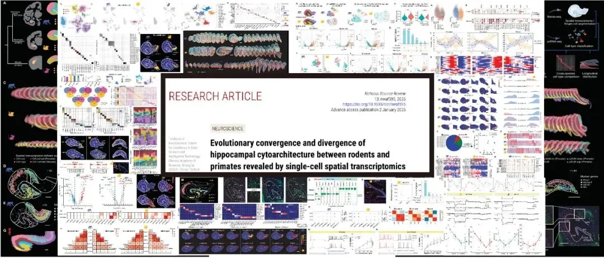
如果你希望有人真的手把手教你学单细胞和空转：
更多课程：

[R语言scRNA-seq小白全程班](<https://mp.weixin.qq.com/s?__biz=MzAwMzIzOTk5OQ==&mid=2247535408&idx=1&sn=1f3b4b99bab378887d11dd83fd87feb7&scene=21#wechat_redirect>)

[Python版scRNA-seq分析全流程](<https://mp.weixin.qq.com/s?__biz=MzAwMzIzOTk5OQ==&mid=2247533067&idx=1&sn=7ef76058cbcf7bd45f58147766c75854&scene=21#wechat_redirect>)[Python 空间转录组全程班](<https://mp.weixin.qq.com/s?__biz=MzAwMzIzOTk5OQ==&mid=2247533721&idx=1&sn=9648ed4701224e5d2e4c704d7046d9de&scene=21#wechat_redirect>)
如果需要数据分析**指导** 、生信热点**全文复现** 、自测数据**个性化分析** 辅导、[常态化实验学习](<https://mp.weixin.qq.com/s?__biz=MzAwMzIzOTk5OQ==&mid=2247528769&idx=1&sn=53528029a1595c5dde109a461ec3708d&scene=21#wechat_redirect>)，欢迎联系客服微信[**Biomamba_zhushou**]。

**二、主要内容**

尽管已知哺乳动物海马体由齿状回、CA区（CA1-4）及下托复合体等具有不同细胞构筑和连接特性的亚区组成，但长期以来，这些亚区的确切边界定义仍存在争议，尤其是沿海马体纵轴的功能异质性与其背后的基因表达谱及细胞类型分布之间的关系，在灵长类中尚不清晰。现有的单细胞测序技术虽揭示了细胞的分子多样性，却丢失了关键的空间位置信息，因此亟需一种能系统绘制全海马体基因表达模式并精确定位细胞类型的综合图谱，以解析区域特异性的连接与功能。

为突破这一局限，此研究创新性地结合了高分辨率空间转录组技术（Stereo-seq）与单核测序（snRNA-seq），构建了猕猴、狨猴和小鼠三种物种的全海马体单细胞精度空间图谱，并辅以人类数据验证及电生理记录。研究不仅厘清了海马体亚区的分子边界，更揭示了细胞类型及其基因表达沿海马体多个维度的空间异质性；特别是发现了下托复合体中存在灵长类特有的谷氨酸能神经元亚型，并通过电生理实验证实了这些分子差异对应着显著的生理特性分歧。该成果建立了跨物种的海马体空间转录组，为从分子和细胞层面理解海马体的进化演变、亚区功能特异性以及灵长类高级认知能力的生物学基础提供了关键依据。

**1、 跨物种空间转录组定义的海马体亚区**

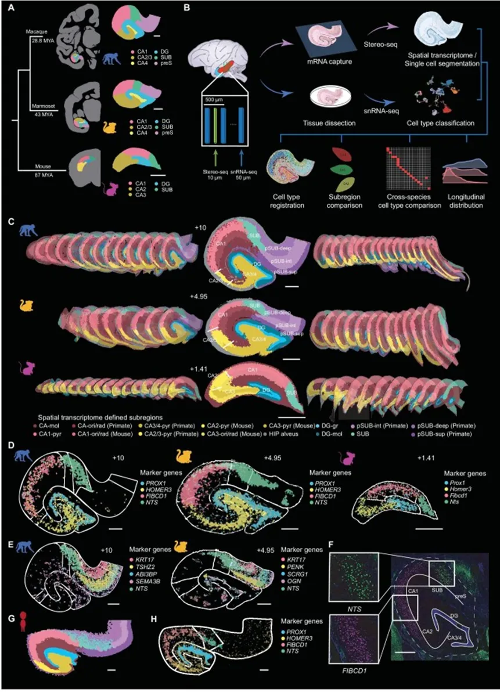Figure1

为了揭示具有独特基因表达谱的海马体亚区，作者利用**[空间转录组测序技术](<https://mp.weixin.qq.com/s?__biz=MzAwMzIzOTk5OQ==&mid=2247535282&idx=2&sn=33c0965569d33a3499b1b7fd1a23d811&scene=21#wechat_redirect>)** （Stereo-seq），系统绘制了猕猴、狨猴和小鼠海马体中的**基因表达空间模式** （Fig 1A）。同时，作者还进行了**[snRNA-seq](<https://mp.weixin.qq.com/s?__biz=MzAwMzIzOTk5OQ==&mid=2247506960&idx=1&sn=9f5913231f9583411e47ccf0dcadedf6&scene=21#wechat_redirect>)** ，将snRNA-seq 数据与 Stereo-seq [数据整合](<https://mp.weixin.qq.com/s?__biz=MzAwMzIzOTk5OQ==&mid=2247529485&idx=2&sn=441d93a7eb0db896b642a1e588945c4f&scene=21#wechat_redirect>)后，获得了所有切片中各类细胞的细胞空间转录组图谱（Fig 1B）。与此同时，作者将基于转录组的亚区划分与传统基于组织学的图谱中定义的亚区进行了比较，发现现有图谱中不同亚区的锥体细胞层在空间位置上与由转录组谱定义的亚区吻合良好。因此作者将对应于 CA1、CA2、CA3 的锥体层、DG 的颗粒细胞层以及前下托和下托本体的空间转录组聚类，分别注释为 CA1-pyr、CA2-pyr、CA3-pyr、DG-gr和 SUB（Fig 1C）。随后，作者比对了**猕猴、狨猴和小鼠** 中对应海马体亚区的转录组谱之间的相似性，并识别出许多同源亚区中进化保守的基因表达模式，例如 DG 中的  _PROX1_ 、CA3/4中的  _HOMER3_ 、CA1中的  _F1BCD1_ 以及SUB 中的  _NTS_ 等（Fig 1D），且发现猕猴和狨猴的转录组谱共享一个共同的标记基因  _KRT17_ （Fig 1E）。通过**荧光原位杂交（****FISH ）**实验，在狨猴海马体切片中验证了  _F1BCD1_ 在CA1 中的选择性表达以及  _NTS_ 在下托中的选择性表达（Fig 1F）。**以上结果展示了基于空间转录组的海马体亚区划分方案，并确立了跨物种同源海马体亚区的分子基础** 。

2、**基于 Stereo-seq 和snRNA-seq 的细胞类型空间分布**

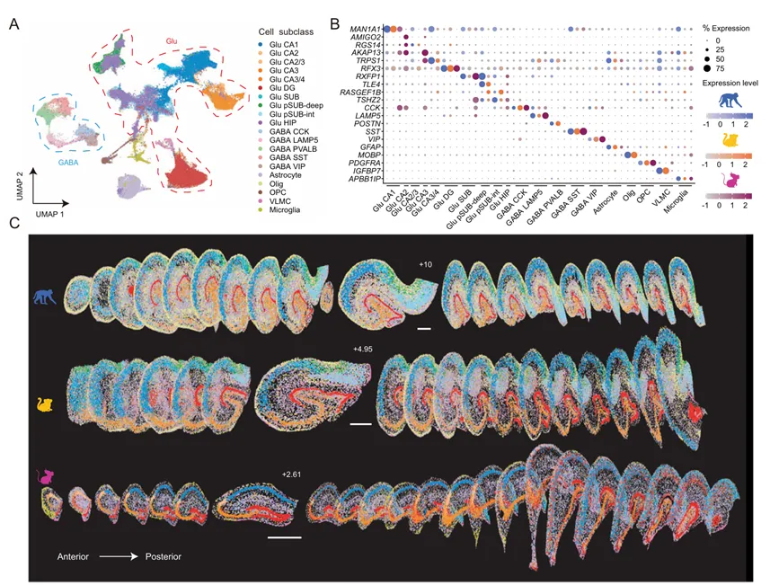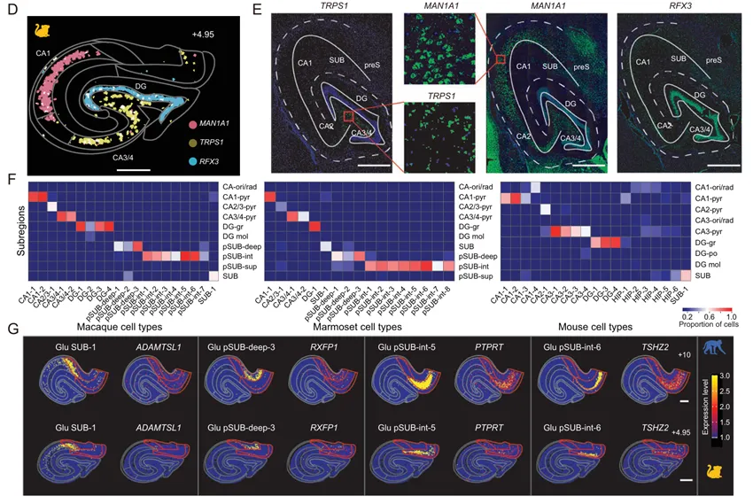Figure2

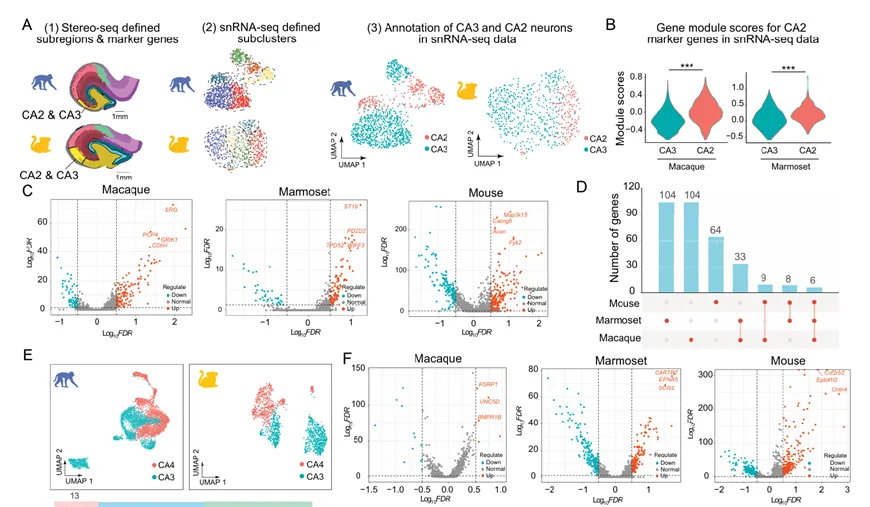

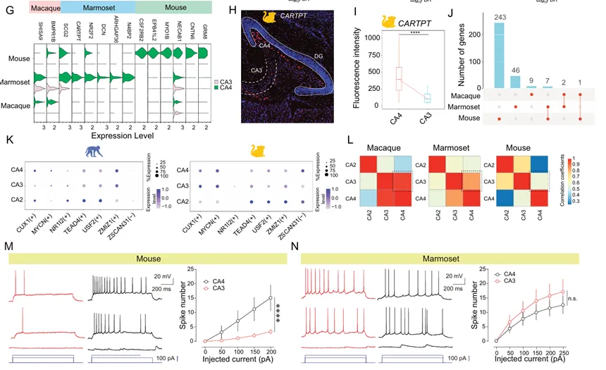

Figure3

为了进一步**鉴定灵长类动物****CA2****和****CA3****之间的[ 差异表达基因](<https://mp.weixin.qq.com/s?__biz=MzAwMzIzOTk5OQ==&mid=2247535727&idx=1&sn=5a8dc6600a13455bcea612ac1cbe0173&scene=21#wechat_redirect>)（****DEGs****）** ，作者在‘CA2/3-pyr’的空间转录组谱内进行了进一步的[聚类分析](<https://mp.weixin.qq.com/s?__biz=MzAwMzIzOTk5OQ==&mid=2247489494&idx=1&sn=44f0a44857c12fcf9a1ab84e4f2cbebf&scene=21#wechat_redirect>)，然后利用这些DEGs来注释狨猴和猕猴谷氨酸能神经元snRNA-Seq数据中‘Glu CA2/3’亚类的子簇（Fig 3A）。同时展示了snRNA-seq数据中鉴定出了更多CA2与CA3之间的DEGs（Fig 3B）,且这些基因在三个物种间大多各不相同（Fig 3C-D）。采用类似的方法，作者通过对‘CA3/4-pyr’空间转录组谱的进一步聚类分析，鉴定了灵长类动物CA3和CA4神经元的DEGs（Fig 3E-F）。同时作者利用**定量荧光原位杂交（****FISH****）实验** 验证了CA3与CA4的差异表达，针对编码神经肽的基因CARTPT的表达进行检测，发现该基因在狨猴CA4中优先表达（Fig 3G-I），其中CA3和CA4之间的DEGs数量从小鼠到狨猴再到猕猴逐渐减少。长类动物的CA3和CA4神经元在转录因子、神经递质受体和离子通道方面表现出相似的基因表达模式，并且CA3与CA4神经元之间的转录组相似性（Fig 3J-K）。其中CA3与CA4神经元之间的转录组相似性从小鼠到狨猴再到猕猴逐渐增加（Fig 3L）。在进化过程中，CA3和CA4区域谷氨酸能细胞类型的转录组差异逐渐减小，这暗示了这两个亚区在灵长类动物中发生了渐进性的**功能趋同（** Fig 3M-N**）** 。

3、**GABA 能神经元与胶质细胞类型的跨物种分析**

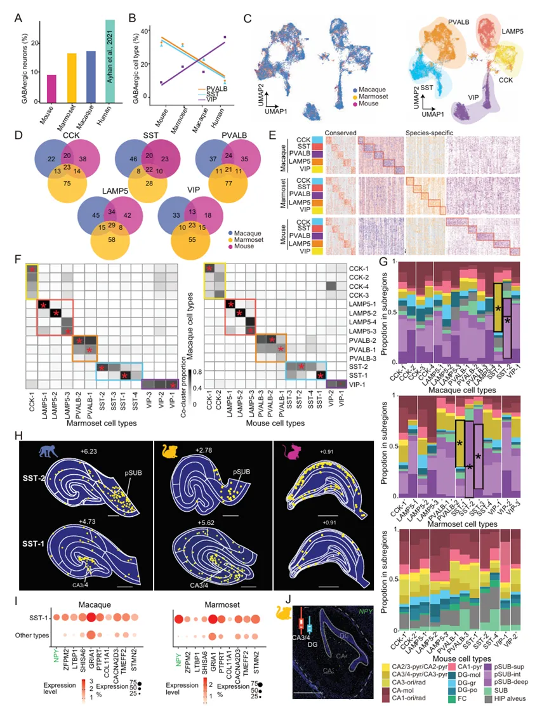Figure4

GABA能神经元是局部神经环路中神经元活动的关键调节者。为了理解GABA能细胞的进化变化，作者分析了猕猴、狨猴和小鼠海马体的snRNA-seq数据中的GABA能细胞，并结合了此前报道的人类snRNA-seq数据。结果发现，在所有采样的海马体细胞中，GABA能[细胞的占比](<https://mp.weixin.qq.com/s?__biz=MzAwMzIzOTk5OQ==&mid=2247503971&idx=2&sn=7dafb1e743ebbb95e488d8d1b7024448&scene=21#wechat_redirect>)随着进化顺序逐渐增加，在人类中达到最高（Fig 4A）。进一步分析显示，各GABA能亚类占所有GABA能细胞的比例在不同物种间存在显著差异（Fig 4B）。接下来，作者比较了小鼠、狨猴和猕猴中这些GABA能亚类的基因表达谱。总体而言，对于所有五个GABA能亚类，猕猴和狨猴之间共享的标记基因数量最多（Fig 4C-E）。进一步的跨物种细胞类型成对比较显示，GABA能细胞类型表现出 largely 相似的基因表达模式，说明在整合聚类分析中共同聚类的细胞比例较高（Fig 4C-F）。且GABA的比例在三个物种间有所不同（Fig 4G）。其中 _NPY_ 在‘GABA SST-1’细胞类型中的表达量远高于所有其他GABA能细胞类型（Fig 4I）。这一结果在狨猴海马切片的**FISH****实验中** 得到了进一步验证（Fig 4J）。**这些结果表明，尽管这三种物种中都存在****GABA****能细胞类型，但从啮齿类到灵长类，它们的相对比例和空间分布发生了进化改变。**

4、**谷氨酸能细胞亚型的跨物种分析**

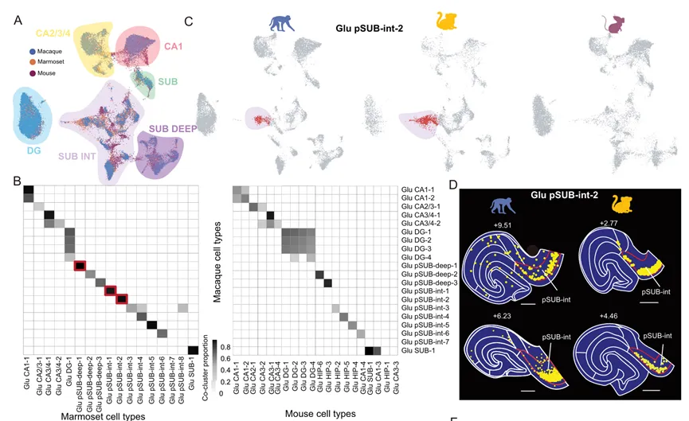

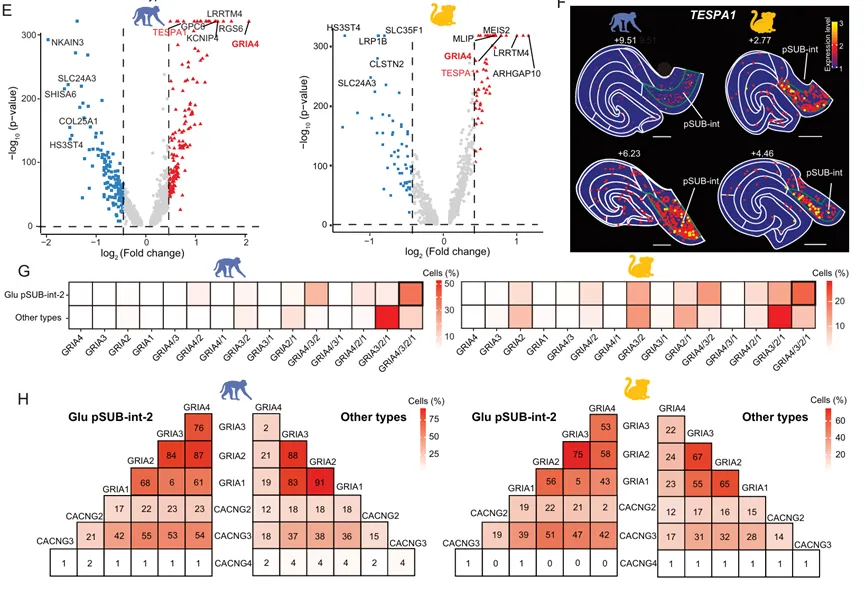

Figure5

作者进一步利用**共识聚类****followed by 共聚类矩阵分析**，调查了这三个物种中是否存在灵长类特有的**谷氨酸能细胞类型** （Fig 5A）。值得注意的是，有三种谷氨酸能细胞类型（**pSUB-deep-1** 、**pSUB-int-1** 和 **pSUB-int-2** ）存在于猕猴和狨猴中，但不存在于小鼠中（Fig 5B-C）。有趣的是，‘Glu pSUB-int-2’细胞类型在不同切片和个体间表现出高度局限性的空间分布，并表达如  _TESPA1_ 等[标记基因](<https://mp.weixin.qq.com/s?__biz=MzAwMzIzOTk5OQ==&mid=2247533676&idx=1&sn=68dc75c55e05eabcfbdb29f46b112a0a&scene=21#wechat_redirect>)（Fig 5D）。与其他亚iculum神经元类型相比，猕猴和狨猴中的 Glu pSUB-int-2、Glu pSUB-int-1 和 Glu pSUB-deep-1 神经元分别共享优先表达的基因，如  _GRIA4_ 、 _PTPRK_ 和  _KIAA1217_ （Fig 5E-H）。综上所述，作者的结果表明，灵长类特有的谷氨酸能细胞类型在亚iculum复合体中表现出**分层偏好性（****laminar preferences ）**，这种分层组织结构可能通过特定神经递质受体亚基组合的差异表达，有助于实现不同的海马体功能。

5、**谷氨酸能神经元沿海马体轴线的异质性分布**

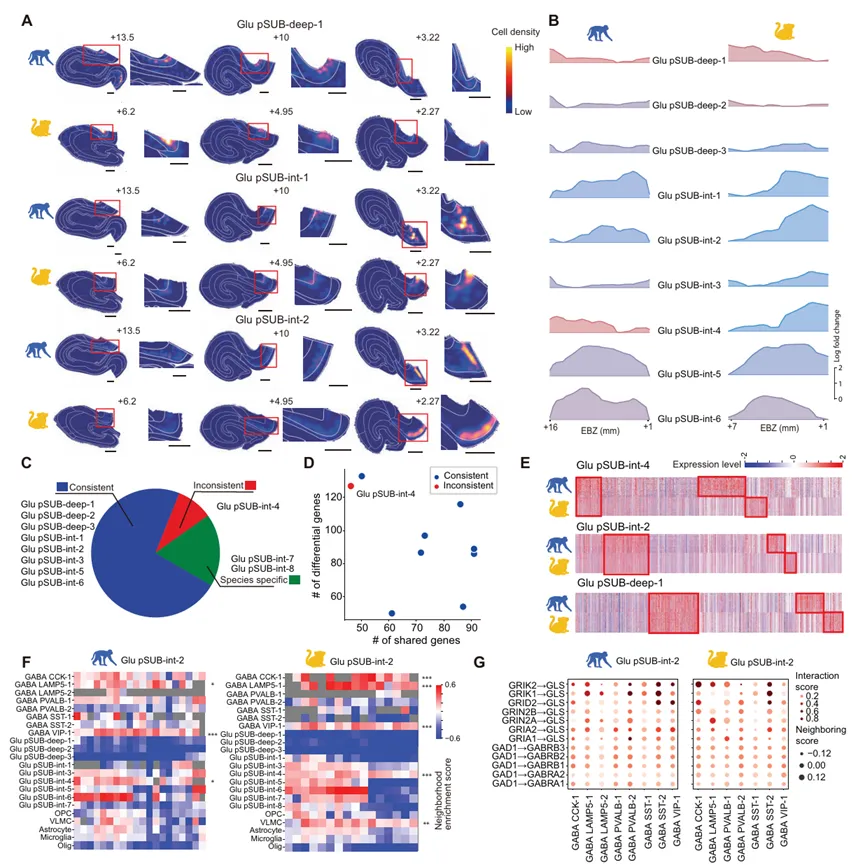 Figure6

之后作者重点关注了表现出高度多样性和独特分层分布的**灵长类亚细胞类型** 。结果显示几乎所有转录组定义的**谷氨酸能细胞类型** 都表现出较大的纵向异质性（Fig 6A-B）。作者将细胞类型分类为**前部富集** 、**后部富集** 或**均匀分布** ，并发现除了‘Glu pSUB-int-4’之外，大多数亚iculum细胞类型在两种灵长类物种中具有相同的分布偏好；‘Glu pSUB-int-4’在两个物种间表现出相反的分布模式（Fig 6C-E）。最后，作者利用snRNA-seq数据检查了‘Glu pSUB-int-2’[邻域](<https://mp.weixin.qq.com/s?__biz=MzAwMzIzOTk5OQ==&mid=2247532641&idx=1&sn=c8422ab7c1cd70751fb3109a84cb64ea&scene=21#wechat_redirect>)中的GABA能细胞类型与其GABA受体亚基表达之间的关系（Fig 6F-G）。以上结果显示各种细胞类型沿**前****-****后轴** 的独特优先分布，以及优先定位于其邻域的细胞类型组成，为灵长类海马体纵轴功能异质性背后的局部[细胞相互作用](<https://mp.weixin.qq.com/s?__biz=MzAwMzIzOTk5OQ==&mid=2247532763&idx=1&sn=f6e4df9242f1341d2dc7e6154c33aa46&scene=21#wechat_redirect>)提供了基础。

6、**CA1 神经元电生理特性的纵向异质性**

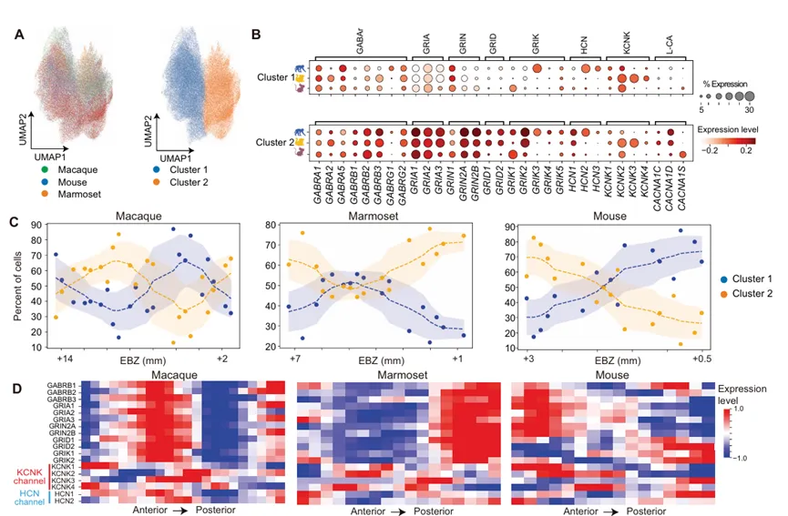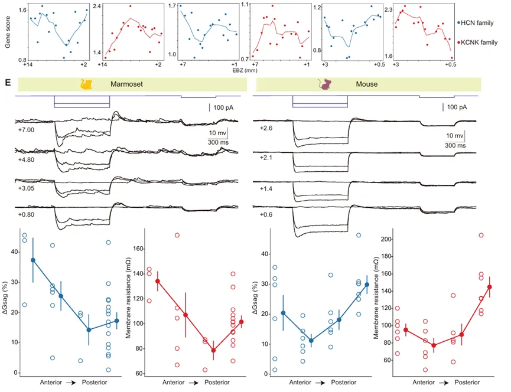Figure7

CA1锥体神经元是海马体三突触核心环路（DG–CA3–CA1）的主要输出端。CA1神经元沿纵轴的电生理特性异质性可能是其连接性和功能特性差异的基础。因此，作者对离子通道和神经递质受体的表达谱进行了**snRNA-seq 数据的聚类分析**，这些分子对神经元的生理特性至关重要。在每个物种中，CA1神经元被分为两个簇，它们表现出特定[基因组的优势表达](<https://mp.weixin.qq.com/s?__biz=MzAwMzIzOTk5OQ==&mid=2247497831&idx=2&sn=82fa51c76a381fba0b444e9b6b23eb5f&scene=21#wechat_redirect>)，包括谷氨酸受体、GABA受体以及离子通道（如 CACNA1C 和 HCN1）（Fig 7A-B），且这两个簇的CA1神经元沿纵轴表现出截然不同的分布模式（Fig 7C）。作者还发现大多数**灵长类** 基因在CA1亚区的**前部和后部** 的表达量远高于**中间部分** （Fig 7D-E）。综上所述，这些结果表明，灵长类和小鼠的CA1神经元共享一些进化上保守的**内在神经生理特性的纵向异质性。**

**三、总结与讨论**

这项研究通过整合**小鼠、狨猴和猕猴** 的空间转录组与单细胞测序数据，构建了高分辨率的跨物种海马体细胞图谱，揭示了灵长类特有的进化特征：一方面发现了亚iculum复合体中灵长类独有的谷氨酸能细胞类型及其严格的分层分布，另一方面观察到小鼠中界限分明的CA3与CA4亚区在灵长类中因基因表达和电生理特性的趋同而逐渐融合。这些发现不仅验证了人类海马体的相似结构，还阐明了GABA能细胞组成的进化改变，为理解灵长类高级认知功能的细胞基础提供了关键线索。

研究进一步确立了“**兴奋性神经元空间异质性”** 的核心原则，发现谷氨酸能细胞类型沿海马体纵轴（前-后/背-腹）呈现高度特异性的非均匀分布，而抑制性及非神经元细胞则相对均匀；这种分子层面的分布差异直接导致了功能上的非线性梯度，例如CA1神经元两端的HCN通道表达及电流显著高于中间区域。这种从基因标记到电生理特性的保守纵向异质性，证明了海马体不同区段的功能特异性（如空间导航与情绪处理）是由其内部兴奋性微环路的固有属性所决定的，而非仅依赖外部连接。

**如何联系我们**

 留一个领取[资料](<https://mp.weixin.qq.com/s?__biz=MzAwMzIzOTk5OQ==&mid=2247535983&idx=1&sn=99378a252908b06f56432eb08741d278&scene=21#wechat_redirect>)、[开箱即用的单细胞分析镜像](<https://mp.weixin.qq.com/s?__biz=MzAwMzIzOTk5OQ==&mid=2247536307&idx=1&sn=8d03259be06f54521aac5251dec988d5&scene=21#wechat_redirect>)的**微信号[Biomamba_zhushou]**，方便各位随时交流。同时我们也构建了[交流群矩阵](<https://mp.weixin.qq.com/s?__biz=MzAwMzIzOTk5OQ==&mid=2247536307&idx=2&sn=2d030173f51d24a4fee43bd0d83da03b&scene=21#wechat_redirect>)，欢迎大家入群讨论。
大家可以阅读完这几篇之后添加[给生信入门初学者的小贴士](<http://mp.weixin.qq.com/s?__biz=MzAwMzIzOTk5OQ==&mid=2247493329&idx=1&sn=597870b7f7ce10346da3561e7c281627&chksm=9b3c9f81ac4b169794088ce9abbcacb5f18e9fd174fc0d7e28da62d78facadf3100ef38aaf22&scene=21#wechat_redirect>)
[没有检索，就没有发言权](<https://mp.weixin.qq.com/s?__biz=MzAwMzIzOTk5OQ==&mid=2247529398&idx=2&sn=5a429852d61721916a405712677d5905&scene=21#wechat_redirect>)

**已有生信基地联系方式的同学****无需重复添加**

 您点的每个赞和在看，我都认真当成了喜欢
