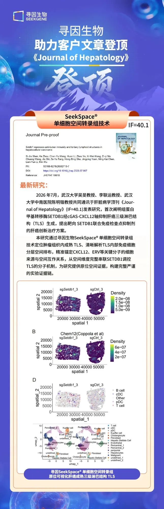
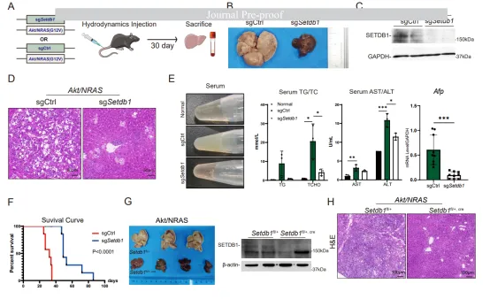
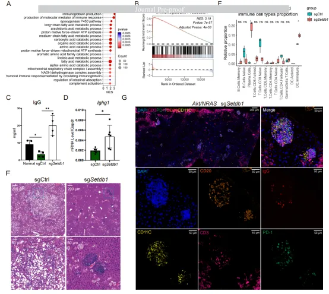
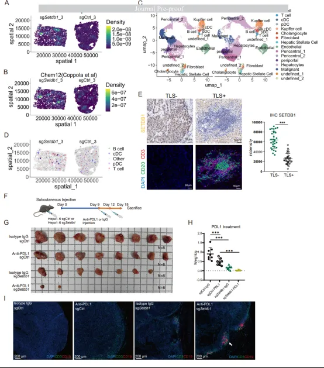
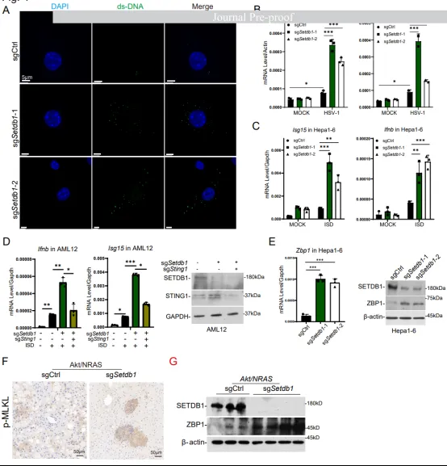
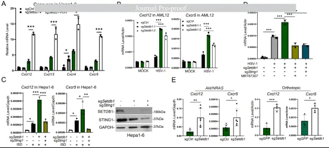
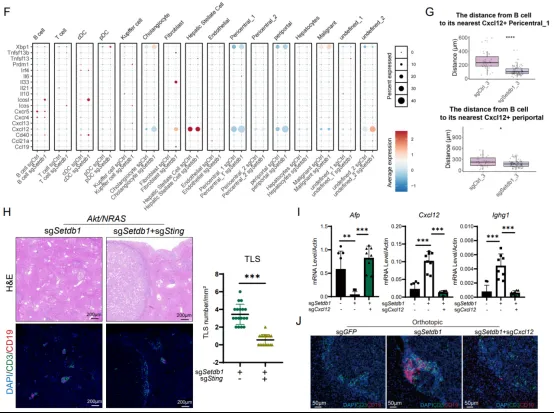
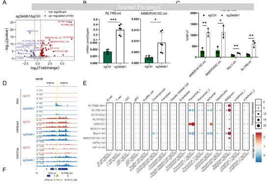
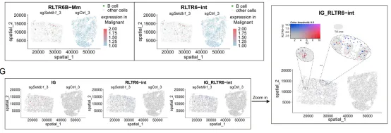
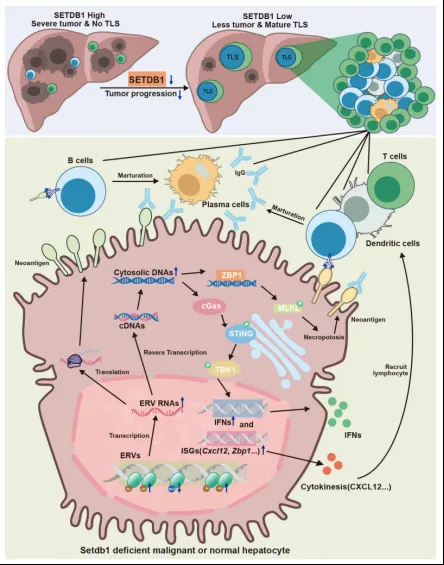

# 《Journal of Hepatology》 (IF=40.1)  ：Setdb1抑制肝细胞癌中抗肿瘤免疫与三级淋巴结构

> 原文：https://mp.weixin.qq.com/s?__biz=MzAwMzIzOTk5OQ==&mid=2247540623&idx=1&sn=ac08b1154229a480340b039cec082b79&chksm=9b3c26dfac4bafc971419144f4790931731370514acf6a98097c077bbe34d44ee7feffa91d5c#rd
> 合集：文献速递

* * *

**一、写在前面**

今天给大家分享的是发表在期刊《Journal of Hepatology》 (IF=40.1)上的文章："Setdb1 represses anti-tumor immunity and tertiary lymphoid structures in hepatocellular carcinoma"

文章链接：https://www.journal-of-hepatology.eu/article/S0168-8278(26)02715-7/fulltext DOi：10.1016/j.jhep.2026.07.007

**三级淋巴结构（ TLSs）就像是免疫系统在肿瘤内部临时搭建的“前线指挥所”。**这些结构非常重要，因为它们能聚集免疫细胞，帮助身体更有效地识别和攻击癌细胞，往往意味着患者能获得更长的生存期和更好的治疗效果。因此，科学家们非常希望能找到办法在肿瘤里诱导生成这些“指挥所”，从而大幅提升免疫疗法的威力。**SETDB1 是异染色质上组蛋白 H3K9me3 的甲基转移酶之一**。SETDB1 敲除会导致 H3K9me3 水平下调，并解除对内源性逆转录病毒（ERVs）的抑制。ERVs 被转录为 mRNA，随后逆转录为双链 DNA（dsDNA），进而被 cGAS 识别并触发炎症基因的表达。

**肝细胞癌（ HCC）是全球最常见、致死率最高的癌症之一。**尽管免疫治疗已广泛应用于HCC 的治疗，但其疗效仍有待进一步提高。为了探究 SETDB1 在 HCC 抗肿瘤免疫中的功能，作者在多种 HCC 动物模型中敲除了 Setdb1。数据表明，敲除 Setdb1 可促进 B 细胞成熟并诱导 HCC 中 TLSs 的形成，这为癌症免疫治疗提供了一种潜在的新策略。

**
**

**二、主要内容**

一：Setdb1 促进肝细胞癌（HCC）发展

首先研究人员在肝癌小鼠模型中，利用CRISPR基因编辑技术敲低或条件性敲除了 Setdb1 基因（Fig.1A-C）。结果发现，少了这个基因后，肝癌的生长被显著抑制，肿瘤标志物（Afp）下降，小鼠的脂肪肝症状减轻，肝脏组织恢复正常，且小鼠活得更久了（Fig. 1D-H）。而在正常小鼠中敲除该基因则没有明显副作用。通过分析人类癌症基因组图谱（[TCGA](<https://mp.weixin.qq.com/s?__biz=MzAwMzIzOTk5OQ==&mid=2247539068&idx=1&sn=2acad38f76a1e54c9d9d4318d2d08a7e&scene=21#wechat_redirect>)）的大数据，研究人员发现：与正常的肝脏组织相比，Setdb1 在肝癌组织中呈现“高表达”状态；而且，患者体内的 Setdb1 表达量越高，其生存期往往越短。

Fig.1

二：敲除 Setdb1 后，肿瘤里竟然大量生产出了抗体（免疫球蛋白）

研究人员对敲除 Setdb1 的肝癌组织进行了RNA测序（RNA-seq）。结果发现大量与“免疫球蛋白（抗体）”相关的基因表达量显著上升。数据分析也证实，抗体生成通路被极大地激活了（Fig.2A-B）。之后进一步验证通过RT-PCR技术，证实了组织中IgG mRNA确实增多了（Fig.2C）。通过ELISA技术，在小鼠的血液血浆中也检测到了IgG蛋白的产生（Fig.2D）。因为抗体的产生通常意味着 B 细胞发育成了浆细胞，研究人员利用生物信息学工具（CIBERSORT）分析了之前的RNA-seq数据。结果显示，在敲除 Setdb1 的肝脏中，浆细胞（专门生产抗体的细胞）和树突状细胞（负责传递情报的侦察兵）的数量显著增加（Fig.2E）。之后，作者经过HE和IF染色分析发现T细胞、B细胞和浆细胞聚集在一起，形成了类似三级淋巴结构（TLS）的阵地（Fig.2F-G）。

Fig.2

三：[空间转录组](<https://mp.weixin.qq.com/mp/appmsgalbum?__biz=MzAwMzIzOTk5OQ==&action=getalbum&album_id=2879312479804489730#wechat_redirect>)技术证实TLS结构的存在

为了确认敲除 Setdb1 后是否真的在肝癌组织中诱导出了 TLS，研究人员使用了由[Seekgene](<https://mp.weixin.qq.com/s?__biz=MzAwMzIzOTk5OQ==&mid=2247536784&idx=1&sn=35754d32e7acbb0208a05917c7a1590b&scene=21#wechat_redirect>) 提供的[单细胞](<https://mp.weixin.qq.com/s?__biz=MzAwMzIzOTk5OQ==&mid=2247538847&idx=1&sn=2ad605c6d70d4e6ee921fda1798bfd8b&scene=21#wechat_redirect>)空间转录组分析技术。这项技术不仅能测出细胞里有哪些基因，还能保留它们在组织中的“地理位置”信息。利用已知的标志物，作者成功在敲除 Setdb1 的组织中预测并检测到了 TLS 区域（Fig.3A-B）。细胞成分分析显示，在敲除 Setdb1 的组织中，恶性肿瘤细胞的比例大幅减少（Fig.3C-D）。这些发现表明Setdb1 在肝癌中起着抑制 TLS 形成的作用；一旦用 CRISPR 技术敲除它，就能成功在肝癌中诱导生成 TLS，并促进抗体的产生。

之后，作者在临床样本中进行检测，发现在真实的患者组织切片中，那些没有形成 TLS 的样本（TLS-组），其 SETDB1 的表达量明显更高（Fig.3E）。为了探索临床治疗潜力，研究人员测试了“敲除 Setdb1”与“抗 PD-L1 免疫治疗”联合使用的效果。结果发现单独敲除 Setdb1 或单独使用抗 PD-L1 都能抑制肿瘤生长，而当两者结合时，抑癌效果显著增强（Fig.3G-I）。

Fig.3

四：敲除 Setdb1 触发细胞内的“病毒警报系统”，并引发了一种特殊的细胞死亡方式来重塑免疫微环境

研究人员发现，敲除 Setdb1 后，肝癌细胞（Hepa1-6）的细胞质内出现了双链 DNA（dsDNA）。这就像是细胞误以为遭到了 DNA 病毒感染，从而激活了名为 cGas 的警报通路（Fig.4A）。如果人为阻断 cGas 通路的关键分子（Sting1），这些信号表达就会被抑制，证实了这一过程完全依赖于cGas通路（Fig.4B-D）。且cGas 通路激活后，上调了一个叫做 Zbp1 的基因，引发细胞坏死性凋亡（Fig.4E）。通过免疫组化（IHC）染色，研究人员在 TLS 区域检测到了升高的磷酸化 MLKL（这是坏死性凋亡的标志性蛋白）（Fig.4F）。简单来说，敲除 Setdb1 会让肝癌细胞产生异常的 DNA，激活 cGas 警报通路；这个通路不仅释放了免疫信号，还通过 Zbp1 引发了 TLS 内部细胞的坏死性凋亡。这种“细胞爆破”可能是促使免疫细胞聚集、形成 TLS 的关键推手。

Fig.4

五：cGAS的激活需要B细胞成熟基因的表达

在免疫学里，B 细胞的成熟需要特定的“向导”——趋化因子（如 CXCL12 和 CXCL13）及其受体。研究人员发现，敲除Setdb1后，肝癌细胞和正常肝细胞中这些关键招募基因的表达量都大幅增加了（Fig.5A-B）。cGas 通路要发挥作用，离不开下游的关键分子 STING。实验表明，无论是肝癌细胞还是正常肝细胞，B 细胞相关基因的激活都依赖于 STING。如果人为使用抑制剂（MRT67307 或 H151）阻断 STING 或其下游的 TBK1，这些招募基因的表达就会被立刻压制（Fig.5C-D）。在细胞实验中发现了好几个相关的招募基因，但在小鼠的肝癌组织中，真正被显著激活的只有 Cxcl12。空间转录组分析进一步揭示，这些 Cxcl12 主要由胆管细胞、成纤维细胞以及肝细胞产生。更关键的是，敲除 Setdb1 后，产生 Cxcl12 的肝细胞与 B 细胞之间的物理距离明显拉近了，说明 CXCL12 正在精准地“吸引” B 细胞（Fig.5E-G）。研究人员在敲除 Setdb1 的基础上，又把 Cxcl12 敲除了，结果发现TLS 里的 B 细胞信号彻底消失了，肿瘤体积随之变大，之前观察到的 IgG（抗体）表达也显著下降（Fig.5I-J）。这些结果表明，敲除 Setdb1 激活了 cGas 通路，进而促使肝脏细胞大量分泌 CXCL12；CXCL12 像磁铁一样把 B 细胞吸引过来，最终成功搭建起 TLS 并产生抗体来对抗肝癌。

Fig.5

**六： Setdb1 敲除后，基因组中“沉睡的远古病毒”是被唤醒******

已知敲除 Setdb1 会激活内源性逆转录病毒（ERVs）。研究人员在肝癌小鼠模型中证实了这一点，**发现敲除 Setdb1 后，有 54 种逆转录转座子（大多是 ERVs）的表达量显著增加**（Fig.6A-B）。通常认为，ERVs 的激活是因为它们失去了 H3K9me3（一种抑制性的组蛋白修饰）的压制。但有趣的是，研究人员发现，部分被激活的 ERVs 并没有出现 H3K9me3 的显著下降，反而是 H3K27ac（一种激活性的组蛋白修饰）升高了。这说明 Setdb1 不仅通过添加 H3K9me3 来抑制 ERVs，还可能通过抑制 H3K27ac 来“踩刹车”（Fig.6C-D）。单细胞和空间转录组分析显示，这些被激活的ERVs 主要集中在恶性肿瘤细胞和特定的肝细胞中（Fig.6E-F）。空间分析还发现，抗体（免疫球蛋白）的表达区域也与这些 ERVs 高度重合（Fig. 6G）。结合之前的报道，研究人员提出了一个极具启发性的可能性：**这些被唤醒的 ERVs 就像是癌细胞特有的“新抗原（neoantigens）”，它们刺激了 TLS 中的 B 细胞发育成熟，并促使身体生产出专门针对这些 ERVs 的抗体，从而精准打击癌细胞。**

Fig.6

**三、总结与展望**

针对当前肝癌免疫治疗响应率有限的临床痛点，**该研究揭示了靶向 SETDB1诱导三级淋巴结构（TLS）形成的新策略及其复杂的分子机制**。研究发现，Setdb1的缺失通过诱导胞质双链DNA积累激活cGAS-STING信号通路，进而上调关键趋化因子CXCL12及坏死性凋亡相关基因Zbp1的表达。与以往认为CXCL13主导的观点不同，体内实验证实CXCL12在肝癌微环境中对B细胞的招募和成熟起决定性作用，而Zbp1主要在成纤维细胞和恶性细胞中高表达，可能介导肿瘤细胞的特异性清除。同时，Setdb1缺失还激活了内源性逆转录病毒（ERVs），这些ERVs作为肿瘤特异性新抗原，进一步刺激了TLS内的抗体产生与B细胞成熟，从而构建起强效的抗肿瘤免疫微环境。

**该研究还强调了肝脏原位微环境及癌症亚型在 TLS形成中的关键作用**，指出Setdb1缺失诱导的TLS形成依赖于特定的细胞互作网络，且与免疫检查点抑制剂具有显著的协同治疗效应。基于SETDB1在促进肿瘤生长和抑制免疫中的双重负面角色，作者提出将其作为极具潜力的临床治疗靶点。未来的转化医学方向可聚焦于开发SETDB1特异性小分子抑制剂，或利用LNP-siRNA技术实现肝脏特异性的基因沉默。**这种策略不仅能通过激活 TLS增强抗肿瘤免疫，还能避免全身性抑制带来的炎症副作用，为改善肝癌患者的免疫治疗响应率和临床预后提供了重要的理论依据和新颖的治疗思路。******

**欢迎交流**

 留一个领取[资料](<https://mp.weixin.qq.com/s?__biz=MzAwMzIzOTk5OQ==&mid=2247532585&idx=1&sn=e265d2846ec66e5faaaf21403d274d2f&scene=21#wechat_redirect>)、[开箱即用的单细胞分析镜像](<https://mp.weixin.qq.com/s?__biz=MzAwMzIzOTk5OQ==&mid=2247528410&idx=2&sn=0f2bac25479cf8d20dab5d82ae986f2e&scene=21#wechat_redirect>)的助手[Biomamba_zhushou]，方便各位随时交流。同时我们也构建了[交流群矩阵](<https://mp.weixin.qq.com/s?__biz=MzAwMzIzOTk5OQ==&mid=2247528057&idx=1&sn=bb348c2a88c977c7cce67ee6731a3591&scene=21#wechat_redirect>)，欢迎大家一起讨论。
您点的每个赞和在看，我都认真当成了喜欢
