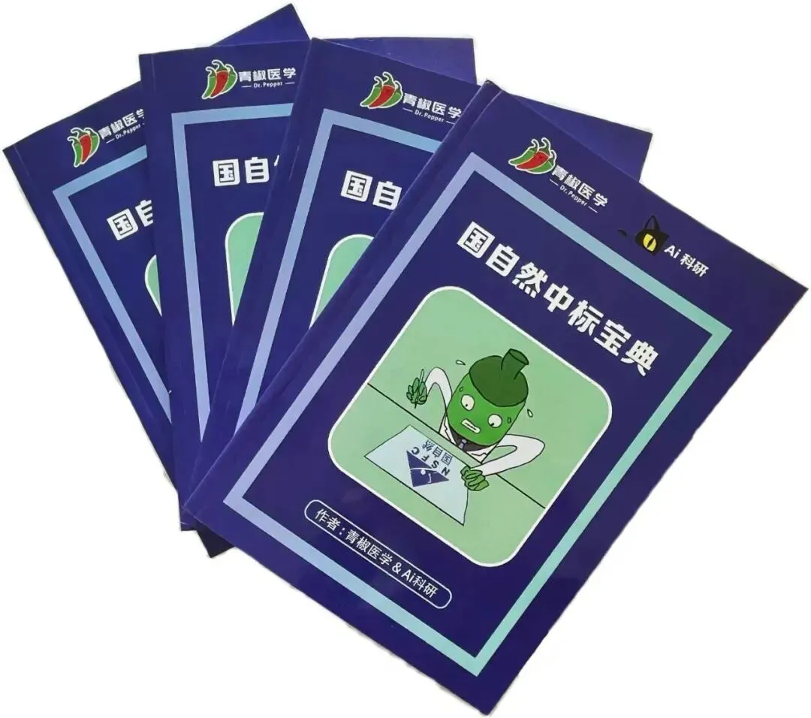
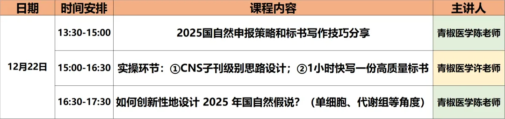
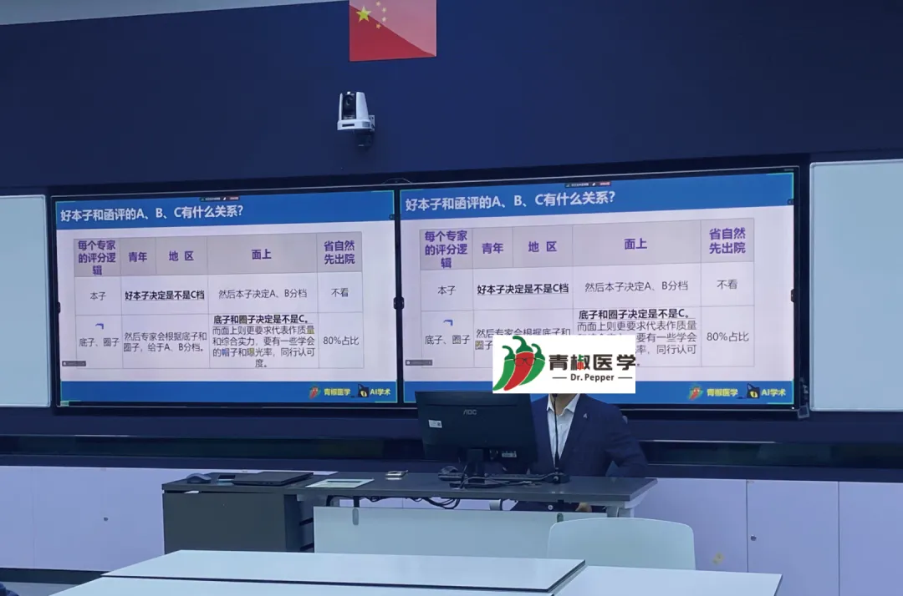

# 国自然中标宝典

> 原文：https://mp.weixin.qq.com/s?__biz=MzAwMzIzOTk5OQ==&mid=2247525030&idx=2&sn=d5bde9346a2b83a19f939dd41e91de72&chksm=9b3c1bf6ac4b92e0bdbdf8c224d0e636d4a9d0d33849c8df52600477fb8d8a3fad8883ceb0ec#rd
> 合集：基金申报

2025国自然写作交流群

必中是一种决心，进群！

群聊若过期大家可以联系下文微信拉群

**线下参加活动的老师同学们现场签到即可领取国自然中标宝典：**

生信基地第三课

近期[生信基地](<http://mp.weixin.qq.com/s?__biz=MzAwMzIzOTk5OQ==&mid=2247522649&idx=1&sn=a3a3df860fd162691403281356dcbf1d&chksm=9b3ce009ac4b691fc8679c43988a0a36e176760d3e21b2489b43184f0248b6409cbe8dcbb96a&scene=21#wechat_redirect>)已经落地，我们已经完成了[生信基地第一课](<https://mp.weixin.qq.com/s?__biz=MzAwMzIzOTk5OQ==&mid=2247522889&idx=1&sn=d70f64a6624825b80c70362483ebd637&scene=21#wechat_redirect>)的举办：[1.5天，你学会单细胞分析了吗？](<https://mp.weixin.qq.com/s?__biz=MzAwMzIzOTk5OQ==&mid=2247523411&idx=2&sn=142574b00dd351fae0b76831cd2d2f19&scene=21#wechat_redirect>)我们也仍在积极探索为生信/科研领域做贡献的新方法。距离公众号创立已经快五年啦，当年的第一批观众现在可能已经从硕博成长为了博后/青椒，开始有了**基金申报** 方面的压力。在此，我们邀请到青椒医学团队(主讲老师**青椒医学** 许老师，陈老师)为我们在12月22日下午(周日)13:30~17:30带来"国自然标书写作技巧"主题讲座(依然**免费！免费！免费！**)，课表计划如下：

**此次讲座名额为24人，报名联系方式(已有生信基地联系方式的同学****无需重复添加****)** ：

往期国自然写作技巧讲授现场：

生信基地往期课程现场：

青椒哥有话说

**致国自然赶路人**

在生命科学部与医学部的国自然申报领域**深耕八年** ，我们团队已经协助**200多位** 科研人员**实现了国自然资助** 的梦想。期间，我们经历了**非编码RNA和m6A** 的研究热潮，也曾探索**人工智能** 和**机器学习** 在生命科学研究中的应用潜力。一路上，我们感受到了合作老师们获得资助后的激动，也与名落孙山的科研人共情。毕竟目前国自然医学部为例，平均**中标率** 已经下降到了**11.6%** ，何况热门的H18肿瘤口、运动医学、呼吸口等，**竞争尤其惨烈** 。如此，我团队最大的感受：国自然不变的中标特征就是一直在“求变”、“内卷”，为何要一直“求变”？**创新** 是核心：紧扣自由探索与目标导向国自然的核心在于创新。这种创新不仅仅停留在表面，而是要扎实地基于“自由探索”和“目标导向”两大准则，深入挖掘有价值、亟待解决的科学问题。创新的具体表现包括：**(1)科学问题创新** ：提出新颖而有意义的科学问题。**(2)分子创新** ：挖掘新的分子或靶点，并探讨其作用机制。**(3)机制创新：** 探索新颖的分子和细胞机制。**(4)表型新** ：在实验设计和表型展示上展现新的视角。**(5)技术手段新** ：使用先进或新兴的技术手段。**(6)多组学角度新** ：从多组学的角度揭示疾病或病理过程。面对国自然的内卷，这种多层面的创新才是脱颖而出的关键。底子与圈子：双重实力的综合考验但是国自然又不单单只是本子写得好就可以了，还需要“底子和圈子”作为基本盘，因为你还需要向国自然专家证明，你拥有足够的实力结题。底子指的是你得5年内，一作或者通讯作者的**代表作** ，是否是博士；圈子指的是你的导师、依托单位、同行认可度（学术会议露脸多寡）。代表作质量的重要性但是圈子这个因素，我们很难短时间内改变，个人认为我们从功利角度讲，从“本子”和“底子”角度提升是最佳策略。而本子的创新性其实是基于文章的**延续性** 的，没有延续性，创新就无从谈起。底子需要有一篇中科院二区甚至一区的非水刊和预警期刊的论著，这个筹备的周期需要精确规划到1.5年内完成，否则男性青年申请人很容易超过**35周岁** ，毕竟博士毕业基本上都31、32岁了。我们都知道国自然需要典型的4组图：多组学分析、体内、体外、分子表征，多组学分析指的是什么呢？多组学分析：多角度探讨微环境的独特视角如今，国自然申报中的**多组学分析** 成为一大亮点。典型的国自然申报需要具备四组图：多组学分析、体内实验、体外实验以及分子表征。这些图表展示的不仅仅是研究结果，更是申请人对科研问题的多维度解读和探索能力。多组学分析：包括单细胞**转录组** 、蛋白组、单细胞**代谢** 组和**空间** 转录组等。这些技术手段帮助科研人员从组织微环境的角度揭示关键靶基因和通路在疾病或病理现象中的作用机制。此种创新的独特视角不仅能提升SCI的论文影响因子和分区，更可以提升国自然本子的创新级别和可行性。既然国自然是绕不开的高山，那就勇敢、扎实迈出每一步，全方位地以多组学测序分析为出发点，从本子和底子上，精心打扮自己一番，用“**0差评** ”的标准要求自己去准备2025年国自然申报季，念念不忘必有回响。——**青椒医学团队**

**如何联系我们**

 公众号后台消息回复不便，这里给大家留一下领取资料及免费服务器([足够支持你完成硕博生涯的生信环境](<http://mp.weixin.qq.com/s?__biz=MzAwMzIzOTk5OQ==&mid=2247507693&idx=1&sn=d9517a0803ad75cb7be430806834e7b8&chksm=9b3ca7bdac4b2eaba1ad01ed04ab1fbcbafcf4f6ddfe9e4f76ed9229707f545fe7d9c9ffd6ae&scene=21#wechat_redirect>))的**微信号** ，方便各位随时交流（别问在么，添加时直接说来意）。呼声很高的**交流群** 也建好了，欢迎大家入群讨论：

[永久免费的生信、科研交流群](<http://mp.weixin.qq.com/s?__biz=MzAwMzIzOTk5OQ==&mid=2247505868&idx=2&sn=20c81313eaef9a7031a84ef3a691d1b5&chksm=9b3cae9cac4b278a42c8de97e864c7664a37e9a4adb5973625fe3f8dd1093e55aeda88d443aa&scene=21#wechat_redirect>)

大家可以阅读完这几篇之后添加[给生信入门初学者的小贴士](<http://mp.weixin.qq.com/s?__biz=MzAwMzIzOTk5OQ==&mid=2247493329&idx=1&sn=597870b7f7ce10346da3561e7c281627&chksm=9b3c9f81ac4b169794088ce9abbcacb5f18e9fd174fc0d7e28da62d78facadf3100ef38aaf22&scene=21#wechat_redirect>)
[如何搜索公众号过往发布内容](<http://mp.weixin.qq.com/s?__biz=MzAwMzIzOTk5OQ==&mid=2247506266&idx=2&sn=22b1164bc9602c25620d058847785422&chksm=9b3ca00aac4b291c16d738271746ffb90149282a728f484e8a1952463c46a8e7dc4f883ab928&scene=21#wechat_redirect>)

**已有生信基地联系方式的同学****无需重复添加**

 您点的每个赞和在看，我都认真当成了喜欢
