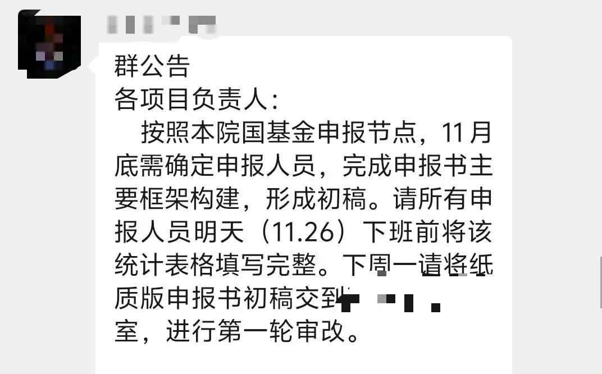
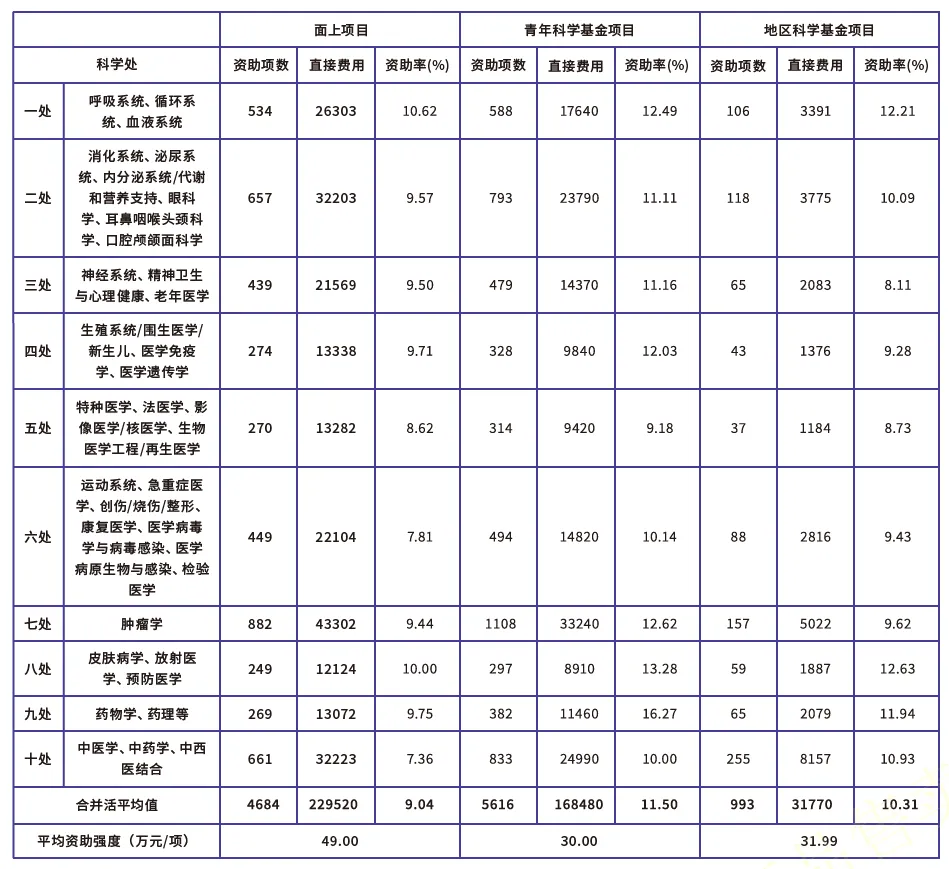
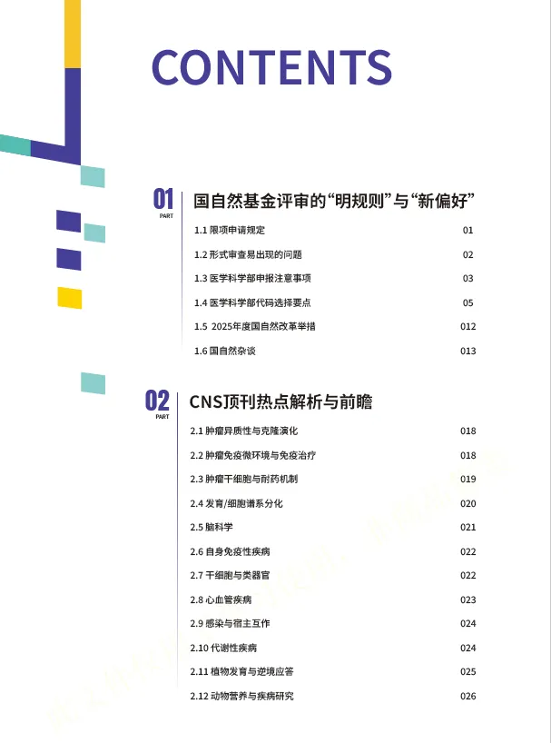
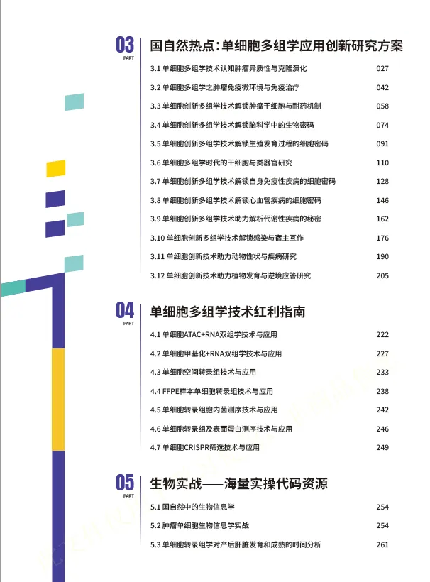
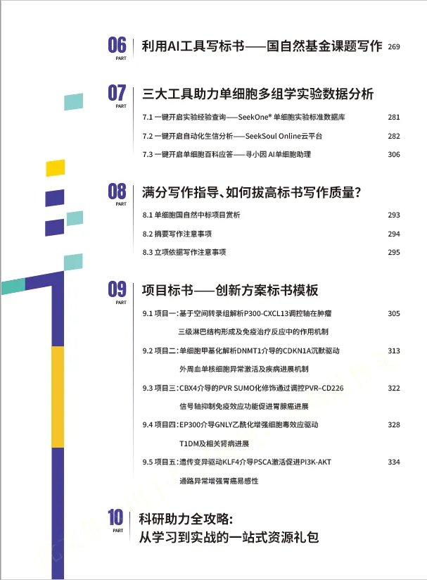

# 早早就要交明年的国自然标书了

> 原文：https://mp.weixin.qq.com/s?__biz=MzAwMzIzOTk5OQ==&mid=2247533659&idx=1&sn=d8b3d8c80e549874bacedce84571d77c&chksm=9b3c3d0bac4bb41d3d13ce1a7115e31d6956c9ffc347e3641b85b2b0ebf7c7b84eed007f69e1#rd
> 合集：基金申报

愈演愈烈

可以看出各单位的科研职能部门很重视国自然申报了，来年三月提交，但往往头一年冬天就开始收材料组织内审了。国自然的中标率是残酷的：总体中标率为12.26%，但医学部面上项目资助率从去年的13%跌至约11%，青年项目情况也不容乐观，更别提H18肿瘤口、中医药等白热化方向。因此，探究国自然的内在规律至关重要。
lncRNA、circRNA、RNA甲基化的申报热潮已经逐渐冷。现在谁的本子里不得加几句单细胞测序、空间转录组、类器官。国自然一直都是我们科研道路上最重要一环，为了给大家提供一个全面、实用的工具书，帮助大家更好地把握国自然项目的申报方向和策略，我们整理出版了**《 国自然单细胞多组学大红书申报宝典》**。旨在帮助科研人员在前沿技术的纷繁脉络中找到创新的切入点，实现“科学问题与基金导向的同频共振”。

生物信息学在国自然申请中扮演着至关重要的角色，它不仅是处理和分析海量生物数据的关键工具，更是推动生命科学研究从数据驱动向知识发现转变的核心驱动力。在申请中，生信部分需要紧密结合研究目标，明确其在解决复杂生物学问题中的具体应用，如通过高通量数据分析挖掘潜在的基因调控网络、鉴定疾病相关标志物或揭示微生物群落功能等。

此宝典重点聚焦于国自然中的单细胞多组学技术涵盖十大部分:

01：国自然基金评审的“明规则”与“新偏好”。

02：CNS顶刊热点解析与前瞻

03：单细胞多组学应用创新研究方案

04：单细胞多组学技术红利指南

**05****：海量实操代码资源**

06：利用AI工具写标书⸺国自然基金课题写作

**07****： SeekOne®单细胞实验标准数据库/SeekSoul Online云平台/寻小因 AI单细胞助理**

08:标书写作指导

09：标书模板展示

10：从学习到实战的一站式资源礼包

**
**

**获取方式：**

没错，其中第五章就是由Biomamba生信基地分享的生信实战内容，包含多个生信实战案例。看完这本宝典，单细胞与空转思路文思泉涌，生信技能哐哐增长。可以填写好问卷后，联系客服微信[Biomamba_zhushou]获得一手资料。我们还为大家准备了交流群~

https://www.wjx.cn/vm/rTLooCK.aspx#

**大红书核心模块：20万字干货+12大创新方案+ 5篇标书案例+单细胞创新多组学技术应用**

**不仅有：**

**1**

**洞察先机：摸透国自然评审的“明规则”与“新偏好”（**青椒医学）****

  * 拆解近几年最新评审趋势、资助倾向，精准对齐评审期待

  * 解读学科代码背后的“隐藏逻辑”，避免方向选错、申报错位

  * 盘点高频“踩坑点”（如创新点表述、技术路线漏洞），帮你提前避坑

**2**

**追踪前沿：CNS顶刊热点汇总（BioArt)**

  * 梳理近1年CNS级刊物中“单细胞多组学”突破性研究

**3**

**技术赋能：单细胞多组学“从0到1”创新解决方案**

  * 全面介绍单细胞多组学产品矩阵，匹配不同研究场景需求

  * 提供单细胞创新技术一站式科研支持方案

  * 附真实高分文章案例：看别人如何用单细胞多组学产出CNS级成果

**4**

**标书升华：满分写作指导+AI工具双助攻（青椒医学、华哥生信）**

  * 拆解“中标标书结构”，教你突出科学假说层次感、强化逻辑链

  * 分享AI工具DeepSeek使用方法，效率翻倍不踩雷

  * 提供5篇创新方案标书模板，从模仿开始写标书

**5**

**生物信息：如何借助生信分析抢占先机 (Biomamba生信基地)**

**更有：**

**
**

**三大在线工具助力单细胞多组学实验数据分析！即使生信零基础也能上手资源礼包：从学习到实战的“一站式弹药库”。**

在本手册的编撰过程中,我们历经了无数次的研讨、修改和完善,每一个细节都凝聚着众多人的智慧和心血。

在此,我们怀着无比感激的心情,向所有给予我们支持和帮助的学会团体、专家、技术合作单位与媒体平台致以最诚挚的谢意。

它不止是一本“申报指南”，更会成为你桌面上最常翻的“决策参考”和“灵感来源”！

✅**这本手册，特别适合这样的你：**

  * 不满足“跟风申报”，想在2026国自然提出“引领性课题”的申请者；

  * 希望将研究方向升级为“单细胞多组学”，建立技术壁垒的科研团队；

  * 盘点高频“踩坑点”（如创新点表述、技术路线漏洞），帮你提前避坑

**红宝书目录一览**

**如何联系我们**

 留一个领取[资料](<https://mp.weixin.qq.com/s?__biz=MzAwMzIzOTk5OQ==&mid=2247528482&idx=1&sn=7cc0715eace4f592a62bdaf157b25c01&scene=21#wechat_redirect>)、[开箱即用的单细胞分析镜像](<https://mp.weixin.qq.com/s?__biz=MzAwMzIzOTk5OQ==&mid=2247528410&idx=2&sn=0f2bac25479cf8d20dab5d82ae986f2e&scene=21#wechat_redirect>)的**微信号[Biomamba_zhushou]**，方便各位随时交流。同时我们也构建了[交流群矩阵](<https://mp.weixin.qq.com/s?__biz=MzAwMzIzOTk5OQ==&mid=2247528057&idx=1&sn=bb348c2a88c977c7cce67ee6731a3591&scene=21#wechat_redirect>)，欢迎大家入群讨论。
大家可以阅读完这几篇之后添加[给生信入门初学者的小贴士](<http://mp.weixin.qq.com/s?__biz=MzAwMzIzOTk5OQ==&mid=2247493329&idx=1&sn=597870b7f7ce10346da3561e7c281627&chksm=9b3c9f81ac4b169794088ce9abbcacb5f18e9fd174fc0d7e28da62d78facadf3100ef38aaf22&scene=21#wechat_redirect>)
[没有检索，就没有发言权](<https://mp.weixin.qq.com/s?__biz=MzAwMzIzOTk5OQ==&mid=2247529398&idx=2&sn=5a429852d61721916a405712677d5905&scene=21#wechat_redirect>)

**已有生信基地联系方式的同学****无需重复添加**

****

您点的每个赞和在看，我都认真当成了喜欢
