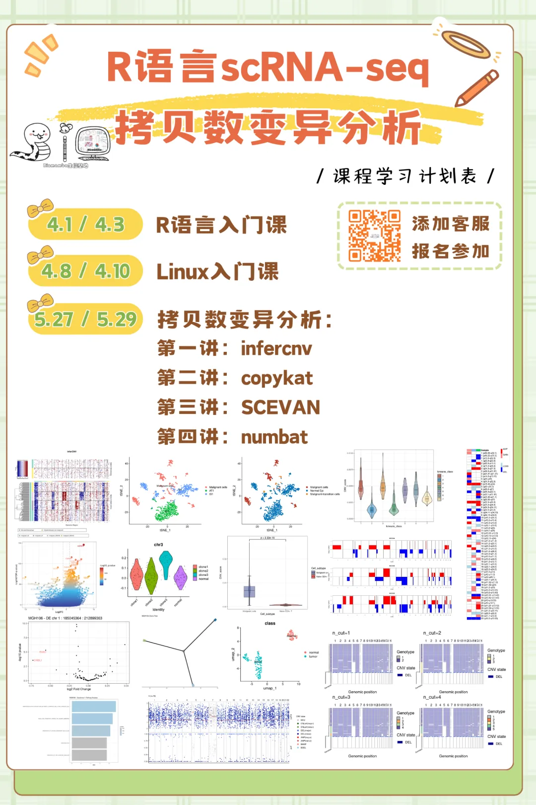
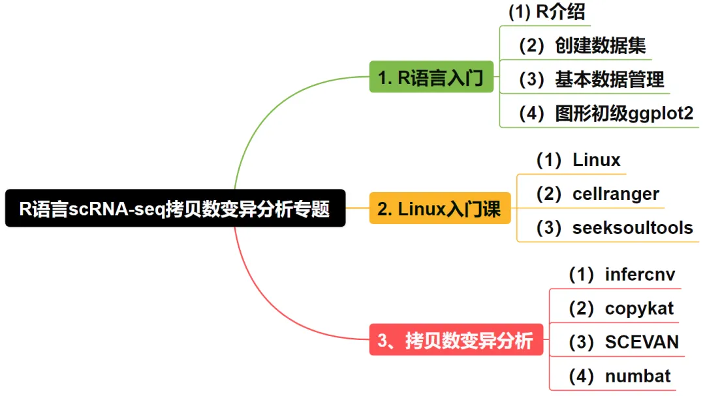
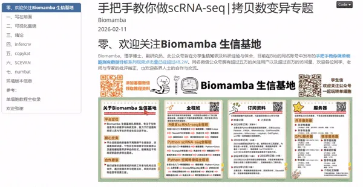
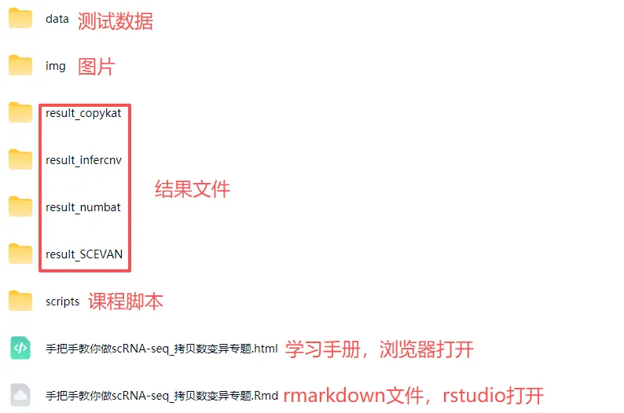

# R语言scRNA-seq拷贝数变异分析专题

> 原文：https://mp.weixin.qq.com/s?__biz=MzAwMzIzOTk5OQ==&mid=2247535877&idx=6&sn=6b2682106ed9a84c5bf57dadec45a0d3&chksm=9b3c3455ac4bbd435fd3e761c7b7f73e2a86590920db4ff6765a1d1efc5b6d6dd88ee49c147f#rd
> 合集：专题班/R语言scRNA-seq分析系列

R语言scRNA-seq拷贝数变异分析专题

我们将根据不同学员的学习需求，分专题精准授课。今年全新开设基因共表达网络分析专题，系统讲解infercnv，copykat、SCEVAN、numbat四大工具，并全程带练完整分析实操流程，满足大家按需学习、高效交流的需求。

教单细胞，我们是专业的！Biomamba的单细胞教程播放量已经48.8w+。小伙伴们的发文致谢可见：[致谢合辑](<https://mp.weixin.qq.com/mp/appmsgalbum?__biz=MzAwMzIzOTk5OQ==&action=getalbum&album_id=3425248581018714114#wechat_redirect>)。

https://www.bilibili.com/video/BV1S44y1b76Z/

交流中我们发现，由于缺少编程、单细胞、文章套路等基本知识，大家自学并不能完全自学掌握单细胞分析技能。因此，我们推出了全新的《scRNA-seq数据分析小白全程班》。2026.04~06，为期两个月在[生信基地](<https://mp.weixin.qq.com/s?__biz=MzAwMzIzOTk5OQ==&mid=2247526229&idx=1&sn=0718f1702150ba77a7f7e3beadd6e0ba&scene=21#wechat_redirect>)（线上/线下均可参与，错过直播也可以加入录播/答疑+循环开课）“手把手”的带大家完成scRNA-seq数据分析学习。拒绝生信快餐！课后欢迎大家随时在群里对课程内容提问~。

我们将根据不同学员的学习需求，分专题精准授课。因此，《R语言scRNA-seq拷贝数变异分析专题》上线，系统讲解infercnv，copykat、SCEVAN、numbat四大工具，并全程带练完整分析实操流程。2026.4.1-4.10、5.27-5.29为期六天在生信基地（线上/线下均可参与，错过直播也可以加入录播/答疑+循环开课）也希望真的能够做到“手把手”的带大家完成单细胞测序数据分析的学习，当然，我们拒绝生信快餐，课后欢迎大家随时在群里对课程内容提问~报名即可获得：

1、专属服务

三年内课程指导、答疑、回放、直播复听。

2、专属学习社群

加入《R语言scRNA-seq拷贝数变异分析专题》专属学习群，与同期学员共同交流、互助进步。

3、专属服务器

开箱即用(我们已经布置好了环境)的单细胞拷贝数变异分析环境，三个月特惠版服务器使用权限：CPU核心(20核)、运行内存(256GB)、硬盘(512G)。

4、开课前附赠学习资料

·《单细胞概论》和《生信小白入门课》理论知识回放；

· 专题学习手册：R语言入门手册、Linux入门手册、拷贝数变异分析学习手册，配套代码与测试文件及对应的练习题。

教程部分图片集锦：

**
**

**报名联系客服微信[ Biomamba_zhushou]：**

内容计划&大纲

**学习资料一览**

通过这次全程学习，你将获得并掌握以下学习手册与资料：

R语言入门

同我们以前的课程一样，我们给大家准备了学习手册和学习资料，大家可联系客服微信[Biomamba_zhushou]领取：

R语言教程目录：

1 R介绍

1.1 R下载与安装

1.1.1 RStudio

1.1.2 R帮助函数

1.1.3 用于管理R工作区的帮助函数

1.2 包

1.2.1 包的基本函数

1.2.2 包处理大型数据集的示例展示

2 创建数据集

2.1 理解数据类型

2.2 数据结构

2.2.1 向量(vector)

2.2.2 矩阵(matrix)

2.2.3 数组(array)

2.2.4 数据框(data)

2.2.5 因子(factor)

2.2.6 列表(list)

2.3 数据输入

2.3.1 从带分隔符的文本文件导入数据

2.3.2 导入Excel数据

3 基本数据管理

3.1 创建新变量

3.2 变量的重编码(recoding)

3.3 变量的重命名

3.4.缺失值（NA）

3.5 类型判断和转换

3.6 数据排序

3.7 数据集的合并

3.8 选取变量

3.9 选取观测值

3.10 subset()函数选择观测值或变量

3.11 剔除变量

3.12 dplyr包

3.13 使用管道操作符对语句进行串接

4 图形初级(ggplot2)

4.1 使用ggplot2包创建图形

4.1.1 函数ggplot2()

4.1.2 geom()函数

4.1.3 分组

4.1.4 标尺

4.1.5 刻面

4.1.6 标签

4.1.7主题

4.2 ggplot2包的详细信息

4.2.1 放置数据和映射选项

4.2.2 将图形作为对象使用

4.2.3 保存图形

Linux入门

同我们以前的课程一样，我们给大家准备了学习手册和学习资料，大家可联系客服微信[Biomamba_zhushou]领取：
Linux教程目录：

一、写在前面

二 、服务器使用教程

三、Linux

3.1 什么是Linux系统

3.2 如何获取Linux系统

3.3 命令行与基本命令

3.4 Linux的文件目录系统

3.5 路径查看与切换

3.6 通配符

3.7 删除文件

3.8 复制和移动

3.9 用户与组群概念

3.10 用户管理

3.11 权限管理

3.12 快捷键

3.13 重定向

3.14 管道符

3.15 文件查找

3.16 软链接与硬链接

3.17 文件压缩和解压缩

3.18 文本查看

3.19 文本浏览器

3.20 vim文本编辑器

3.21 文本处理

3.22 grep

3.23 sed

3.24 awk

3.25 shell脚本

3.26 if条件语句

3.27 循环

四、cellranger

4.1 软件下载和安装

4.2 数据准备

4.3 参数说明

4.4 执行cellranger分析

4.5 主要输出文件

五、seeksoultools

5.1 软件下载和安装

5.2 数据准备

5.3 参数说明

5.4 执行seeksoultools分析

5.5 主要输出文件

单细胞进阶分析——拷贝数变异分析

同我们以前的课程一样，我们给大家准备了学习手册和学习资料，大家可联系客服微信[Biomamba_zhushou]领取：

教程图片集锦：

# **
**

# **拷贝数变异分析学习手册**

**拷贝数变异分析教程目录** ：

**一、写在前面**

**二、可视化集锦**

**三、绪论**

**3.1 定义**

**3.2 主要研究成果**

**（1）区分肿瘤细胞与正常细胞**

**（2） 推断的拷贝数变异（CNA）谱的准确性**

**（3） 亚克隆结构推断准确性的评估**

（4）计算效率

**3.3 小结**

**四、infercnv**

4.1 简介

4.2 安装

4.3 输入文件

4.4 infercnv workflow

4.5 infercnv实战

（1）数据概况

（2）infercnv流程

（3）热图优化

（4）小提琴图

****五、copykat****

5.1 copykat介绍

（1）简介

（2）copykat工作流程描述

（3）性能评估

（4）实体肿瘤中肿瘤细胞和正常细胞的分类

（5）应用于其他scRNA-seq技术

（6）推断乳腺肿瘤的克隆亚结构

（7）小结

5.2 copykat流程（1）安装（2）counts矩阵预处理（3）常用参数（4）copykat（5）整理数据（6）绘制热图5.3 copykat实战（1）数据概况（2）copykat（3）整理数据（4）热图绘制（5）探究一下拷贝数变异与原来亚群之间的关系（6）CNA score小提琴图

**六****、SCEVAN******

****6.1 安装R包****

****6.2 加载R包********6.3 单样本分析********（1）加载数据********（2）执行分析********（3）结果查看********6.4 多样本分析********（1）加载数据 （2）执行分析（3）结果查看********6.5 联合Seurat对象********（1）创建****Seurat对象**** （2）将拷贝数变异结果加入****Seurat对象**** （3）降维分群（4）可视化****

****七****、numbat********

********7.1****安装R包************

****7.2****加载R包************7.3 数据下载********7.4 等位基因数据准备********（1）运行参数解释 （2）示例脚本（3）可能出现的报错（4）执行分析********7.5 运行numbat********（1）运行参数解释********（2）运行****numbat************7.6 结果解读********（1）拷贝数景观和单细胞系统发育 （2）在系统发育上完善亚克隆（3）共识拷贝数区段（4）pseudobulks水平拷贝数变异（5）进化树********八、环境版本信息********
********九、参考********十、单细胞教程全收录********十一、欢迎致谢****

测试文件，总大小35.46GB

报名费用

6天满满的课程只要1199￥，相信比小学生补课班还便宜。支持对公！也欢迎看看我们的价值观：[想钱想疯了？](<https://mp.weixin.qq.com/s?__biz=MzAwMzIzOTk5OQ==&mid=2247529315&idx=1&sn=df2cf4c0fa3411889c558229f4068a8c&scene=21#wechat_redirect>)

线下学习环境

**地点** ：南京市江宁区，详细地址咨询客服微信[Biomamba_zhushou]
**往期活动现场：******

除了知识之外，现场还能够给大家提供：

**茶水吧、咖啡机、零食柜**

**各类饮料、零食小吃**

**如何联系我们**

 留一个领取[资料](<https://mp.weixin.qq.com/s?__biz=MzAwMzIzOTk5OQ==&mid=2247532585&idx=1&sn=e265d2846ec66e5faaaf21403d274d2f&scene=21#wechat_redirect>)、[免费两周学习版](<https://mp.weixin.qq.com/s?__biz=MzAwMzIzOTk5OQ==&mid=2247527585&idx=1&sn=fa32112c11b215b33096cab43baf08ea&scene=21#wechat_redirect>)服务器的**微信号[Biomamba_zhushou]**，方便各位随时交流。同时我们也构建了[交流群矩阵](<https://mp.weixin.qq.com/s?__biz=MzAwMzIzOTk5OQ==&mid=2247528057&idx=1&sn=bb348c2a88c977c7cce67ee6731a3591&scene=21#wechat_redirect>)，欢迎大家入群讨论。
大家可以阅读完这几篇之后添加[给生信入门初学者的小贴士](<http://mp.weixin.qq.com/s?__biz=MzAwMzIzOTk5OQ==&mid=2247493329&idx=1&sn=597870b7f7ce10346da3561e7c281627&chksm=9b3c9f81ac4b169794088ce9abbcacb5f18e9fd174fc0d7e28da62d78facadf3100ef38aaf22&scene=21#wechat_redirect>)
[如何搜索公众号过往发布内容](<http://mp.weixin.qq.com/s?__biz=MzAwMzIzOTk5OQ==&mid=2247506266&idx=2&sn=22b1164bc9602c25620d058847785422&chksm=9b3ca00aac4b291c16d738271746ffb90149282a728f484e8a1952463c46a8e7dc4f883ab928&scene=21#wechat_redirect>)

**已有生信基地联系方式的同学****无需重复添加**

 您点的每个赞和在看，我都认真当成了喜欢
