# 生信基地第二课线下阶段收官~

> 原文：https://mp.weixin.qq.com/s?__biz=MzAwMzIzOTk5OQ==&mid=2247525030&idx=1&sn=a006e1a4f36ae20744d81c8ff7afc240&chksm=9b3c1bf6ac4b92e08bce0ab6ba9a4e2e1e967572c50a91a141395252c471bcba789d4c7dfb58#rd
> 合集：生信基地

生信基地第二课

[想了很久的生信基地](<http://mp.weixin.qq.com/s?__biz=MzAwMzIzOTk5OQ==&mid=2247522649&idx=1&sn=a3a3df860fd162691403281356dcbf1d&chksm=9b3ce009ac4b691fc8679c43988a0a36e176760d3e21b2489b43184f0248b6409cbe8dcbb96a&scene=21#wechat_redirect>)已经落地，我们也开始积极探索为生信领域做贡献的新方法，希望能够给大家提供系统性、形成性、规范性的生信教学。

这次我们邀请到的主讲老师**华哥**[ 在生信基地完成](<https://mp.weixin.qq.com/s?__biz=MzAwMzIzOTk5OQ==&mid=2247522649&idx=1&sn=a3a3df860fd162691403281356dcbf1d&scene=21#wechat_redirect>)**12月7~8日** 为期两天的线下教学。在有限的时间里我们完成了"编程基础学习--R语言"、"编程基础知识---数据结构"、"以Nature文章源代码学习转录组数据表达矩阵处理基本处理"、"以Cell文章源代码学习生存曲线"的学习。现已把**一~****四节课** 的**代码数据** 文件整理打包，并录制了**视频回放** ，大家可以转发此条推送至朋友圈，30赞添加客服微信发送截图领取(**不限名额**)：

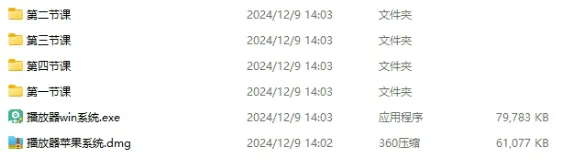

**已有生信基地联系方式的同学****无需重复添加**

上课ing:

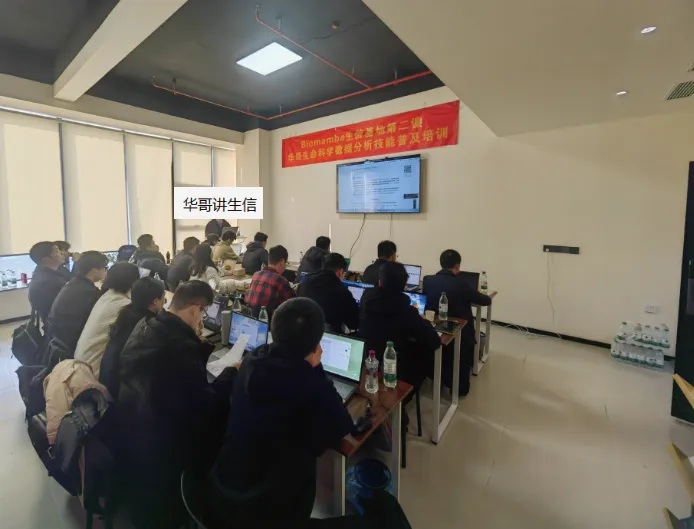

下课留念合影：

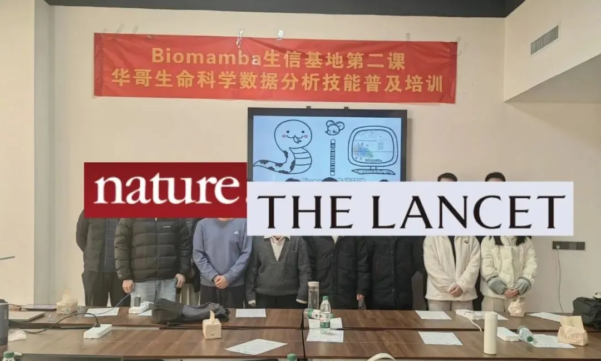

华哥介绍：中山大学博士，师从加州大学终身教授，深耕于**单细胞多组学数据分析** 和**机器学习算法** 研究，发表过多篇**CNS子刊** ，参与过多项**国自然重点** 、**国家重大专项** 、**孔雀计划** 等项目申报，指导过多篇CNS文章生信分析。

完整课表

1.**一个月时间** 掌握基本的CNS文章数据分析****

2. 授课方式采用**线上线下相结合** ，同步进行。**线上腾讯会议****直播课** ，**互动答疑****。** 线下在南京，**现场教学更踏实** ！

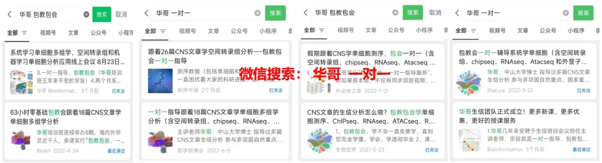4.**深入剖析****二十篇CNS文章** 的**分析思路和分析方法，** 按照**CNS文章源代码讲解** ，以文章的fig为例进行代码演示和复现学习，个性化分析

**第一节：编程基础学习--R语言**

1.R和Rstudio的安装、环境配置

2.R语言简单语法及常见命令

3.**以Cell文章方法** 描述学习R包的安装及使用

4.**以Nature文章源代码** 学习重点函数基础代码

**第二节：编程基础知识---数据结构**

1.向量、矩阵、数据框和列表的创建和索引

2.多种数据结构的合并**【Cell】**

3.自定义Function函数构建

4.for循环、字符型数据的处理**【Cell】**

**第三节： 以Nature文章源代码学习转录组数据表达矩阵处理基本处理**

1.重复基因和缺失值的删除

2.不同分组样本的批量归类**【Nature】**

3.多个样本的表达矩阵合并

4.芯片探针基因名字的转换**【Nature】**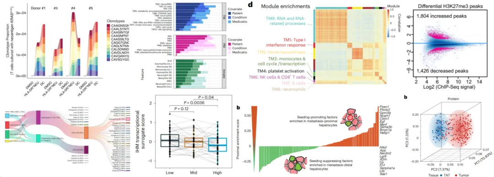

**第四节： 以Cell文章源代码学习生存曲线**

1.临床预后信息的批量整理

2.创建生存对象、拟合曲线**【Cell】**

3.特定基因的筛选构建预后分组

4.combat算法不同数据集的批次处理

**第五节：差异分析 RNAseq数据分析**

1.芯片数据上游分析**【Cancer Discovery】**

2.多个样本的数据归一化处理

3.分组矩阵系统讲解**【Nature】**

4.Deseq2分析流程**【Science】**

5.EdgeR差异分析系统讲解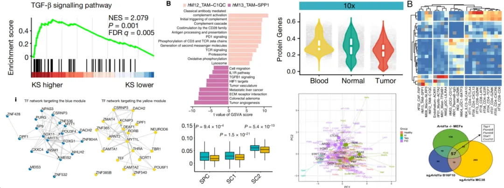

**第六节： 以多篇CNS文章源代码学习画图**

1.ggplot体系画图包括热图

2.火山图 箱线图 小提琴图**【Nature】**

3.多分组显著性p值添加方法**【Nat Med】**

4.三维pca图展示差异特征**【Science】**

5.层次聚类算法区分不同样本特征

**第七节：基因集富集分析**

1.over representation

2.GSEA 富集 **【Cancer Cell】**

3.**包括自定义基因集的富集分析**

4.富集通路网络图**【Nat Genet】**

5.蛋白互作网络构建**【Nature】**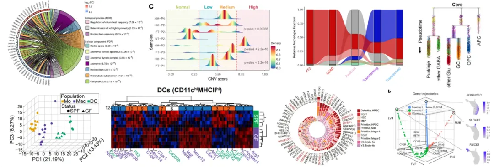

**第八节： 以Nature文章为例系统讲解单细胞转录组基本分析**

1.单细胞在CNS文章思路解析及常见图形解读

2.数据质控、数据放缩、PCA降维、聚类

3.三维tSNE、UMAP可视化**【Science】**

4.单细胞多组学分析思路和方法**【Nature】**

**第九节 ：单细胞转录组拟时序分析**

1.monocle拟时序分析 **【Nature】**

2.细胞排序，构造一棵生成树

3.基因随轨迹分析变化热图**【Cell】**

4.BEAM轨迹分支分析**【Nature】**

5.**自测和挖掘单细胞项目思路归纳总结**

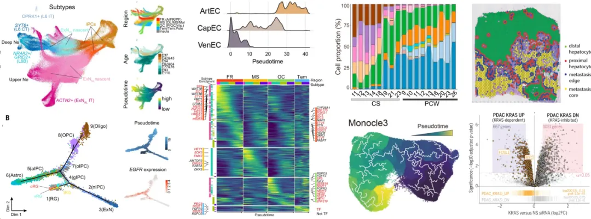

**第十节：空间转录组理论及分析内容**

1.空间转录组技术发展历程和原理介绍

2.**空间转录组CNS文章思路解析** 及常见图解读

3.10x Visium 基本分析流程**【Cancer Cell】**

4.空间数据与单细胞整合分析思路

**第十一节课：高分辨空间转录组分析**

1.Xenium 空转数据分析**【Nature】**

2.Visium HD空转数据分析**【Cell】**

3.**Stereo-seq “亚细胞级分辨率”** 测序介绍

4.空间测序多截面3D邻域重建**【Nature】**

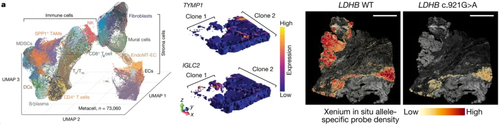

**第十二节课：机器学习基础理论**

1.随机森林和支持向量机（SVM）

2.弹性网络回归算法Enet**【Cell】**

3.广义提升回归模型（GBM）

**第十三节课：表观遗传研究**

1.ChIP-seq、ATAC-seq在CNS文章中应用

2.ChIP-seq数据分析峰值可视化**【Nature】**

3.**ATAC-seq数据peak注释****【Cancer Cell】**

4.峰值在外显子、内含子、启动子的分布计算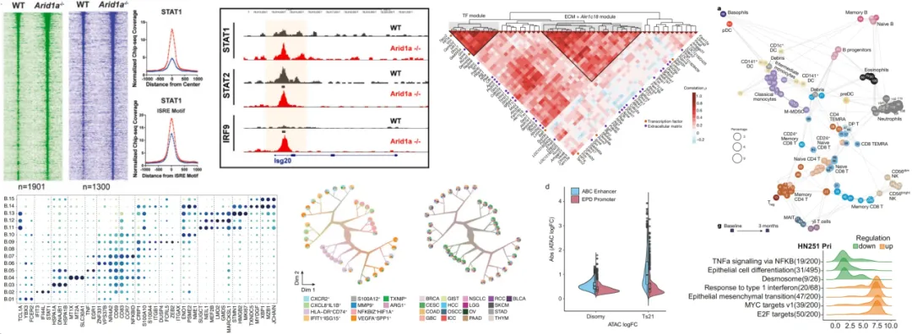

**第十四节：加权基因共表达网络分析 (WGCNA）算法系统讲解以 nature文章为例 **

1.构建邻接矩阵和拓扑重叠矩阵

2.无尺度网络模型**【Nature】**

3.共表达调控网络**【Cell】**

**第十五节：免疫浸润计算**

1.CIBERSORT反卷积算法，以TCGA数据为例

2.非监督共识聚类算法**【Science】**

3.转录因子富集**【Cell Stem Cell】**

4.Mfuzz、 BioNet调控网络构建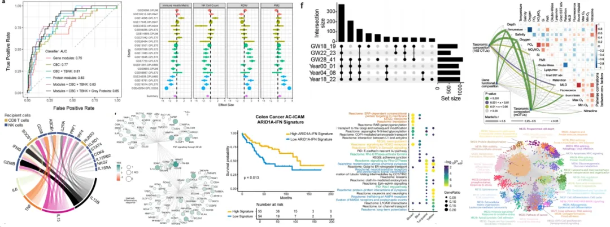

**第十六节：大数据分析在基金申请中应用**

**第十七节：实践课** （课程总结，带领学员使用自测数据**完成整体分析流程** ）

****

**报名联系方式** ：

**如何联系我们**

 公众号后台消息回复不便，这里给大家留一下领取资料及免费服务器([足够支持你完成硕博生涯的生信环境](<http://mp.weixin.qq.com/s?__biz=MzAwMzIzOTk5OQ==&mid=2247507693&idx=1&sn=d9517a0803ad75cb7be430806834e7b8&chksm=9b3ca7bdac4b2eaba1ad01ed04ab1fbcbafcf4f6ddfe9e4f76ed9229707f545fe7d9c9ffd6ae&scene=21#wechat_redirect>))的**微信号** ，方便各位随时交流（别问在么，添加时直接说来意）。呼声很高的**交流群** 也建好了，欢迎大家入群讨论：

[永久免费的生信、科研交流群](<http://mp.weixin.qq.com/s?__biz=MzAwMzIzOTk5OQ==&mid=2247505868&idx=2&sn=20c81313eaef9a7031a84ef3a691d1b5&chksm=9b3cae9cac4b278a42c8de97e864c7664a37e9a4adb5973625fe3f8dd1093e55aeda88d443aa&scene=21#wechat_redirect>)

大家可以阅读完这几篇之后添加[给生信入门初学者的小贴士](<http://mp.weixin.qq.com/s?__biz=MzAwMzIzOTk5OQ==&mid=2247493329&idx=1&sn=597870b7f7ce10346da3561e7c281627&chksm=9b3c9f81ac4b169794088ce9abbcacb5f18e9fd174fc0d7e28da62d78facadf3100ef38aaf22&scene=21#wechat_redirect>)
[如何搜索公众号过往发布内容](<http://mp.weixin.qq.com/s?__biz=MzAwMzIzOTk5OQ==&mid=2247506266&idx=2&sn=22b1164bc9602c25620d058847785422&chksm=9b3ca00aac4b291c16d738271746ffb90149282a728f484e8a1952463c46a8e7dc4f883ab928&scene=21#wechat_redirect>)

**已有生信基地联系方式的同学****无需重复添加**

 您点的每个赞和在看，我都认真当成了喜欢
