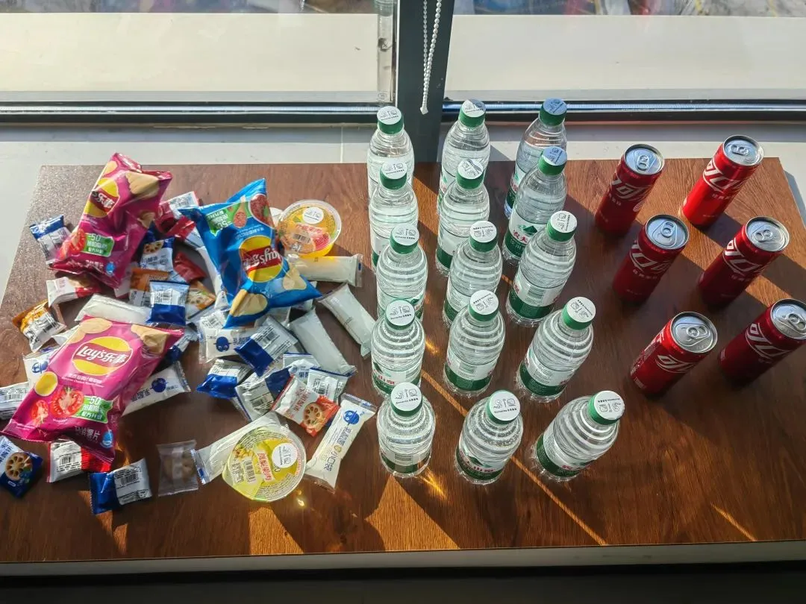
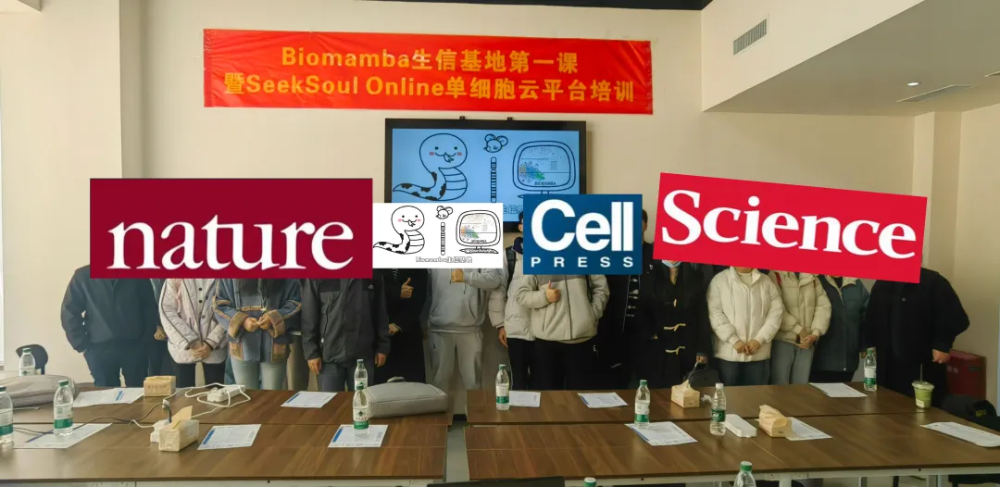
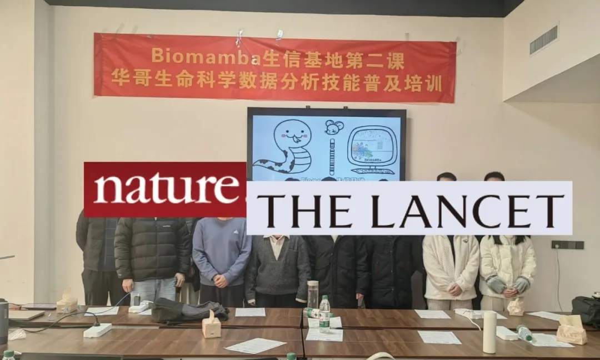
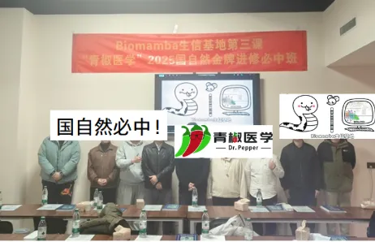

# 周六开课，生物信息学概论

> 原文：https://mp.weixin.qq.com/s?__biz=MzAwMzIzOTk5OQ==&mid=2247526253&idx=2&sn=be5f25c89dbe317b230fc32f02b1f557&chksm=9b3c1e3dac4b972bc60d50ed5610e6767d7ac37d4079848d4690dae1e280b7434bdde7fed55c#rd
> 合集：生信基地

Biomamba主讲

[生信基地](<http://mp.weixin.qq.com/s?__biz=MzAwMzIzOTk5OQ==&mid=2247522649&idx=1&sn=a3a3df860fd162691403281356dcbf1d&chksm=9b3ce009ac4b691fc8679c43988a0a36e176760d3e21b2489b43184f0248b6409cbe8dcbb96a&scene=21#wechat_redirect>)已经落地，我们也在积极探索为生信领域做贡献的新方法，希望能够给大家提供系统性、形成性、规范性的生信教学。这已经是我们的**第四次线下** 活动啦。**往期活动** 可见合辑：[生信基地](<https://mp.weixin.qq.com/mp/appmsgalbum?__biz=MzAwMzIzOTk5OQ==&action=getalbum&album_id=3721493119318310916#wechat_redirect>)

此前的几次活动中我们也在不断的总结反馈与经验，期间发现各位来参加活动的老师与同学中很多对生物信息学、高通量测序这些内容的**知识背景** 并没有基本的了解，这对后面的生信实战学习造成了很大的**障碍** 。因此Biomamba以此前给硕士生上课的框架(**零翘课****&****double人数旁听**)为基础进行修订。给大家完成一次"**生信小白入门课** "，为大家进行生物信息学基本概念与常见组学的普及(**非实操** ，不要幻想一天可以掌握那么多分析技能，仅提供**概论教程** 与**学习思路 &方法**分享)。

**时间** ：2025年1月4日(周六) 09:00~17:00**地点** ：南京市江宁区，详细地址报名咨询~**线上线下** 均可参加**目标** ：生信小白可以通过此次活动了解"**什么是** 生物信息学？"、"**为什么** 要学习生物信息学？"、"**怎样** 学习生物信息学？"**目录** ：(暂定，可能会有补充)：

1、生物信息学&高通量测序

2、(sc)RNA-Seq的前世今生

3、可视化实例

4、蛋白质各级结构及理化性质预测

5、空间转录组学概论

6、生信文章实例讲解

7、R语言入门

**报名/缴费** 请联系客服微信

**已有生信基地联系方式的同学****无需重复添加**

除了知识之外，现场还能够给大家提供：

**茶水吧、咖啡机、零食柜**

**各类饮料、零食小吃**

往期活动现场

大家都有在认真学习！

**如何联系我们**

 公众号后台消息回复不便，这里给大家留一下领取资料及免费服务器([足够支持你完成硕博生涯的生信环境](<http://mp.weixin.qq.com/s?__biz=MzAwMzIzOTk5OQ==&mid=2247507693&idx=1&sn=d9517a0803ad75cb7be430806834e7b8&chksm=9b3ca7bdac4b2eaba1ad01ed04ab1fbcbafcf4f6ddfe9e4f76ed9229707f545fe7d9c9ffd6ae&scene=21#wechat_redirect>))的**微信号** ，方便各位随时交流(别问在么，添加时直接说来意)。呼声很高的**交流群** 也建好了，欢迎大家入群讨论：

[永久免费的生信、科研交流群](<http://mp.weixin.qq.com/s?__biz=MzAwMzIzOTk5OQ==&mid=2247505868&idx=2&sn=20c81313eaef9a7031a84ef3a691d1b5&chksm=9b3cae9cac4b278a42c8de97e864c7664a37e9a4adb5973625fe3f8dd1093e55aeda88d443aa&scene=21#wechat_redirect>)

大家可以阅读完这几篇之后添加[给生信入门初学者的小贴士](<http://mp.weixin.qq.com/s?__biz=MzAwMzIzOTk5OQ==&mid=2247493329&idx=1&sn=597870b7f7ce10346da3561e7c281627&chksm=9b3c9f81ac4b169794088ce9abbcacb5f18e9fd174fc0d7e28da62d78facadf3100ef38aaf22&scene=21#wechat_redirect>)
[如何搜索公众号过往发布内容](<http://mp.weixin.qq.com/s?__biz=MzAwMzIzOTk5OQ==&mid=2247506266&idx=2&sn=22b1164bc9602c25620d058847785422&chksm=9b3ca00aac4b291c16d738271746ffb90149282a728f484e8a1952463c46a8e7dc4f883ab928&scene=21#wechat_redirect>)

**已有生信基地联系方式的同学****无需重复添加**

 您点的每个赞和在看，我都认真当成了喜欢
