# 承包你的单细胞/空转硕博生涯

> 原文：https://mp.weixin.qq.com/s?__biz=MzAwMzIzOTk5OQ==&mid=2247531916&idx=1&sn=d3b66d39d5723c09adf4dd2d7513af48&chksm=9b3c04dcac4b8dca1d36c81202638f273dcf98d3dcdd1aced607a0086f30e2fb717b773432b9#rd
> 合集：生信基地

**一、写在前面**

为啥说承包各位的单细胞/空转硕博生涯，因为我们的[全程班](<https://mp.weixin.qq.com/s?__biz=MzAwMzIzOTk5OQ==&mid=2247531447&idx=1&sn=242b49b5e2f5496efbd4484bf2e81604&scene=21#wechat_redirect>)支持三年的答疑和复听!三年的陪伴式学习，希望大家都不会延毕。[搞生信教学](<https://mp.weixin.qq.com/s?__biz=MzAwMzIzOTk5OQ==&mid=2247531410&idx=1&sn=e0850491da199c8abaa538f2d64e0035&scene=21#wechat_redirect>)，我们是专业的，Biomamba生信基地全网分享的生信教程点击量近千万次。B站单细胞视频单个合辑播放量就直逼50w，每每看到有[粉丝致谢](<https://mp.weixin.qq.com/mp/appmsgalbum?__biz=MzAwMzIzOTk5OQ==&action=getalbum&album_id=3425248581018714114#wechat_redirect>)，还是满满的成就感。[生信基地](<https://mp.weixin.qq.com/s?__biz=MzAwMzIzOTk5OQ==&mid=2247526229&idx=1&sn=0718f1702150ba77a7f7e3beadd6e0ba&scene=21#wechat_redirect>)的要务就是为大家提供高质量生信教学，拒绝生信快餐，我们拥有多个学习周期两个月的全程课程，每个课程都创建并维护交流群，课后欢迎大家随时在群里针对课程内容提问！还配套[开箱即用的单细胞分析镜像](<https://mp.weixin.qq.com/s?__biz=MzAwMzIzOTk5OQ==&mid=2247528410&idx=2&sn=0f2bac25479cf8d20dab5d82ae986f2e&scene=21#wechat_redirect>)，想学不会都难！

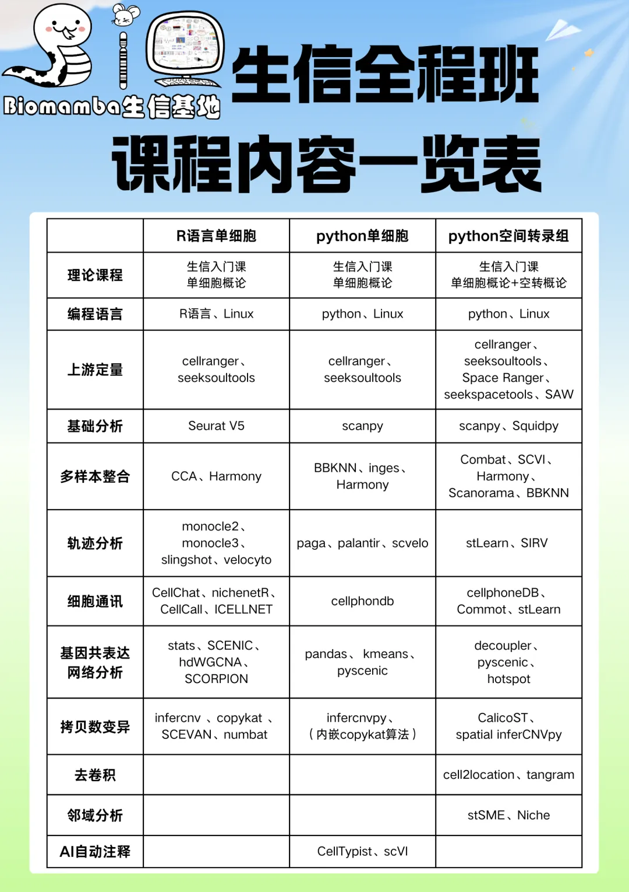
感兴趣的同学欢迎联系客服微信[Biomamba_zhushou]参与学习

现有培训体系详细大家可参考(图片可跳转详细介绍)：

当然，三个班一起参加也会有优惠：

现有培训体系详细大家可参考：

一、单细胞+空间转录组，Python全流程实战教学！

单细胞和空间转录组，已成为高分文章“标配”。 实际科研中，很多同学常常遇到：面对海量数据，不知如何处理，东查西搜分析出结果，却不敢确定结果是否正确；想系统性学习空间转录组，却不知从何开始，更不清楚如何与单细胞联合；门诊、实验、科研疲于奔命，学习时间不固定，学了几年生信，还在原地踏步。。。此前推出的R语言版本[scRNA-seq数据分析小白全程班](<https://mp.weixin.qq.com/s?__biz=MzAwMzIzOTk5OQ==&mid=2247529379&idx=1&sn=10283cee636a7bc706f145edc791fe7c&scene=21#wechat_redirect>)，能够帮助大家从零掌握了完整的分析流程。但在科研实践中，R语言面对越卷越大的数据集常常显得力不从心：[挑战用R语言硬干一百万单细胞数据分析](<https://mp.weixin.qq.com/s?__biz=MzAwMzIzOTk5OQ==&mid=2247531160&idx=1&sn=ecf56af3b929ec2b241854c89d25c671&scene=21#wechat_redirect>)。所以，这一次我们带来了全新的——[scRNA-seq分析Python全程班 & 空间转录组分析全程班课程 ](<https://mp.weixin.qq.com/s?__biz=MzAwMzIzOTk5OQ==&mid=2247531180&idx=2&sn=c73fece98aef7ec350983f13c5fbb326&scene=21#wechat_redirect>)🎉2025.10.20~12.12，为期两个月（线上/线下均可参与，错过直播也可以加入录播/答疑+循环开课）。[生信基地](<https://mp.weixin.qq.com/s?__biz=MzAwMzIzOTk5OQ==&mid=2247526229&idx=1&sn=0718f1702150ba77a7f7e3beadd6e0ba&scene=21#wechat_redirect>)希望能够做到“手把手”的带大家完成数据分析学习，当然，我们拒绝生信快餐，课后欢迎大家随时在群里对课程内容提问~。自学能力强的小伙伴也可以直接跟B站教程。参与此次课程你将获得：1、为期两个月单细胞/空间转录组数据分析教学。2、加入全程班群聊，三年内当前课程指导、答疑、回放、直播复听，相信足够覆盖你的硕博生涯学习。2、[开箱即用的单细胞+空间转录组分析镜像](<https://mp.weixin.qq.com/s?__biz=MzAwMzIzOTk5OQ==&mid=2247528410&idx=2&sn=0f2bac25479cf8d20dab5d82ae986f2e&scene=21#wechat_redirect>)，256GB内存、500GB硬盘、20线程服务器3个月使用权。4、课程对应分析手册、代码、测试文件。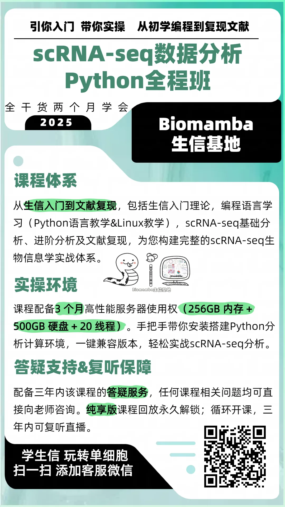
通过两个月的学习，你能够绘制上百种单细胞/空间转录组图表，以下为部分图片集锦：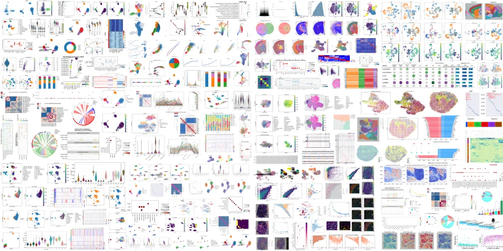

**报名联系客服微信[ Biomamba_zhushou]：**

1、内容计划&大纲

为了兼顾大家的时间，我们将课程安排为交叉上课形式。你既可以专注学习其中一门课程，也可以同时选择两门，灵活度更高，两课连报，优惠多多：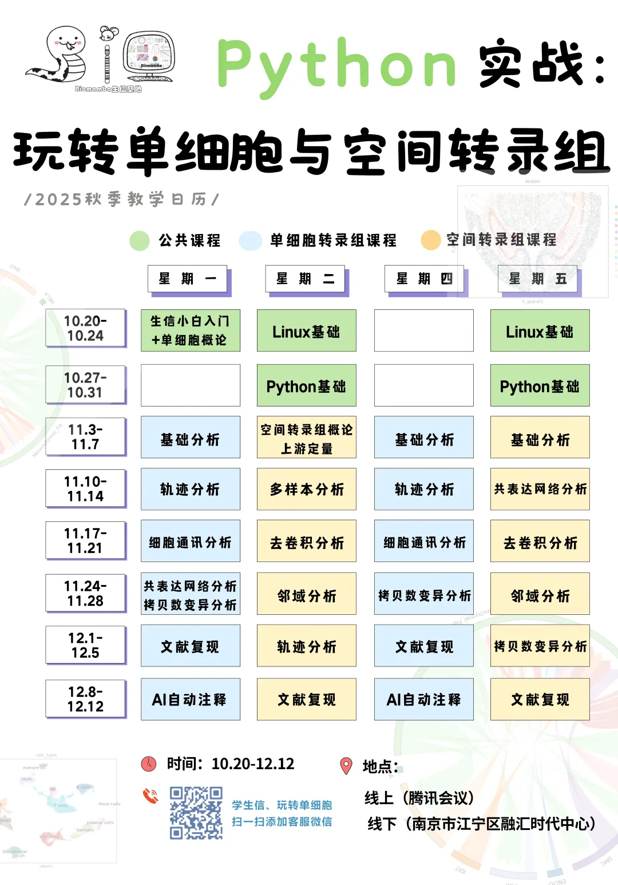

**2、所见即所得**

通过这次全程学习，你将获得并掌握以下学习手册与资料：

Linux基础课学习手册

同我们以前的课程一样，我们给大家准备了学习手册和学习资料，大家可联系客服微信[Biomamba_zhushou]领取：

Python基础课学习手册

同我们以前的课程一样，我们给大家准备了学习手册和学习资料，大家可联系客服微信[Biomamba_zhushou]领取：
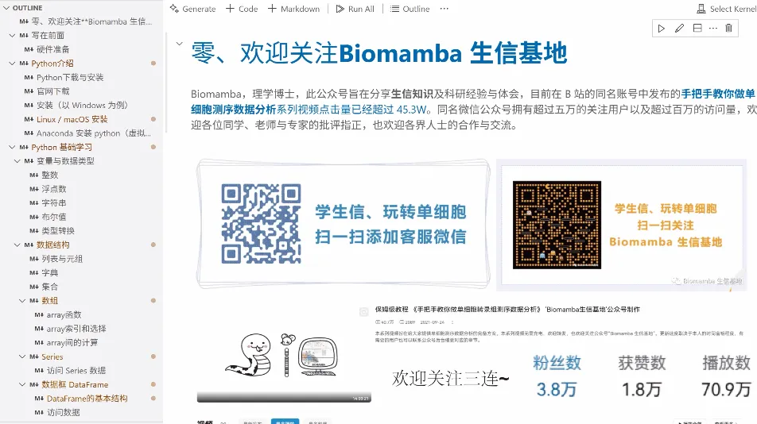

单细胞-基础分析学习资料

同我们以前的课程一样，我们给大家准备了学习手册和学习资料，大家可联系客服微信[Biomamba_zhushou]领取：

教程图片集锦：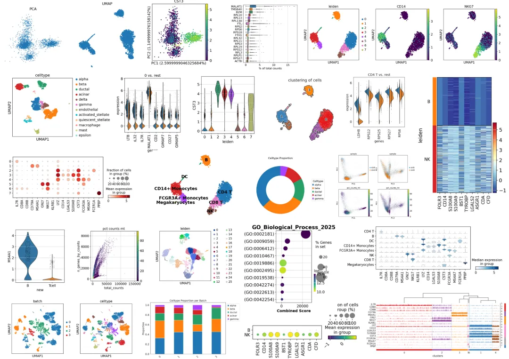
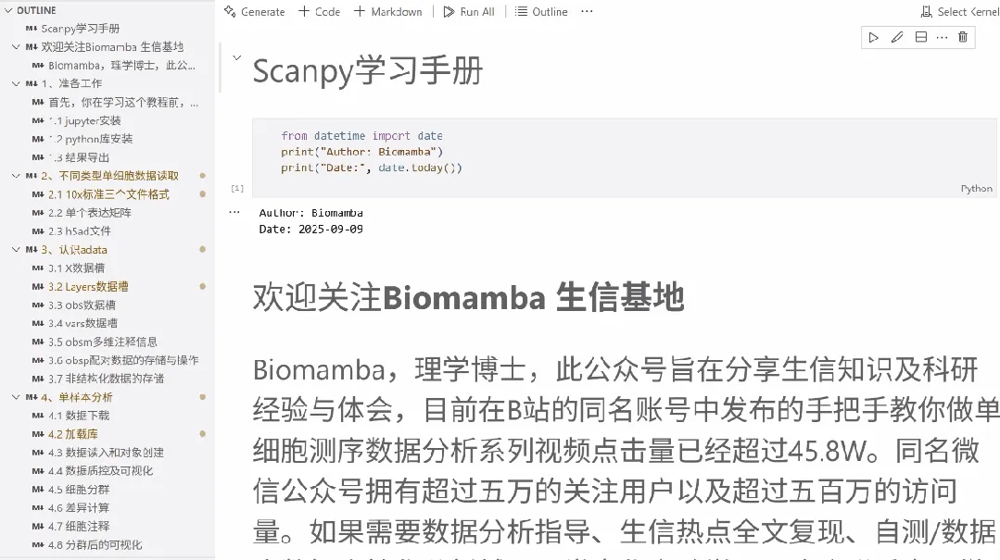

教程目录：零、欢迎关注一、准备工作1.1 jupyter安装1.2 python库安装1.3 结果导出二、不同类型单细胞数据提取2.1 10x标准三个文件格式2.2 单个表达矩阵2.3 h5ad文件三、认识adata3.1 X数据槽3.2 Layers数据槽3.3 obs数据槽3.4 vars数据槽3.5 obsm多维注释信息3.6 obsp配对数据的存储与操作3.7 非结构化数据的存储四、单样本分析4.1 数据下载4.2 加载库4.3 数据读入和对象创建4.4 数据质控与可视化4.5 细胞分群4.6 差异计算4.7 细胞注释4.8 分群后的可视化五、多样本分析5.1 数据读入和对象创建5.2 数据质控及可视化5.3 细胞分群5.4 批次效应 5.4.1 不去批次 5.4.2 BBKNN去批次 5.4.3 ingest去批次 5.4.4 harmony去批次六、细胞注释6.1 手动注释6.2 常见marker数据库6.3 自动注释 6.3.1 库加载 6.3.2 数据读入 6.3.3 自动注释七、分类变量处理八、差异分析8.1 数据读入8.2 两组之间差异计算8.3 批量差异分析8.4 差异基因可视化8.5 提取基因表达量，用matplotlib 绘制箱线图九、富集分析9.1 数据准备9.2 GO富集分析9.3 KEGG富集分析9.4 GSEA富集分析 十、细胞比例统计10.1 数据准备10.2 饼图10.3 甜甜圈图10.4 柱形图10.5 堆积柱状图10.6 箱线图十一、可视化11.1 降维展示11.2 marker基因展示 11.2.1 气泡图 11.2.2 小提琴图 11.2.3 矩阵图 11.2.4 热图 11.2.5 track图 11.2.6 拼图11.3 diff基因展示 11.3.1 气泡图 11.3.2 小提琴图 11.3.3 矩阵图 11.3.4 热图 11.3.5 track图11.4 聚类及相关性十二、软件版本十三、单细胞教程全收录十四、欢迎致谢

单细胞-进阶分析-轨迹分析学习资料

同我们以前的课程一样，我们给大家准备了学习手册和学习资料，大家可联系客服微信[Biomamba_zhushou]领取：

教程图片集锦：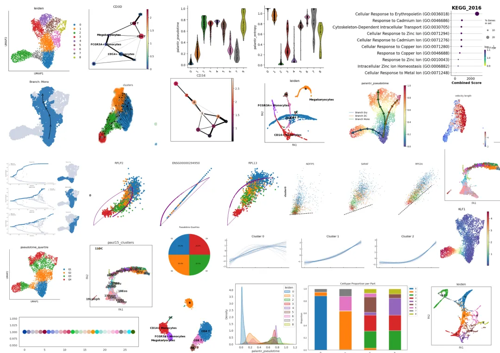
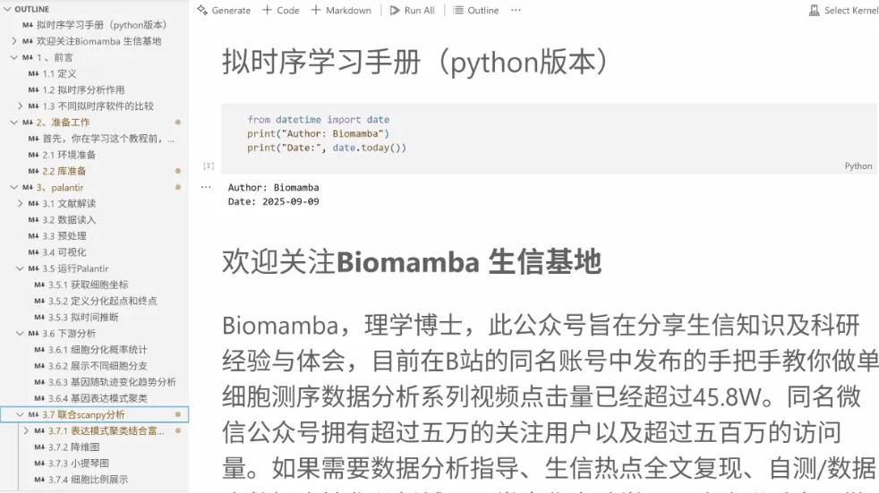**教程目录** ：零、欢迎关注一、前言1.1 定义1.2 拟时序分析作用1.3 不同拟时序软件的比较1.3.1 总体评价结果1.3.2 准确性1.3.3 可扩展性1.3.4 稳定性1.3.5 软件、文档和手稿方面的可用性二、准备工作2.1 环境准备 2.2 库准备三、palantir3.1 文献解读 3.1.1 摘要 3.1.2 结果 3.1.3 小结3.2 数据读入3.3 预处理3.4 可视化 3.5 运行Palantir 3.5.1 获取细胞坐标 3.5.2 定义分化起点和终点 3.5.3 拟时间推断3.6 下游分析 3.6.1 细胞分化概率统计 3.6.2 展示不同细胞分支 3.6.3 基因随轨迹变化趋势分析 3.6.4 基因表达模式聚类3.7 联合scanpy分析 3.7.1 表达模式聚类结合富集分析 (1) 差异基因鉴定 (2) 表达模式聚类 (3) 富集分析 3.7.2 降维图 3.7.3 小提琴图 3.7.4 细胞比例展示 3.7.5 密度分布图四、PAGA4.1 文献解读
4.1.1 摘要 4.1.2 结果 4.1.3 小结4.2 pbmc3k数据实操 4.2.1 数据读入 4.2.2 数据预处理 4.2.3 运行PAGA 4.2.4 可视化 4.2.5 重新定义发育起点4.3 人骨髓数据实操 4.3.1 数据读入 4.3.2 数据预处理 4.3.3 运行PAGA 4.3.4 可视化 4.3.5 重新定义发育起点4.4 联合scanpy分析 4.4.1 拟时间降维图 4.4.2 小提琴图 4.4.3 细胞比例展示 4.4.4 密度分布图4.5 小鼠髓系数据实操五、RNAvelocity5.1 文献解读 5.1.1 摘要 5.1.2 结果 5.1.3 小结5.2 数据下载 5.2.1 bam文件 5.2.2 repeatmask文件 5.2.3 gtf文件5.3 loom文件准备5.4 RNA速率分析 5.4.1 导入loom文件 5.4.2 导入细胞降维坐标和分群文件
5.4.3 轨迹推断 (1) 数据过滤和归一化 (2) 计算表达均值和方差 (3) 计算RNA速率 (4) 构建RNA速率图 (5) 在UMAP降维空间可视RNA速率方向 (6) 在UMAP降维空间以流场形式展示RNA速率方向5.5 下游数据挖掘 5.5.1 关注基因可视化 5.5.2 鉴定重要基因 5.5.3 细胞周期分析 5.5.4 RNA速率的置信度 5.5.5 潜在时间(latent time)分析 5.5.6 Cluster-specific top-likelihood 基因六、软件版本七、单细胞教程全收录八、欢迎致谢

单细胞-进阶分析-细胞通讯分析学习资料

同我们以前的课程一样，我们给大家准备了学习手册和学习资料，大家可联系客服微信[Biomamba_zhushou]领取：

教程图片集锦：

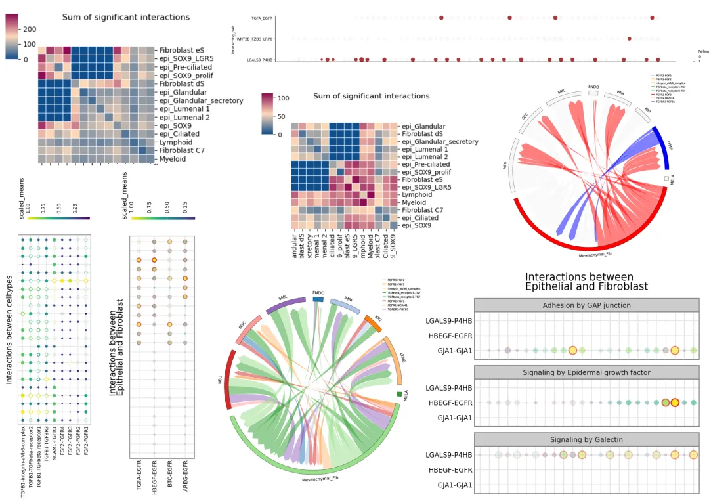
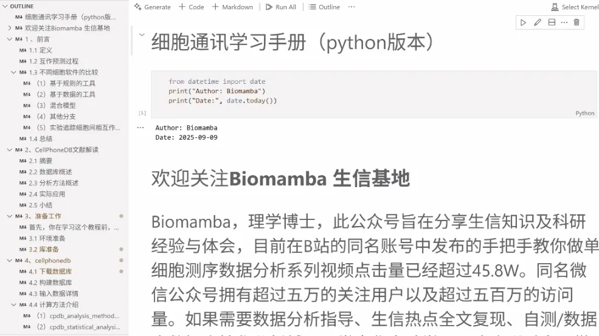

**教程目录** ：

**零、欢迎关注**

**一、前言**

**1.1 定义**

**1.2 互作预测过程**

**1.3 不同细胞软件的比较**

**1.3.1 基于规则的工具**

**1.3.2 基于数据的工具**

**1.3.3 混合模型**

**1.3.4 其他分支**

**1.3.5 实验追踪细胞间相互作用**

**二、CellPhoneDB文献解读**

**2.1 摘要**

**2.2 数据库概述**

**2.3 分析方法概述**

**2.4 实际应用**

**2.5 小结**

**三、准备工作**

**3.1 环境准备**

**3.2 库准备**

**四、cellphonedb**

**4.1 下载数据库**

**4.2 构建数据库**

**4.3 输入数据详情**

**4.4 计算方法介绍**

**4.4.1 cpdb_analysis_method.call**

**4.4.2 cpdb_statistical_analysis_method.call**

**4.4.3 cdpb_degs_analysis_method.call**

**4.5 示例代码**

**4.6 示例数据-方法1**

**4.6.1 输入文件**

**4.6.2 互作对预测**

**4.6.3 结果解读**

**4.6.4 思考？**

**4.7 示例数据-方法2**

**4.7.1 输入文件****4.7.2 互作对预测****4.7.3 结果解读****4.7.4 探索CellphoneDB结果****4.7.5 可视化**

**4.8 示例数据-方法3**

4.8.1 输入文件 4.8.2 互作对预测 4.8.3 结果解读 4.8.4 探索CellphoneDB结果 4.8.5 可视化

**4.9 人纤维化皮肤病单细胞数据实操**

**4.9.1 输入文件**

**4.9.2 准备文件**

**4.9.3 互作对预测**

**4.9.4 结果解读**

**4.9.5 探索CellphoneDB结果**

**4.9.6 可视化**

****五、软件版本********
********六、单细胞教程全收录********七、欢迎致谢********
****

单细胞-进阶分析-共表达网络分析学习资料

同我们以前的课程一样，我们给大家准备了学习手册和学习资料，大家可联系客服微信[Biomamba_zhushou]领取：

教程图片集锦：

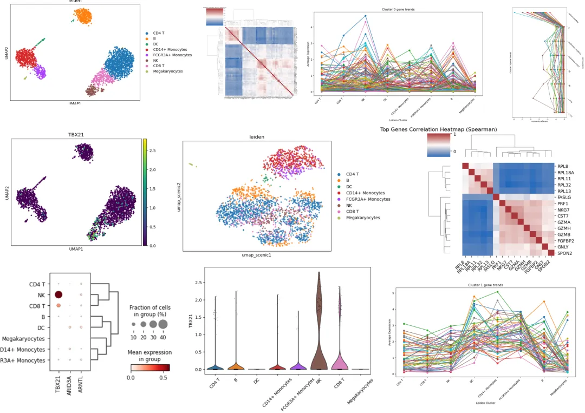
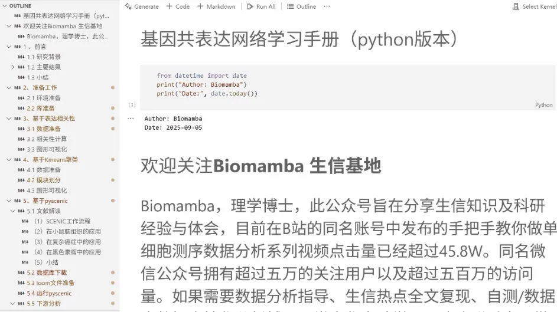

**教程目录** ：

**零、欢迎关注**

**一、前言**

**1.1 研究背景**

**1.2 主要结果**

**1.3 小结**

**二、准备工作**

2.1 环境准备2.2 库准备

**三、基于表达相关性**

3.1 数据准备3.2 相关性计算3.3 图形可视化

**四、基于Kmeans聚类**

4.1 数据准备4.2 模块划分4.3 图形可视化

**五、基于pyscenic******
****

****5.1 文献解读****

****5.1.1 SCENIC工作流程****

****5.1.2 在小鼠脑组织的应用****

****5.1.3 在复杂癌症中的应用****

****5.1.4 在黑色素瘤中的应用****

****5.1.5 小结****

****5.2 数据库下载****

****5.3 loom文件准备****

****5.4 运行pyscenic****

****5.5 下游分析****

****5.5.1 基因aucell降维****

****5.5.2 vlnplot****

****5.5.3 umap****

****5.5.4 dotplot****

****六、软件版本********七、单细胞教程全收录********八、欢迎致谢****

单细胞-进阶分析-拷贝数变异分析学习资料

同我们以前的课程一样，我们给大家准备了学习手册和学习资料，大家可联系客服微信[Biomamba_zhushou]领取：

教程图片集锦：

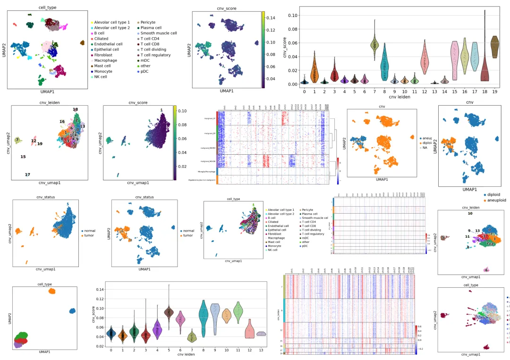
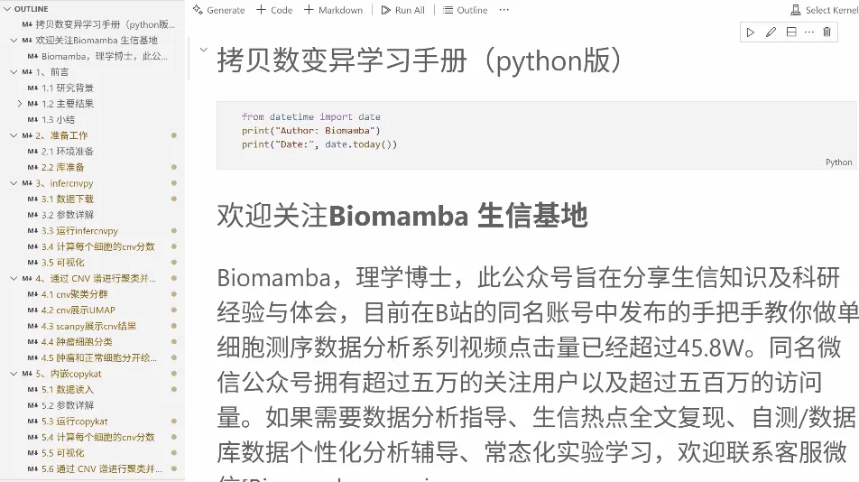

**教程目录** ：

**零、欢迎关注**

**一、前言**

1.1 研究背景1.2 主要结果1.3 小结

**二、准备工作**

2.1 环境准备2.2 库准备

**三、infercnvpy**

3.1 数据下载 3.2 参数详解3.3 运行infercnvpy3.4 计算每个细胞的cnv分数3.5 可视化

**四、通过CNV谱进行聚类并识别肿瘤细胞**

4.1 cnv聚类分群**
**

**4.2 cnv展示umap**

**4.3 scanpy展示cnv结果**

**4.4 肿瘤细胞分类**

**4.5 肿瘤和正常细胞分开绘制热图**

**五、内嵌copykat**

**5.1 数据读入**

**5.2 参数详解**

**5.3 运行copycat**

**5.4 计算每个细胞的cnv分数**

**5.5 可视化**

**5.6 通过cnv谱进行聚类并识别肿瘤细胞**

**5.7 肿瘤和正常细胞分开绘制热图**

**六、**对比R版本的infercnv****

**七、如何获取基因在染色体上的位置**

****八、软件****版本************九、单细胞教程全收录********十、欢迎致谢****

单细胞-文献复现学习资料

同我们以前的课程一样，我们给大家准备了学习手册和学习资料，大家可联系客服微信[Biomamba_zhushou]领取：

原文集锦：

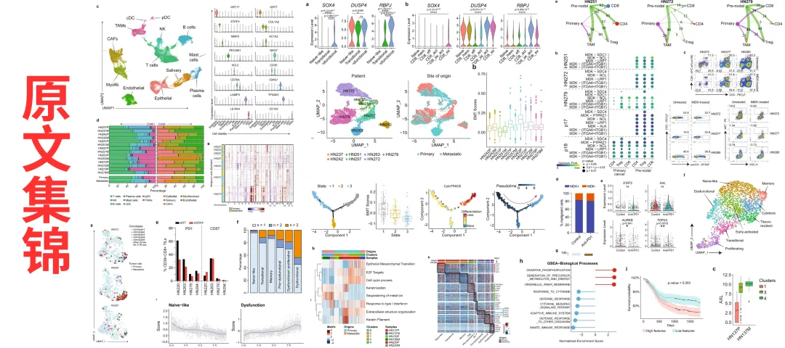

复现图片集锦：

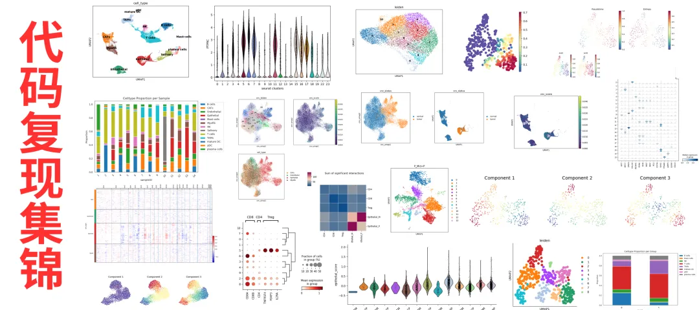
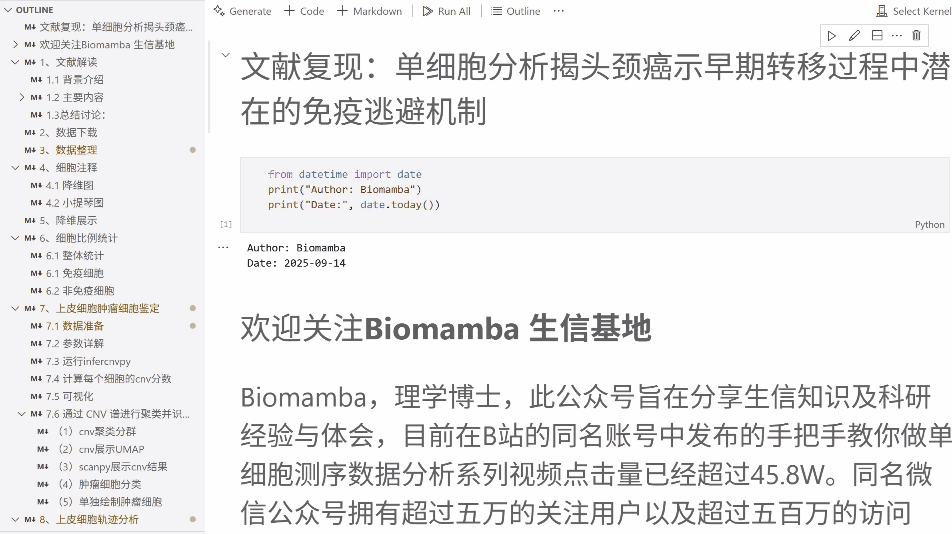

**教程目录** ：

**零、欢迎关注**

**一、文献解读**

**1.1 背景介绍**

**1.2 主要内容**

**1.3 总结讨论：**

**二、数据下载**

**三、数据整理**

**四、细胞注释**

**4.1 降维图**

**4.2 小提琴图**

**五、降维展示**

**六、细胞比例统计**

**6.1 整体统计**

**6.2 免疫细胞**

**6.3 非免疫细胞**

**七、上皮细胞肿瘤细胞鉴定**

**7.1 数据准备**

**7.2 参数详解**

**7.3 运行infercnvpy**

**7.4 计算每个细胞的cnv分数**

**7.5 可视化**

**7.6 通过CNV谱进行聚类并识别肿瘤细胞**

**7.6.1 cnv聚类分群**

**7.6.2 cnv展示UMAP**

**7.6.3 scanpy展示cnv结果**

**7.6.4 肿瘤细胞分类**

**7.6.5 单独绘制肿瘤细胞**

**八、上皮细胞轨迹分析**

**8.1 降维分群**

**8.2 预处理**

**8.3 可视化**

**8.4 运行Palantir**

**8.4.1 获取细胞坐标**

**8.4.2 定义分化起点和终点**

**8.4.3 拟时间推断**

**九、上皮细胞EMT评分**

**十、CD8T轨迹分析**

**10.1 T细胞注释**

**10.2 CD8 T细胞注释**

**10.3 预处理**

**10.4 可视化**

**10.5 运行Palantir**

**10.5.1 获取细胞坐标**

**10.5.2 定义分化起点和终点**

**10.5.3 拟时间推断**

**十一、上皮细胞互作分析**

**11.1 数据预处理**

**11.2 互作对预测**

**11.3 结果解读**

**11.4 探索cellphonedb结果**

**11.5 可视化**

**十二、软件版本**

**十三、单细胞教程全收录**

**十四、欢迎致谢**

单细胞-AI自动注释学习资料

同我们以前的课程一样，我们给大家准备了学习手册和学习资料，大家可联系客服微信[Biomamba_zhushou]领取：

教程图片集锦：

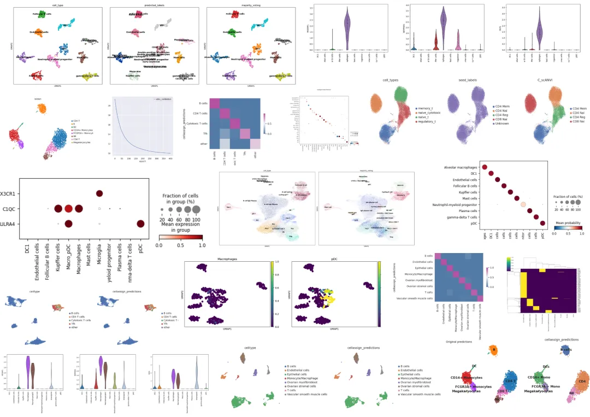
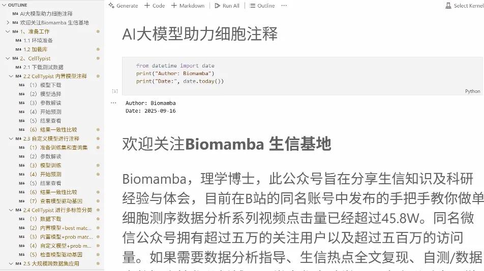

**教程目录** ：

**零、欢迎关注**

**一、准备工作**

**1.1 环境准备**

**1.2 加载库**

**二、CellTypist**

**2.1 下载测试数据**

**2.2 CellTypist内置模型注释**

2.2.1 模型下载 2.2.2 模型选择 2.2.3 参数解读 2.2.4 开始预测 2.2.5 结果查看 2.2.6 一致性比较

**2.3 自定义模型进行注释**

2.3.1 准备训练集和查询集 2.3.2 参数解读 2.3.3 模型训练 2.3.4 开始预测 2.3.5 结果查看 2.3.6 结果一致性比较 2.3.7 查看模型驱动基因

**2.4 CellTypist进行多标签分类**

**2.4.1 数据下载**

**2.4.2 内置模型+best match模式**

**2.4.3 内置模型+prob match模式**

**2.4.4 自定义模型+prob match模式**

**2.4.5 检查模型驱动基因**

**2.5 大规模跨数据集应用**

**2.5.1 数据下载**

**2.5.2 数据预处理**

**2.5.3 训练集的特征选择**

**2.5.4 开始预测**

**2.5.5 结果一致性比较**

**三、scVI**

3.1 基础设置3.2 功能介绍3.3 滤泡性淋巴瘤细胞 3.3.1 数据下载 3.3.2 模型预测 3.3.3 结果查看 3.3.4 一致性比较3.4 HGSC数据 3.4.1 数据下载 3.4.2 模型预测 3.4.3 结果查看 3.4.4 一致性比较3.5 scANVI种子标记 3.5.1 数据下载 3.5.2 根据marker注释部分细胞 3.5.3 模型预测 3.5.4 一致性比较3.6 外部数据验证 3.6.1 数据准备 3.6.2 准备二值化矩阵 3.6.3 模型预测 3.6.4 结果查看 3.6.5 一致性比较****四、****环境版本信息************五、单细胞教程全收录********六一、欢迎致谢****

空间转录组-概论及上游定量学习资料

同我们以前的课程一样，我们给大家准备了学习手册和学习资料，大家可联系客服微信[Biomamba_zhushou]领取：

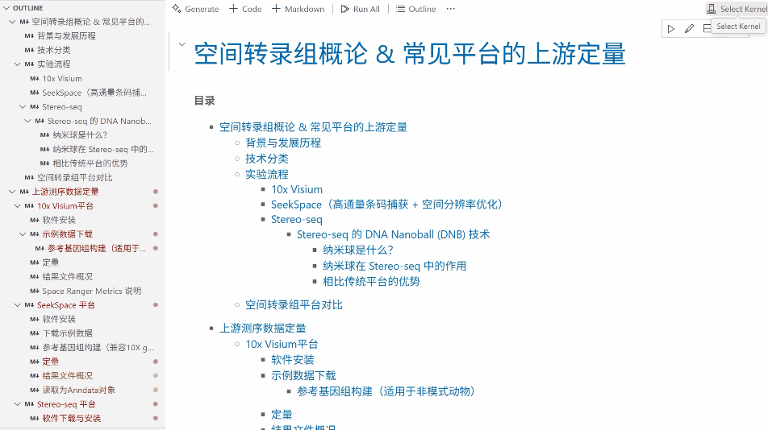

**教程目录** ：

**零、欢迎关注**

**一、空间转录组概论 &常见平台的上游定量**

**1.1 背景与发展历程**

**1.2 技术分类**

**1.3 实验流程**

**1.3.1 10x Visium**

**1.3.2 SeekSpace（高通量条码捕获+空间分辨率优化）**

**1.3.3 Stereo-seq**

（1）Stereo-seq的DNA Nanoball（DNB）技术

**1.4 空间转录组平台对比**

**二、上游测序数据定量**

**2.1**10x Visium平台****

****2.1.1 软件安装****

****2.1.2 示例数据下载****

****2.1.3 参考基因组构建（适用于非模式动物）****

****2.1.4 定量****

****2.1.5 结果文件概况****

****2.1.6 Space Ranger Metrics说明****

**2.2**SeekSpace平台****

2.2.1 软件安装 2.2.2 下载示例数据 2.2.3 参考基因组构建（兼容10X genomics格式） 2.2.4 定量 2.2.5 结果文件概况 2.2.6 读取为Anndata对象

**2.3 Stereo-seq平台**

2.3.1 软件安装与下载 2.3.2 构建参考基因组（非模式动物） 2.3.3 定量 （1）输入文件 （2）运行 2.3.4 结果文件概况 （1）不同大小Bin统计信息 （2）Cell Bin统计信息 2.3.5 读取为Anndata对象 ****三、软件版本********
********四、单细胞教程全收录********五、欢迎致谢****

空间转录组-基础分析学习资料

同我们以前的课程一样，我们给大家准备了学习手册和学习资料，大家可联系客服微信[Biomamba_zhushou]领取：

教程图片集锦：

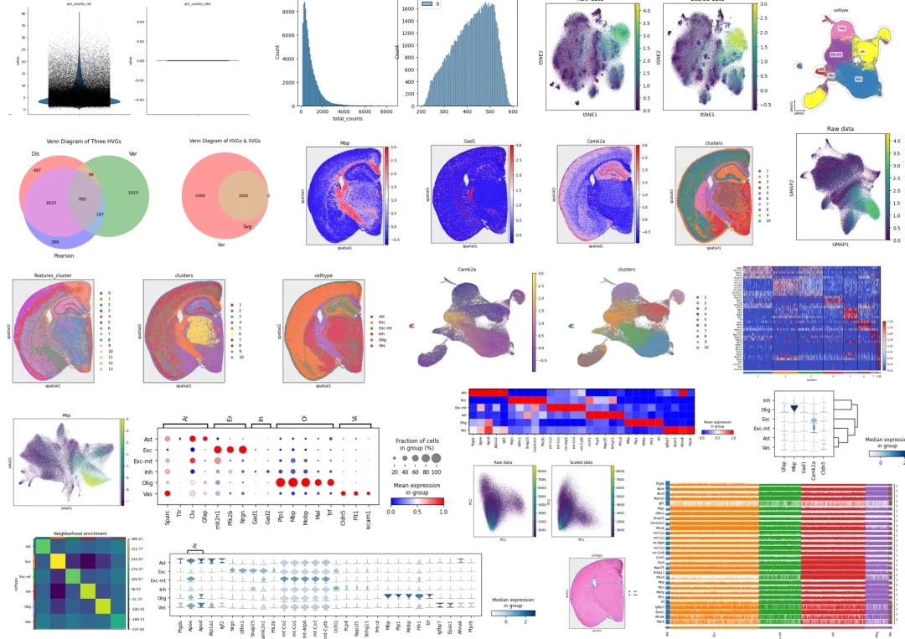

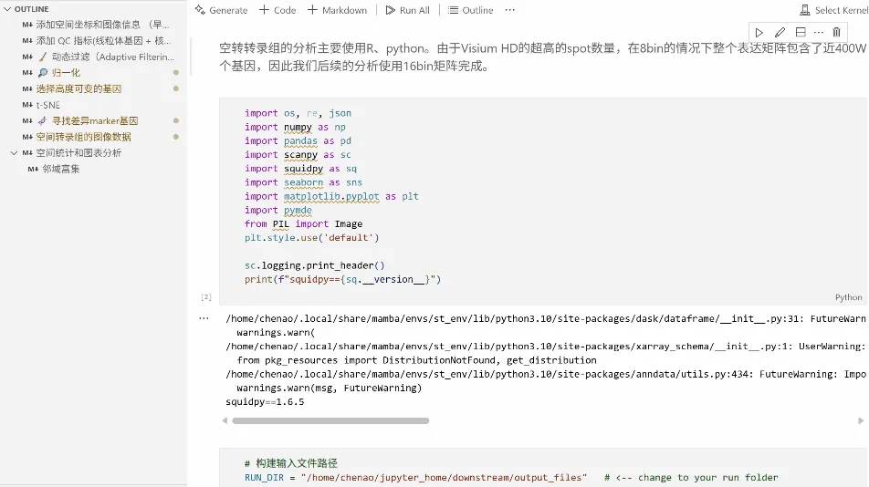

**教程目录** ：

零、欢迎关注

**一、添加空间坐标和图像信息（早期版本）**

**二、添加QC指标（线粒体基因+核糖体基因）**

**三、动态过滤（Adaptive Filtering）**

**四、归一化**

**五、选择高度可变的基因**

**六、t-SNE**

**七、寻找差异marker基因**

**八、空间转录组的图像数据**

**九、空间统计和图表统计**

****9.1 邻域富集********十、软件版本********
********十一、单细胞教程全收录********十二、欢迎致谢****

空间转录组-进阶分析-多样本分析学习资料

同我们以前的课程一样，我们给大家准备了学习手册和学习资料，大家可联系客服微信[Biomamba_zhushou]领取：

教程图片集锦：

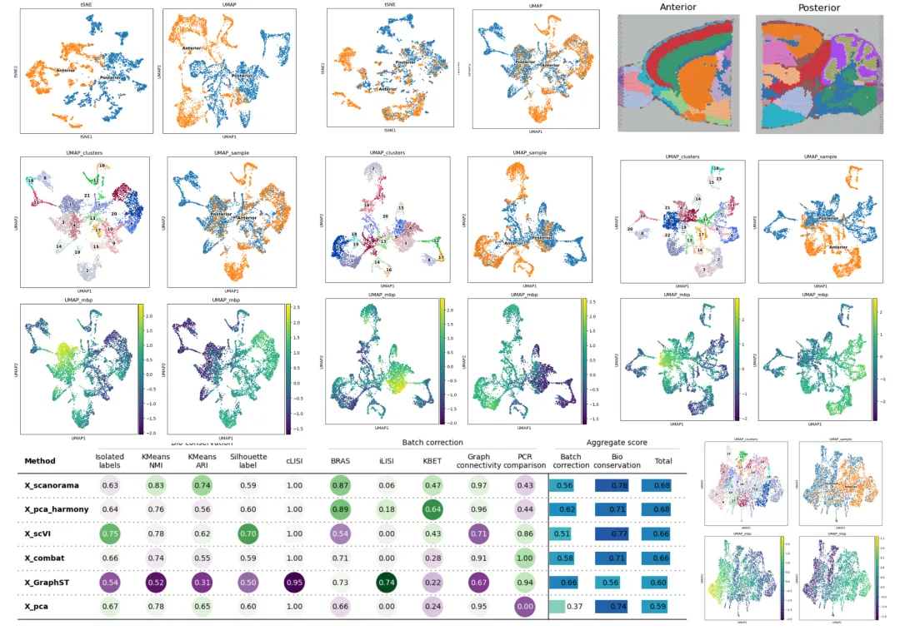
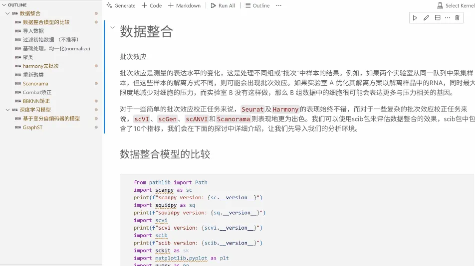

**教程目录** ：

**零、欢迎关注**

**一、数据整合**

**1.1 数据整合模型的比较**

**1.2 导入数据**

**1.3 过滤初始数据（不推荐）**

**1.4 基础处理，均一化（normalize）**

**1.5 聚类**

**1.6 harmony去批次**

**1.7 重新聚类**

**1.8 Scanorama**

**1.9 Combat矫正**

**1.10 BBKNN矫正**

**二、深度学习模型**

**2.1 基于变分自编码器的模型**

2.2 GraphST

****三、软件****版本************四、单细胞教程全收录********五、欢迎致谢****

空间转录组-进阶分析-共表达网络分析学习资料

同我们以前的课程一样，我们给大家准备了学习手册和学习资料，大家可联系客服微信[Biomamba_zhushou]领取：

教程图片集锦：

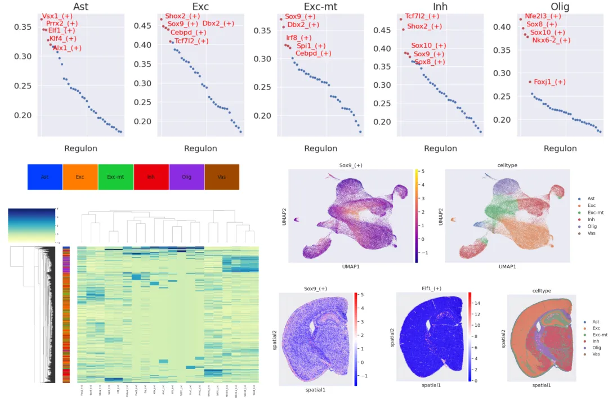
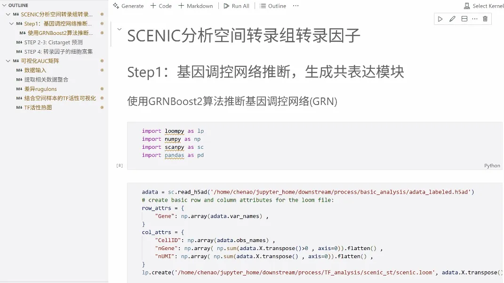

**教程目录** ：

**零、欢迎关注**

**一、SCENIC分析空间转录组转录因子**

**1.1 基因调控网络推断，生成共表达模块**

**1.1.1 使用GRNBoost2算法推断基因调控网络（GRN）**

**1.2 Cistarget预测**

**1.3 转录因子的细胞富集**

**二、可视化AUC矩阵**

**2.1 数据输入**

**2.2 提取相关数据整合**

**2.3 差异regulons**

**2.4 结合空间样本的TF活性可视化**

**2.5 TF活性热图**

****三、软件****版本************四、单细胞教程全收录********五、欢迎致谢****

空间转录组-进阶分析-去卷积分析学习资料

同我们以前的课程一样，我们给大家准备了学习手册和学习资料，大家可联系客服微信[Biomamba_zhushou]领取：

教程图片集锦：

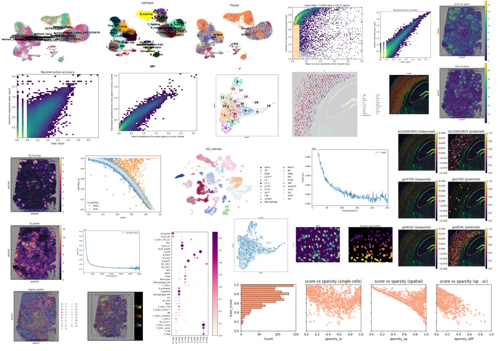
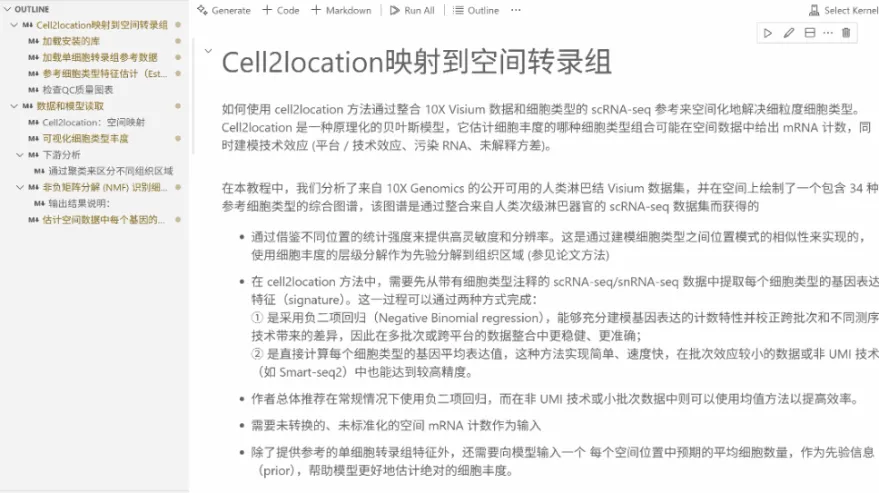

**教程目录** ：

**零、欢迎关注**

**一、Cell2location**

**1.1 Cell2location映射到空间转录组**

**1.1.1 加载安装的库**

**1.1.2 价值单细胞转录组参考数据**

**1.1.3 参考细胞类型特征估计（Estimation of reference cell type signatures）------NB回归）**

**1.1.4 检查QC质量图表**

**1.2 数据和模型读取**

**1.2.1**Cell2location：空间映射****

**1.2.2 可视化细胞类型丰度**

**1.2.3 下游分析**

**（1）通过聚类来区分不同组织区域**

**1.2.4 非负矩阵分解（NMF）识别细胞区室/组织区域**

**（1）输出结果说明**

**1.2.5 估计空间数据中每个基因的细胞类型特异性表达**

**二、Tangram**

**2.1 加载空间转录组和单细胞参考数据**

**2.2 预处理**

**2.3 数据对齐**

**2.4 细胞类型映射**

**2.5 通过对齐单细胞数据获得新的空间数据**

**2.6 通过比对单细胞数据进行反卷积**

****三、软件版本********
********四、单细胞教程全收录********五、欢迎致谢****

空间转录组-进阶分析-邻域分析学习资料

同我们以前的课程一样，我们给大家准备了学习手册和学习资料，大家可联系客服微信[Biomamba_yunying]领取：

教程图片集锦：

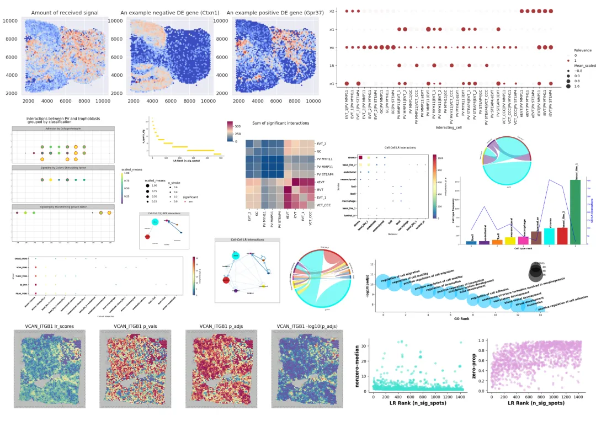
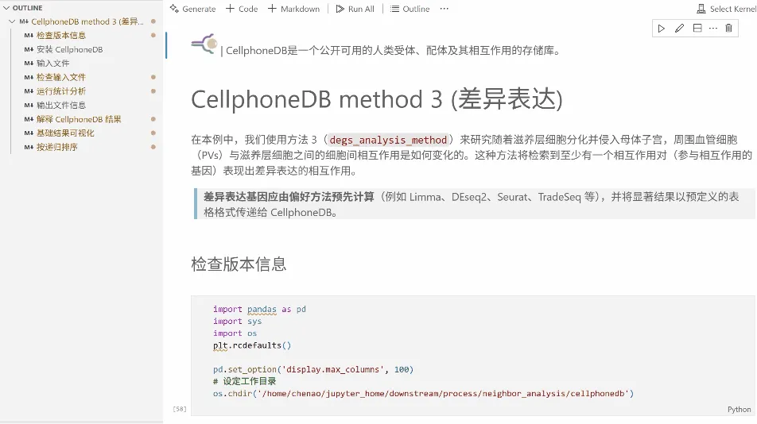

**教程目录** ：

**零、欢迎关注**

**一、CellphoneDB**

**1.1 检查版本信息**

**1.2 安装CellphoneDB**

**1.3 输入文件**

**1.4 检查输入文件**

**1.5 运行统计分析**

**1.6 输出文件信息**

**1.7 解释CellphoneDB结果**

**1.8 基础结果可视化**

**1.9 按递归排序**

**二、commot**

**2.1 安装**

**2.2 测试文件**

**2.2.1 导入所需库和包**

**2.2.2 预处理空间数据文件**

**2.2.3 空间通讯信号推断**

**三、stlearn**

**3.1 StLearn细胞间相互作用分析**

**3.1.1 环境配置**

**3.1.2 数据加载和预处理**

**3.1.3 运行受配体分析**

**3.1.4 P值矫正**

**3.1.5 按显著程度可视化LR的整体排名**

**3.1.6 判定绘图**

**3.1.7 下游可视化**

**（1）受配体对的统计可视化**

**（2）LR解释结果可视化**

**（3）预测重要的CCIs**

**（4）检查相互作用和细胞类型频率相关性**

**（5）CCI可视化**

**（6）空间细胞类型的相互作用**

**3.2 作者建议-可视化技巧**

****四、软件版本********
********五、单细胞教程全收录********六、欢迎致谢****

空间转录组-进阶分析-轨迹分析学习资料

同我们以前的课程一样，我们给大家准备了学习手册和学习资料，大家可联系客服微信[Biomamba_yunying]领取：

教程图片集锦：

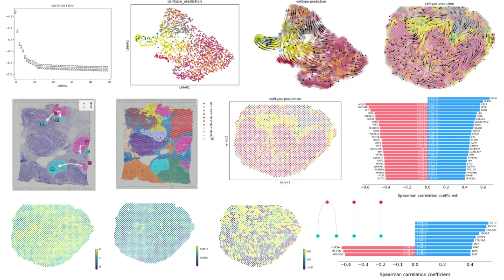
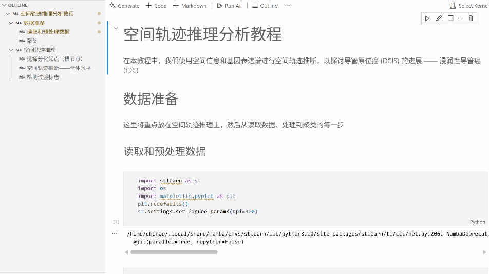

**教程目录** ：

**零、欢迎关注**

**一、stLearn_pse**

**1.1数据准备**

**1.1.1 读取和预处理数据**

**1.1.2 聚类**

**1.2 空间轨迹推理**

**1.2.1 选择分化起点（根节点）**

**1.2.2 空间轨迹推断--全体水平**

**1.2.3 检测过渡标志**

**二、SIRV**

**2.1 准备工作**

**2.2 SIRV实现流程**

**2.2.1 输入数据**

**2.2.2 域适配（Domain Adaptation / Alignment）**

**2.2.3 基于scRNA-seq训练模型 / 回归**

**2.2.4 将预测的velocity映射到空间**

**2.2.5 标签转移**

**2.3 运行示例**

**2.3.1 加载所需的库**

**2.3.2 读取示例数据**

**2.3.3 补全信息**

**2.3.4 常规降维**

**2.3.5 降维聚类**

**2.3.6 velocity推断流程**

**2.3.7 可视化流线图**

**2.3.8 局部流向箭头图**

**2.3.9 比较补全前后信息**

**2.3.10 评估velocity相似性**

****三、软件****版本************四、单细胞教程全收录********五、欢迎致谢****

空间转录组-进阶分析-拷贝数变异分析学习资料

同我们以前的课程一样，我们给大家准备了学习手册和学习资料，大家可联系客服微信[Biomamba_yunying]领取：

教程图片集锦：

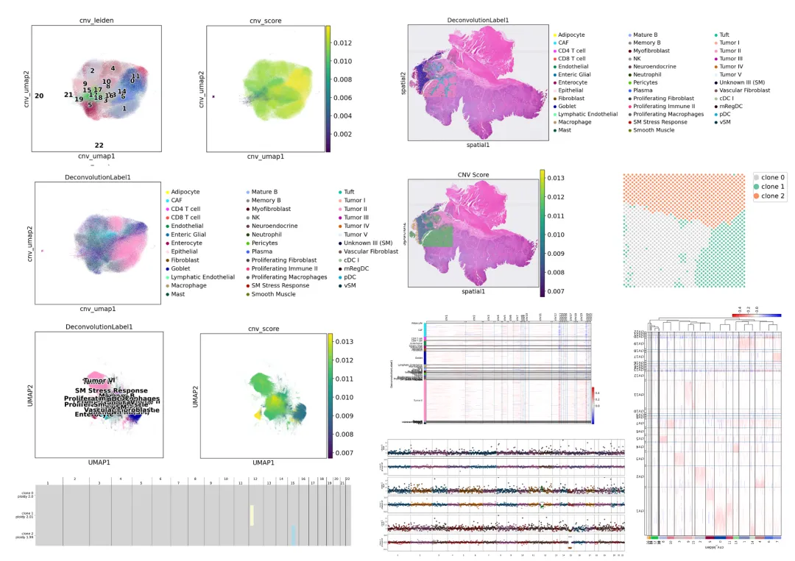
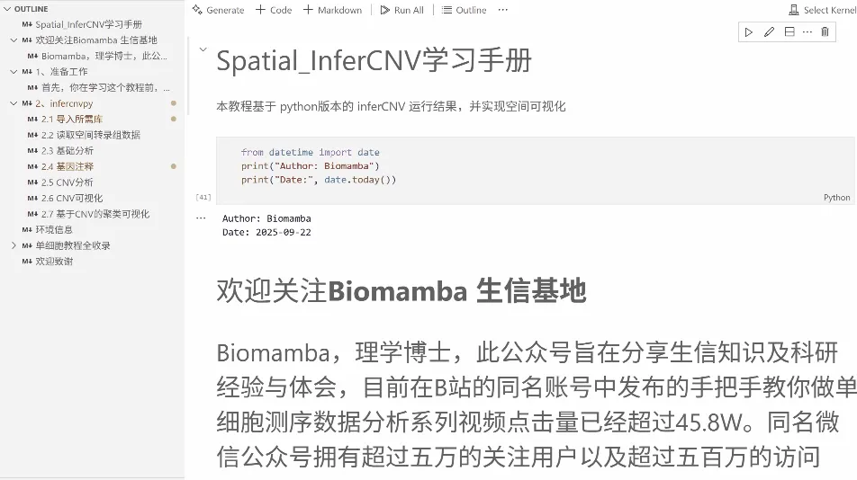

**教程目录** ：

**零、欢迎关注**

**一、使用模拟数据运行CalicoST**

**1.1 下载数据**

**1.2 运行CalicoST**

**二、复制configuration文件来用于推断CNA和癌症克隆**

**2.1 加载结果到python中进行可视化**

****三、软件****版本************四、单细胞教程全收录********五、欢迎致谢****

报名费用

两个月的课程，单个只要4999￥，两班联报，优惠多多！详情咨询客服微信[Biomamba_yunying]

有其它任何想法的同学也欢迎随时联系我们，更欢迎看看我们的价值观：[想钱想疯了？](<https://mp.weixin.qq.com/s?__biz=MzAwMzIzOTk5OQ==&mid=2247529315&idx=1&sn=df2cf4c0fa3411889c558229f4068a8c&scene=21#wechat_redirect>)

二、这可能是全网最全的scRNA-seq分析教程！

**[scRNA-seq数据分析小白全程班](<https://mp.weixin.qq.com/s?__biz=MzAwMzIzOTk5OQ==&mid=2247529379&idx=1&sn=10283cee636a7bc706f145edc791fe7c&scene=21#wechat_redirect>)** 课程现已制作完毕！整整100h内容，涵盖161个精心录制的课程高清视频(共计95GB资源)，专为小白学习者量身打造。各教学模块如下：

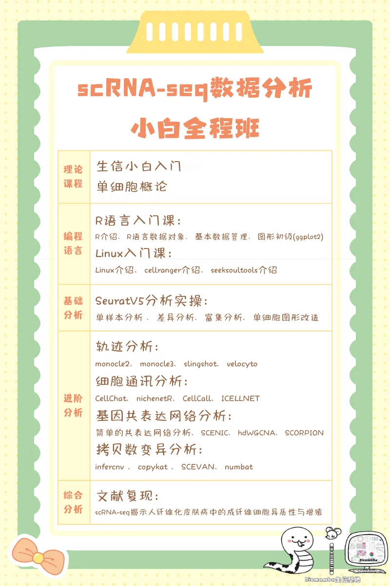
本次课程在教学上循序渐进，零基础也能跟上学习节奏。同时包含大量实操教学，切实提升你的实战能力。另外，我们还建有课程群，有任何疑问随时都可以在群里提出，会有老师来帮你解答疑惑。我们拥有五年以上的单细胞教学经验，制作的单细胞教程总播放量超五百万，不怕你学不会！报名即可享受三年内该课程的指导、答疑、回放、直播复听，同时获赠[256GB单细胞专属服务器](<https://mp.weixin.qq.com/s?__biz=MzAwMzIzOTk5OQ==&mid=2247529640&idx=2&sn=b52cd3ca727044a967a6fa2a9e395079&scene=21#wechat_redirect>)：256GB内存、500GB硬盘、20线程服务器3个月使用权。配套还有scRNA-seq骨灰级分析手册、代码、测试文件（~300GB、1150个文件），详情可见下文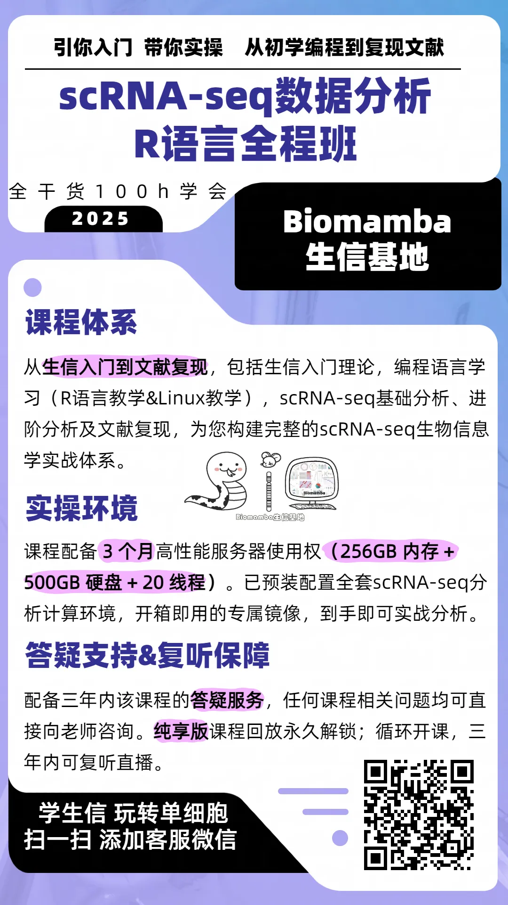
感兴趣的朋友可以联系客服微信[Biomamba_yunying]咨询报名详情。

**1、本次课程学习资料**

**
**

课程时长目录： 时长(时.分.秒)| 专题名称
---|---
05.00.13| 01 生物小白入门/单细胞概论
09.05.19| 02 R语言入门课
10.02.41| 03 Linux入门课
16.07.52| 04 scRNA-seq基础分析
13.58.59| 05 scRNA-seq轨迹分析
13.42.02| 06 scRNA-seq 细胞通讯分析
13.14.04| 07 scRNA-seq基因共表达网络分析
10.28.01| 08 scRNA-seq拷贝数变异分析
08.23.42| 09 文献复现
视频回放链接: https://pan.baidu.com/s/1hDqPHqG1d1Mx4kwu75y5rQ

提取码可联系客服微信[Biomamba_yunying]获取~

**2、所见即所得**

通过这次全程学习，你将获得并掌握以下学习手册与资料：

R语言入门课学习资料

同我们以前的课程一样，我们给大家准备了学习手册和学习资料，大家可联系客服微信[Biomamba_yunying]领取：

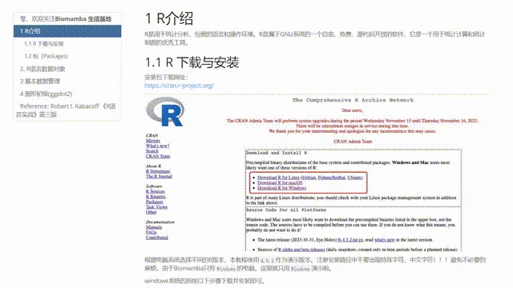

Linux入门课学习手册

同我们以前的课程一样，我们给大家准备了学习手册和学习资料，大家可联系客服微信[Biomamba_yunying]领取：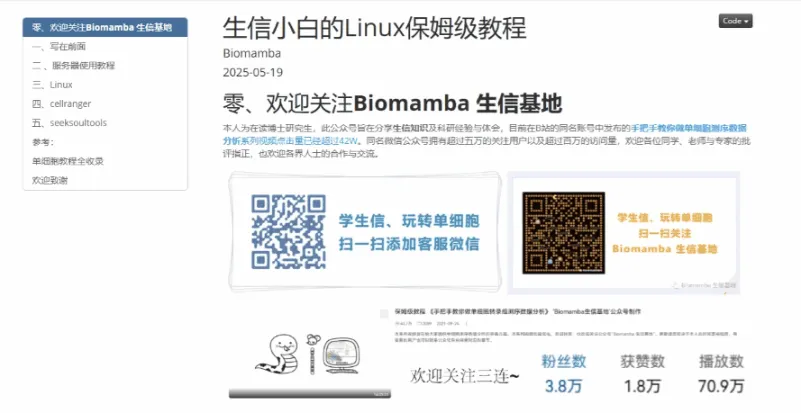

单细胞细胞基础分析学习资料

同我们以前的课程一样，我们给大家准备了学习手册和学习资料，大家可联系客服微信[Biomamba_yunying]领取：

教程图片集锦：

测试文件，总大小5.1GB

├── GSE139107

│ ├── GSE139107_MouseIRI_12hours.dge.txt.gz

│ ├── GSE139107_MouseIRI_14days.dge.txt.gz

│ ├── GSE139107_MouseIRI_2days.dge.txt.gz

│ ├── GSE139107_MouseIRI_4hours.dge.txt.gz

│ ├── GSE139107_MouseIRI_6weeks.dge.txt.gz

│ └── GSE139107_MouseIRI_control.dge.txt.gz

├── GSE139107_MouseIRI.metadata.txt.gz

├── MonacoImmuneData.rds

├── bcell.marker.CSV

├── cg.rds

├── color.Rdata

├── data.txt

├── filtered_gene_bc_matrices

│ └── hg19

│ ├── barcodes.tsv

│ ├── genes.tsv

│ └── matrix.mtx

├── iri.intergrate.harmony.rds

├── iri.intergrate.harmony.rename.rds

├── iri.intergrate.havebatch.rds

├── iri.intergrate.havebatch.v5CCA.rds

├── iri.intergrate.rds

├── iri.obj4.rds

├── iri.obj5.rds

├── my.pbmc.tar.gz

├── mycount.txt

├── panc8.rds

├── pbmcrenamed.rds

└── single_cell_datamatrix.txt

3 directories, 27 files

单细胞进阶分析——轨迹分析学习资料

同我们以前的课程一样，我们给大家准备了学习手册和学习资料，大家可联系客服微信[Biomamba_yunying]领取：

教程图片集锦：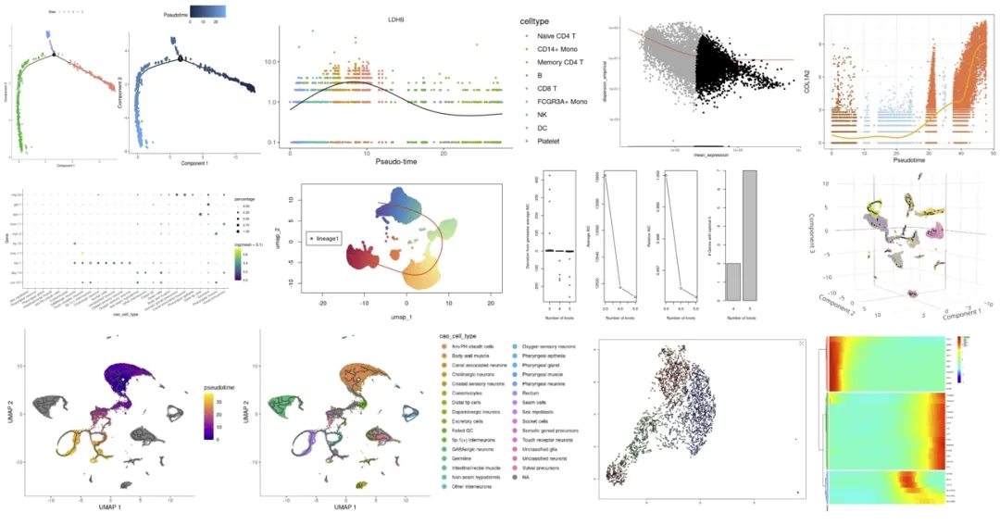

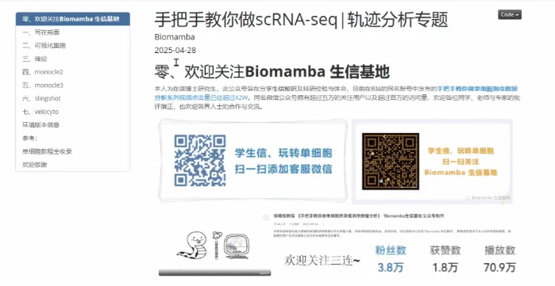**教程目录** ：一、写在前面二、可视化集锦三、绪论1.定义2.拟时序分析作用3.不同拟时序软件的比较（1）总体评价结果（2）准确性（3）可扩展性（4）稳定性（5）软件、文档和手稿方面的可用性四、monocle21.简介2.安装monocle23.monocle2对象的格式4.初探monocle2（1）预处理、质控（2）细胞降维、分群、鉴定5.monocle2实战（1）半监督式拟时序（2）非监督式的
6.下游探索（1）DimPlot和FeaturePlot（2）VlnPlot（3）ggplot2绘图（4）细胞比例探索（5）基因表达量的探索五、monocle31.简介2.monocle3和monocle2的主要区别（1）monocle3的主要功能（2）先谈缺点（3）再看看优点3.安装monocle3（1）R语言中的安装（2）通过conda安装4.初探monocle3（1）monocle3对象的构建（2）预处理、质控（3）细胞降维、分群、鉴定（4）取子集以及亚群分析5.monocle3实战（1）预处理数据（2）拟时序分析6.下游探索（1）DimPlot和FeaturePlot（2）VlnPlot（3）ggplot2绘图（4）细胞比例探索（5）基因表达量的探索六、slingshot1.简介2.官方教学解读（1）介绍（2）上游分析（3）下游分析（4）功能详细解说3.外部数据实操（1）单细胞数据下载：GSE163973（2）测试数据预处理（3）细胞聚类（4）关键细胞（5）拟时序分析（6）探究分化过程中的基因表达4.下游探索（1）DimPlot和FeaturePlot（2）VlnPlot（3）ggplot2绘图（4）细胞比例探索（5）基因表达量的探索七、velocyto

## 1.RNAvelocity原文解读

## （1）摘要

## （2）结果

## （3）小结

## 2.数据下载

## （1）bam文件

## （2）repeatmask文件

## （3）gtf文件

## 3.软件安装

## 4.生成loom文件

## 5.RNA速率分析实战

## （1）安装R包

## （2）加载R包

## （3）处理测试数据

## （4）统计spliced和unspliced区域

## （5）RNA速率推断

八、环境版本信息九、参考十、单细胞教程全收录十一、欢迎致谢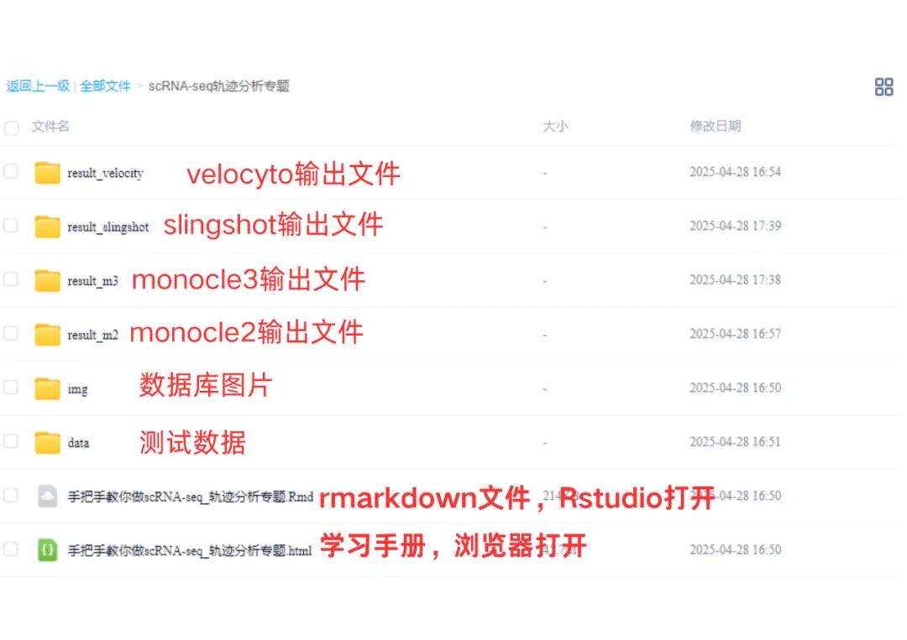

测试文件，总大小2.77GB

单细胞进阶分析——细胞通讯分析学习资料

同我们以前的课程一样，我们给大家准备了学习手册和学习资料，大家可联系客服微信[Biomamba_yunying]领取：

教程图片集锦：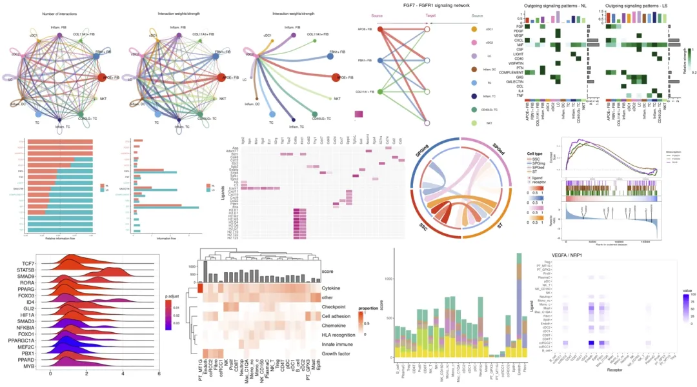

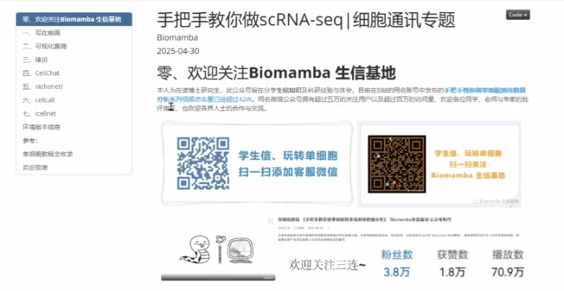

**教程目录** ：

**一、写在前面**

**二、可视化集锦**

**三、绪论**

**3.1 定义**

**3.2 不同细胞通讯软件的比较**

**（1）互作预测过程**

**（2）主要研究成果**

**3.3 实验追踪细胞间相互作用**

**3.4 总结**

**四、cellchat**

4.1 简介

4.2 安装并加载R包

4.3 下载、读取、创建cellchat对象

4.4 载入数据库并开始计算

4.5 可视化

4.6 进阶可视化

4.7 配受体展示

4.8 通路展示

4.9 多个细胞通讯通路气泡图可视化

4.10 多组别细胞通讯

（1）准备工作

（2）可视化

****五、nichenetr****

5.1 准备工作

（1）安装并加载R包

（2）表达矩阵获取

（3）下载先验模型

5.2 细胞通讯分析（1）定义sender与receiver（2）定义一组感兴趣的基因集（3）获取配受体基因表达矩阵（4）配体活性分析（5）推断受体以及配体潜在调控靶基因与配体的调控活性（6）sender中配体的组间差异log fold change值（7）可视化拼盘5.3 差异细胞通讯分析（1）准备工作（2）定义niches（3）计算niches的差异基因（4）定义感兴趣的基因组（5）计算配体活性并推断配受体对（6）计算配体、受体、target的表达量（7）通过受体表达量评估配受体对互作强度（8）计算配受体对权重（9）差异可视化

**六****、cellcall******

****6.1 软件安装和加载****

****6.2 数据准备********6.3 创建cellchat对象********6.4 推断细胞-细胞通讯得分********6.5 通路活动分析********6.6 可视化********（1）圈图**** （2）热图****（3）桑葚图********（4）TF富集分析图********（5）山脊图********6.7 结果保存****

****七****、icellnet********

******7.1 软件安装和加载******

****7.2 数据准备********7.3 数据预处理********7.4 在感兴趣的集群上应用icellnet管道********7.5 计算细胞通讯分数********7.6 结果可视化********（1）热图********（2）柱形图********7.7 在TME内识别ccRCC2特定的通信信道********（1）计算****ccRCC2的特定相互作用************（2）可视化********7.8 结果保持********八、环境版本信息********
********九、参考********十、单细胞教程全收录********十一、欢迎致谢****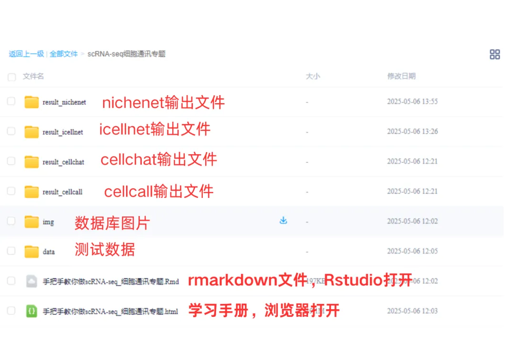

测试文件，总大小5.23GB

单细胞进阶分析——拷贝数变异分析学习资料

同我们以前的课程一样，我们给大家准备了学习手册和学习资料，大家可联系客服微信[Biomamba_yunying]领取：

教程图片集锦：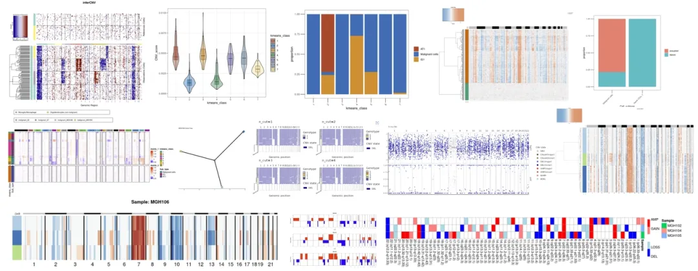

**教程目录** ：

**一、写在前面**

**二、可视化集锦**

**三、绪论**

**3.1 定义**

**3.2 主要研究成果**

**（1）区分肿瘤细胞与正常细胞**

**（2） 推断的拷贝数变异（CNA）谱的准确性**

**（3） 亚克隆结构推断准确性的评估**

（4）计算效率

**3.3 小结**

**四、infercnv**

4.1 简介

4.2 安装

4.3 输入文件

4.4 infercnv workflow

4.5 infercnv实战

（1）数据概况

（2）infercnv流程

（3）热图优化

（4）小提琴图

****五、copykat****

5.1 copykat介绍

（1）简介

（2）copykat工作流程描述

（3）性能评估

（4）实体肿瘤中肿瘤细胞和正常细胞的分类

（5）应用于其他scRNA-seq技术

（6）推断乳腺肿瘤的克隆亚结构

（7）小结

5.2 copykat流程（1）安装（2）counts矩阵预处理（3）常用参数（4）copykat（5）整理数据（6）绘制热图5.3 copykat实战（1）数据概况（2）copykat（3）整理数据（4）热图绘制（5）探究一下拷贝数变异与原来亚群之间的关系（6）CNA score小提琴图

**六****、SCEVAN******

****6.1 安装R包****

****6.2 加载R包********6.3 单样本分析********（1）加载数据********（2）执行分析********（3）结果查看********6.4 多样本分析********（1）加载数据 （2）执行分析（3）结果查看********6.5 联合Seurat对象********（1）创建****Seurat对象**** （2）将拷贝数变异结果加入****Seurat对象**** （3）降维分群（4）可视化****

****七****、numbat********

********7.1****安装R包************

****7.2****加载R包************7.3 数据下载********7.4 等位基因数据准备********（1）运行参数解释 （2）示例脚本（3）可能出现的报错（4）执行分析********7.5 运行numbat********（1）运行参数解释********（2）运行****numbat************7.6 结果解读********（1）拷贝数景观和单细胞系统发育 （2）在系统发育上完善亚克隆（3）共识拷贝数区段（4）pseudobulks水平拷贝数变异（5）进化树********八、环境版本信息********
********九、参考********十、单细胞教程全收录********十一、欢迎致谢****
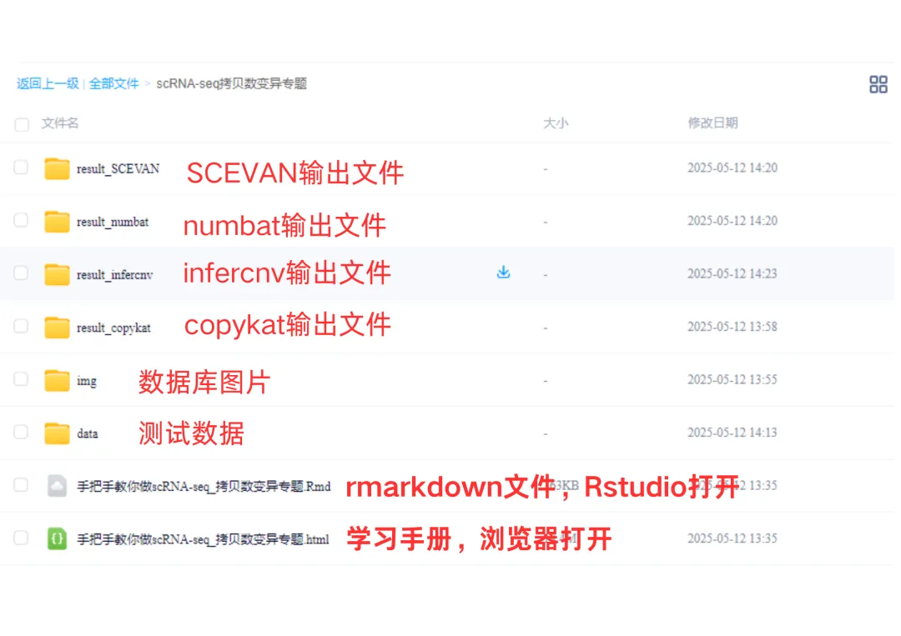

测试文件，总大小55.57B

单细胞进阶分析——基因表达网络分析学习资料

同我们以前的课程一样，我们给大家准备了学习手册和学习资料，大家可联系客服微信[Biomamba_zhushou]领取：

教程图片集锦：

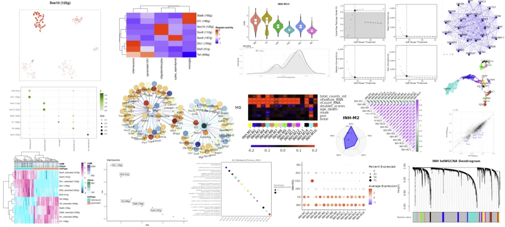

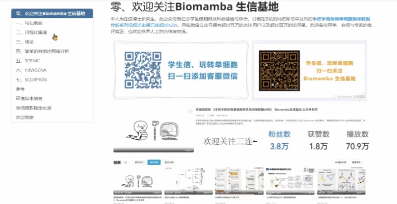

**教程目录** ：

**一、写在前面**

**二、可视化集锦**

**三、绪论**

**3.1 研究背景**

**3.2 主要结果**

**（1）合成网络数据集**

**（2）精选模型数据**

**（3）实验性的单细胞RNA-Seq数据集**

**3.3 小结**

**四、简单的共表达网络分析**

4.1 加载R包

4.2 计算相关性

****五、SCENIC****

5.1 软件安装

5.2 加载R包5.3 官方手册5.4 测试数据（1）直接读取loom文件（2）创建loom文件5.5 RcisTarget数据库（1）文件获取（2）RcisTarget数据库文件初始化5.6 分析流程（1）初步设置（2）共表达网络(Co-expression network)计算（3）构建基因调控网络(Gene regulatory network, GRN)（4）runSCENIC_3_scoreCells()分解步骤（5）二元矩阵及可视化（6）对regulon活性进行聚类分群、降维分析5.7 下游探索工作（1）交互式的探索（2）在tSNE中绘制TF的表达水平（3）探究regulon, 靶基因, motif的关系（4）用热图探究细胞与regulon的关系（5）调控网络的绘制

**六****、hdWGCNA******

****6.1 数据准备****

****（1）加载R包****

****6.2 数据读入********6.3 为 WGCNA 设置 Seurat 对象********6.4 创建metacells********6.5 构建共表达网络**** （1）设置表达矩阵****（2）设置软阈值********6.6 可视化********（1）模块特征图********（2）雷达图********（3）相关性热图********（4）DotPlot********（5）VlnPlot********（6）网络图********（7）UMAP图********（8）module与表型数据相关性分析********（9）Enrichment analysis 基因集（module）富集分析**** （10）模块之间的差异分析

****七****、SCORPION********

****7.1 安装R包****

****7.2 加载R包********7.3 示例数据展示********7.4 小鼠肠上皮单细胞数据********（1）******安装R包**************（2）数据准备********（3）scorpion分析********7.5 人类胚胎干细胞********（1）定义QC质控函数********（2）导入单细胞数据********（3）单细胞数据处理********（4）单细胞分群展示********（5）8C-like细胞鉴定********（6）8C-like和其他亚群差异基因鉴定********（7）导入TF和PPT网络********（8）scorpion分析********7.6 结果可视化和解读********（1）导入Hnf4α和Hnf4γ分析结果**** （2）Hnf4a密度图****（3）Hnf4a差异值分布********（4）Hnf4g密度图********（5）Hnf4g差异值分布**** （6）Hnf4a线性回归与靶基因富集分析****（7）Hnf4g线性回归与靶基因富集分析********（8）加载DUX4分析结果********（9）转录因子调控分布散点图********（10）DUX4密度图********（11）DUX4差异值分布********（12）DUX4线性回归与靶基因富集分析********八、参考********九、****环境版本信息************十、单细胞教程全收录********十一、欢迎致谢****

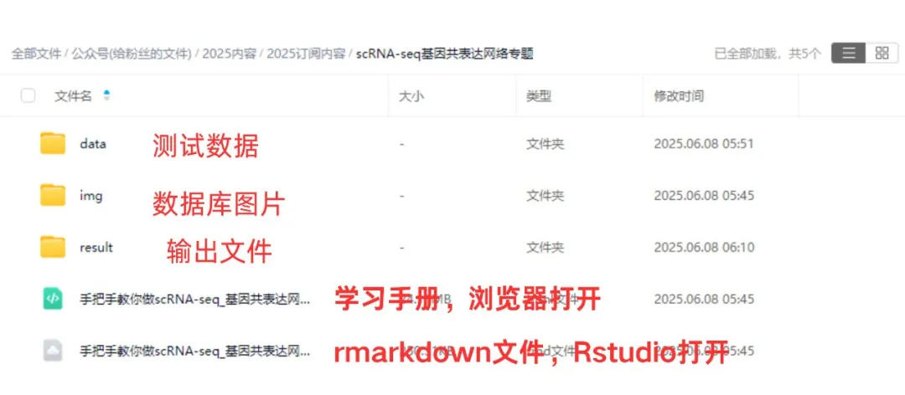

测试文件，总大小12.11GB

文献复现

复现图片集锦

学习手册以html文件格式提供，可在浏览器中打开并翻阅学习

**教程目录** ：

**一、文献解读**

1.0复现集锦

(1)原文集锦(2)代码复现集锦

1.1背景介绍

1.2主要内容

(1)scRNA-seq揭示正常瘢痕和纤维性皮肤病真皮组织的细胞异质(2)瘢痕疙瘩和正常瘢痕中成纤维细胞形成不同的细胞亚群(3)纤维化皮肤病中间充质成纤维细胞特征的鉴定(4)成纤维细胞亚群中的配体-受体相互作用分析(5) 间充质成纤维细胞通过POSTN促进瘢痕中胶原蛋白表达(6) sC4 成纤维细胞比 sC1 成纤维细胞更像间充质细胞(7) 间充质成纤维细胞在硬皮病中增加

1.3总结讨论

**二、准备工作**

2.1 硬件准备

2.2 单细胞基础

**三、数据下载、处理和** 可视化

  1. 数据下载
  2. 数据整合
  3. Seurat标准流程(harmony去批次)
  4. 细胞注释
  5. 细胞周期计算
  6. 数据可视化（1）分样本细胞比例柱形图（2）分样本细胞比例桑基图（3）UMAP降维图（4）Marker小提琴图（5）Marker FeaturePlot（6）Marker DotPlot（7）Marker热图
  7. 成纤维细胞亚群（1）亚群细分（2）分样本细胞比例柱形图（3） 亚群分样本降维图（4） 基因差异表达提琴图（5） 细分注释（6）注释后Marker展示（7）Mesenchymal_Fib组间差异分析（8）Mesenchymal_Fib差异基因富集分析

  8. 间充质成纤维细胞在纤维化皮肤疾病中的特性（1）分样本基因表达FeaturePlot（2）分组基因表达箱线图（3）亚群间差异基因热图（4）Mesenchymal_Fib相对其他FIB亚群上调差异基因富集（5）marker基因堆叠小提琴图

  9. 细胞通讯分析（1）亚群标签映射回细胞大类（2）Normal组细胞通讯（3）Keloid组细胞通讯（4）细胞通讯热图
  10. 拟时序分析
  11. Mesenchymal_Fib两个亚群间差异和富集

文末下载链接中包含的内容：

测试文件约**12.17GB** ，大家注意按需下载！

三、生信小白入门课

[生信基地](<http://mp.weixin.qq.com/s?__biz=MzAwMzIzOTk5OQ==&mid=2247522649&idx=1&sn=a3a3df860fd162691403281356dcbf1d&chksm=9b3ce009ac4b691fc8679c43988a0a36e176760d3e21b2489b43184f0248b6409cbe8dcbb96a&scene=21#wechat_redirect>)已经落地，我们也在积极探索为生信领域做贡献的新方法，希望能够给大家提供系统性、形成性、规范性的生信教学。这已经是我们的**第四次线下** 活动啦。**往期活动** 可见合辑：[生信基地](<https://mp.weixin.qq.com/mp/appmsgalbum?__biz=MzAwMzIzOTk5OQ==&action=getalbum&album_id=3721493119318310916#wechat_redirect>)

此前的几次活动中我们也在不断的总结反馈与经验，期间发现各位来参加活动的老师与同学中很多对生物信息学、高通量测序这些内容的**知识背景** 并没有基本的了解，这对后面的生信实战学习造成了很大的**障碍** 。因此Biomamba以此前给硕士生上课的框架(**零翘课****&****double人数旁听**)为基础进行修订。给大家完成一次"**生信小白入门课** "，为大家进行生物信息学基本概念与常见组学的普及(**非实操** ，不要幻想一天可以掌握那么多分析技能，仅提供**概论教程** 与**学习思路 &方法**分享)。

**时间** ：2025年1月4日(周六) 09:00~17:00(**已完成**)**地点** ：南京市江宁区，详细地址报名咨询~**线上线下** 均可参加**目标** ：生信小白可以通过此次活动了解"**什么是** 生物信息学？"、"**为什么** 要学习生物信息学？"、"**怎样** 学习生物信息学？"**主题内容** ：

1、生物信息学&高通量测序

2、(sc)RNA-Seq的前世今生

3、可视化实例

4、蛋白质各级结构及理化性质预测

5、空间转录组学概论

6、生信文章实例讲解

**讲义下载** 二维码，大家可以扫码自学：

四、R语言入门课

1、课程简介

[生信基地](<http://mp.weixin.qq.com/s?__biz=MzAwMzIzOTk5OQ==&mid=2247522649&idx=1&sn=a3a3df860fd162691403281356dcbf1d&chksm=9b3ce009ac4b691fc8679c43988a0a36e176760d3e21b2489b43184f0248b6409cbe8dcbb96a&scene=21#wechat_redirect>)希望能够给大家提供**系统性** 、**形成性** 、**规范性** 的生信教学。前面几次活动中同学们表示希望能够有线下集中学习以及**针对性的指导、答疑** 。所以，此次我们已推出"生信**R语言入门课** "，分为"R介绍"、"R语言数据对象"、"基本数据管理"、"图形初级(ggplot2)"四个模块共12节课。当然，我们也**不做生信快餐** ，本次活动回放已剪辑完毕，方便错过活动的小伙伴加入。后续我们会**持续拉群** 在群里进行**课程内容** 的答疑。

2、R语言介绍R语言是一种专门为统计分析、数据可视化和计算而设计的编程语言，广泛应用于各个领域。R语言支持各种统计分析方法，如线性回归、方差分析、聚类分析等，同时也能够进行复杂的图形和数据可视化。R语言凭借其开源、免费、工具包丰富、数据处理能力强、可视化丰富的特性在**生物信息学中被广泛应用** 。例如RNA-Seq差异分析常用的DESeq2、edgeR的引用次数多达数万次。我们制作的[单细胞](<https://mp.weixin.qq.com/s?__biz=MzAwMzIzOTk5OQ==&mid=2247522475&idx=1&sn=84dd9a65348528be9aa2b8d2711d776c&scene=21#wechat_redirect>)教程几乎也全是基于R语言环境。很多同学找我们学习单细胞的时候都表示不想学习R语言，直接学习单细胞分析，[不积跬步无以至千里](<https://mp.weixin.qq.com/s?__biz=MzAwMzIzOTk5OQ==&mid=2247488966&idx=2&sn=f77d7ad73e7cb9c76ea2fb7fbf7a5cd1&scene=21#wechat_redirect>)，这显然是不现实的，所以，欢迎大家来参加此次的课程。

**报名/缴费二维码：**

资料&课表

本次课程的学习资料可以联系文末客服微信领取：

目前12节总计5.5h的视频课程回放已剪辑完毕，方便错过直播的同学随时加入学习：

除了学习视频外，还给大家准备了学习资料，包括学习手册、课后习题。大家人手一份资料可以跟着视频联系：

课程目录：

**1 、R介绍**

1.1 R 下载与安装

1.1.1 RStudio1.1.2 R的帮助函数1.1.3 用于管理R工作区的函数

1.2 包（Packages)

1.2.1 包的基本函数1.2.2 包处理大型数据集的示例展示

**2、 R语言数据对象**

2.1 理解数据集

2.2 数据结构

2.2.1 向量(vector)2.2.2 矩阵(matrix)2.2.3 数组(array)2.2.4 数据框(data)2.2.5 因子(factor)2.2.6 列表(list)

2.3 数据输入

2.3.1 从带分隔符的文本文件导入数据2.3.2 导入Excel数据

**3、基本数据管理**

3.1 创建新变量

3.2 变量的重编码(recoding)

3.3 变量的重命名

3.4.缺失值（NA）

3.5 类型判断和转换

3.6 数据排序

3.7 数据集的合并

3.8 选取变量

3.9 选取观测值

3.10 subset()函数选择观测值或变量

3.11 剔除变量

3.12 dplyr包

3.13 使用管道操作符对语句进行串接

**4、图形初级(ggplot2)**

4.1 使用ggplot2包创建图形

4.1.1 函数ggplot2()4.1.2 geom()函数4.1.3 分组4.1.4 标尺4.1.5 刻面4.1.6 标签4.1.7主题

4.2 ggplot2包的详细信息

4.2.1 放置数据和映射选项4.2.2 将图形作为对象使用4.2.3 保存图形

订阅后获取下载链接

请联系[Biomamba_zhushou]获取文件提取码

本教程资料、回放下载链接：

https://pan.baidu.com/s/1L3HgkhRlj9VkHNyo7pa0YA?

**-Biomamba**

**如何联系我们**

 留一个领取[资料](<https://mp.weixin.qq.com/s?__biz=MzAwMzIzOTk5OQ==&mid=2247528482&idx=1&sn=7cc0715eace4f592a62bdaf157b25c01&scene=21#wechat_redirect>)、[开箱即用的单细胞分析镜像](<https://mp.weixin.qq.com/s?__biz=MzAwMzIzOTk5OQ==&mid=2247528410&idx=2&sn=0f2bac25479cf8d20dab5d82ae986f2e&scene=21#wechat_redirect>)的**微信号[Biomamba_zhushou]**，方便各位随时交流。同时我们也构建了[交流群矩阵](<https://mp.weixin.qq.com/s?__biz=MzAwMzIzOTk5OQ==&mid=2247528057&idx=1&sn=bb348c2a88c977c7cce67ee6731a3591&scene=21#wechat_redirect>)，欢迎大家入群讨论。
大家可以阅读完这几篇之后添加[给生信入门初学者的小贴士](<http://mp.weixin.qq.com/s?__biz=MzAwMzIzOTk5OQ==&mid=2247493329&idx=1&sn=597870b7f7ce10346da3561e7c281627&chksm=9b3c9f81ac4b169794088ce9abbcacb5f18e9fd174fc0d7e28da62d78facadf3100ef38aaf22&scene=21#wechat_redirect>)
[没有检索，就没有发言权](<https://mp.weixin.qq.com/s?__biz=MzAwMzIzOTk5OQ==&mid=2247529398&idx=2&sn=5a429852d61721916a405712677d5905&scene=21#wechat_redirect>)

**已有生信基地联系方式的同学****无需重复添加**

****

您点的每个赞和在看，我都认真当成了喜欢
