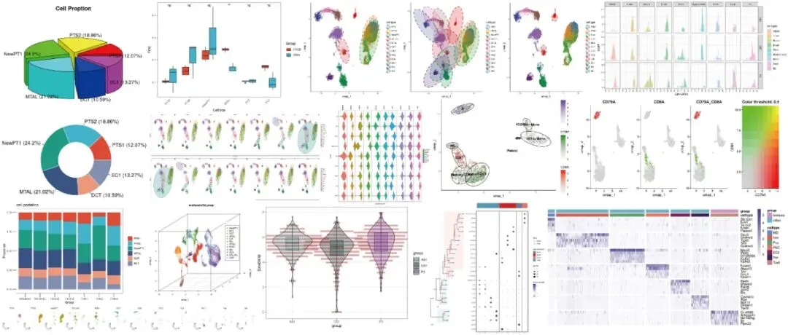
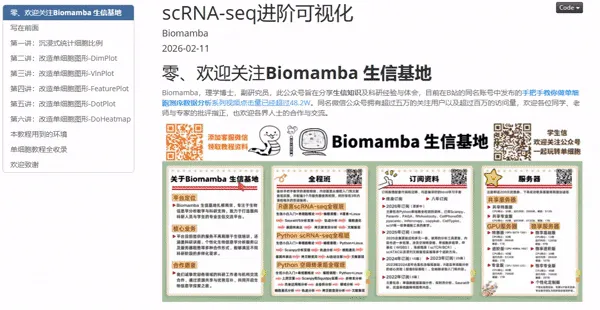
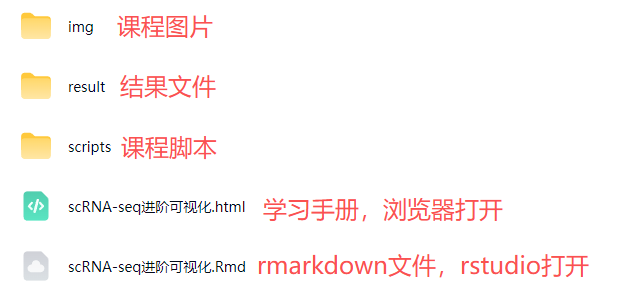

# 周三、周五直播，如何优雅地进行scRNA-seq可视化

> 原文：https://mp.weixin.qq.com/s?__biz=MzAwMzIzOTk5OQ==&mid=2247537525&idx=2&sn=03d391961d46193cc974431befb3916e&chksm=9b3c2a25ac4ba3336f97d6a757ea32eb905e1d03ea6d6ad9413fd6f99e4aa1cd213b18a497b5#rd
> 合集：生信基地

这周三、周五09:00继续进行[scRNA-seq数据基础分析专题](<https://mp.weixin.qq.com/s?__biz=MzAwMzIzOTk5OQ==&mid=2247535877&idx=1&sn=e988a2172618fd6f609575294db9a44f&scene=21#wechat_redirect>)中的进阶可视化教学，详细介绍与课程大纲可见：[视频介绍，学单细胞你应该按照这个节奏](<https://mp.weixin.qq.com/s?__biz=MzAwMzIzOTk5OQ==&mid=2247536612&idx=1&sn=19032a541a2b5a9f07d64981cc22069f&scene=21#wechat_redirect>)，还没有报名的同学，可联系客服微信[Biomamba_zhushou]报名参加课程哦~

单细胞进阶可视化教学内容

同我们以前的课程一样，我们给大家准备了学习手册和学习资料，大家可联系客服微信[Biomamba_zhushou]领取：

教程图片集锦：

# **
**

# **单细胞进阶可视化学习手册**

单细胞进阶可视化教程目录：

一、写在前面

二、沉浸式统计细胞比例

2.1 准备工作

2.2 饼图

2.3 甜甜圈图

2.4 堆积柱状图

2.5 箱线图

三、改造单细胞图形-DimPlot

3.1 准备工作

3.2 调整DimPlot参数

3.3 ggplot2直接中的DIY

3.4 3D降维图与动图

3.5 一些造好的轮子

四、改造单细胞图形-VlnPlot

4.1 准备工作

4.2 调整VlnPlot参数

4.3 ggplot2直接中的DIY

4.4 ggplot2改造

五、改造单细胞图形-FeaturePlot

5.1 准备工作

5.2 调整FeaturePlot参数

5.3 ggplot2直接中的DIY

六、改造单细胞图形-DotPlot

6.1 准备工作

6.2 DotPlot参数

6.3 DotPlot及其自带参数美化

6.4 DotPlot联合ggplot2美化

6.5 ggplot2复现DotPlot

七、改造单细胞图形-DoHeatmap

7.1 加载数据

7.2 DoHeatmap参数

7.3 DoHeatmap及其自带参数美化

7.4 ggplot2复现DoHeatmap

7.5 pheatmap复现DoHeatmap

7.6 complexheatmap复现DoHeatmap

7.7 拓展：基因表达均值热图

八、本教程用到的环境

九、单细胞教程全收录

十、欢迎致谢

测试文件，总大小67.68MB还想要了解更多单细胞/空转课程：[共计251小时视频教程，保姆级单细胞&空转教学](<https://mp.weixin.qq.com/s?__biz=MzAwMzIzOTk5OQ==&mid=2247536399&idx=2&sn=6c73155a0393ed9c246fee69cb06341f&scene=21#wechat_redirect>)，都欢迎找我们聊聊~

**如何联系我们**

 留一个领取[资料](<https://mp.weixin.qq.com/s?__biz=MzAwMzIzOTk5OQ==&mid=2247535983&idx=1&sn=99378a252908b06f56432eb08741d278&scene=21#wechat_redirect>)、[开箱即用的单细胞分析镜像](<https://mp.weixin.qq.com/s?__biz=MzAwMzIzOTk5OQ==&mid=2247536307&idx=1&sn=8d03259be06f54521aac5251dec988d5&scene=21#wechat_redirect>)的**微信号[Biomamba_zhushou]**，方便各位随时交流。同时我们也构建了[交流群矩阵](<https://mp.weixin.qq.com/s?__biz=MzAwMzIzOTk5OQ==&mid=2247536307&idx=2&sn=2d030173f51d24a4fee43bd0d83da03b&scene=21#wechat_redirect>)，欢迎大家入群讨论。
大家可以阅读完这几篇之后添加[给生信入门初学者的小贴士](<http://mp.weixin.qq.com/s?__biz=MzAwMzIzOTk5OQ==&mid=2247493329&idx=1&sn=597870b7f7ce10346da3561e7c281627&chksm=9b3c9f81ac4b169794088ce9abbcacb5f18e9fd174fc0d7e28da62d78facadf3100ef38aaf22&scene=21#wechat_redirect>)
[没有检索，就没有发言权](<https://mp.weixin.qq.com/s?__biz=MzAwMzIzOTk5OQ==&mid=2247529398&idx=2&sn=5a429852d61721916a405712677d5905&scene=21#wechat_redirect>)

**已有生信基地联系方式的同学****无需重复添加**

**
**

您点的每个赞和在看，我都认真当成了喜欢
