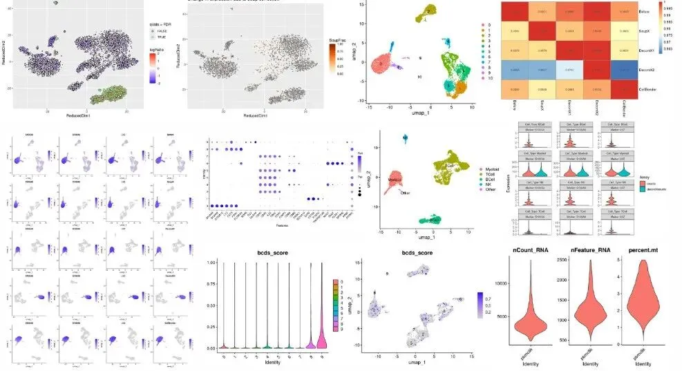
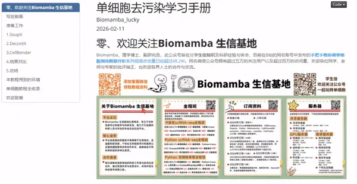
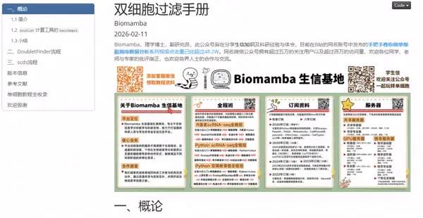
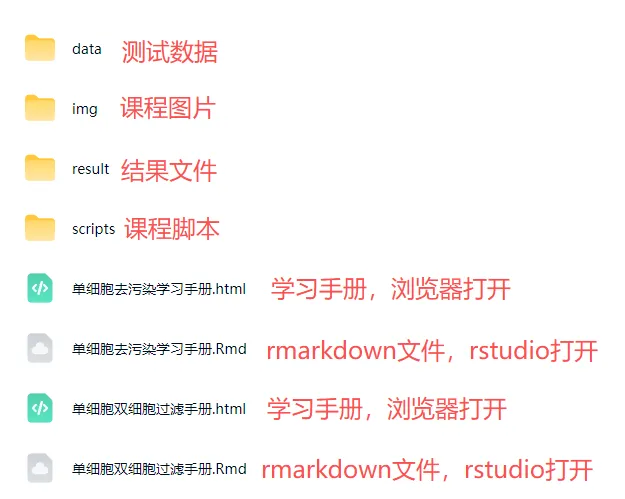

# 下周直播教学，《scRNA-seq进阶质控》：双细胞、RNA污染去除

> 原文：https://mp.weixin.qq.com/s?__biz=MzAwMzIzOTk5OQ==&mid=2247537531&idx=2&sn=e9caca7ae68a2aea785ca4655f105f68&chksm=9b3c2a2bac4ba33d2e1bff1209fe8e6e86291903a8caa6203f351c94208a59dc5c5ee00f9685#rd
> 合集：生信基地

下周三、周五09:00进行[scRNA-seq数据进阶质控专题](<https://mp.weixin.qq.com/s?__biz=MzAwMzIzOTk5OQ==&mid=2247535877&idx=2&sn=0323d692cf61092ed994fb434e4cfb1d&scene=21#wechat_redirect>)教学，详细介绍与课程大纲可见：[视频介绍，学单细胞你应该按照这个节奏](<https://mp.weixin.qq.com/s?__biz=MzAwMzIzOTk5OQ==&mid=2247536612&idx=1&sn=19032a541a2b5a9f07d64981cc22069f&scene=21#wechat_redirect>)，还没有报名的同学，可联系客服微信[Biomamba_zhushou]报名参加课程哦~

单细胞进阶质控教学内容

同我们以前的课程一样，我们给大家准备了学习手册和学习资料，大家可联系客服微信[Biomamba_zhushou]领取：

教程图片集锦：

#

# **
**

# ****单细胞去污染学习手册****

# ********

单细胞去污染教程目录：

一、写在前面

二、准备工作

2.1 编程基础

2.2 硬件基础

三、SoupX

3.1 文献解读

3.2 包的安装和导入

3.3 数据下载

3.4 数据读取

3.5 向SoupChannel对象中添加额外的元数据

3.6 估计污染比例

3.7 矫正表达矩阵

3.8 PBMC8K实战

四、DecontX

4.1 文献解读

4.2 包的安装和导入

4.3 数据读取

4.4 方案一：只输入一个过滤后的细胞矩阵

4.5 方案二：提供raw/droplet矩阵

五、CellBender

5.1 文献解读

5.2 安装

5.3 数据测试

5.4 CellBender 运行输出文件说明

5.5 降维分群

六、结果比对

6.1 细胞数目对比

6.2 交集细胞对比

6.3 细胞类型偏好性对比

6.4 去污染后基因表达对比

七、总结

八、本教程用到的环境

九、单细胞教程全收录

十、欢迎致谢

# ****
****

**双细胞过滤手册**

****

双细胞过滤教程目录：

一、概论

1.1简介

1.2doublet计算工具的benchmark

1.3小结

二、DoubletFinder流程

2.1简介

2.2实操

2.2.1环境准备

2.2.2输入数据

2.2.3pN-pK计算

2.2.4同源doublets预测

2.2.5比例评估

2.2.6取出singlet

三、scds流程

3.1 包的安装和加载

3.1.1安装

3.1.2可能遇到的报错

3.1.3加载包

3.2 实操

3.2.1数据读取

3.2.2doublets score计算

3.2.3整理并查看doublets score分布情况

3.2.4删除doublets

3.2.5scds的其它内置算法

四、版本信息

五、参考文献

六、单细胞教程全收录

七、欢迎致谢

****

测试文件，总大小 5.75GB

还想要了解更多单细胞/空转课程：[共计251小时视频教程，保姆级单细胞&空转教学](<https://mp.weixin.qq.com/s?__biz=MzAwMzIzOTk5OQ==&mid=2247536399&idx=2&sn=6c73155a0393ed9c246fee69cb06341f&scene=21#wechat_redirect>)，都欢迎找我们聊聊~

**如何联系我们**

 留一个领取[资料](<https://mp.weixin.qq.com/s?__biz=MzAwMzIzOTk5OQ==&mid=2247535983&idx=1&sn=99378a252908b06f56432eb08741d278&scene=21#wechat_redirect>)、[免费两周学习版](<https://mp.weixin.qq.com/s?__biz=MzAwMzIzOTk5OQ==&mid=2247532717&idx=2&sn=eb98e578098b9f432ea6ecbdc3c0d74b&scene=21#wechat_redirect>)服务器的**微信号[Biomamba_zhushou]**，方便各位随时交流。同时我们也构建了[交流群矩阵](<https://mp.weixin.qq.com/s?__biz=MzAwMzIzOTk5OQ==&mid=2247536307&idx=2&sn=2d030173f51d24a4fee43bd0d83da03b&scene=21#wechat_redirect>)，欢迎大家入群讨论。
大家可以阅读完这几篇之后添加[给生信入门初学者的小贴士](<http://mp.weixin.qq.com/s?__biz=MzAwMzIzOTk5OQ==&mid=2247493329&idx=1&sn=597870b7f7ce10346da3561e7c281627&chksm=9b3c9f81ac4b169794088ce9abbcacb5f18e9fd174fc0d7e28da62d78facadf3100ef38aaf22&scene=21#wechat_redirect>)
[如何搜索公众号过往发布内容](<http://mp.weixin.qq.com/s?__biz=MzAwMzIzOTk5OQ==&mid=2247506266&idx=2&sn=22b1164bc9602c25620d058847785422&chksm=9b3ca00aac4b291c16d738271746ffb90149282a728f484e8a1952463c46a8e7dc4f883ab928&scene=21#wechat_redirect>)

**已有生信基地联系方式的同学****无需重复添加**

 您点的每个赞和在看，我都认真当成了喜欢
