# Biomamba 生信基地核心内容全汇总

> 原文：https://mp.weixin.qq.com/s?__biz=MzAwMzIzOTk5OQ==&mid=2247537786&idx=1&sn=8288f16b95c1f4598079cef9eb03678d&chksm=9b3c2d2aac4ba43c4633ef27c37475a3f58ddb37f3012ca52bde6d20a2c984d939826fd170c1#rd
> 合集：生信基地

**写在前面******

有同学在我们的B站下面做出了下图评论。


能帮到大家，真的特别开心！Biomamba 生信基地的初衷就是帮大家降低生信学习门槛——为大家整理系统且详实的干货内容，省去东搜西找的麻烦，最大程度帮大家节省宝贵的时间成本。**我们用心打磨的每一份内容，都值得被更多人看见。** 另外想说，你觉得咱们课程是 “傻瓜式” 好上手，其实恰恰是因为你本身有着良好的学习和阅读能力；当然也有部分同学会觉得内容有难度，不过没关系，咱们一起沉淀、一起精进，并肩加油！

本推文罗列出Biomamba 生信基地的主要内容。内容有：

[全程班培训课程](<https://mp.weixin.qq.com/s?__biz=MzAwMzIzOTk5OQ==&mid=2247531447&idx=1&sn=242b49b5e2f5496efbd4484bf2e81604&scene=21#wechat_redirect>)、[单细胞教程全收录](<https://mp.weixin.qq.com/mp/appmsgalbum?__biz=MzAwMzIzOTk5OQ==&action=getalbum&album_id=2168829347397156865#wechat_redirect>)、[空间转录组](<https://mp.weixin.qq.com/mp/appmsgalbum?__biz=MzAwMzIzOTk5OQ==&action=getalbum&album_id=2879312479804489730#wechat_redirect>)、[Bulk RNA-seq](<https://mp.weixin.qq.com/mp/appmsgalbum?__biz=MzAwMzIzOTk5OQ==&action=getalbum&album_id=2959853503529910274#wechat_redirect>)、[订阅内容](<https://mp.weixin.qq.com/s?__biz=MzAwMzIzOTk5OQ==&mid=2247532585&idx=1&sn=e265d2846ec66e5faaaf21403d274d2f&scene=21#wechat_redirect>)、[编程语言教程](<https://mp.weixin.qq.com/mp/appmsgalbum?__biz=MzAwMzIzOTk5OQ==&action=getalbum&album_id=3889788454284181504#wechat_redirect>)、[服务器](<https://mp.weixin.qq.com/mp/appmsgalbum?__biz=MzAwMzIzOTk5OQ==&action=getalbum&album_id=2725521219349151745#wechat_redirect>)、[在线工具](<https://mp.weixin.qq.com/mp/appmsgalbum?__biz=MzAwMzIzOTk5OQ==&action=getalbum&album_id=3168648680917467142#wechat_redirect>)、**[单细胞云平台](<https://mp.weixin.qq.com/mp/appmsgalbum?__biz=MzAwMzIzOTk5OQ==&action=getalbum&album_id=3403706694394970115#wechat_redirect>) 、**[生信基地](<https://mp.weixin.qq.com/mp/appmsgalbum?__biz=MzAwMzIzOTk5OQ==&action=getalbum&album_id=3721493119318310916#wechat_redirect>)、[实验基地](<https://mp.weixin.qq.com/mp/appmsgalbum?__biz=MzAwMzIzOTk5OQ==&action=getalbum&album_id=3674593374767628288#wechat_redirect>)、[答读者问](<https://mp.weixin.qq.com/mp/appmsgalbum?__biz=MzAwMzIzOTk5OQ==&action=getalbum&album_id=2453318094304673794#wechat_redirect>)、[粉丝来稿](<https://mp.weixin.qq.com/mp/appmsgalbum?__biz=MzAwMzIzOTk5OQ==&action=getalbum&album_id=2649634741759279105#wechat_redirect>)、[基金申报](<https://mp.weixin.qq.com/mp/appmsgalbum?__biz=MzAwMzIzOTk5OQ==&action=getalbum&album_id=3567317259540447238#wechat_redirect>)、[文献速递](<https://mp.weixin.qq.com/mp/appmsgalbum?__biz=MzAwMzIzOTk5OQ==&action=getalbum&album_id=2802463431357661184#wechat_redirect>)、[漫谈胡侃](<https://mp.weixin.qq.com/mp/appmsgalbum?__biz=MzAwMzIzOTk5OQ==&action=getalbum&album_id=2697849917016670209&token=2056463462&lang=zh_CN#wechat_redirect>)、[求职/求学/招聘](<https://mp.weixin.qq.com/mp/appmsgalbum?__biz=MzAwMzIzOTk5OQ==&action=getalbum&album_id=2672902529483309057#wechat_redirect>)、[千里姻缘一线牵](<https://mp.weixin.qq.com/mp/appmsgalbum?__biz=MzAwMzIzOTk5OQ==&action=getalbum&album_id=3722529418976378880#wechat_redirect>)、[送周边](<https://mp.weixin.qq.com/mp/appmsgalbum?__biz=MzAwMzIzOTk5OQ==&action=getalbum&album_id=2774482520754388994#wechat_redirect>)、[交流群](<https://mp.weixin.qq.com/s?__biz=MzAwMzIzOTk5OQ==&mid=2247530312&idx=2&sn=2e639b8b7abce5a454e434bf37e671bc&scene=21#wechat_redirect>)。

如果需要[单细胞数据分析](<https://mp.weixin.qq.com/s?__biz=MzAwMzIzOTk5OQ==&mid=2247531160&idx=2&sn=04d3798dc60958af2c9020fe7c4bd9b8&scene=21&token=827157490&lang=zh_CN&poc_token=HLe6Q2mjR5L5stXqZGOdzOvf2Vk8eTYi05UUYRRy#wechat_redirect>)教学、生信热点[全文复现](<https://mp.weixin.qq.com/mp/appmsgalbum?__biz=MzAwMzIzOTk5OQ==&action=getalbum&album_id=2981710763847614469&token=827157490&lang=zh_CN#wechat_redirect>)、自测数据个性化分析辅导、[实验科研服务](<https://mp.weixin.qq.com/s?__biz=MzAwMzIzOTk5OQ==&mid=2247537678&idx=1&sn=578993fdfa060d38c80e2df6fc200c39&scene=21#wechat_redirect>)和[常态化实验学习](<https://mp.weixin.qq.com/s?__biz=MzAwMzIzOTk5OQ==&mid=2247532039&idx=2&sn=1e7a1ae6097fe217182f1ff305325512&scene=21&token=827157490&lang=zh_CN&poc_token=HAu7Q2mj4g12fl0KnW3ea82YSsZC41y8EAkeGbBI#wechat_redirect>)，欢迎联系客服微信[Biomamba_zhushou]。

**全程班培训课程**

我们的培训课程主要有：[生信小白入门课](<https://mp.weixin.qq.com/s?__biz=MzAwMzIzOTk5OQ==&mid=2247526126&idx=1&sn=ab205f18c19b5b98b4b59b6c89b394ec&scene=21&token=1721358726&lang=zh_CN&poc_token=HKPDT2mjZ1EjCfBM7QtZoCWK39OO-kMAipOkd4-p#wechat_redirect>)、[R语言入门课](<https://mp.weixin.qq.com/s?__biz=MzAwMzIzOTk5OQ==&mid=2247528126&idx=2&sn=668c2709891956b567b316f9f2fb26ea&scene=21&click_id=2&token=1721358726&lang=zh_CN&poc_token=HNPGT2mjdx6snIb3sfaprsNlMqyNmwUUEDKM1wpf#wechat_redirect>)、[Python入门课](<https://mp.weixin.qq.com/s?__biz=MzAwMzIzOTk5OQ==&mid=2247537399&idx=1&sn=d14c7987d1384fe133094748844b8d59&scene=21#wechat_redirect>)[R语言scRNA-seq基础课](<https://mp.weixin.qq.com/s?__biz=MzAwMzIzOTk5OQ==&mid=2247535877&idx=1&sn=e988a2172618fd6f609575294db9a44f&scene=21#wechat_redirect>)、[R语言scRNA-seq小白全程班](<https://mp.weixin.qq.com/s?__biz=MzAwMzIzOTk5OQ==&mid=2247535927&idx=2&sn=86947f0522de0d9785865bd24115b002&scene=21#wechat_redirect>)、[Python scRNA-seq全程班](<https://mp.weixin.qq.com/s?__biz=MzAwMzIzOTk5OQ==&mid=2247533067&idx=1&sn=7ef76058cbcf7bd45f58147766c75854&scene=21#wechat_redirect>)、[Python 空间转录组全程班](<https://mp.weixin.qq.com/s?__biz=MzAwMzIzOTk5OQ==&mid=2247533721&idx=1&sn=9648ed4701224e5d2e4c704d7046d9de&scene=21#wechat_redirect>)。这些课程均有回放，可联系客服[Biomamba_zhushou]领取资料并进群，另外还有老师答疑解惑。

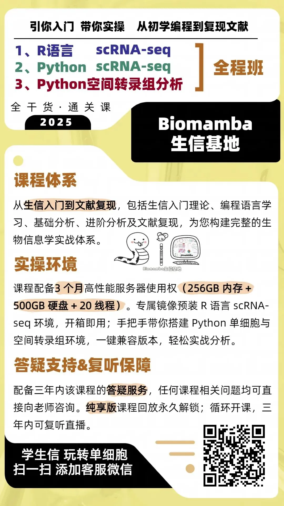

**Biomamba 生信基地的培训课程**

入门及编程语言

[生信小白入门课](<https://mp.weixin.qq.com/s?__biz=MzAwMzIzOTk5OQ==&mid=2247526459&idx=2&sn=13151661ad9d02bf4d8d20ab000b4df0&scene=21&token=2056463462&lang=zh_CN&poc_token=HEhmX2mjnVizkwrwJBJtfdhCDuMPdi3Fil96l-JU#wechat_redirect>)

[R语言入门课](<https://mp.weixin.qq.com/s?__biz=MzAwMzIzOTk5OQ==&mid=2247528126&idx=2&sn=668c2709891956b567b316f9f2fb26ea&scene=21&click_id=2&token=1721358726&lang=zh_CN&poc_token=HNPGT2mjdx6snIb3sfaprsNlMqyNmwUUEDKM1wpf#wechat_redirect>)

[Python入门课](<https://mp.weixin.qq.com/s?__biz=MzAwMzIzOTk5OQ==&mid=2247537399&idx=1&sn=d14c7987d1384fe133094748844b8d59&scene=21#wechat_redirect>)

[专题班](<https://mp.weixin.qq.com/mp/appmsgalbum?__biz=MzAwMzIzOTk5OQ==&action=getalbum&album_id=4421772406013378566#wechat_redirect>)

[短平快！R语言scRNA-seq数据基础分析专题](<https://mp.weixin.qq.com/s?__biz=MzAwMzIzOTk5OQ==&mid=2247535877&idx=1&sn=e988a2172618fd6f609575294db9a44f&scene=21#wechat_redirect>)[R语言scRNA-seq进阶质控专题](<https://mp.weixin.qq.com/s?__biz=MzAwMzIzOTk5OQ==&mid=2247535877&idx=2&sn=0323d692cf61092ed994fb434e4cfb1d&scene=21#wechat_redirect>)[R语言scRNA-seq轨迹分析专题](<https://mp.weixin.qq.com/s?__biz=MzAwMzIzOTk5OQ==&mid=2247535877&idx=3&sn=d24f80518eccef24183277eab1f62928&scene=21#wechat_redirect>)[R语言scRNA-seq细胞通讯分析专题](<https://mp.weixin.qq.com/s?__biz=MzAwMzIzOTk5OQ==&mid=2247535877&idx=4&sn=847ec896b51c5c1571e31a54f198ebc2&scene=21#wechat_redirect>)[R语言scRNA-seq基因共表达网络分析专题](<https://mp.weixin.qq.com/s?__biz=MzAwMzIzOTk5OQ==&mid=2247535877&idx=5&sn=23f42e58509a93e1f91c09cad53ccbdf&scene=21#wechat_redirect>)[R语言scRNA-seq拷贝数变异分析专题](<https://mp.weixin.qq.com/s?__biz=MzAwMzIzOTk5OQ==&mid=2247535877&idx=6&sn=6b2682106ed9a84c5bf57dadec45a0d3&scene=21#wechat_redirect>)[R语言scRNA-seq文献复现专题](<https://mp.weixin.qq.com/s?__biz=MzAwMzIzOTk5OQ==&mid=2247535877&idx=7&sn=b716aeb8e86eba4acd50b982beb0c963&scene=21#wechat_redirect>)

全程班

[R语言scRNA-seq小白全程班](<https://mp.weixin.qq.com/s?__biz=MzAwMzIzOTk5OQ==&mid=2247535408&idx=1&sn=1f3b4b99bab378887d11dd83fd87feb7&scene=21#wechat_redirect>)

[Python scRNA-seq全程班](<https://mp.weixin.qq.com/s?__biz=MzAwMzIzOTk5OQ==&mid=2247533067&idx=1&sn=7ef76058cbcf7bd45f58147766c75854&scene=21#wechat_redirect>)

[Python 空间转录组全程班](<https://mp.weixin.qq.com/s?__biz=MzAwMzIzOTk5OQ==&mid=2247533721&idx=1&sn=9648ed4701224e5d2e4c704d7046d9de&scene=21#wechat_redirect>)

**三大全程班课程内容**

**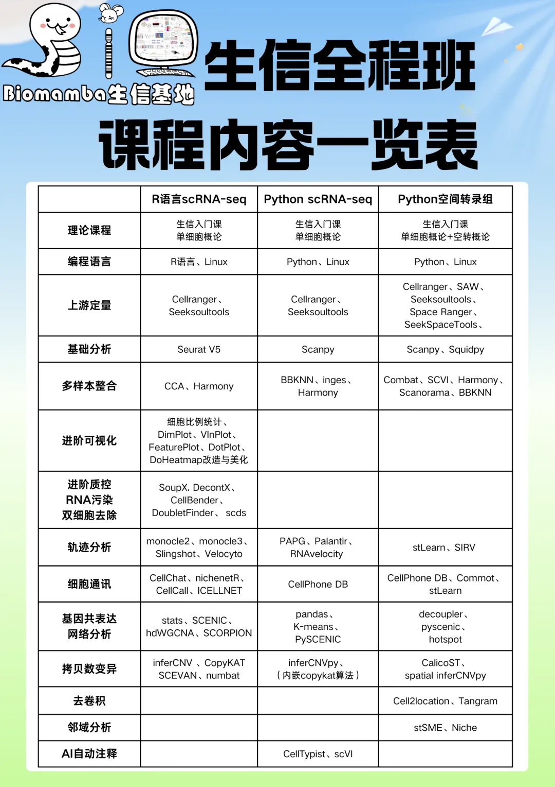**

**
**

**当然我们针对[ R语言scRNA-seq数据分析全程班](<https://mp.weixin.qq.com/s?__biz=MzAwMzIzOTk5OQ==&mid=2247535927&idx=2&sn=86947f0522de0d9785865bd24115b002&scene=21#wechat_redirect>)出了理论自测题**

**[单细胞全程班理论习题检测](<https://mp.weixin.qq.com/mp/appmsgalbum?__biz=MzAwMzIzOTk5OQ==&action=getalbum&album_id=4470288526508818453#wechat_redirect>)**

**[生信小白自测题](<https://mp.weixin.qq.com/s?__biz=MzAwMzIzOTk5OQ==&mid=2247536583&idx=2&sn=5b45fec890d76ded83e8935195228287&scene=21#wechat_redirect>)**

**[单细胞R语言理论自测题](<https://mp.weixin.qq.com/s?__biz=MzAwMzIzOTk5OQ==&mid=2247536584&idx=2&sn=9aa608d9939357a2e82cc16a940039bb&scene=21#wechat_redirect>)**

**[单细胞Linux理论自测题](<https://mp.weixin.qq.com/s?__biz=MzAwMzIzOTk5OQ==&mid=2247536940&idx=2&sn=84b393eb8fd063eb419026b0723843ad&scene=21#wechat_redirect>)**

**[单细胞基础分析和进阶可视化理论自测题](<https://mp.weixin.qq.com/s?__biz=MzAwMzIzOTk5OQ==&mid=2247537055&idx=2&sn=42e5e599fad13ff0a2913668158ac513&scene=21#wechat_redirect>)**

**[单细胞进阶质控理论自测题](<https://mp.weixin.qq.com/s?__biz=MzAwMzIzOTk5OQ==&mid=2247537005&idx=2&sn=258977a5793ebd544c08a08f3a9a2591&scene=21#wechat_redirect>)**

**[单细胞轨迹分析理论自测题](<https://mp.weixin.qq.com/s?__biz=MzAwMzIzOTk5OQ==&mid=2247536956&idx=2&sn=492ed96cc40b18e6d3c294e7b2e77280&scene=21#wechat_redirect>)**

**[单细胞细胞通讯分析理论自测题](<https://mp.weixin.qq.com/s?__biz=MzAwMzIzOTk5OQ==&mid=2247537562&idx=2&sn=c2b018fdff8338d9a900da54138c0ec7&scene=21#wechat_redirect>)**

**[单细胞基因共表达网络分析理论自测题](<https://mp.weixin.qq.com/s?__biz=MzAwMzIzOTk5OQ==&mid=2247537574&idx=2&sn=dac38b5519e1440e8ae65cefd215e42c&scene=21#wechat_redirect>)**

**[单细胞拷贝数变异分析理论自测题](<https://mp.weixin.qq.com/s?__biz=MzAwMzIzOTk5OQ==&mid=2247537733&idx=3&sn=896048fe2a44635da159a1a7da7b026f&scene=21#wechat_redirect>)**

**
**

我们后面将会举办更多的课程，大家可以持续关注我们~

**单细胞教程全收录**

这里一站式汇总了本号单细胞测序分析的全部干货教程，每一份内容都凝结着实战经验，希望能帮大家解锁生信技能，学有所获！

单细胞数据分析系列教程：

B站视频，先看一遍视频再去看推送操作，建议至少看三遍

**https://www.bilibili.com/video/BV1zWXhBQE1i/ **

**
**

如果你希望有人真的手把手教你学单细胞：**[保姆级单细胞 &空转教学| 生信全程班一览](<https://mp.weixin.qq.com/s?__biz=MzAwMzIzOTk5OQ==&mid=2247531447&idx=1&sn=242b49b5e2f5496efbd4484bf2e81604&scene=21&token=636745559&lang=zh_CN&poc_token=HHqHQ2mjHxAVJMXE2-QMPjoEyUjfwX7y7mgzXLH5#wechat_redirect>)**

**R语言scRNA-seq基础课：[ 这下真手把手教你做scRNA-seq数据基础分析](<https://mp.weixin.qq.com/s?__biz=MzAwMzIzOTk5OQ==&mid=2247535877&idx=1&sn=e988a2172618fd6f609575294db9a44f&scene=21#wechat_redirect>)**

**R语言scRNA-seq全程班：[ 100个小时沉浸式学会scRNA-seq数据分析](<https://mp.weixin.qq.com/s?__biz=MzAwMzIzOTk5OQ==&mid=2247531092&idx=1&sn=9968319b84186bb9b717b7b409132d8b&scene=21#wechat_redirect>)****Python scRNA-seq全程班：[ 82h视频教程《Python版scRNA-seq分析全流程》](<https://mp.weixin.qq.com/s?__biz=MzAwMzIzOTk5OQ==&mid=2247533067&idx=1&sn=7ef76058cbcf7bd45f58147766c75854&scene=21#wechat_redirect>)********
**学单细胞的顺序：**[R人学习单细胞的最佳顺序](<https://mp.weixin.qq.com/s?__biz=MzAwMzIzOTk5OQ==&mid=2247534877&idx=1&sn=e96e4b6e31d94b860a466905609fc9ac&scene=21#wechat_redirect>)****
**单细胞基础分析教程[ 单细胞数据基础分析学习手册](<https://mp.weixin.qq.com/s?__biz=MzAwMzIzOTk5OQ==&mid=2247510380&idx=1&sn=0eb2b0c519ef1dc25ee8821b736a0fde&scene=21&token=2143911808&lang=zh_CN&poc_token=HFxqX2mjMcZbNsKBXEaXKzpty9RMPgGYm700FRGb#wechat_redirect>)

**[手把手教你做单细胞测序数据分析|1.绪论](<https://mp.weixin.qq.com/s?__biz=MzAwMzIzOTk5OQ==&mid=2247499776&idx=2&sn=7fc250d94ed88cfd5e2224f071bb1742&chksm=9b3cb950ac4b30467a082527547b91aec15b7d1f40d44e362894aedeb6a99e014518fa5e4743&scene=21&token=2143911808&lang=zh_CN#wechat_redirect>)**

**[手把手教你做单细胞测序数据分析|2.各类数据结构与读取方法](<https://mp.weixin.qq.com/s?__biz=MzAwMzIzOTk5OQ==&mid=2247499795&idx=2&sn=68e6298eb43633c71939c146d90230ff&chksm=9b3cb943ac4b3055e09739d77e037d679f3d9ec68780d1aa8c592f806fcc8d2322eaee78752d&scene=21&token=2143911808&lang=zh_CN#wechat_redirect>)**

****[手把手教你做单细胞测序数据分析|3.单样本分析(2023年重置)](<https://mp.weixin.qq.com/s?__biz=MzAwMzIzOTk5OQ==&mid=2247500010&idx=2&sn=2f9fd1b0101d579bcd250fdc24e98bfc&chksm=9b3cb9baac4b30ac6f0ce28a6dd10470e73d1e1d6defece5636939a32a6db9b2cce0ff8688eb&scene=21&token=2143911808&lang=zh_CN#wechat_redirect>)********[手把手教你做单细胞测序数据分析|4.多样本整合(2023年重置)](<https://mp.weixin.qq.com/s?__biz=MzAwMzIzOTk5OQ==&mid=2247500117&idx=2&sn=cef0b0abec6d73a8c2615980ef68aec1&chksm=9b3cb805ac4b3113fdc820b9c9667f9554b2e39f90c45b5806021a415698b0a5141c521c64dc&scene=21&token=2143911808&lang=zh_CN#wechat_redirect>)********[手把手教你做单细胞测序数据分析|5.细胞类型注释，从入门到入土](<https://mp.weixin.qq.com/s?__biz=MzAwMzIzOTk5OQ==&mid=2247500167&idx=2&sn=8de136b938e8d4753042d23166a24026&chksm=9b3cb8d7ac4b31c19c843810c7fe4341515df8ba6fff86a0ebff9d830edfcd656a29d18011c9&scene=21&token=2143911808&lang=zh_CN#wechat_redirect>)********[手把手教你做单细胞测序数据分析|6组间差异分析](<https://mp.weixin.qq.com/s?__biz=MzAwMzIzOTk5OQ==&mid=2247500270&idx=2&sn=d8c4ebf8f63d12bd2ac8e2607864f322&chksm=9b3cb8beac4b31a824e228b486f0d8dd21a8f4113a0a0bcbaf1b20eaade3a83c9c7c1184010b&scene=21&token=2143911808&lang=zh_CN#wechat_redirect>)********[手把手教你做单细胞测序数据分析|7基因集富集分析](<http://mp.weixin.qq.com/s?__biz=MzAwMzIzOTk5OQ==&mid=2247500357&idx=2&sn=40034079b771c478b482e849ed4b216c&chksm=9b3cbb15ac4b3203d517ff71073ab0520fe144bc108b7a26f6b17e88fb63a78c5777946618e3&scene=21#wechat_redirect>)********[scRNA-seq数据基础分析手册(2025最新修订)](<https://mp.weixin.qq.com/s?__biz=MzAwMzIzOTk5OQ==&mid=2247528199&idx=1&sn=ab75e7d7987ab233c675455188f10f33&scene=21&token=2143911808&lang=zh_CN&poc_token=HLU4TmmjnBlx3yNhCLKDtU92y1p_ateGUxNAWa0U#wechat_redirect>) （Seurat V5）******[scRNA-Seq学习手册Python版](<https://mp.weixin.qq.com/s?__biz=MzAwMzIzOTk5OQ==&mid=2247504877&idx=2&sn=2b56a9cfa19fcc918ee6c2ed88fed017&scene=21#wechat_redirect>)**

单细胞图片改造计划

**[改造单细胞降维图| 1.DimPlot的探索](<https://mp.weixin.qq.com/s?__biz=MzAwMzIzOTk5OQ==&mid=2247496162&idx=1&sn=598c2920f7cc0697ee5a1fa6cadaee04&chksm=9b3c88b2ac4b01a415feeebbbec6c4891319439dc8dcdafd33cca7a1222e5adc723ae9d3a73d&scene=21&token=2143911808&lang=zh_CN#wechat_redirect>)**

****[改造单细胞降维图| 2.ggplot2中的DIY](<https://mp.weixin.qq.com/s?__biz=MzAwMzIzOTk5OQ==&mid=2247496239&idx=1&sn=1fe6fd4a7fb88ecc0456b4f5710cb5d6&chksm=9b3c8b7fac4b0269e0abeab951ad6ae0ddd1464dd9d1867280eeb9755fda5ba8f5237d88a7a6&scene=21&token=2143911808&lang=zh_CN#wechat_redirect>)********[改造单细胞降维图| 3.3D降维图与动图绘制](<https://mp.weixin.qq.com/s?__biz=MzAwMzIzOTk5OQ==&mid=2247498080&idx=2&sn=a9bcf65e3ae34ba201e8d49ee33c0728&chksm=9b3c8030ac4b0926c3f059a9a5d23f1bcdbcaf8e5a562eba2b7e3bec3396c44573269bd08e7b&scene=21&cur_album_id=2707677276481814529&token=2143911808&lang=zh_CN#wechat_redirect>)
********[改造单细胞降维图| 4.一些造好的轮子](<https://mp.weixin.qq.com/s?__biz=MzAwMzIzOTk5OQ==&mid=2247498191&idx=1&sn=952312a6b26232d460bf787cc276543f&chksm=9b3c809fac4b098972c8c1dd83b9f954a38fe5b5f6bc7e295f3f3a7ba6c4c3d32951679ac24d&scene=21&token=2143911808&lang=zh_CN#wechat_redirect>)********[沉浸式统计细胞比例](<https://mp.weixin.qq.com/s?__biz=MzAwMzIzOTk5OQ==&mid=2247503971&idx=2&sn=7dafb1e743ebbb95e488d8d1b7024448&chksm=9b3ca933ac4b2025f922a325ec6893e93613f130ff1d4fd609e2d7274f7f1fdb5134092e28ad&scene=21&token=2143911808&lang=zh_CN#wechat_redirect>)********[改造单细胞FeaturePlot](<https://mp.weixin.qq.com/s?__biz=MzAwMzIzOTk5OQ==&mid=2247504616&idx=1&sn=f7b4a0e6b25d224380cd803e3463a3e4&chksm=9b3cabb8ac4b22aeb65e0d6ec32a1f8674dcf907da078ccb3b61e06c4aa035864ebec092f571&scene=21&token=2143911808&lang=zh_CN#wechat_redirect>)********[VlnPlot用法及ggplot复现](<https://mp.weixin.qq.com/s?__biz=MzAwMzIzOTk5OQ==&mid=2247504768&idx=1&sn=4fc5eb47037d3a80178e32975488d70b&chksm=9b3caad0ac4b23c61147cfb0f46ecd846568f37ce89c963eb5f069d3e89a8ba285897726bb3d&scene=21&token=2143911808&lang=zh_CN#wechat_redirect>)********[VlnPlot的ggplot改造](<https://mp.weixin.qq.com/s?__biz=MzAwMzIzOTk5OQ==&mid=2247504843&idx=1&sn=b795a3e36ae092d8f87abb5a87187828&chksm=9b3caa9bac4b238dd33e905c33924b58aa4ff14e83abbf08046fba7fe765ecb0204163cb6acf&scene=21&token=2143911808&lang=zh_CN#wechat_redirect>)********[单细胞Figure 1常见图表](<https://mp.weixin.qq.com/s?__biz=MzAwMzIzOTk5OQ==&mid=2247509260&idx=1&sn=9ff90a428c3f22d43a31ec864e2d8a94&chksm=9b3cdc5cac4b554a2f7cb2a6368f7df9a9a3f6e406eb070663f53d81841a76e188c0b50727de&scene=21&cur_album_id=2707677276481814529&search_click_id=#wechat_redirect>)********[单细胞常见Figure 1 视频教程](<https://mp.weixin.qq.com/s?__biz=MzAwMzIzOTk5OQ==&mid=2247522008&idx=1&sn=f8c89bf880b66ecc2c5253f31e25b215&chksm=9b3cef88ac4b669e990ad91d2bfc8de08b417419bdcd4449d77bc496ac40541854d004516320&scene=21&cur_album_id=2707677276481814529&search_click_id=#wechat_redirect>)********[改造单细胞DotPlot](<https://mp.weixin.qq.com/s?__biz=MzAwMzIzOTk5OQ==&mid=2247527750&idx=1&sn=55f4645a82ac055cc0bfdbed3375fc06&scene=21#wechat_redirect>)********[改造单细胞DoHeatmap](<https://mp.weixin.qq.com/s?__biz=MzAwMzIzOTk5OQ==&mid=2247527762&idx=1&sn=ba7c8a4cb704e71fa86ebfe1f19bffea&scene=21#wechat_redirect>)****

向下滑动查看更多

**上游fastq文件处理**

****[单细胞分析的最上游——处理Fastq文件：cellranger](<https://mp.weixin.qq.com/s?__biz=MzAwMzIzOTk5OQ==&mid=2247501751&idx=2&sn=a79512f54db7456ea577de40f1a2d286&chksm=9b3cbee7ac4b37f1ce313d5eeb9a9ac9940640ab599ac5ab5d438fa86a8007796b768e4e68c2&scene=21&token=2143911808&lang=zh_CN#wechat_redirect>)****

****[单细胞分析的最上游——处理Fastq文件：dropseqRunner](<https://mp.weixin.qq.com/s?__biz=MzAwMzIzOTk5OQ==&mid=2247501812&idx=2&sn=7feb4d89ebc45ca7d64ad2dd5cd3c832&chksm=9b3cbea4ac4b37b2d2609172d58251076a6ab6a7043600613f0fb2ae0bea427de542b4dcf91e&scene=21&token=2143911808&lang=zh_CN#wechat_redirect>)********[Cellranger报错：Unable to distinguish between [SC5P-R2, SC3Pv2] ...](<https://mp.weixin.qq.com/s?__biz=MzAwMzIzOTk5OQ==&mid=2247504739&idx=2&sn=e4e6ad0559b9b6a703d6ab37c2a8fdb0&chksm=9b3caa33ac4b23257424184bda44dd600ad98bc0dfdfa90ab0e3ebaf208e598b0b710fbafa4b&scene=21&token=2143911808&lang=zh_CN#wechat_redirect>)********[BD Rhapsody平台单细胞转录组定量流程](<https://mp.weixin.qq.com/s?__biz=MzAwMzIzOTk5OQ==&mid=2247506542&idx=1&sn=99cf7af7fc0d56b0d6fe7ea3596df2b6&chksm=9b3ca33eac4b2a28e6682a7cf0b2091a387a06ecf89ee10737cf2194286ec0bba472ef1c2b90&scene=21&token=2143911808&lang=zh_CN#wechat_redirect>)********[BD Rhapsody定量输出文件读取](<https://mp.weixin.qq.com/s?__biz=MzAwMzIzOTk5OQ==&mid=2247519706&idx=1&sn=9d084bd8edf6ab4d9184672e5a4a2722&chksm=9b3cf48aac4b7d9c16ef85de7a5f33e65552bbba5d11d2170237063cf754fe9ff376647d3bd7&scene=21&token=2143911808&lang=zh_CN#wechat_redirect>)********[10X Visium上游定量过程](<https://mp.weixin.qq.com/s?__biz=MzAwMzIzOTk5OQ==&mid=2247522444&idx=1&sn=91ddf9e2ca3fb75db3ad524fe0042fab&chksm=9b3ce1dcac4b68cae69b4da8444dbccbf8c5cddd04697797420d1cc43a2048575a5f23d9d395&token=2143911808&lang=zh_CN&scene=21#wechat_redirect>)********[原理+代码流程，一文学会华大C4平台scRNA-seq定量分析](<https://mp.weixin.qq.com/s?__biz=MzAwMzIzOTk5OQ==&mid=2247533649&idx=1&sn=1cbe6e3116527a14c239f4e6fa2ab553&scene=21#wechat_redirect>)****

向下滑动查看更多

单细胞进阶分析-轨迹分析B站连续播放起来比较方便：https://www.bilibili.com/video/BV1br4y1x7Hf?p=1[《拟时序分析》1.概论](<https://mp.weixin.qq.com/s?__biz=MzAwMzIzOTk5OQ==&mid=2247486553&idx=1&sn=b689ec962a17ca1a1ada29ae8ff8c019&chksm=9b3f7509ac48fc1f0f81e288de8f15c86548215a1cd9d5c740dc63f2421371d13890398ab1df&scene=21&token=2143911808&lang=zh_CN#wechat_redirect>)**[《拟时序分析》2.monocle概论](<https://mp.weixin.qq.com/s?__biz=MzAwMzIzOTk5OQ==&mid=2247487001&idx=1&sn=329129e75f703e3f332e76af9c66871e&chksm=9b3f7749ac48fe5f081248c2a48c56685e3915015036c73f8f67ec3e6acc246ddf815daedb22&scene=21&token=2143911808&lang=zh_CN#wechat_redirect>)****[《拟时序分析》3.monocle2实操：精简版拟时序](<https://mp.weixin.qq.com/s?__biz=MzAwMzIzOTk5OQ==&mid=2247487398&idx=1&sn=6621eed90157d8da06ef778c40bd5554&chksm=9b3f76f6ac48ffe081ddfee3a323e0e31c1fda33731012de73168cf2ab30a226cf70c848f769&scene=21&token=2143911808&lang=zh_CN#wechat_redirect>)****[《拟时序分析》4.monocle2实操：完整版](<https://mp.weixin.qq.com/s?__biz=MzAwMzIzOTk5OQ==&mid=2247501684&idx=2&sn=45c8b083e1094718d7fc4b97e370b01d&chksm=9b3cbe24ac4b3732e6eb04084fe3af4419c817755e4eb9a11ba1fb9f68488d12fe7bc865ad0b&scene=21&token=2143911808&lang=zh_CN#wechat_redirect>)****[《拟时序分析》5.初识monocle3](<https://mp.weixin.qq.com/s?__biz=MzAwMzIzOTk5OQ==&mid=2247489044&idx=1&sn=061dbfc34d200b73a8227d0bb28a1d27&chksm=9b3f6f44ac48e65251f7e5ecce84637c05d50ecb92769e8386f221f8e7b9bfeb719232def863&scene=21&token=2143911808&lang=zh_CN#wechat_redirect>)****[《拟时序分析》6.monocle3的降维、分群、聚类](<https://mp.weixin.qq.com/s?__biz=MzAwMzIzOTk5OQ==&mid=2247489494&idx=1&sn=44f0a44857c12fcf9a1ab84e4f2cbebf&chksm=9b3f6e86ac48e79026321de2fdca81a139d104d655884ffe87a68e0a1551ddffa5af7919d19e&scene=21&token=2143911808&lang=zh_CN#wechat_redirect>)****[《拟时序分析》7.monocle3的拟时序分析](<https://mp.weixin.qq.com/s?__biz=MzAwMzIzOTk5OQ==&mid=2247490418&idx=1&sn=18ae0b6139fe1a2436dcf6cc47850297&chksm=9b3f6222ac48eb3450de0b02a34eb5fff2db89ab8f155460d554cbb23be0cd27fd349079e7b2&scene=21&token=2143911808&lang=zh_CN#wechat_redirect>)****[解决monocle2的orderCells报错的两种方法](<https://mp.weixin.qq.com/s?__biz=MzAwMzIzOTk5OQ==&mid=2247491083&idx=1&sn=c5697ab024193cb6595d27e4f4d3bfaf&chksm=9b3f675bac48ee4d7244d9819e14fe210f7e42e40fc7a6a8df7b95bfd92f06334d60d226cb93&scene=21&token=2143911808&lang=zh_CN#wechat_redirect>)****[一文搞定拟时序分析的下游可视化探索](<https://mp.weixin.qq.com/s?__biz=MzAwMzIzOTk5OQ==&mid=2247494479&idx=1&sn=32f39c79c4c9fc07aa829eed49016da3&chksm=9b3c921fac4b1b091efcdd151500b69d19f71d5ca518122af697fc37e87acd915f3be5f63fb8&scene=21&token=2143911808&lang=zh_CN#wechat_redirect>)****[Slingshot拟时序分析学习手册](<https://mp.weixin.qq.com/s?__biz=MzAwMzIzOTk5OQ==&mid=2247527850&idx=1&sn=f4e2ca5e2e5e71eeaf132375bb8270eb&scene=21#wechat_redirect>)**[ 一文学会scRNA Velocity剪切速率分析](<https://mp.weixin.qq.com/s?__biz=MzAwMzIzOTk5OQ==&mid=2247528458&idx=1&sn=900357283922571c6294435be409a2f3&scene=21#wechat_redirect>)[一文学会四种scRNA-seq轨迹分析](<https://mp.weixin.qq.com/s?__biz=MzAwMzIzOTk5OQ==&mid=2247528666&idx=1&sn=d29545d296bac3e41de322e43fde80dd&scene=21#wechat_redirect>)

向下滑动查看更多

单细胞进阶分析-细胞通讯分析

B站连续播放起来比较方便：https://www.bilibili.com/video/BV1br4y1x7Hf?p=1

****[《细胞通讯》CellChat学习手册](<https://mp.weixin.qq.com/s?__biz=MzAwMzIzOTk5OQ==&mid=2247501735&idx=2&sn=35fc792961507f4ae1cbae3a2882fba6&chksm=9b3cbef7ac4b37e1417d4108c8bd378c68c3907431ddfc52ad37c916e85649bb450d761a8e19&scene=21&token=2143911808&lang=zh_CN#wechat_redirect>)********[《细胞通讯》1.概论](<https://mp.weixin.qq.com/s?__biz=MzAwMzIzOTk5OQ==&mid=2247501282&idx=2&sn=cd37ea80e0b92f5bfbc98ea286e363da&chksm=9b3cbcb2ac4b35a4258d21fe003374795619fc2356376ebbe4ff640233f4b4c6e3e3ead41370&scene=21&token=2143911808&lang=zh_CN#wechat_redirect>)********[《细胞通讯》2.CellChat基础分析教程](<https://mp.weixin.qq.com/s?__biz=MzAwMzIzOTk5OQ==&mid=2247501296&idx=2&sn=fb3e252d95ee8b50cd446e71335b1aa0&chksm=9b3cbca0ac4b35b621b4f51d2c3a130f00461faeeff067396222c2fc2eeb53f3544664d7d9bc&scene=21&token=2143911808&lang=zh_CN#wechat_redirect>)********[《细胞通讯》2.2CellChat多组别分析](<https://mp.weixin.qq.com/s?__biz=MzAwMzIzOTk5OQ==&mid=2247501523&idx=2&sn=6fa803f256c2e0b945f93ae7d8245f50&chksm=9b3cbf83ac4b3695b587e9817840f419104c8680f5ef08ee39aa149b79852f48b179f68e3397&scene=21&token=2143911808&lang=zh_CN#wechat_redirect>)********[一文学会四种scRNA-seq细胞通讯分析](<https://mp.weixin.qq.com/s?__biz=MzAwMzIzOTk5OQ==&mid=2247528770&idx=1&sn=6242bce437a9d60f81a8651ea9b57e0b&scene=21#wechat_redirect>)********[scRNA-Seq细胞通讯之《iTalk学习手册》](<https://mp.weixin.qq.com/s?__biz=MzAwMzIzOTk5OQ==&mid=2247528921&idx=1&sn=7584797c68f0e979112b6dd2e4e30f14&scene=21#wechat_redirect>)********[SeekSpace细胞通讯分析](<http://mp.weixin.qq.com/s?__biz=MzAwMzIzOTk5OQ==&mid=2247511890&idx=1&sn=3457b875cd00b4433f50a39a45e1cb8a&chksm=9b3cd602ac4b5f144ad982dfbdf583b56d1bfb768e4e5f2cc9e5424af6e014e752835fadc8a6&scene=21#wechat_redirect>)********[CellChat更新，projectData不能用啦](<https://mp.weixin.qq.com/s?__biz=MzAwMzIzOTk5OQ==&mid=2247534016&idx=2&sn=7d3db44e55c2d140b26a7502c2b11016&scene=21#wechat_redirect>)****

向下滑动查看更多

单细胞进阶分析-SCENIC转录因子&基因共表达网络分析

[SCENIC单细胞转录因子预测|1.学习手册](<https://mp.weixin.qq.com/s?__biz=MzAwMzIzOTk5OQ==&mid=2247500439&idx=1&sn=d6b4874a8352f5b7a4165629c03058ce&chksm=9b3cbbc7ac4b32d158fd3c5c2f155c54c892d40eaae3718409936fc319f69705da32badf79d6&scene=21&token=2143911808&lang=zh_CN#wechat_redirect>)

[SCENIC单细胞转录因子预测|2.绪论](<https://mp.weixin.qq.com/s?__biz=MzAwMzIzOTk5OQ==&mid=2247500098&idx=1&sn=8c31241bd259e303a6ac3c9740f298d9&chksm=9b3cb812ac4b31046fd298c8ee5f0bc0de445df62b234bd934c34ca655e61de3da54d81e2053&scene=21&token=2143911808&lang=zh_CN#wechat_redirect>)

**[SCENIC单细胞转录因子预测|3.软件安装与数据准备](<https://mp.weixin.qq.com/s?__biz=MzAwMzIzOTk5OQ==&mid=2247500631&idx=1&sn=5d73db4dcc74b66de07dee9db910bb83&chksm=9b3cba07ac4b3311d1820bb305778aea707294f19fd6ff2631cd003da80bdcff8f8bc8ed34de&scene=21&token=2143911808&lang=zh_CN#wechat_redirect>)****[SCENIC单细胞转录因子预测|4.精简版流程](<https://mp.weixin.qq.com/s?__biz=MzAwMzIzOTk5OQ==&mid=2247501260&idx=1&sn=f1e2a165599e753e2959aad7c8a298cb&chksm=9b3cbc9cac4b358a9499654a2f95fa9010309ee4f408ef8b1f31ceb1a0f263ce22e8b511c430&scene=21&token=2143911808&lang=zh_CN#wechat_redirect>)****[SCENIC单细胞转录因子预测|5.step1+step2构建共表达网络与regulon](<https://mp.weixin.qq.com/s?__biz=MzAwMzIzOTk5OQ==&mid=2247501692&idx=1&sn=3f7e263a93942ad03faa1ba5f8694ec4&chksm=9b3cbe2cac4b373af9db74a50ffb08a9b8a3b958fc6385c937385f0f7323bc935cdb0fe5275c&scene=21&token=2143911808&lang=zh_CN#wechat_redirect>)****[SCENIC单细胞转录因子预测|6.Step3 利用AUCell对Regulon评分](<https://mp.weixin.qq.com/s?__biz=MzAwMzIzOTk5OQ==&mid=2247501989&idx=1&sn=2700bf779d7d261a4d751d1635fdce2c&chksm=9b3cb1f5ac4b38e3014476242fe956cf510cc45b9f4cef86070af8094fd5f884f9d5c3a3363f&scene=21&token=2143911808&lang=zh_CN#wechat_redirect>)****[SCENIC单细胞转录因子预测|7.Step4 二元矩阵的计算与可视化](<https://mp.weixin.qq.com/s?__biz=MzAwMzIzOTk5OQ==&mid=2247503995&idx=1&sn=26c7e9ec56af434e62b02853cfe667d6&chksm=9b3ca92bac4b203d7986645ab5a3fb574f44185c7ced8bd47957fa237d436a95bfa2579d052a&scene=21&token=2143911808&lang=zh_CN#wechat_redirect>)****[SCENIC单细胞转录因子预测|8.Step5 regulon聚类、分群、降维](<https://mp.weixin.qq.com/s?__biz=MzAwMzIzOTk5OQ==&mid=2247504024&idx=1&sn=143c0ec4d94b8fca0a4a47d3dc24415b&chksm=9b3ca9c8ac4b20de70a87acb2d3f810b0e1497071b1c6f14f1882a6d844fff016e9ba5581eb3&scene=21&token=2143911808&lang=zh_CN#wechat_redirect>)****[SCENIC单细胞转录因子预测|9.下游探索](<https://mp.weixin.qq.com/s?__biz=MzAwMzIzOTk5OQ==&mid=2247505276&idx=1&sn=949c753feb85d5877121433caaa33013&chksm=9b3cac2cac4b253affb587a937d3f5e0576851a4f4e1570cb7510a594d155873961bbd91758d&scene=21&token=2143911808&lang=zh_CN#wechat_redirect>)**[ SCENIC转录因子调控网络图](<https://mp.weixin.qq.com/s?__biz=MzAwMzIzOTk5OQ==&mid=2247530488&idx=2&sn=cc79762d4d7aa42673871b2472808852&scene=21&token=2143911808&lang=zh_CN&poc_token=HENKTmmj0Cx7WBCzELeDx6YKH9OBvrd8SfGcxKAA#wechat_redirect>)**[比R版本快几十倍| Pyscenic单细胞转录因子预测](<https://mp.weixin.qq.com/s?__biz=MzAwMzIzOTk5OQ==&mid=2247528198&idx=1&sn=2bdac420c143423d8a7012d028473573&scene=21&token=2143911808&lang=zh_CN&poc_token=HFtKTmmjNq6m1a_gdOq7CBnds8Nb1O9z899DxoXz#wechat_redirect>)****[非模式物种PySCENIC分析流程](<https://mp.weixin.qq.com/s?__biz=MzAwMzIzOTk5OQ==&mid=2247528411&idx=1&sn=efa4ace804c343379073dea63de64b4e&scene=21#wechat_redirect>)**[ R+Python组合拳可能是分析SCENIC最好的方式](<https://mp.weixin.qq.com/s?__biz=MzAwMzIzOTk5OQ==&mid=2247530488&idx=1&sn=e0c57d42b1ecb73e8b7b9f6caecbb81d&scene=21#wechat_redirect>)

# [一文学会四种基因共表达网络分析](<https://mp.weixin.qq.com/s?__biz=MzAwMzIzOTk5OQ==&mid=2247529410&idx=1&sn=9bbaf955d93ddce60874e1cdc2f16115&scene=21#wechat_redirect>)

# [scRNA-seq基因共表达网络分析合辑](<https://mp.weixin.qq.com/s?__biz=MzAwMzIzOTk5OQ==&mid=2247530020&idx=2&sn=a41e26954103818eaa409f854f61dcb7&scene=21#wechat_redirect>)

# [SCENIC报错 object 'motifAnnotations_hgnc' not found 解决方案](<https://mp.weixin.qq.com/s?__biz=MzAwMzIzOTk5OQ==&mid=2247537452&idx=1&sn=931d71c9dcfdd64feca3f099c258cc3e&scene=21#wechat_redirect>)

向下滑动查看更多

单细胞进阶分析-拷贝数变异分析**[单细胞拷贝数变异学习手册](<https://mp.weixin.qq.com/s?__biz=MzAwMzIzOTk5OQ==&mid=2247522733&idx=1&sn=4e3a0707fd8f83b5ad9377bc91ee8e53&scene=21#wechat_redirect>)**[ 肿瘤异质性分析必备| 一文学会四种scRNA-seq拷贝数变异分析](<https://mp.weixin.qq.com/s?__biz=MzAwMzIzOTk5OQ==&mid=2247531103&idx=2&sn=cad11d768e252d2489d124e68b71c7b0&scene=21#wechat_redirect>)[scRNA肿瘤细胞鉴定神器：copykat](<https://mp.weixin.qq.com/s?__biz=MzAwMzIzOTk5OQ==&mid=2247530392&idx=1&sn=0d426f34e172e29cf09aaf14242ac534&scene=21#wechat_redirect>)[copykat和infercnv鉴定肿瘤细胞还挺准](<https://mp.weixin.qq.com/s?__biz=MzAwMzIzOTk5OQ==&mid=2247535878&idx=1&sn=ff9527456bf977fa615fe7f725a3a039&scene=21#wechat_redirect>)[CopyKat的加速计算](<https://mp.weixin.qq.com/s?__biz=MzAwMzIzOTk5OQ==&mid=2247536094&idx=1&sn=4a158fbc72383d96ae2108060135e197&scene=21#wechat_redirect>)
scATAC分析

[scATAC分析学习手册](<https://mp.weixin.qq.com/s?__biz=MzAwMzIzOTk5OQ==&mid=2247521636&idx=1&sn=208907010f3f7412c1c91343d7dfb0d3&scene=21#wechat_redirect>)

[一文了解单细胞染色质及常见分析](<https://mp.weixin.qq.com/s?__biz=MzAwMzIzOTk5OQ==&mid=2247522998&idx=1&sn=843d378d3b679951ad3c8e5da7c32d87&scene=21#wechat_redirect>)**[一文了解染色质可及性和表观基因组调控](<https://mp.weixin.qq.com/s?__biz=MzAwMzIzOTk5OQ==&mid=2247510114&idx=1&sn=f7e8b1df1804a6bba0d79b1ffec2467c&scene=21#wechat_redirect>)****[snATAC联合scRNA揭示小鼠肾脏细胞分化程序和疾病靶点](<https://mp.weixin.qq.com/s?__biz=MzAwMzIzOTk5OQ==&mid=2247522324&idx=1&sn=62993c2354af1e793fcfd0e06586af17&scene=21&token=2143911808&lang=zh_CN&poc_token=HLhMTmmjT5uQLmejTqBxFbbMyaWUQm4zzci1K6lf#wechat_redirect>)****[4.6w字长文| SeekOne®-DD单细胞ATAC+RNA一胞双组学-学习手册](<https://mp.weixin.qq.com/s?__biz=MzAwMzIzOTk5OQ==&mid=2247528858&idx=1&sn=0620dd3681e73858eb47256d785d7437&scene=21#wechat_redirect>)****[一站式完成scATAC与scRNA-seq定量-seekarctools](<https://mp.weixin.qq.com/s?__biz=MzAwMzIzOTk5OQ==&mid=2247528887&idx=1&sn=8c6355adaef3ba65056a3057ba374bd0&scene=21#wechat_redirect>)****[Seurat团队打造——Signac分析实操](<https://mp.weixin.qq.com/s?__biz=MzAwMzIzOTk5OQ==&mid=2247529014&idx=1&sn=31602a765aa257ccdc4bbb081c1065f4&scene=21#wechat_redirect>)****[肝癌实战多样本分析| 基于SeekOne® DD单细胞ATAC+RNA双组学](<https://mp.weixin.qq.com/s?__biz=MzAwMzIzOTk5OQ==&mid=2247529253&idx=1&sn=136209939b24c9b3508da46dd364c15a&scene=21#wechat_redirect>)**

向下滑动查看更多

scFAST系列**[一文学会scFAST-seq数据分析](<https://mp.weixin.qq.com/s?__biz=MzAwMzIzOTk5OQ==&mid=2247505213&idx=1&sn=5f4ed0587dd96149d127a98d36f721f0&chksm=9b3cac6dac4b257bbc00c4647382d27883139bf06ab3071947bf1cccde8d1d501006dabab5f1&scene=21&token=2143911808&lang=zh_CN#wechat_redirect>)******[scFAST分析| 01.绪论](<https://mp.weixin.qq.com/s?__biz=MzAwMzIzOTk5OQ==&mid=2247503875&idx=1&sn=2b5ca0c57e17e51abb52adfe199c5736&chksm=9b3ca953ac4b20450f643b94bcfc95aa2b04ded197ce93e455a281901d7ccba099b48cfd03d9&scene=21&token=2143911808&lang=zh_CN#wechat_redirect>)******[scFAST分析| 02.单细胞分析准备工作](<https://mp.weixin.qq.com/s?__biz=MzAwMzIzOTk5OQ==&mid=2247504023&idx=1&sn=4091a22e853242b4aae7a7d3b4008f5c&chksm=9b3ca9c7ac4b20d1bb0389fad5fe85a3c4cf49179747fe97dffaab1087b7d2793668d9f63aa4&scene=21&token=2143911808&lang=zh_CN#wechat_redirect>)****[scFAST分析| 03.fast模块](<https://mp.weixin.qq.com/s?__biz=MzAwMzIzOTk5OQ==&mid=2247504044&idx=1&sn=d37991280217dcc29280efa344f856bb&chksm=9b3ca9fcac4b20eab124ccd4ba6ad3f5eee640df314e7d8fec0225035f06178e3a51dbe2033f&scene=21&token=2143911808&lang=zh_CN#wechat_redirect>)****[scFAST分析| 04.Seurat分析及可视化](<https://mp.weixin.qq.com/s?__biz=MzAwMzIzOTk5OQ==&mid=2247504435&idx=1&sn=c6a6f7ca00684601f3cda49e53be5339&chksm=9b3cab63ac4b2275d993bbaa64c71652685065fa377be57319fc6a5c47eb958b3644c7459cd5&scene=21&token=2143911808&lang=zh_CN#wechat_redirect>)****[scFAST分析| 05.mut模块](<https://mp.weixin.qq.com/s?__biz=MzAwMzIzOTk5OQ==&mid=2247504878&idx=1&sn=2c5d9fc694eaf3e264c38b0691cd3a43&chksm=9b3caabeac4b23a87d201009137572c02ba1ea0dd747bcd8b8c02878b45917b6e235551c41cb&scene=21&token=2143911808&lang=zh_CN#wechat_redirect>)****[scFAST-seq创新技术方案助力清华大学沈晓骅课题组Cell发表](<https://mp.weixin.qq.com/s?__biz=MzAwMzIzOTk5OQ==&mid=2247531285&idx=1&sn=29ad6cd40ba628d202d9abdbb8d14528&scene=21#wechat_redirect>)**

向下滑动查看更多

单细胞其它技术贴[不知不觉，已分享了近两百篇单细胞知识帖](<https://mp.weixin.qq.com/s?__biz=MzAwMzIzOTk5OQ==&mid=2247522475&idx=1&sn=84dd9a65348528be9aa2b8d2711d776c&chksm=9b3ce1fbac4b68ede52e7f24adfb846b4812bcf6e6096cfbda6382de57026497a310abaf1765&token=2143911808&lang=zh_CN&scene=21#wechat_redirect>)[细胞的数量由誰决定？](<https://mp.weixin.qq.com/s?__biz=MzAwMzIzOTk5OQ==&mid=2247484056&idx=1&sn=4967a054f5241ff3a1bd4a6fe9a502b1&chksm=9b3f7bc8ac48f2deca3141461be035deb8658be184d78597af28f8ba2092d12f020768275248&token=2143911808&lang=zh_CN&scene=21#wechat_redirect>)[单细胞中应该如何做GSVA？](<https://mp.weixin.qq.com/s?__biz=MzAwMzIzOTk5OQ==&mid=2247484701&idx=1&sn=ad90680f252d092a2e21f349c8f32cab&chksm=9b3f7c4dac48f55bf1d11337406ab0e1295e8e1731dbac0715eedc99d11beff7f380e42dd49b&token=2143911808&lang=zh_CN&scene=21#wechat_redirect>)[什么？不做单细胞也能分析细胞类群和免疫浸润？](<https://mp.weixin.qq.com/s?__biz=MzAwMzIzOTk5OQ==&mid=2247485798&idx=1&sn=c849bc7a0093af92fc99e13b55842bb2&chksm=9b3f7036ac48f92048d726b38f2dd978d0b0cce779c1a4090aa4da5cb2df3ad30a5c5dbed27e&token=2143911808&lang=zh_CN&scene=21#wechat_redirect>)[各类单细胞对象（数据格式）转换大全（一）](<https://mp.weixin.qq.com/s?__biz=MzAwMzIzOTk5OQ==&mid=2247485925&idx=1&sn=14e08440200f0f5cb4dcc2dc615efeb8&chksm=9b3f70b5ac48f9a37a43cc2a8b2a5e485a3f84b4ef87949dfe99056bc6301b110e80800f6bb1&token=2143911808&lang=zh_CN&scene=21#wechat_redirect>)[单细胞对象(数据格式)转换大全|2. h5ad转Seuratobj](<https://mp.weixin.qq.com/s?__biz=MzAwMzIzOTk5OQ==&mid=2247496786&idx=1&sn=408a81e4824c33eaefe6e9e7f0143c7e&scene=21#wechat_redirect>)[批量整理好GEO中下载的单细胞数据](<https://mp.weixin.qq.com/s?__biz=MzAwMzIzOTk5OQ==&mid=2247486045&idx=1&sn=0b6874bcffc8abafb505cabce4c4fc0e&chksm=9b3f730dac48fa1b140ef01c07a7749e69df4fa7d2056deeed0673c668b6246724cd85741125&token=2143911808&lang=zh_CN&scene=21#wechat_redirect>)[SCTransform与ScaleData](<https://mp.weixin.qq.com/s?__biz=MzAwMzIzOTk5OQ==&mid=2247489675&idx=1&sn=be27cd0a25fe4f2924582bd87a3d86d4&chksm=9b3f61dbac48e8cd19187daa9851cdc7fd435d72d99563613ec9674aa6a8b9d64f63125ba77e&token=2143911808&lang=zh_CN&scene=21#wechat_redirect>)[没有barcode文件的单细胞数据要怎么读取](<https://mp.weixin.qq.com/s?__biz=MzAwMzIzOTk5OQ==&mid=2247490952&idx=1&sn=364a3941e59e45234795c906a42fc9ab&chksm=9b3f64d8ac48edcec70384cf5c6a91224d0f7841ce3a7cfcade6513500c13673a6695d6f0299&token=2143911808&lang=zh_CN&scene=21#wechat_redirect>)[单细胞基因集评分之AUCell](<https://mp.weixin.qq.com/s?__biz=MzAwMzIzOTk5OQ==&mid=2247491761&idx=1&sn=41f5c1ceaacf6a1c4840567f8a349e06&chksm=9b3c99e1ac4b10f7ca158561e96fec76a49ff32b8412cb146ed3fb7aa9260c75172b4eb16f9a&token=2143911808&lang=zh_CN&scene=21#wechat_redirect>)[一文搞定单细胞基因集评分](<https://mp.weixin.qq.com/s?__biz=MzAwMzIzOTk5OQ==&mid=2247493493&idx=1&sn=2cd725b2f04377f218955bafbcbb877d&chksm=9b3c9e25ac4b17330a9b9ff77302ab95a9dc5dc7e6fe7298f28d682112ee066c7d4bc1947982&token=2143911808&lang=zh_CN&scene=21#wechat_redirect>)[如何加快Seurat的计算速度](<https://mp.weixin.qq.com/s?__biz=MzAwMzIzOTk5OQ==&mid=2247494116&idx=1&sn=f3dc577cbb464779062aada313191a05&chksm=9b3c90b4ac4b19a27a17f958e3437337d5b10b6ba7153e4dd43dedcb4df812d8c6b4d86fe970&token=2143911808&lang=zh_CN&scene=21#wechat_redirect>)[人类单细胞测序数据中有哪些以"**-"开头的基因](<https://mp.weixin.qq.com/s?__biz=MzAwMzIzOTk5OQ==&mid=2247495019&idx=1&sn=f52ac22ca1ea47ecddaa3503bdc2c0b6&chksm=9b3c943bac4b1d2d521f7155ce8f499389dade23828017572a84cdce71e5d08d37d74e08512b&token=2143911808&lang=zh_CN&scene=21#wechat_redirect>)[为什么总把分辨率调的很高](<https://mp.weixin.qq.com/s?__biz=MzAwMzIzOTk5OQ==&mid=2247495765&idx=1&sn=2ec5e3e26491e28c92e25c40630bffae&chksm=9b3c8905ac4b0013a23f9cda2cccd67cdf3c4a941bac161e3a15a12ab98cd4e5eca8aeedbe96&token=2143911808&lang=zh_CN&scene=21#wechat_redirect>)[Seurat中如何让细胞听你指挥](<https://mp.weixin.qq.com/s?__biz=MzAwMzIzOTk5OQ==&mid=2247495938&idx=1&sn=2258390c97ec14f3cd336defede59cdb&chksm=9b3c8852ac4b01448fd3b84463d5ab6b697495db6ad57746e7f60e32f491547a3e35290c66ee&token=2143911808&lang=zh_CN&scene=21#wechat_redirect>)[单细胞数据在R中的读取及存储速度太慢怎么办？这个神包来帮你！](<https://mp.weixin.qq.com/s?__biz=MzAwMzIzOTk5OQ==&mid=2247500270&idx=1&sn=11bdf3c7f9042fc03f9ed237a9b9677b&chksm=9b3cb8beac4b31a8bf1d9fb862553ed32ac9a56f4a6e0f2d38c9478132f87327d8c6b6940573&token=2143911808&lang=zh_CN&scene=21#wechat_redirect>)[单细胞分群分辨率选择困难症](<https://mp.weixin.qq.com/s?__biz=MzAwMzIzOTk5OQ==&mid=2247501241&idx=1&sn=9e15d23f721ad7f4ae1335ce5362031b&chksm=9b3cbce9ac4b35ff43434c0384afbbf5689f5b62a677e55e8a635d4812da57593d85a73cf48b&token=2143911808&lang=zh_CN&scene=21#wechat_redirect>)[一文搞定空间转录组与单细胞测序的整合分析](<https://mp.weixin.qq.com/s?__biz=MzAwMzIzOTk5OQ==&mid=2247507210&idx=1&sn=f32037ffefd60b0d1bcca7bf9c3e0823&chksm=9b3ca45aac4b2d4cf0c68299db3a2891130d89d9e0fe2a9ecb34b394736550bcf7d7c51090cc&token=2143911808&lang=zh_CN&scene=21#wechat_redirect>)[一文掌握十个单细胞数据库](<https://mp.weixin.qq.com/s?__biz=MzAwMzIzOTk5OQ==&mid=2247507979&idx=1&sn=e94225b592733f2e22b4b09245027365&chksm=9b3cd95bac4b504df8dc25d9c5cfddf56d3b47e7cc6f33a7ef369bc916c60abb6b49277b79f7&token=2143911808&lang=zh_CN&scene=21#wechat_redirect>)

[如何将已经构建好的Seurat空转对象转存为原始文件？](<https://mp.weixin.qq.com/s?__biz=MzAwMzIzOTk5OQ==&mid=2247508133&idx=1&sn=297b8fb9cc8f33a1d19167dba1104e97&chksm=9b3cd9f5ac4b50e36df53e3e18bb2990d9635d88a725f1e54fc5eb5967ac9f0934b79cbb8b34&token=2143911808&lang=zh_CN&scene=21#wechat_redirect>)

[单细胞Figure 1常见图表](<https://mp.weixin.qq.com/s?__biz=MzAwMzIzOTk5OQ==&mid=2247509260&idx=1&sn=9ff90a428c3f22d43a31ec864e2d8a94&chksm=9b3cdc5cac4b554a2f7cb2a6368f7df9a9a3f6e406eb070663f53d81841a76e188c0b50727de&token=2143911808&lang=zh_CN&scene=21#wechat_redirect>)

[快速上手Seurat V5](<https://mp.weixin.qq.com/s?__biz=MzAwMzIzOTk5OQ==&mid=2247509880&idx=1&sn=3b7cd169ccfe688d10cb1ca70dc91e91&chksm=9b3cde28ac4b573ec6d5f4bceafa4294c0e9a001b7d0c0b64f274a9978b1438eeccc747ca0c0&token=2143911808&lang=zh_CN&scene=21#wechat_redirect>)

[一文学会零代码单细胞分析](<https://mp.weixin.qq.com/s?__biz=MzAwMzIzOTk5OQ==&mid=2247511007&idx=1&sn=e7be3d9775890e5717889714629cfaf5&chksm=9b3cd28fac4b5b9936428d5f74d8b581b5cddc18d0fc42e2a5d75604cce080588d50f1304a17&token=2143911808&lang=zh_CN&scene=21#wechat_redirect>)

[scRNA-Seq双细胞过滤手册](<https://mp.weixin.qq.com/s?__biz=MzAwMzIzOTk5OQ==&mid=2247511622&idx=1&sn=60b35668e569267bab14ec8fbba8bd74&chksm=9b3cd716ac4b5e00122eac47f55085198040a4a0e97c56895bbc39f3a9f1a1eb4eba27048a8f&token=2143911808&lang=zh_CN&scene=21#wechat_redirect>)

[SeekSpace| 会单细胞就会空间转录组](<https://mp.weixin.qq.com/s?__biz=MzAwMzIzOTk5OQ==&mid=2247511779&idx=1&sn=23868525d86a9ed7867a3837ed18612c&chksm=9b3cd7b3ac4b5ea502950d0278d68da978f6011b2597c3ec90fb77e79320883fb4a5be2d5399&token=2143911808&lang=zh_CN&scene=21#wechat_redirect>)

[单细胞必修课——Seurat流程](<https://mp.weixin.qq.com/s?__biz=MzAwMzIzOTk5OQ==&mid=2247512220&idx=1&sn=c71bc3f1ef007eb29be8b3b4ec10f0af&chksm=9b3cc9ccac4b40da749d2388dc2d885239a1e4f6ea0989f36b031c7253ce103b061e2605ad8c&token=2143911808&lang=zh_CN&scene=21#wechat_redirect>)

[10xGenomics官方可视化工具——Loupe Browser](<https://mp.weixin.qq.com/s?__biz=MzAwMzIzOTk5OQ==&mid=2247519698&idx=1&sn=0135ef1763fc146252835f2bd7f728ec&chksm=9b3cf482ac4b7d949d0936f11b487d5da4fd8f235bb86f63e960e23785885b9db0d14897b63d&token=2143911808&lang=zh_CN&scene=21#wechat_redirect>)

[快速上手Cellranger](<https://mp.weixin.qq.com/s?__biz=MzAwMzIzOTk5OQ==&mid=2247521051&idx=1&sn=e2ab820001013bae6e35310e27897086&chksm=9b3cea4bac4b635ddbb74c29240896902b497cdc47f1f37d99fa0fb8a402375e513690f24e3f&token=2143911808&lang=zh_CN&scene=21#wechat_redirect>)

[genesorteR——比FindAllMarkers快一百倍！](<https://mp.weixin.qq.com/s?__biz=MzAwMzIzOTk5OQ==&mid=2247521266&idx=1&sn=2a74f282222b694f51362445e65c85a6&chksm=9b3ceaa2ac4b63b4a721d1134317af5ee1c9fbe844383a1f404249748e506b674ea26e66d0d2&token=2143911808&lang=zh_CN&scene=21#wechat_redirect>)

[应审稿人要求| pseudo bulk差异分析](<https://mp.weixin.qq.com/s?__biz=MzAwMzIzOTk5OQ==&mid=2247521437&idx=1&sn=d47b48170f7189b8fb74b2316d0c4898&chksm=9b3cedcdac4b64db43487176203e52e53fe08e01ce819a1615fa1e2f9f8d513bbd4efdee5558&token=2143911808&lang=zh_CN&scene=21#wechat_redirect>)

[你的电脑算单细胞有多快？](<https://mp.weixin.qq.com/s?__biz=MzAwMzIzOTk5OQ==&mid=2247524308&idx=1&sn=f00b40599ac7f57e433ebf33b9edc174&chksm=9b3ce684ac4b6f927982d1afc93d17a9770a1bd8e403729e9aed12be83777fd4f881adcb000e&token=2143911808&lang=zh_CN&scene=21#wechat_redirect>)

[30w单细胞数据会吃掉多少内存？](<https://mp.weixin.qq.com/s?__biz=MzAwMzIzOTk5OQ==&mid=2247525849&idx=1&sn=aa48c5e9405afcf28ffccb7bb4312e70&chksm=9b3c1c89ac4b959faa1e531dd134995b6345a896fefa2b0f82b55acfb3528850ed924ac43cde&token=2143911808&lang=zh_CN&scene=21#wechat_redirect>)

[如何选取适合自己的单细胞测序平台](<https://mp.weixin.qq.com/s?__biz=MzAwMzIzOTk5OQ==&mid=2247527807&idx=1&sn=84381d363ee36d00394c0ec95c0a6795&chksm=9b3c142fac4b9d391db9f0e2cb2989d98e5f130700bd118d34ff3b91a79c162700eb95dff4a3&token=2143911808&lang=zh_CN&scene=21#wechat_redirect>)

[如何让计算时间缩短2/3](<https://mp.weixin.qq.com/s?__biz=MzAwMzIzOTk5OQ==&mid=2247527882&idx=1&sn=ce4206208983185957ddddb086e974fe&chksm=9b3c149aac4b9d8cecb5ac5851264e9675c36216d6c96abf2d840cabf34ef741cad46673d45e&token=2143911808&lang=zh_CN&scene=21#wechat_redirect>)

[《Cancer Cell》|时空单细胞揭示CRC的PD-1治疗免疫细胞动态](<https://mp.weixin.qq.com/s?__biz=MzAwMzIzOTk5OQ==&mid=2247528056&idx=1&sn=73c0da3ff7ff50bafbb9315fd5b60f15&chksm=9b3c1728ac4b9e3ea3d3a35b9a60d5b21f74fe08671da8388c60ed43ba310617e6c48566b54a&token=2143911808&lang=zh_CN&scene=21#wechat_redirect>)

[开箱即用的单细胞分析镜像](<https://mp.weixin.qq.com/s?__biz=MzAwMzIzOTk5OQ==&mid=2247528410&idx=2&sn=0f2bac25479cf8d20dab5d82ae986f2e&chksm=9b3c168aac4b9f9cd7404d5592fe24d5520c782799bffb16e8f3fd83305a4ee5d8f2480a9344&token=2143911808&lang=zh_CN&scene=21#wechat_redirect>)

[布置Python单细胞分析环境](<https://mp.weixin.qq.com/s?__biz=MzAwMzIzOTk5OQ==&mid=2247528493&idx=2&sn=b8add6f0303ec6032ecc2242f59d8289&chksm=9b3c097dac4b806b5c80b16a5fdbbb9a9bcfea3960b4a5c086c50feb2f91c6fe33db9a38a407&token=2143911808&lang=zh_CN&scene=21#wechat_redirect>)

[一文了解Python中的单细胞通货：AnnData](<https://mp.weixin.qq.com/s?__biz=MzAwMzIzOTk5OQ==&mid=2247528513&idx=1&sn=1ff1b8bee321f8f5bcac425ce96dc6ff&chksm=9b3c0911ac4b8007b781f78aaf6926a8786783143ee5de734d197c9cf52e6151af7b3338a20e&token=2143911808&lang=zh_CN&scene=21#wechat_redirect>)

[勘误| infercnv亚群注释](<https://mp.weixin.qq.com/s?__biz=MzAwMzIzOTk5OQ==&mid=2247528855&idx=1&sn=a300e28967e868d16babad700e35883a&chksm=9b3c08c7ac4b81d1f6dbfed2f997ef3a87e7c90cc9a77771e66434c46362065d60459683b744&token=2143911808&lang=zh_CN&scene=21#wechat_redirect>)

[关于T Cell能不能分化为B Cell这件事](<https://mp.weixin.qq.com/s?__biz=MzAwMzIzOTk5OQ==&mid=2247529864&idx=1&sn=825c0c6d9e29c224dc46e97f3c6d7f47&chksm=9b3c0cd8ac4b85ce3a0def6ace951bb94cc3d070e4b2745e056435d8299e09278fc8199fc96d&token=2143911808&lang=zh_CN&scene=21#wechat_redirect>)

[Biomamba的单细胞分析环境大公开！](<https://mp.weixin.qq.com/s?__biz=MzAwMzIzOTk5OQ==&mid=2247529901&idx=1&sn=3e9cb1075a3b0b4c253ca19addf8b387&chksm=9b3c0cfdac4b85eb37539a9c48eea51dcaf72aabc0c895c85066939a8f8fc2b8b7d13648499f&token=2143911808&lang=zh_CN&scene=21#wechat_redirect>)

[大家有没有发现infercnv的这个小bug](<https://mp.weixin.qq.com/s?__biz=MzAwMzIzOTk5OQ==&mid=2247530697&idx=1&sn=1e10a4463fdb93534b99aa2bfc9d947e&chksm=9b3c0199ac4b888f521354e415c7be5d563d796625d2b405e1d8633df33541650e9f6a1bee6b&token=2143911808&lang=zh_CN&scene=21#wechat_redirect>)

[单细胞免疫组库测序(scTCR+scBCR)学习手册](<https://mp.weixin.qq.com/s?__biz=MzAwMzIzOTk5OQ==&mid=2247531444&idx=2&sn=77ad356b087fca6a03e90d4f9cc973de&chksm=9b3c02e4ac4b8bf2e8377894871f69937a3c53b17042e144e8dfc715a7529b409a110fce18ec&token=2143911808&lang=zh_CN&scene=21#wechat_redirect>)

[还有比这更好复现的数据吗](<https://mp.weixin.qq.com/s?__biz=MzAwMzIzOTk5OQ==&mid=2247531461&idx=1&sn=c0251ff4d274ac7bc9f79647b60dc75e&chksm=9b3c0295ac4b8b834d12f8165689d908e18fb0dc468398b3fc0a60075e0b1dfc41f7f24afb47&token=2143911808&lang=zh_CN&scene=21#wechat_redirect>)

[跟着《Nature》和《Cell》学Ro/e分析](<https://mp.weixin.qq.com/s?__biz=MzAwMzIzOTk5OQ==&mid=2247532034&idx=1&sn=f5379f62dfcfd8bf99ee2fbea8e8fc8f&chksm=9b3c0752ac4b8e44e737b9bd9ad6202d009920374f303487b70eae21e0e35a224d1c6a7bf5c7&token=2143911808&lang=zh_CN&scene=21#wechat_redirect>)

[T Cell注释神器,《Nature Methods》发布T-CellAnnoTator，搞定你的TCell！](<https://mp.weixin.qq.com/s?__biz=MzAwMzIzOTk5OQ==&mid=2247532453&idx=1&sn=d9cce237c0ff8e1d58d0596b0975ecce&chksm=9b3c06f5ac4b8fe3027a70d79f85f271ad6587426a18531e5399b1594f1e87921e6a394a2bf6&token=2143911808&lang=zh_CN&scene=21#wechat_redirect>)

[不做单细胞，怎么让自己的Bulk数据也能分析细胞类群和免疫浸润？](<https://mp.weixin.qq.com/s?__biz=MzAwMzIzOTk5OQ==&mid=2247532107&idx=2&sn=7afc7517afb7dbdefeb7fd3312c1d5e8&chksm=9b3c071bac4b8e0da42d00342beec2e32d0e3b74c3f0bea7e3ea86d3622a1ffe6dd8987c9ce0&token=2143911808&lang=zh_CN&scene=21#wechat_redirect>)

[AI有时候没有搜索引擎好使](<https://mp.weixin.qq.com/s?__biz=MzAwMzIzOTk5OQ==&mid=2247532797&idx=1&sn=395c1a724450e6f7ae360a7d0bdd8dba&chksm=9b3c39adac4bb0bb915f8890244ddf153fe2fbbca7685bcaf79073f87a5037bf0967e9522745&token=2143911808&lang=zh_CN&scene=21#wechat_redirect>)

[Seurat与Scanpy的数据转换](<https://mp.weixin.qq.com/s?__biz=MzAwMzIzOTk5OQ==&mid=2247533070&idx=1&sn=eb762b5b475695f418438d6628d8012f&chksm=9b3c3b5eac4bb2480b47ce8aa71d64b5c9cdcf4a0a3f72e40085b33dc12e33ec8d4c523460f8&token=2143911808&lang=zh_CN&scene=21#wechat_redirect>)

[突然想起学单细胞走过的弯路](<https://mp.weixin.qq.com/s?__biz=MzAwMzIzOTk5OQ==&mid=2247533491&idx=1&sn=1dd2fe09639fcb52ac5be6d2af2b77b6&chksm=9b3c3ae3ac4bb3f5d5bb99c18d1fc673f372282a3cb8debcdc61562df06c0b5926ffe132af50&token=2143911808&lang=zh_CN&scene=21#wechat_redirect>)

[methylSig分析WGBS甲基化提取与差异分析流程](<https://mp.weixin.qq.com/s?__biz=MzAwMzIzOTk5OQ==&mid=2247534129&idx=1&sn=f3dd8f3f390efcfc4eaca8310f1e7933&scene=21#wechat_redirect>)

[抛开基因，只用通路评分来分析单细胞，有没有搞头?](<https://mp.weixin.qq.com/s?__biz=MzAwMzIzOTk5OQ==&mid=2247534044&idx=1&sn=8017fc5928ac89b8c910379a3d2bbed8&scene=21#wechat_redirect>)

[Biseq计算差异甲基化区域](<https://mp.weixin.qq.com/s?__biz=MzAwMzIzOTk5OQ==&mid=2247534526&idx=1&sn=fb3c25cb8c41dd8c7a93f29f9561ea6a&scene=21#wechat_redirect>)

[Seurat单细胞亚群分析](<https://mp.weixin.qq.com/s?__biz=MzAwMzIzOTk5OQ==&mid=2247534661&idx=1&sn=16872e942170ace88f26deb0ea6c4b34&scene=21#wechat_redirect>)

[还在做简单的差异分析？MOFA单细胞多组学因子分析筛选特征基因](<https://mp.weixin.qq.com/s?__biz=MzAwMzIzOTk5OQ==&mid=2247534672&idx=1&sn=8f8415f2463cfde5362a3092aee8beab&scene=21#wechat_redirect>)

[详解anndata对象的.obs与.var](<https://mp.weixin.qq.com/s?__biz=MzAwMzIzOTk5OQ==&mid=2247534988&idx=1&sn=1e673ac2838aae9c14c9b79024fbfc57&scene=21#wechat_redirect>)

[CellOracle联合scRNA与scATAC构建基因调控网络](<https://mp.weixin.qq.com/s?__biz=MzAwMzIzOTk5OQ==&mid=2247535250&idx=1&sn=a2839b6cb9d3618dff3f20570c48cf0f&scene=21#wechat_redirect>)

[单细胞Marker计算与可视化的pseudo-bulk方案](<https://mp.weixin.qq.com/s?__biz=MzAwMzIzOTk5OQ==&mid=2247535727&idx=1&sn=5a8dc6600a13455bcea612ac1cbe0173&scene=21#wechat_redirect>)

[单细胞差异基因别只知道画普通火山图啦](<https://mp.weixin.qq.com/s?__biz=MzAwMzIzOTk5OQ==&mid=2247536970&idx=1&sn=9b51f3c942793be68dbaaa12e1ab39b4&scene=21#wechat_redirect>)

[《Nature Methods》教你选择单细胞高变基因](<https://mp.weixin.qq.com/s?__biz=MzAwMzIzOTk5OQ==&mid=2247537219&idx=1&sn=043692316d09cbfa24ececb3eb7166bf&scene=21#wechat_redirect>)

[scDEAL预测bulk与scRNA-seq药物敏感性](<https://mp.weixin.qq.com/s?__biz=MzAwMzIzOTk5OQ==&mid=2247537240&idx=1&sn=bdeb86c8080deeafc49f23b4e14c93cd&scene=21#wechat_redirect>)

[实测风靡一时的scTenifoldKnk单细胞虚拟基因敲除,准不准?](<https://mp.weixin.qq.com/s?__biz=MzAwMzIzOTk5OQ==&mid=2247537448&idx=2&sn=349176614975169c284b22342d88d8da&scene=21#wechat_redirect>)

[《NBT》教你如何在单细胞中预测不存在的分类变量](<https://mp.weixin.qq.com/s?__biz=MzAwMzIzOTk5OQ==&mid=2247537576&idx=1&sn=5b89e2808f9b059087c6acf7db81e40b&scene=21#wechat_redirect>)

[UNAGI做个时间序列分析，顺便把药物干扰给预测了](<https://mp.weixin.qq.com/s?__biz=MzAwMzIzOTk5OQ==&mid=2247537658&idx=1&sn=a4cb5c4626986f7f78dfa6419b4e7365&scene=21#wechat_redirect>)

[单细胞转录组跨物种比对](<https://mp.weixin.qq.com/s?__biz=MzAwMzIzOTk5OQ==&mid=2247537750&idx=1&sn=21ccf14fa96dc44db59a090966fc419f&scene=21#wechat_redirect>)

向下滑动查看更多

单细胞压力测试

**[30w单细胞数据会吃掉多少内存？](<https://mp.weixin.qq.com/s?__biz=MzAwMzIzOTk5OQ==&mid=2247525849&idx=1&sn=aa48c5e9405afcf28ffccb7bb4312e70&scene=21#wechat_redirect>)****[你的电脑算单细胞有多快？](<https://mp.weixin.qq.com/s?__biz=MzAwMzIzOTk5OQ==&mid=2247524308&idx=1&sn=f00b40599ac7f57e433ebf33b9edc174&scene=21#wechat_redirect>)****[新年新气象| 独享用户硬件升级对比报告](<https://mp.weixin.qq.com/s?__biz=MzAwMzIzOTk5OQ==&mid=2247526418&idx=1&sn=d1ab22d2f98854faf21cb14dc0b494ee&scene=21#wechat_redirect>)****[如何让计算时间缩短2/3](<https://mp.weixin.qq.com/s?__biz=MzAwMzIzOTk5OQ==&mid=2247527882&idx=1&sn=ce4206208983185957ddddb086e974fe&scene=21#wechat_redirect>)****[5w单细胞在Monocle2拟时序中占据多少内存？](<https://mp.weixin.qq.com/s?__biz=MzAwMzIzOTk5OQ==&mid=2247528216&idx=1&sn=a12e276a7dac4df56d24b5a92dd78a24&scene=21#wechat_redirect>)**[ CellChat细胞通讯运行内存及时间压力测试](<https://mp.weixin.qq.com/s?__biz=MzAwMzIzOTk5OQ==&mid=2247528468&idx=1&sn=ad6493b1e7e0284c4cb84e1d79eb446b&scene=21#wechat_redirect>)[挑战用R语言硬干一百万单细胞数据分析](<https://mp.weixin.qq.com/s?__biz=MzAwMzIzOTk5OQ==&mid=2247531160&idx=1&sn=ecf56af3b929ec2b241854c89d25c671&scene=21#wechat_redirect>)[挑战用Python分析一百万个单细胞数据](<https://mp.weixin.qq.com/s?__biz=MzAwMzIzOTk5OQ==&mid=2247534670&idx=1&sn=7178b77f1efe4ca253f90b9121231204&scene=21#wechat_redirect>)

向下滑动查看更多

单细胞代码复现

****[单细胞注释复写(一):Human Fetal Kidney](<https://mp.weixin.qq.com/s?__biz=MzAwMzIzOTk5OQ==&mid=2247490504&idx=1&sn=0066b2b33067cedb9d1c28689a53faab&chksm=9b3f6298ac48eb8e12cdc7bdd6263e5feb9039f549f7b9dbf4e258854ee61476d09f702f1447&token=2143911808&lang=zh_CN&scene=21#wechat_redirect>)********[单细胞注释复写（二）: human colorectal](<https://mp.weixin.qq.com/s?__biz=MzAwMzIzOTk5OQ==&mid=2247491642&idx=1&sn=2246fb702277ddc690f056fc8854142e&chksm=9b3c996aac4b107c059a403978eca7be1ae7987659626272c58430910ad75892ad470517aefb&token=2143911808&lang=zh_CN&scene=21#wechat_redirect>)********[单细胞复写|3.急性心肌梗塞(AMI)外周血scRNA-Seq分析实战(链接重置)](<https://mp.weixin.qq.com/s?__biz=MzAwMzIzOTk5OQ==&mid=2247501145&idx=2&sn=12c2e8d104ad343fc13acb8cda266e6c&chksm=9b3cbc09ac4b351f4ed708a0ed577a21f48ccb0d4173aed94a027b4170147ab85931ee51d1e5&token=2143911808&lang=zh_CN&scene=21#wechat_redirect>)********[单细胞复写|4. GSE157783数据集复现及差异分析](<https://mp.weixin.qq.com/s?__biz=MzAwMzIzOTk5OQ==&mid=2247503585&idx=1&sn=0035977a80621f09d0774d3c9b0a86cd&chksm=9b3cb7b1ac4b3ea76685ed44abcfb031c698835d9b9b42b269496f6104cd8c9d45467de7eddd&token=2143911808&lang=zh_CN&scene=21#wechat_redirect>)****

[ 复现24年前的《Nature》—GEO中的第一个数据](<https://mp.weixin.qq.com/s?__biz=MzAwMzIzOTk5OQ==&mid=2247526262&idx=1&sn=0cf9dc3dfb55a636634612a2aa1d2e23&chksm=9b3c1e26ac4b9730379286158af7e6f2a04a1bd496c8264581e361650b4fdb87d8ddef8939fa&token=2143911808&lang=zh_CN&scene=21#wechat_redirect>)

[学员代码复现|scRNA-seq解析非酒精性脂肪性肝发生机制](<https://mp.weixin.qq.com/s?__biz=MzAwMzIzOTk5OQ==&mid=2247534107&idx=1&sn=24c3f2f1a2ba2a3db6d49acc1ba1220a&scene=21#wechat_redirect>)

[《NC》代码复现| scRNA-seq揭示人纤维化皮肤病中的成纤维细胞异质性和间充质成纤维细胞增加](<https://mp.weixin.qq.com/s?__biz=MzAwMzIzOTk5OQ==&mid=2247525649&idx=1&sn=6145f50422ef8680be2a7ffd6c66f5f3&chksm=9b3c1c41ac4b955748b6735bb43b27fb222f3795c4ae49bb8a453f78765fc472ff43f9e7fc89&token=2056463462&lang=zh_CN&scene=21#wechat_redirect>)

[《Nature Communications》| scRNA-seq揭示头颈癌早期转移过程中潜在的免疫逃避机制](<https://mp.weixin.qq.com/s?__biz=MzAwMzIzOTk5OQ==&mid=2247526011&idx=1&sn=e601b8dedfad86ee6d9ce5b6d6ca8511&chksm=9b3c1f2bac4b963d523438200ea92f352bd84ab5fbb40a4b2220e7f1af77778f27aa1f728e47&token=2056463462&lang=zh_CN&scene=21#wechat_redirect>)

[代码复写《Developmental Cell》|利用scRNA-seq对新生儿~成人肝脏发育和成熟的时间分析](<https://mp.weixin.qq.com/s?__biz=MzAwMzIzOTk5OQ==&mid=2247526426&idx=1&sn=7191649a25332d1b8bf2bd9c797d06a7&chksm=9b3c114aac4b985cd9d16e134892c140111b32493063036363b39119ef7aad205a3c12bba867&token=2056463462&lang=zh_CN&scene=21#wechat_redirect>)

[《Cell》复现|中性粒细胞scRNA-seq图谱阐明抗肿瘤抗原呈递效力](<https://mp.weixin.qq.com/s?__biz=MzAwMzIzOTk5OQ==&mid=2247526776&idx=1&sn=99eb6a16c7bf345445b6ff4b61110138&chksm=9b3c1028ac4b993e5cdd2ef10956a2b9fbea0075487feec8fcfaef442b8c5eabd1500eb9c2c3&token=2056463462&lang=zh_CN&scene=21#wechat_redirect>)

[代码复现|scRNA-seq绘制透明细胞肾癌的免疫微环境](<https://mp.weixin.qq.com/s?__biz=MzAwMzIzOTk5OQ==&mid=2247527498&idx=1&sn=c8282e9d4175bfb2e572278312073d81&chksm=9b3c151aac4b9c0c2ac7f0c184f5bba183b52a6c9b9f4e30d0494ef752df0cd216afe15dbf2f&token=2056463462&lang=zh_CN&scene=21#wechat_redirect>)

[《Cancer Cell》|时空单细胞揭示CRC的PD-1治疗免疫细胞动态](<https://mp.weixin.qq.com/s?__biz=MzAwMzIzOTk5OQ==&mid=2247528056&idx=1&sn=73c0da3ff7ff50bafbb9315fd5b60f15&chksm=9b3c1728ac4b9e3ea3d3a35b9a60d5b21f74fe08671da8388c60ed43ba310617e6c48566b54a&token=1721358726&lang=zh_CN&scene=21#wechat_redirect>)

[代码复现|吞噬作用增强肿瘤中巨噬细胞的氧化代谢和免疫抑制特征](<https://mp.weixin.qq.com/s?__biz=MzAwMzIzOTk5OQ==&mid=2247528289&idx=1&sn=b56f00f3d8a4b152e54f3acd40aef21d&chksm=9b3c1631ac4b9f27db6577962d2113ae2fa5c3960ac942bf6ee94f58073642eeb6a4d8369212&token=2056463462&lang=zh_CN&scene=21#wechat_redirect>)

[代码复现| scRNA-seq揭示人纤维化皮肤病中的成纤维细胞异质性与增殖](<https://mp.weixin.qq.com/s?__biz=MzAwMzIzOTk5OQ==&mid=2247530338&idx=1&sn=2d092e76080359f5a169ec14d54d1241&chksm=9b3c0e32ac4b872435a1f4af3c6903c777fdb07f43ad222ccbf08163ae259d56b9e499ee2fe6&token=2056463462&lang=zh_CN&scene=21#wechat_redirect>)

[《NC》代码复现|snATAC联合scRNA-seq揭示小鼠肾脏细胞分化程序与疾病靶点](<https://mp.weixin.qq.com/s?__biz=MzAwMzIzOTk5OQ==&mid=2247531908&idx=1&sn=2f094e390621a57853ba17f59f298ebe&chksm=9b3c04d4ac4b8dc26acab20d53b4c9f6cc50132d7ef4da167ff068a49f4801e7c42d96c6c986&token=2056463462&lang=zh_CN&scene=21#wechat_redirect>)

[《Nature Genetics》文献复写 | 结直肠癌免疫细胞的高清空转分析（Visium HD+Xenium）](<https://mp.weixin.qq.com/s?__biz=MzAwMzIzOTk5OQ==&mid=2247533068&idx=1&sn=52cbc8d161ec216b5d7a8238a49d47c6&chksm=9b3c3b5cac4bb24a1b5c8ee1304f896c2ccea583e81bda4f9fae26564bc7d77c09a58baef3de&token=2056463462&lang=zh_CN&scene=21#wechat_redirect>)

****[单细胞代码复写| 干细胞样CD4+ T细胞与自身免疫性血管炎](<https://mp.weixin.qq.com/s?__biz=MzAwMzIzOTk5OQ==&mid=2247506684&idx=1&sn=c27703a05d4fffae6a5e9e54b4fa7dfe&chksm=9b3ca3acac4b2abaa1e5d4f4a7e4d0730f2e5c4d72c7b3d3d29a653c3bae6590d90e31908dde&token=2143911808&lang=zh_CN&scene=21#wechat_redirect>)********[代码复写| 结直肠癌免疫图谱中的基因表达程序](<https://mp.weixin.qq.com/s?__biz=MzAwMzIzOTk5OQ==&mid=2247506720&idx=2&sn=4760277df5a7b6f0d6d1698ac734aa3b&chksm=9b3ca270ac4b2b66b0330e822893fa233ba3bdfd45d857097fba6e86561196c1497c20db25b8&token=1721358726&lang=zh_CN&scene=21#wechat_redirect>)********[代码复写| MLP模型鉴定免疫细胞发育和瘤内T细胞耗竭的单细胞染色质图谱](<https://mp.weixin.qq.com/s?__biz=MzAwMzIzOTk5OQ==&mid=2247506754&idx=1&sn=3e3e9b4857bb0371b7c1113df792df2e&chksm=9b3ca212ac4b2b043baf0c72684d186a1c065ff7b3d865c308aff4f3483ab5923638fda8d1ff&token=2143911808&lang=zh_CN&scene=21#wechat_redirect>)********[代码复写| T Cell单细胞参考图谱](<https://mp.weixin.qq.com/s?__biz=MzAwMzIzOTk5OQ==&mid=2247506779&idx=1&sn=dc97a74cfac6caeabaa838160385c3b2&chksm=9b3ca20bac4b2b1da51998764b22ac3c08415298a47ded14283337386f18f9548749de70725e&token=2143911808&lang=zh_CN&scene=21#wechat_redirect>)********[代码复写| 小鼠纹状体单细胞基因变化图谱](<https://mp.weixin.qq.com/s?__biz=MzAwMzIzOTk5OQ==&mid=2247506900&idx=1&sn=83774f3062e42ca0eee1df2cf19144f0&chksm=9b3ca284ac4b2b9221736162ac44280d6184c9f8b0cc13bbcc4c914c14b707fe13a850c6418e&token=2143911808&lang=zh_CN&scene=21#wechat_redirect>)********[代码复写| 人类肾脏snRNA-seq图谱拟时序分析](<https://mp.weixin.qq.com/s?__biz=MzAwMzIzOTk5OQ==&mid=2247506960&idx=1&sn=9f5913231f9583411e47ccf0dcadedf6&chksm=9b3ca540ac4b2c56a60b5f71ab32e1eacd3194af4bfef819b2de60fc50781360876b45837bf7&token=1721358726&lang=zh_CN&scene=21#wechat_redirect>)********[代码复写| CellRank的教程重现](<https://mp.weixin.qq.com/s?__biz=MzAwMzIzOTk5OQ==&mid=2247507012&idx=1&sn=fb01cca63326fd6e8c682434a53fc2ea&chksm=9b3ca514ac4b2c02115ae5dea368190ce74997ac16a07fdc29f76cef815600b1e5b813c71163&token=1721358726&lang=zh_CN&scene=21#wechat_redirect>)********[代码复写| 胶质瘤相关巨噬细胞scRNA图谱](<https://mp.weixin.qq.com/s?__biz=MzAwMzIzOTk5OQ==&mid=2247507096&idx=1&sn=98e42a5768074d2766f2ce64214ac391&chksm=9b3ca5c8ac4b2cdebe68a8519a087e41a4c88a7e465c5ddc107f633a5fbf3fcc8bbff6aa8821&token=2143911808&lang=zh_CN&scene=21#wechat_redirect>)********[代码复写| 肝癌单细胞分群marker](<https://mp.weixin.qq.com/s?__biz=MzAwMzIzOTk5OQ==&mid=2247507136&idx=2&sn=16f8afe29fb59b9a8e9cac265098709c&chksm=9b3ca590ac4b2c86c9554bf20edd587f5d758636f55cf9e390220249d3338b1fde7717fb3c6e&token=2143911808&lang=zh_CN&scene=21#wechat_redirect>)********[代码复写| scRNA揭示T1D骨髓与骨质减少的关系](<https://mp.weixin.qq.com/s?__biz=MzAwMzIzOTk5OQ==&mid=2247507144&idx=1&sn=ed6e95f16601e6196cea7179b88db250&chksm=9b3ca598ac4b2c8ecfd1025246eb79c6aa8bf5703f8698d23f1d1f673121e3bf8168a32dba07&token=2143911808&lang=zh_CN&scene=21#wechat_redirect>)********[代码复写| 微环境中肿瘤免疫屏障决定了免疫治疗的效果](<https://mp.weixin.qq.com/s?__biz=MzAwMzIzOTk5OQ==&mid=2247507337&idx=1&sn=e23d849663a6cfcad19bacdaeeb85b5f&chksm=9b3ca4d9ac4b2dcf8ce4d9720bf7588a30e932adea4297862927ebfe20c29f8961436f761b8c&token=2143911808&lang=zh_CN&scene=21#wechat_redirect>)********[代码复写| 肝脏发育、成熟的单细胞图谱](<https://mp.weixin.qq.com/s?__biz=MzAwMzIzOTk5OQ==&mid=2247507353&idx=1&sn=f2922ce2337c31a781a690ea59c5abde&chksm=9b3ca4c9ac4b2ddfc267838fe6d794027643e89fe054a5ca4d48e51976ea825af7fed285e26b&token=2143911808&lang=zh_CN&scene=21#wechat_redirect>)********[代码复写| 胰腺导管腺癌的内异质性和恶性进展scRNA-seq图谱](<https://mp.weixin.qq.com/s?__biz=MzAwMzIzOTk5OQ==&mid=2247507450&idx=1&sn=ee9b7d482ad9a88c6da18341c7ec5254&chksm=9b3ca4aaac4b2dbc83fc6cc4c084636fb397e56d0057dfb5b546acf402661ab64d241f985073&token=2143911808&lang=zh_CN&scene=21#wechat_redirect>)********[代码复写| 人类肾脏scRNA-seq图谱](<https://mp.weixin.qq.com/s?__biz=MzAwMzIzOTk5OQ==&mid=2247507501&idx=2&sn=dec30ee34e483c3695613b3e41488a78&chksm=9b3ca77dac4b2e6b1734f1fd3d0134468b2ca8bc9f9118edc6e114a37f7ceea7dc4fa41b4556&token=1721358726&lang=zh_CN&scene=21#wechat_redirect>)********[代码复写| 小鼠与人类的空间表观单细胞图谱](<https://mp.weixin.qq.com/s?__biz=MzAwMzIzOTk5OQ==&mid=2247507501&idx=1&sn=94c2a38b98957a9526d510798f791419&chksm=9b3ca77dac4b2e6b40d37e73f54791d55a919f50992bf62ac557ecbac919fb6415dca468dba4&token=2143911808&lang=zh_CN&scene=21#wechat_redirect>)****

[ 代码复写| 疟疾中免疫细胞亚群的调控响应](<https://mp.weixin.qq.com/s?__biz=MzAwMzIzOTk5OQ==&mid=2247507659&idx=2&sn=a6860bb0eb8d3854a37acd0342777956&chksm=9b3ca79bac4b2e8dc0c3aa83c000894a53e2b316388495703e58d42ab205dd093bf578807b74&token=2143911808&lang=zh_CN&scene=21#wechat_redirect>)

[代码复写| 儿童白血病的单细胞数据读取](<https://mp.weixin.qq.com/s?__biz=MzAwMzIzOTk5OQ==&mid=2247507693&idx=2&sn=8d45c680ad78f52043d4ce4cbbf3c67a&chksm=9b3ca7bdac4b2eab2405773b5d71ff1f5495250ef813b24429e1b920c1b96a4ee391507d011b&token=2143911808&lang=zh_CN&scene=21#wechat_redirect>)

[代码复写| 小鼠脑动脉瘤模型的scRNA-Seq分析](<https://mp.weixin.qq.com/s?__biz=MzAwMzIzOTk5OQ==&mid=2247507717&idx=2&sn=1d99c171cbfedc11f11fc827b643c89d&chksm=9b3ca655ac4b2f4360790bde80bc1452e9e314c6a0ae2dc6f9d19edbcc580e81ace3080dbb5f&token=2143911808&lang=zh_CN&scene=21#wechat_redirect>)

[代码复写| colon, tumor, anti-PD-1, scRNA-seq](<https://mp.weixin.qq.com/s?__biz=MzAwMzIzOTk5OQ==&mid=2247507757&idx=2&sn=8c9c844b9b209c133e3169b66998f4c4&chksm=9b3ca67dac4b2f6b70ad9df39f55643adbe7be50f9cbb1fcdfb027625ab085104b2b66a29d9a&token=1721358726&lang=zh_CN&scene=21#wechat_redirect>)

[代码复写| 非小细胞肺癌免疫治疗后肿瘤微环境重塑scRNA图谱](<https://mp.weixin.qq.com/s?__biz=MzAwMzIzOTk5OQ==&mid=2247507757&idx=1&sn=1045b58a64b4602881e9853d2a908012&chksm=9b3ca67dac4b2f6b4d33f10e71da2a6287968512677e77017b3820bf9aedfcd60301bb14d401&token=2143911808&lang=zh_CN&scene=21#wechat_redirect>)

[代码复写| 皮质神经注释复写](<https://mp.weixin.qq.com/s?__biz=MzAwMzIzOTk5OQ==&mid=2247507783&idx=2&sn=d1e28f5f4bddb3a3e4f1a85db1feac7f&chksm=9b3ca617ac4b2f01b40ae6adbe48e9371e50f9df543638e8c3e8e57bf9312b5daf731041ee16&token=2143911808&lang=zh_CN&scene=21#wechat_redirect>)

[代码复写| 肢端黑色素瘤细胞scRNA-seq图谱&免疫治疗](<https://mp.weixin.qq.com/s?__biz=MzAwMzIzOTk5OQ==&mid=2247507783&idx=1&sn=6ca5dc13a6aefbe78cce3f938fe04e40&chksm=9b3ca617ac4b2f01fb6e4677668f052f6361282ff394745394d363b54ea4c1eb58d2f30da30a&token=2143911808&lang=zh_CN&scene=21#wechat_redirect>)

[代码复写| 人类乳腺癌scRNA-seq数据](<https://mp.weixin.qq.com/s?__biz=MzAwMzIzOTk5OQ==&mid=2247507792&idx=2&sn=52dc1c2e5a23910ca0d8330ea917b60d&chksm=9b3ca600ac4b2f16a04624c74f2bcd3d24d300a835053a6f76ac4e1421b90c34b2ea01f1e7c8&token=2143911808&lang=zh_CN&scene=21#wechat_redirect>)

[优秀文章复现案例展示](<https://mp.weixin.qq.com/s?__biz=MzAwMzIzOTk5OQ==&mid=2247526557&idx=1&sn=b5860857bf2fcf1b74209771faef8d07&chksm=9b3c11cdac4b98db7b49d1d4e14ddab4560a04b415d8054e79104e0d53aa6f48fd05d1ce7e54&token=1721358726&lang=zh_CN&scene=21#wechat_redirect>)

[零代码复现《NC》+1](<https://mp.weixin.qq.com/s?__biz=MzAwMzIzOTk5OQ==&mid=2247527812&idx=1&sn=26745eb65570f442bab31ef617818c78&chksm=9b3c14d4ac4b9dc2a8785311bf977da842f1f168a98e9f7b95b463749d66731661e1217c0726&token=2143911808&lang=zh_CN&scene=21#wechat_redirect>)

[零代码复现| scRNA-seq解析胃癌患者器官特异性转移](<https://mp.weixin.qq.com/s?__biz=MzAwMzIzOTk5OQ==&mid=2247528326&idx=1&sn=1979536cb00756f263031d5e640177d3&chksm=9b3c16d6ac4b9fc0259d5d48daf533e8c39c2d3736f99ec452a5016b82b178255c4d84eace95&token=2143911808&lang=zh_CN&scene=21#wechat_redirect>)

[零代码复现《Genome Medicine》|scRNA-seq解析CXCL16/CXCR6驱动驻留T细胞促进突触消除](<https://mp.weixin.qq.com/s?__biz=MzAwMzIzOTk5OQ==&mid=2247528493&idx=1&sn=d7e31fc84bef96bbad9e9fde06e55726&chksm=9b3c097dac4b806bce7b76a87c03c966b167acaec87729f64dbc5703fb4ff8a9a5360dcb131b&token=2143911808&lang=zh_CN&scene=21#wechat_redirect>)

向下滑动查看更多

单细胞文献阅读****[写SCI论文前首先要问自己11个问题](<https://mp.weixin.qq.com/s?__biz=MzAwMzIzOTk5OQ==&mid=2247494517&idx=1&sn=c15c4377723454e6cb01239443fc9293&chksm=9b3c9225ac4b1b334cab7a6621525860b622d5a6ebf50f0bbbae82cc86f6aa7a0bdf0a8dba3e&token=1721358726&lang=zh_CN&scene=21#wechat_redirect>)********[2022年了，都有哪些器官/组织有scRNA-Seq数据|小鼠篇](<https://mp.weixin.qq.com/s?__biz=MzAwMzIzOTk5OQ==&mid=2247494796&idx=1&sn=92c91a65719bdf39658814eb691a780f&chksm=9b3c95dcac4b1cca5547440a5881e650da3ea430bad3e6017cbd2891606b2ec40e3ec343bc0e&token=1721358726&lang=zh_CN&scene=21#wechat_redirect>)********[2022年了，都有哪些器官/组织有scRNA-Seq数据|人类篇](<https://mp.weixin.qq.com/s?__biz=MzAwMzIzOTk5OQ==&mid=2247494806&idx=1&sn=1d15ad9cb4d350a164d3b941bc715233&chksm=9b3c95c6ac4b1cd054cedbd3e8c8f57ee88cc59a6ebda2fd11ba8fea79f5e9e8c65d21ff338c&token=1721358726&lang=zh_CN&scene=21#wechat_redirect>)********[测序技术的发展与应用](<https://mp.weixin.qq.com/s?__biz=MzAwMzIzOTk5OQ==&mid=2247495792&idx=2&sn=1aecc80b68f65f8a44a899df524038c0&chksm=9b3c8920ac4b0036b23268331b457a335b22b4fa3aed1db287ab79e7a4613df8d195bd11421a&token=2143911808&lang=zh_CN&scene=21#wechat_redirect>)********[2023年了, 都哪些物种有scRNA-Seq数据](<https://mp.weixin.qq.com/s?__biz=MzAwMzIzOTk5OQ==&mid=2247496958&idx=1&sn=f34c69e2114d99fa25e2524411c028a2&chksm=9b3c8daeac4b04b80a5629433d5eec4d25b8ba7d2a74fa31cd499b98c36601ddfe436e2196eb&token=2143911808&lang=zh_CN&scene=21#wechat_redirect>)********[单细胞测序解析糖尿病肾病中肾小球的动态变化](<https://mp.weixin.qq.com/s?__biz=MzAwMzIzOTk5OQ==&mid=2247497682&idx=2&sn=7ef49191c5e334bb291ccdaa8ea444ae&chksm=9b3c8e82ac4b079425433938c831d528eddb9237efaca49acbc210e9cd715d057541589dc290&token=1721358726&lang=zh_CN&scene=21#wechat_redirect>)********[Science| 小鼠全肾单细胞测序开篇之作](<https://mp.weixin.qq.com/s?__biz=MzAwMzIzOTk5OQ==&mid=2247497713&idx=2&sn=554d6a4e1b28b2e5303695fae5942a34&chksm=9b3c8ea1ac4b07b72323ce25cd49474a9228ec1aaa56243f57dca3f2f668dc42ab9cd58dca21&token=1721358726&lang=zh_CN&scene=21#wechat_redirect>)********[Cell metabolism| 单细胞测序技术解析健康人与T2D患者的胰岛差异](<https://mp.weixin.qq.com/s?__biz=MzAwMzIzOTk5OQ==&mid=2247497713&idx=1&sn=b7f8df758bc4d95b88969378c6dfbeee&chksm=9b3c8ea1ac4b07b7c6a0b5023ebf6c8ecd7d34741ab076baa0b564535d1d753bbf9dc5be5290&token=1721358726&lang=zh_CN&scene=21#wechat_redirect>)********[一篇不花钱就能白嫖的文章](<https://mp.weixin.qq.com/s?__biz=MzAwMzIzOTk5OQ==&mid=2247497840&idx=2&sn=1dacbfb190e11d2ff104e32f238cf8c4&chksm=9b3c8120ac4b08367bfe3a0dd8d55f21f5d13528826de3144a9a85ce9b1c9f4c710de703edae&token=1721358726&lang=zh_CN&scene=21#wechat_redirect>)********[不会吧不会吧，Nature都能白嫖？](<https://mp.weixin.qq.com/s?__biz=MzAwMzIzOTk5OQ==&mid=2247497867&idx=2&sn=caeb8ed06ffd5239b58cebcd90843cf8&chksm=9b3c81dbac4b08cd9eec50978951a1b890ca08edec644ff75205a09ad1f067dff25d6ecb938e&token=1721358726&lang=zh_CN&scene=21#wechat_redirect>)********[高氧下小鼠肺发育损伤的ScRNA图谱](<https://mp.weixin.qq.com/s?__biz=MzAwMzIzOTk5OQ==&mid=2247498513&idx=2&sn=79845edf56a3023c59c73403d7b6494b&chksm=9b3c8241ac4b0b57793402686edc8c35aaa3b0959d3096b5122207fbb70ab809d1df5faee0d7&token=2143911808&lang=zh_CN&scene=21#wechat_redirect>)******
****************[老树开新花—EGFR、肿瘤、免疫+scRNA-Seq](<https://mp.weixin.qq.com/s?__biz=MzAwMzIzOTk5OQ==&mid=2247498596&idx=2&sn=8f63f5856cdf90e15f1d19b4cfe6a39e&chksm=9b3c8234ac4b0b221a5d2c417558f0e63f742459c0a3f8c1cbb4cdf74ce25ddcaf0e48f4a7ce&token=2143911808&lang=zh_CN&scene=21#wechat_redirect>)******
******************[癌前基质细胞驱动BRCA1肿瘤发生](<https://mp.weixin.qq.com/s?__biz=MzAwMzIzOTk5OQ==&mid=2247498597&idx=2&sn=9f5fee38d0821052c9c6b3753c2b3bed&chksm=9b3c8235ac4b0b238c4902ad7b3944b285baaa0a7ec6f5c7d08a596fdf89735dc7a7afab91f0&token=2143911808&lang=zh_CN&scene=21#wechat_redirect>)******
****************[单细胞全序列转录组测序上新](<https://mp.weixin.qq.com/s?__biz=MzAwMzIzOTk5OQ==&mid=2247498597&idx=1&sn=1ad5dfa3c8c428972200798a65ea08e0&chksm=9b3c8235ac4b0b23371d59ed732cb31dc6ea9d2217dbf7717a48cd3f8526d8d868d1b70fc823&token=1721358726&lang=zh_CN&scene=21#wechat_redirect>)********[原发头颈癌和肿瘤转移微生态](<https://mp.weixin.qq.com/s?__biz=MzAwMzIzOTk5OQ==&mid=2247498644&idx=2&sn=6293493263eeb2b4bf3f82cf526dea36&chksm=9b3c82c4ac4b0bd2a9f48b1326bbfbf2b8270ab79e5877f9bca21aa7883f60fb9cb235df2c36&token=1721358726&lang=zh_CN&scene=21#wechat_redirect>)********[IgA肾病 & STRT-Seq](<https://mp.weixin.qq.com/s?__biz=MzAwMzIzOTk5OQ==&mid=2247498665&idx=2&sn=c32affcb095e485f30ee80838c6876ab&chksm=9b3c82f9ac4b0bef42405982960035b9d48a92453da8639d9dd3ac59779be6e7ea7b294c7275&token=1721358726&lang=zh_CN&scene=21#wechat_redirect>)********[紧跟生信"钱"沿,胰腺癌 &免疫多模态图谱](<https://mp.weixin.qq.com/s?__biz=MzAwMzIzOTk5OQ==&mid=2247498668&idx=2&sn=50cb239885bed65d3d3702c813d8e354&chksm=9b3c82fcac4b0beabece692f6e2d89c5fe4adf3a268e2944d8f0df4393cc554de5432086d6c1&token=2143911808&lang=zh_CN&scene=21#wechat_redirect>)**********[《Cell Metabolism》：肾脏疾病 &代谢&核受体ESRRA](<https://mp.weixin.qq.com/s?__biz=MzAwMzIzOTk5OQ==&mid=2247498860&idx=2&sn=156afeec25201c7baa880af8daac8c60&chksm=9b3c853cac4b0c2a2ca09f44fd487c6d8d9701cb447f318c89f83a53e1a7b712d6f10ff17c43&token=2143911808&lang=zh_CN&scene=21#wechat_redirect>)******
******************[《Nature communication》：PD-1 &急性髓细胞性白血病&T Cell](<https://mp.weixin.qq.com/s?__biz=MzAwMzIzOTk5OQ==&mid=2247498862&idx=2&sn=1ba36b54428198104c5168d84aba6c51&chksm=9b3c853eac4b0c2874eee3d90b5a989fdc2b366c40805b5041a6f1a588e99b45be14469bdd56&token=2143911808&lang=zh_CN&scene=21#wechat_redirect>)******
****************[单细胞测序揭示鼻咽癌微环境的基质动力学和肿瘤特异性特征](<https://mp.weixin.qq.com/s?__biz=MzAwMzIzOTk5OQ==&mid=2247498926&idx=2&sn=3bbd43812d2dfcbbd9230c8cb50df36b&chksm=9b3c85feac4b0ce8225b6f77eec91ac9c8150bff171ac6874363b2617ccfe6042400777415c3&token=2143911808&lang=zh_CN&scene=21#wechat_redirect>)********[《Nature》：MYB调控衰竭性T细胞对检查点抑制的响应](<https://mp.weixin.qq.com/s?__biz=MzAwMzIzOTk5OQ==&mid=2247498939&idx=2&sn=b63958fb8f28af052036f4ffc05e2fc2&chksm=9b3c85ebac4b0cfdf3fda8f7236c50db168de20ff4795db7af9d6a0b45304e3f6fb3ba888694&token=2143911808&lang=zh_CN&scene=21#wechat_redirect>)********[自测scRNA-Seq+scWGBS=3分三区文章？](<https://mp.weixin.qq.com/s?__biz=MzAwMzIzOTk5OQ==&mid=2247498939&idx=1&sn=1b33d219c795f2de8ff66a5c330a3d24&chksm=9b3c85ebac4b0cfd050a7c0abe11dead991a988aa5b790eac6fd57de2f76a85ef2191d8b9ca6&token=2143911808&lang=zh_CN&scene=21#wechat_redirect>)********[百万级单细胞多组学数据集成](<https://mp.weixin.qq.com/s?__biz=MzAwMzIzOTk5OQ==&mid=2247499336&idx=1&sn=864c535b38ce630487fccc602d893a80&chksm=9b3c8718ac4b0e0e8a0e2560a83546167a82616d99503606e3ac0ef29e90b01cc762e95d64e6&token=2143911808&lang=zh_CN&scene=21#wechat_redirect>)********[单细胞测序做到什么程度能毕业|硕士篇](<https://mp.weixin.qq.com/s?__biz=MzAwMzIzOTk5OQ==&mid=2247499793&idx=2&sn=678300b2a85cfc3694436f6597022289&chksm=9b3cb941ac4b30573c91d401eb3f1ef509fb77a2e4ad0993f8b281c124e26d0cf779f0d08b6f&token=1721358726&lang=zh_CN&scene=21#wechat_redirect>)********[单细胞测序做到啥程度能毕业|博士篇](<https://mp.weixin.qq.com/s?__biz=MzAwMzIzOTk5OQ==&mid=2247499793&idx=1&sn=f81b7fc9535198f502ae5488bbd9d720&chksm=9b3cb941ac4b3057af8d633a40e61f75b559a8d63aab1b9c5016de990b657551bb885b14eaeb&token=1721358726&lang=zh_CN&scene=21#wechat_redirect>)********[单细胞转录组+亚细胞空间代谢组=25分文章](<https://mp.weixin.qq.com/s?__biz=MzAwMzIzOTk5OQ==&mid=2247500097&idx=2&sn=1a47aa52f8108783dc460ff64db90384&chksm=9b3cb811ac4b3107b4e581e2ee1802816c743cfaab6249453864e61829fdf8050f3579c67e6a&token=1721358726&lang=zh_CN&scene=21#wechat_redirect>)********[终于读到一篇用monocle3做拟时序的文章](<https://mp.weixin.qq.com/s?__biz=MzAwMzIzOTk5OQ==&mid=2247500192&idx=2&sn=b30f8f489695be29df65dc8b60858264&chksm=9b3cb8f0ac4b31e6561aba7bbaf7305e3bf1ca07acbd21aa16cd50ad6a0909f2fa4bff2d295b&token=1721358726&lang=zh_CN&scene=21#wechat_redirect>)********[空间转录组与单细胞转录组整合分析工具大比拼](<https://mp.weixin.qq.com/s?__biz=MzAwMzIzOTk5OQ==&mid=2247500243&idx=1&sn=b0e513e85a202ec7ca4041a700a7ae10&chksm=9b3cb883ac4b3195cffd0398d880468b12dd068f9a9fd96b7d0f8aed8961be34293e6ff4a2bb&token=2143911808&lang=zh_CN&scene=21#wechat_redirect>)********[酸了，六个样本的scRNA-Seq+差异分析=9分文章](<https://mp.weixin.qq.com/s?__biz=MzAwMzIzOTk5OQ==&mid=2247500273&idx=2&sn=c95ac7ceecce0e6364f49e75058caabe&chksm=9b3cb8a1ac4b31b76b36635ac5e3d3385db6cc8c3fa916541bcb61d9a3ad4417f4bfdaa10274&token=1721358726&lang=zh_CN&scene=21#wechat_redirect>)********[FPKM,TPM, Counts: 谁更适合做差异分析？](<https://mp.weixin.qq.com/s?__biz=MzAwMzIzOTk5OQ==&mid=2247500475&idx=2&sn=22aca40cd46e12f9f41714fecd964bb4&chksm=9b3cbbebac4b32fd15490dfc65357abfb63dd77a497e8605228bce0162f9175679fee291484f&token=1721358726&lang=zh_CN&scene=21#wechat_redirect>)********[单细胞都能活检测序了？](<https://mp.weixin.qq.com/s?__biz=MzAwMzIzOTk5OQ==&mid=2247500846&idx=1&sn=d5e9782c0318e411771e746950f5b5f5&chksm=9b3cbd7eac4b3468ea93a5d6a28cfd05409660a532cc8df72ed9b58f30a76b0a8b6cec79934a&token=1721358726&lang=zh_CN&scene=21#wechat_redirect>)********[急性心肌梗塞(AMI)外周血scRNA-Seq分析流程及结果梳理](<https://mp.weixin.qq.com/s?__biz=MzAwMzIzOTk5OQ==&mid=2247500943&idx=1&sn=c85cf5be55fa2ae4b85c70ca7e4dfffc&chksm=9b3cbddfac4b34c99abb307f71883ca495e2ed876556a7ad064a3cd69e17827dc534317b372e&token=1721358726&lang=zh_CN&scene=21#wechat_redirect>)********[< IF=27.4> IgG4相关性疾病中颌下腺和血液中的细胞和分子改变](<https://mp.weixin.qq.com/s?__biz=MzAwMzIzOTk5OQ==&mid=2247503081&idx=1&sn=29890957ab75f050d466ca659292b529&chksm=9b3cb5b9ac4b3cafe279783c49cf7928819c5caeffbc34e52ae0c79f5e701ce8a25dd6f0c913&token=2143911808&lang=zh_CN&scene=21#wechat_redirect>)********[scRNA-Seq+WGCNA+铁死亡：IF=9.69](<https://mp.weixin.qq.com/s?__biz=MzAwMzIzOTk5OQ==&mid=2247503498&idx=1&sn=fcf38bd6fd1dbaf80e203926bb63d5c4&chksm=9b3cb7daac4b3ecca9f2dd590fc581f5b1ae67a7f89be6f76eb438a017b5c335d8a01830b6a5&token=2143911808&lang=zh_CN&scene=21#wechat_redirect>)********[《Nature》: 单细胞解析大脑感知流感过程](<https://mp.weixin.qq.com/s?__biz=MzAwMzIzOTk5OQ==&mid=2247503508&idx=1&sn=72781ff97ecae1c32815fe2c4d71b24e&chksm=9b3cb7c4ac4b3ed2b46c8c22f4ce8f93e3f93004ee76542bdd92039d301cec4a10077bb973db&token=2143911808&lang=zh_CN&scene=21#wechat_redirect>)********[两万字长文|当前单细胞 RNA-seq 分析的最佳实践](<https://mp.weixin.qq.com/s?__biz=MzAwMzIzOTk5OQ==&mid=2247503544&idx=1&sn=d563497cc912950d07c2284709f3aede&chksm=9b3cb7e8ac4b3efe66fa4e743f9d6c245a7dd6ea370cd0ee397e92761a2d680cac5c6dd4ea87&token=2143911808&lang=zh_CN&scene=21#wechat_redirect>)********[数百万级单细胞数据时代的多组学分析](<https://mp.weixin.qq.com/s?__biz=MzAwMzIzOTk5OQ==&mid=2247503603&idx=1&sn=c146eec4528f418226f0103030cb803c&chksm=9b3cb7a3ac4b3eb5bd8be7e41c8c440c80e8223fb10634bfc6d523fe389e3aa0bc14e5ea87d5&token=2143911808&lang=zh_CN&scene=21#wechat_redirect>)********[《Nature Methods》: NiCheNet, 能够考虑到胞内转录调控的细胞通讯软件](<https://mp.weixin.qq.com/s?__biz=MzAwMzIzOTk5OQ==&mid=2247503617&idx=1&sn=18389ffe1d201b1c0592ebc923aac851&chksm=9b3cb651ac4b3f4777cb0a6282ad99cd2aad711050d1590f20f970d843f05fb42f8cc02833e2&token=2143911808&lang=zh_CN&scene=21#wechat_redirect>)********[基于scRNA-Seq &空间转录组的AKI研究](<https://mp.weixin.qq.com/s?__biz=MzAwMzIzOTk5OQ==&mid=2247503664&idx=1&sn=39519d9cfa54e2d5b757f6c249ccbc86&chksm=9b3cb660ac4b3f768c8cfb708d8355c426b2d4ad39538acd5584aa9741ccdf1076b7112492df&token=2143911808&lang=zh_CN&scene=21#wechat_redirect>)********[生信分析不能光抄教程](<https://mp.weixin.qq.com/s?__biz=MzAwMzIzOTk5OQ==&mid=2247504329&idx=1&sn=c512e032419ef451d1f568e2c26e3277&chksm=9b3ca899ac4b218f95138995de0dc8246712344e80ced309bc70b2ee5446c0294f0634f6e6a6&token=1721358726&lang=zh_CN&scene=21#wechat_redirect>)********[自测蛋白质组+Bulk RNA-Seq & 挖掘scRNA-Seq=13.6分JASN](<https://mp.weixin.qq.com/s?__biz=MzAwMzIzOTk5OQ==&mid=2247504408&idx=1&sn=da427a6687b06a82d9dd58ae9f9aa474&chksm=9b3cab48ac4b225e8272d0475ae9295c1ea96172419aa604526f1b8a898748cb3897508d95a0&token=2143911808&lang=zh_CN&scene=21#wechat_redirect>)********[非监督式聚类在scRNA-Seq应用中的挑战](<https://mp.weixin.qq.com/s?__biz=MzAwMzIzOTk5OQ==&mid=2247505257&idx=1&sn=a524a42b966007defbb2529d300d4c28&chksm=9b3cac39ac4b252f9f88181b932fdc279507c2affc765b53dbccf73084f86f0de25ab1af39bc&token=2143911808&lang=zh_CN&scene=21#wechat_redirect>)********[宋尔卫院士的儿子以共一身份发表《Cell》！](<https://mp.weixin.qq.com/s?__biz=MzAwMzIzOTk5OQ==&mid=2247506223&idx=1&sn=3afb714446e63df5f2f2acff2b0f375e&chksm=9b3ca07fac4b296938175bd1ceffb7a9d6b09848e5ebc01d3f9cceb6a141a58ecb8717da07d9&token=1721358726&lang=zh_CN&scene=21#wechat_redirect>)********[Seurat V5的《Nature Biotechnology》](<https://mp.weixin.qq.com/s?__biz=MzAwMzIzOTk5OQ==&mid=2247505826&idx=1&sn=5b9e4aeb41fc2f2943aeac9e22d4d038&chksm=9b3caef2ac4b27e4d57e75a508f00b5605ab99a7b51024110f54778683e14ed8bbcd743f0588&token=2143911808&lang=zh_CN&scene=21#wechat_redirect>)********[CAR-T治疗急性髓细胞性白血病的scRNA-Seq图谱](<https://mp.weixin.qq.com/s?__biz=MzAwMzIzOTk5OQ==&mid=2247506371&idx=1&sn=a9f44bdfd795a4d04615bc307cd23cf5&chksm=9b3ca093ac4b29853f7f068e3969384ed07cd2cf4d64a55c423cd74bce83b914c96844a4cb3d&token=2143911808&lang=zh_CN&scene=21#wechat_redirect>)********[有免疫特征的基质细胞，有没有可能是双细胞？](<https://mp.weixin.qq.com/s?__biz=MzAwMzIzOTk5OQ==&mid=2247506493&idx=1&sn=ed65c6b0738a1fb8492da0b4ecdc9c63&chksm=9b3ca36dac4b2a7b4ca45f169526c6ed51777e20811d50c2892e683eee405c25607a42cc7a66&token=2143911808&lang=zh_CN&scene=21#wechat_redirect>)********[人类肾脏参考组织图谱](<https://mp.weixin.qq.com/s?__biz=MzAwMzIzOTk5OQ==&mid=2247506567&idx=1&sn=e895c0d5a6dde49be76429e9961e61bf&chksm=9b3ca3d7ac4b2ac15dc4e2665e5d624b92bf85d8c94ac70c26e476444451c40a5286c853628f&token=2143911808&lang=zh_CN&scene=21#wechat_redirect>)********[临床样本+单细胞+空转=IF4.8？](<https://mp.weixin.qq.com/s?__biz=MzAwMzIzOTk5OQ==&mid=2247508744&idx=1&sn=1bc02443acab6d1720fe64e0334ce57a&chksm=9b3cda58ac4b534e3bf7ed2ab225d104d9976c5dc21b8443f88d3a555c5db67449b622ac91b4&token=2143911808&lang=zh_CN&scene=21#wechat_redirect>)********[鼻咽癌的Bulk RNA-Seq与scRNA-Seq联合分析](<https://mp.weixin.qq.com/s?__biz=MzAwMzIzOTk5OQ==&mid=2247510548&idx=1&sn=58048c46e837b1d56dffa282272c6d96&chksm=9b3cd344ac4b5a52369e91b4e61fa0a2c951b82cc21165b99f42ba2c2191d4add803bd73c928&token=2143911808&lang=zh_CN&scene=21#wechat_redirect>)********[GPTCelltype：玩GPT4玩出Nature](<https://mp.weixin.qq.com/s?__biz=MzAwMzIzOTk5OQ==&mid=2247510790&idx=1&sn=b56acf349e417f4ce1a09485256a5f87&chksm=9b3cd256ac4b5b400af5a809c5f595c8e1442513d277501c5bca1c80ce85f18a06a1d8994a9c&token=2143911808&lang=zh_CN&scene=21#wechat_redirect>)********[13分+文章利用scRNA-Seq揭示地铁细颗粒物引起肺部炎症的分子机制](<https://mp.weixin.qq.com/s?__biz=MzAwMzIzOTk5OQ==&mid=2247511886&idx=1&sn=31c712d00377b0f0ed33703b5b4fbfd8&chksm=9b3cd61eac4b5f084fde14a2eb50356f2f40a66c608d38909f12a3d81f48cff029a09ce2ee8c&token=2143911808&lang=zh_CN&scene=21#wechat_redirect>)********[除了铁死亡，还有铜死亡？！](<https://mp.weixin.qq.com/s?__biz=MzAwMzIzOTk5OQ==&mid=2247518144&idx=1&sn=d036f1bb04b09eb73f53e2104d69404c&chksm=9b3cfe90ac4b77862f2f463b42132c7bfdb687a1b61d350dcf656117b1331271e179710fd4fa&token=2143911808&lang=zh_CN&scene=21#wechat_redirect>)********[拟时序分析神包—monocle的三篇《Nature》](<https://mp.weixin.qq.com/s?__biz=MzAwMzIzOTk5OQ==&mid=2247519064&idx=1&sn=173948cb696c7d33b90cd21b28986777&chksm=9b3cf208ac4b7b1e328fdc445f9aecd6cfb836fdb33767876ba1aa35c55098a2a071dbe8e2f0&token=2143911808&lang=zh_CN&scene=21#wechat_redirect>)********[Q1临床设计+生信分析，单细胞揭示骨髓增生异常综合征中的造血功能异常 &微环境中的细胞状态](<https://mp.weixin.qq.com/s?__biz=MzAwMzIzOTk5OQ==&mid=2247520295&idx=1&sn=8f98781c4ecc8205bcfd2cfa86caed9c&chksm=9b3ce977ac4b60617583775dcd4f0b2e3133a4fec23f7c9b95ae42b26bae9b8f6ddcd1f5ccb0&token=2143911808&lang=zh_CN&scene=21#wechat_redirect>)********[单细胞空间转录组在脑科学领域的应用](<https://mp.weixin.qq.com/s?__biz=MzAwMzIzOTk5OQ==&mid=2247520599&idx=1&sn=f5de77dfcb186b29ff0f0657ea680baf&chksm=9b3ce807ac4b61119cff06d6dc1517e05e6296b2039d8a150121964eb134d30259e5f9e965ff&token=2143911808&lang=zh_CN&scene=21#wechat_redirect>)********[IF14.3| scRNA-seq+脂质组多组学分析揭示宫内生长受限导致肝损伤的性别差异](<https://mp.weixin.qq.com/s?__biz=MzAwMzIzOTk5OQ==&mid=2247520900&idx=1&sn=157134292ffc2e5df730c5ba8a357b61&chksm=9b3cebd4ac4b62c286543c30381e9b4fdb8b44b28d4fa902fb963bbd45b28e1d3f1bc98eb148&token=2143911808&lang=zh_CN&scene=21#wechat_redirect>)********[《Nature Methods》教你如何挑选空转平台](<https://mp.weixin.qq.com/s?__biz=MzAwMzIzOTk5OQ==&mid=2247520891&idx=1&sn=147d185643bd5dbba4e58b20b2eed872&chksm=9b3ceb2bac4b623d0273eb53b44709e951a493d79338d622b07e256cb4bf385c7d77983e7f48&token=2143911808&lang=zh_CN&scene=21#wechat_redirect>)********[Tangram利用深度学习完成空间与单细胞数据的整合](<https://mp.weixin.qq.com/s?__biz=MzAwMzIzOTk5OQ==&mid=2247521196&idx=1&sn=f77395164cd2e2568daa2aae811b8861&chksm=9b3ceafcac4b63ea5349ea37e1376ca3e0de875466bfc296721bd9e65568de342ddc406293df&token=1721358726&lang=zh_CN&scene=21#wechat_redirect>)********[《Narure Biotechnology》教你怎么"捏造"单细胞数据](<https://mp.weixin.qq.com/s?__biz=MzAwMzIzOTk5OQ==&mid=2247521498&idx=1&sn=925561221f12e2ef2846b897914cc692&chksm=9b3ced8aac4b649c9073ec8dcaae49d689acfaf3d2d8b0012b727ef75b8231088b4e176fa9ca&token=2143911808&lang=zh_CN&scene=21#wechat_redirect>)********[《Advanced Science》新型Arf1抑制剂促进癌症干细胞衰老并增强抗肿瘤免疫](<https://mp.weixin.qq.com/s?__biz=MzAwMzIzOTk5OQ==&mid=2247522233&idx=1&sn=287a380de741ff55f0ce78dc9c727985&chksm=9b3ceee9ac4b67ffd925abafeba2cb215a5984e6dc85f0d8607340a07ec9208f1d19eae0e04b&token=2143911808&lang=zh_CN&scene=21#wechat_redirect>)********[scRNA-seq揭示脓毒症预后水平预测的关键靶点！](<https://mp.weixin.qq.com/s?__biz=MzAwMzIzOTk5OQ==&mid=2247522281&idx=1&sn=f95eb12fdc340b8da1123ec6253e6fac&chksm=9b3ceeb9ac4b67afa587e5fa3a2a8960e9bb28a1ad6dc48e49120a76154417a4c8be95af90b0&token=2143911808&lang=zh_CN&scene=21#wechat_redirect>)********[snATAC联合scRNA揭示小鼠肾脏细胞分化程序和疾病靶点](<https://mp.weixin.qq.com/s?__biz=MzAwMzIzOTk5OQ==&mid=2247522324&idx=1&sn=62993c2354af1e793fcfd0e06586af17&chksm=9b3ce144ac4b6852aa1c38a44041ccf1bbf3353cfe515bcb28b434a184368e5888641690fd5b&token=1721358726&lang=zh_CN&scene=21#wechat_redirect>)********[一文了解单细胞染色质及常见分析](<https://mp.weixin.qq.com/s?__biz=MzAwMzIzOTk5OQ==&mid=2247522998&idx=1&sn=843d378d3b679951ad3c8e5da7c32d87&chksm=9b3ce3e6ac4b6af02091a4bdd23c2366cb40e06637d74f0a1a634b125de3a9f76a68a2f141d5&token=1721358726&lang=zh_CN&scene=21#wechat_redirect>)********[2025年国自然还能写肿瘤免疫微环境吗？](<https://mp.weixin.qq.com/s?__biz=MzAwMzIzOTk5OQ==&mid=2247523066&idx=1&sn=d615912806fe4a52494fe2eaa4425bdb&chksm=9b3ce3aaac4b6abc716c31cd571dfa342fe34a1349b70edd160827f6434315417e116c4f5f48&token=1721358726&lang=zh_CN&scene=21#wechat_redirect>)********[《NAR》 | 泛癌单细胞多组学在线分析工具—scCancerExplorer](<https://mp.weixin.qq.com/s?__biz=MzAwMzIzOTk5OQ==&mid=2247526730&idx=1&sn=b1317d8ae25ea5fe8868de2b2e9baad9&chksm=9b3c101aac4b990c89168d874a14e2551047d13426567dd103045818357fc7d5c52fbd30d951&token=1721358726&lang=zh_CN&scene=21#wechat_redirect>)********[scRNA-seq揭示人纤维化皮肤病中的成纤维细胞异质性和间充质成纤维细胞增加](<https://mp.weixin.qq.com/s?__biz=MzAwMzIzOTk5OQ==&mid=2247526977&idx=1&sn=9cd57b202bd8b9b973961e2d288eaea3&chksm=9b3c1311ac4b9a073a28e627def4f2c721a307fdc0b8ac9e61c6839288ea3c4a8362dd7ff17b&token=2143911808&lang=zh_CN&scene=21#wechat_redirect>)********[一文了解sc与sn的异同](<https://mp.weixin.qq.com/s?__biz=MzAwMzIzOTk5OQ==&mid=2247526966&idx=1&sn=9b2aaa1059e6ed68ada65fe004190108&chksm=9b3c1366ac4b9a708b44e51a4a5488a0a74ed6887b080ccac57a19ddfd0f856b86629a239c58&token=1721358726&lang=zh_CN&scene=21#wechat_redirect>)********[scRNA-seq联合olink揭示肥胖骨关节炎患者新治疗靶点！](<https://mp.weixin.qq.com/s?__biz=MzAwMzIzOTk5OQ==&mid=2247527090&idx=1&sn=18f632c4e791f0b99d76416e3e0fa346&chksm=9b3c13e2ac4b9af4bab7c3a85e91236bb4814fd64c2c834cf661c16af6b1e6848b1767bdaa06&token=2143911808&lang=zh_CN&scene=21#wechat_redirect>)********[单细胞转录组+亚细胞空间代谢组=25分文章](<https://mp.weixin.qq.com/s?__biz=MzAwMzIzOTk5OQ==&mid=2247496126&idx=1&sn=8cb6040a38eb844bb215c0d395196e3a&chksm=9b3c88eeac4b01f8dcb8f4c7a19c5a58841d5fe1623f0a4c585c6dcc281cbbdd2830a1150f6a&token=1721358726&lang=zh_CN&scene=21#wechat_redirect>)********[一文了解2024《Nature Method》年度研究方法：空间蛋白质组学](<https://mp.weixin.qq.com/s?__biz=MzAwMzIzOTk5OQ==&mid=2247527835&idx=1&sn=ad4c69eccd36d8aa88b17d90bbd1ce0e&chksm=9b3c14cbac4b9dddd4a0fbd95bddd5913bc03c12ceca84c7835c27773c5ce1b1cfc39b11fec7&token=1721358726&lang=zh_CN&scene=21#wechat_redirect>)********[scATAC分析神器——Signac](<https://mp.weixin.qq.com/s?__biz=MzAwMzIzOTk5OQ==&mid=2247527911&idx=1&sn=9407093c64e0b725bea160014fa6fb64&chksm=9b3c14b7ac4b9da113ab3dc72c25c513336b5d196f79ad81d1b0193855217fe4f466e136e9cc&token=2143911808&lang=zh_CN&scene=21#wechat_redirect>)********[KIF18A在肝细胞癌转移中的双重角色](<https://mp.weixin.qq.com/s?__biz=MzAwMzIzOTk5OQ==&mid=2247528014&idx=1&sn=d285c9ebd415be328fc682d00e6182c0&chksm=9b3c171eac4b9e082cafdc7d1f6c05c48a1e3ec84d7aa0fe2e229c0f39aaa7ad8cb7cd481bc3&token=2143911808&lang=zh_CN&scene=21#wechat_redirect>)********[必读综述|肿瘤单细胞+免疫微环境](<https://mp.weixin.qq.com/s?__biz=MzAwMzIzOTk5OQ==&mid=2247528088&idx=1&sn=ac4c0e71d5a37e073bf63f65e597541e&chksm=9b3c17c8ac4b9edea5451556ab5bc1ebef98ec3c165f220f608ed1ca40f22ee80eba0f29cf9a&token=2143911808&lang=zh_CN&scene=21#wechat_redirect>)********[《Nature Methods》|单细胞联合类器官技术解析人脑发育特征](<https://mp.weixin.qq.com/s?__biz=MzAwMzIzOTk5OQ==&mid=2247528124&idx=1&sn=dc5e4d511f14f9ce2ad0f63819dab0c1&chksm=9b3c17ecac4b9efa0e3b5cfc8bb91ff4e550da211c5129253799e2e343f9ecd52b5ea9e42049&token=2143911808&lang=zh_CN&scene=21#wechat_redirect>)********[IF=12.4| sc联合Bulk RNA：构建预测前列腺癌的神经内分泌细胞内在特征](<https://mp.weixin.qq.com/s?__biz=MzAwMzIzOTk5OQ==&mid=2247528154&idx=1&sn=7665d8dd86083b7818d04474310c1cb8&chksm=9b3c178aac4b9e9c7b12ab42c6c907b02a9ac3260ab59cdfe15b00810972dff393b566bafdc0&token=2143911808&lang=zh_CN&scene=21#wechat_redirect>)********[汤神《Science》新作：scNanoATAC-seq2](<https://mp.weixin.qq.com/s?__biz=MzAwMzIzOTk5OQ==&mid=2247528284&idx=1&sn=462d26b37e7a64fef32590ee4c4bd481&chksm=9b3c160cac4b9f1a61c0e28769395ca029cb3d752e08f43808ac4ab92b24610ee9ee6bb82367&token=2143911808&lang=zh_CN&scene=21#wechat_redirect>)********[寻找双细胞过滤的八边形战士](<https://mp.weixin.qq.com/s?__biz=MzAwMzIzOTk5OQ==&mid=2247528430&idx=1&sn=41e926a281132b86a52056fc3ad275de&chksm=9b3c16beac4b9fa82e9bf2d45954c3000f2713bc5bab6a0ad0719eb5bb6d802886bbf0ed4a66&token=1721358726&lang=zh_CN&scene=21#wechat_redirect>)********[IF=40.8|肿瘤免疫：从免疫基因组学到单细胞分析和人工智能](<https://mp.weixin.qq.com/s?__biz=MzAwMzIzOTk5OQ==&mid=2247528433&idx=1&sn=981f7d9c45bd56b094241627f2342e9e&chksm=9b3c16a1ac4b9fb728e76781c63dffc27088cb416eeceabbfb3d27685f917f0000c7e889c5d7&token=2143911808&lang=zh_CN&scene=21#wechat_redirect>)********[《Cell Metabolism》| 多组学联用挖掘肾脏致病基因](<https://mp.weixin.qq.com/s?__biz=MzAwMzIzOTk5OQ==&mid=2247528620&idx=1&sn=99b140e34b28eaaf8d4a61194e954adf&chksm=9b3c09fcac4b80ea7727ab9bc612a7e4a252e4f18147d7635168bf60d152a57f27d19e1cb4b5&token=2143911808&lang=zh_CN&scene=21#wechat_redirect>)********[《Immunity》(IF=25.5)| scATAC、scRNA-seq、scVDJ-seq联合分析B细胞亚群](<https://mp.weixin.qq.com/s?__biz=MzAwMzIzOTk5OQ==&mid=2247528765&idx=1&sn=c75b15f8587c07c3e9ac6d60a4e71ecc&chksm=9b3c086dac4b817b7771c0edc193c940455aa942be8489d661b38830b6beb9f15816bc302669&token=2143911808&lang=zh_CN&scene=21#wechat_redirect>)********[iTalk：躺在预印刊的细胞通讯工具](<https://mp.weixin.qq.com/s?__biz=MzAwMzIzOTk5OQ==&mid=2247529428&idx=2&sn=f4a21753d435a90985049b55ddde43cf&chksm=9b3c0a84ac4b8392fbb0008dd8e06ff92212e13d60e555dd6066a2c9ba4d7591091bd4710f49&token=1721358726&lang=zh_CN&scene=21#wechat_redirect>)********[千万级单细胞图谱|泛血液细胞注释工具——scPANDA](<https://mp.weixin.qq.com/s?__biz=MzAwMzIzOTk5OQ==&mid=2247529741&idx=1&sn=2a916b12b5d5363be9ee496972fff274&chksm=9b3c0c5dac4b854b9313e8efa9169aaed5cdb27ffe673d8e35c8428b851edc55e5dda674d59a&token=1721358726&lang=zh_CN&scene=21#wechat_redirect>)********[《Cancer Cell》|时空单细胞分析揭示结直肠癌免疫治疗不同反应的细胞动态](<https://mp.weixin.qq.com/s?__biz=MzAwMzIzOTk5OQ==&mid=2247529906&idx=1&sn=6b666cb8cf3c8e85ff73c9c24e546c60&chksm=9b3c0ce2ac4b85f4a308e62b84932bb66e295a88d817d03f9883903667ac14a04f8b615b8cad&token=1721358726&lang=zh_CN&scene=21#wechat_redirect>)********[HIV相关侵袭性B细胞淋巴瘤的单细胞免疫图谱](<https://mp.weixin.qq.com/s?__biz=MzAwMzIzOTk5OQ==&mid=2247529922&idx=1&sn=a9b607de186454fb4acd1f211a13c0eb&chksm=9b3c0c92ac4b8584df614bed231f6388b7613783cde18e28ea3c1c35397404a2f576f38d094f&token=1721358726&lang=zh_CN&scene=21#wechat_redirect>)********[最全综述|一文了解单细胞和空间组学的分类与应用](<https://mp.weixin.qq.com/s?__biz=MzAwMzIzOTk5OQ==&mid=2247529961&idx=1&sn=b9f65c76a8776caada786c6d57ace15e&chksm=9b3c0cb9ac4b85af132efa2eb2440dee78823f36cd5ee04a495dfdfaaf31b93a22c93e8f85d7&token=1721358726&lang=zh_CN&scene=21#wechat_redirect>)********[单细胞线粒体分析套路](<https://mp.weixin.qq.com/s?__biz=MzAwMzIzOTk5OQ==&mid=2247529840&idx=2&sn=5699b13d8703027edbcfb6ea8cdc6373&chksm=9b3c0c20ac4b85364dcc356d470869410eff467bf96a9ffbcc4f9017994e11a7193a4fe52b48&token=1721358726&lang=zh_CN&scene=21#wechat_redirect>)********[《BMC Genomics》：Slingshot细胞谱系及拟时序推断](<https://mp.weixin.qq.com/s?__biz=MzAwMzIzOTk5OQ==&mid=2247529396&idx=1&sn=cffddfd4d0a8692204125efa376871ec&chksm=9b3c0ae4ac4b83f2140206dc9c944012c9a5b23883e8c171591547d84dd02b6b979f1214d6dd&token=1721358726&lang=zh_CN&scene=21#wechat_redirect>)********[IF=11.83|scRNA揭示AMPK依赖的Parkin激活抑制巨噬细胞抗原提呈](<https://mp.weixin.qq.com/s?__biz=MzAwMzIzOTk5OQ==&mid=2247529353&idx=1&sn=7bcab5f0fdab9058103a23e4730fc201&chksm=9b3c0ad9ac4b83cfab328b7acff71bfd8ac0c270a6acbfcab478a33731ebce84797642e501d2&token=1721358726&lang=zh_CN&scene=21#wechat_redirect>)********[IF=14.8| 壁层上皮细胞的单细胞图谱](<https://mp.weixin.qq.com/s?__biz=MzAwMzIzOTk5OQ==&mid=2247529318&idx=1&sn=a8bdc79153103c3e7f243169f57d423c&chksm=9b3c0a36ac4b83201a4b6e18e9d957bad1ae8576a8f2fddd506a31794d5ded876738ff03534e&token=1721358726&lang=zh_CN&scene=21#wechat_redirect>)********[《Nature》|scRNA Velocity剪切速率分析](<https://mp.weixin.qq.com/s?__biz=MzAwMzIzOTk5OQ==&mid=2247529963&idx=1&sn=a13d388071c83554d86921f7b446cc05&chksm=9b3c0cbbac4b85ad41e9a6a4ba9fb60ae9a4351ecedf1cca380f18ed0bc6c2b221fda02e9483&token=2143911808&lang=zh_CN&scene=21#wechat_redirect>)********[scRNA肿瘤细胞鉴定神器：copykat](<https://mp.weixin.qq.com/s?__biz=MzAwMzIzOTk5OQ==&mid=2247530392&idx=1&sn=0d426f34e172e29cf09aaf14242ac534&chksm=9b3c0ec8ac4b87de17ee33d1c8a797bc89e30563f574e9fcde1abf2e9b99a5dc150399dc81db&token=1721358726&lang=zh_CN&scene=21#wechat_redirect>)********[1.05亿个单细胞| AI跨物种scRNA-seq整合利器！](<https://mp.weixin.qq.com/s?__biz=MzAwMzIzOTk5OQ==&mid=2247530204&idx=1&sn=d81940d116875438724f2e02fd1cd706&chksm=9b3c0f8cac4b869a35b8b4e1bb5fa662e88009dd61efff0d88edf4429bc1824ef4403994151e&token=2143911808&lang=zh_CN&scene=21#wechat_redirect>)********[《NC》| SCEVAN:从scRNA-seq中检测肿瘤克隆拷贝数亚结构](<https://mp.weixin.qq.com/s?__biz=MzAwMzIzOTk5OQ==&mid=2247530573&idx=1&sn=2212439dd6d5bda973f4c5485cdc30f8&chksm=9b3c011dac4b880bf0dd04e309ddebfddcc54986c1284e22bf9387580c63bc120c8b14a106b4&token=1721358726&lang=zh_CN&scene=21#wechat_redirect>)********[鱼类也有自己的scRNA-seq数据库——FishSCT](<https://mp.weixin.qq.com/s?__biz=MzAwMzIzOTk5OQ==&mid=2247530803&idx=1&sn=e0e53416c8e41f2289973c17a82ae881&chksm=9b3c0063ac4b8975c005b7adcb4511b9be9778911ee4dd3a0866c839bfe87ac90cf31efe3ba0&token=1721358726&lang=zh_CN&scene=21#wechat_redirect>)********[临床问题切入到IF=38.6分文章| 单细胞多组学解析急性心肌炎中的特化CD8+效应T Cell](<https://mp.weixin.qq.com/s?__biz=MzAwMzIzOTk5OQ==&mid=2247530929&idx=1&sn=ada1b8732dfc2ec0bbfdbed6c9d90d26&chksm=9b3c00e1ac4b89f761670b07e78a448f6d834d6b6bf8f664cb588c1fee3eb5ce53fcd545d689&token=1721358726&lang=zh_CN&scene=21#wechat_redirect>)********[张泽民院士的《Nature》|706个单细胞样本、35种组织，这篇article的数据量比你的综述都多](<https://mp.weixin.qq.com/s?__biz=MzAwMzIzOTk5OQ==&mid=2247530984&idx=1&sn=41ea9b742095ea9f22e943fc7422a5f1&chksm=9b3c00b8ac4b89ae685f91e9ccd96416a1b33a615f6cf574b4bac017bcb77fed50600f06e767&token=1721358726&lang=zh_CN&scene=21#wechat_redirect>)********[《Cell》| scRNA结合scTCR-免疫组库解析PD-1治疗非小细胞肺癌的免疫异质性](<https://mp.weixin.qq.com/s?__biz=MzAwMzIzOTk5OQ==&mid=2247531049&idx=1&sn=f33b115a5abeffcbeb12ed75427e6951&chksm=9b3c0379ac4b8a6ff58146ba47211c7aa52a8252080dd8032dbda05dca78a215a4b692d7ad83&token=1721358726&lang=zh_CN&scene=21#wechat_redirect>)********[IF=41.7：Numbat—基于scRNA-seq单倍型感知拷贝数变异分析](<https://mp.weixin.qq.com/s?__biz=MzAwMzIzOTk5OQ==&mid=2247531103&idx=1&sn=08cd17747fc7b2388970c193c793e815&chksm=9b3c030fac4b8a19051c0bd00398eaa6212779273b41e75412b89a66531cb5b0bb680d63517d&token=1721358726&lang=zh_CN&scene=21#wechat_redirect>)********[9月新《Cell》∣单细胞新生转录的稀疏性和异质性揭示细胞可塑性](<https://mp.weixin.qq.com/s?__biz=MzAwMzIzOTk5OQ==&mid=2247531278&idx=1&sn=2afea15e9aa80c2cd6492804b23ba2bc&chksm=9b3c025eac4b8b48b8df7be9e4c42377a83b6b2d02bc96004afb58f024ac898da9851f1a8da9&token=1721358726&lang=zh_CN&scene=21#wechat_redirect>)********[临床问题切入到IF=38.6分文章| 单细胞多组学解析急性心肌炎中的特化CD8+效应T Cell](<https://mp.weixin.qq.com/s?__biz=MzAwMzIzOTk5OQ==&mid=2247531388&idx=5&sn=ca2d5cb63e6309ae3edf6efc1061168a&chksm=9b3c022cac4b8b3a457e0023a1303ce73f05b85c34dbbbde383275b5ab7036227a715731095d&token=1721358726&lang=zh_CN&scene=21#wechat_redirect>)********[《Nature Methods》|单细胞免疫组库测序的原理与应用](<https://mp.weixin.qq.com/s?__biz=MzAwMzIzOTk5OQ==&mid=2247531444&idx=1&sn=4c0dc129bb3255899f30fcdaf40a88e1&chksm=9b3c02e4ac4b8bf20a7f4887173e1220dff2d02153b8b8511d78f4617f25555e7f580bccd139&token=1721358726&lang=zh_CN&scene=21#wechat_redirect>)********[汤神近5年学术成果集锦](<https://mp.weixin.qq.com/s?__biz=MzAwMzIzOTk5OQ==&mid=2247532347&idx=1&sn=a09f432dec4ab0c2b08385aee9365512&chksm=9b3c066bac4b8f7d63e076022a925add97dab0bc5ea0bac64f72741ea4ad4138ca645e2a0c2e&token=1721358726&lang=zh_CN&scene=21#wechat_redirect>)********[单细胞组学当下面临哪些计算挑战？](<https://mp.weixin.qq.com/s?__biz=MzAwMzIzOTk5OQ==&mid=2247532515&idx=1&sn=74df58f7f018d14d73a7a9a6b7ce5536&chksm=9b3c06b3ac4b8fa56aefde997831a1a512bcd12c2f701bccca178e73b8a0bde7c846e40075a2&scene=21&cur_album_id=4110844789887746049&search_click_id=#wechat_redirect>)********[利用CLL-1CAR-T细胞治疗异基因造血干细胞移植后复发的急性髓系白血病](<https://mp.weixin.qq.com/s?__biz=MzAwMzIzOTk5OQ==&mid=2247532743&idx=1&sn=2d1d18070af3ee037abc2b608c6d530c&chksm=9b3c3997ac4bb08196541ed458988cdc0851ecf5089fe16875dc3e0fb9aca6eaca379a3f9f35&token=1721358726&lang=zh_CN&scene=21#wechat_redirect>)********[张泽民院士近年高分文章集锦（2020-2025）](<https://mp.weixin.qq.com/s?__biz=MzAwMzIzOTk5OQ==&mid=2247534016&idx=1&sn=7202c83e5e2f24a25736ca5ebcc4e3bd&scene=21#wechat_redirect>)********[单细胞组学的展望、挑战和机遇](<https://mp.weixin.qq.com/s?__biz=MzAwMzIzOTk5OQ==&mid=2247534660&idx=2&sn=c65f089d31d6d1e8dee1cf9980d70c42&scene=21#wechat_redirect>)********[《Advanced Science》单细胞联合空转揭示PROS1-MERTK信号轴驱动甲状腺微小乳头状癌肿瘤微环境](<https://mp.weixin.qq.com/s?__biz=MzAwMzIzOTk5OQ==&mid=2247534794&idx=1&sn=0ea1a78976f1479f7f157dc818d213a9&scene=21#wechat_redirect>)********[2月《Science》也开始用单细胞核空转平台了](<https://mp.weixin.qq.com/s?__biz=MzAwMzIzOTk5OQ==&mid=2247535920&idx=1&sn=d33d42f8c8fcce57a222f3f826826825&scene=21#wechat_redirect>)********[NC | 单细胞分析揭示头颈部癌早期转移过程中潜在的免疫逃逸机制](<https://mp.weixin.qq.com/s?__biz=MzAwMzIzOTk5OQ==&mid=2247536091&idx=1&sn=9c5c8e70ee8855be14ef34489c364ba5&scene=21#wechat_redirect>)********[过敏性鼻炎免疫治疗后的单细胞免疫图谱分析揭示致病性TH2细胞的功能性抑制与克隆转换](<https://mp.weixin.qq.com/s?__biz=MzAwMzIzOTk5OQ==&mid=2247536908&idx=1&sn=b9e96f8ebd6433429d32bd28f329c878&scene=21#wechat_redirect>)********[一文搞懂虚拟基因敲除原理：scTenifoldKnk文献介绍](<https://mp.weixin.qq.com/s?__biz=MzAwMzIzOTk5OQ==&mid=2247537448&idx=1&sn=e7d08e94045c55652bbd4331c66646e1&scene=21#wechat_redirect>)****

[ 单细胞空间转录组揭示啮齿类与灵长类海马细胞结构的进化趋同与分歧](<https://mp.weixin.qq.com/s?__biz=MzAwMzIzOTk5OQ==&mid=2247537562&idx=1&sn=91574f933b9c10df2fbd9668e20337fd&scene=21#wechat_redirect>)

****[单细胞还是得搞免疫，过敏性鼻炎免疫治疗后的单细胞免疫分析揭示致病性T细胞的功能抑制以及克隆转化](<https://mp.weixin.qq.com/s?__biz=MzAwMzIzOTk5OQ==&mid=2247537636&idx=1&sn=c886a0a0c96762cd31f2f58f96252e1d&scene=21#wechat_redirect>)********
****

向下滑动查看更多

**空间转录组**

空间转录组可谓是高、新、贵技术，我们更过以下内容：
学空间转录组的顺序：[Python学习空间转录组的最佳顺序](<https://mp.weixin.qq.com/s?__biz=MzAwMzIzOTk5OQ==&mid=2247535282&idx=1&sn=ea2103b4dd55f40a09d0e76090775f7b&scene=21#wechat_redirect>)
如果你希望有人真的手把手教你学空间转录组：
[一次搞定Python空间转录组分析](<https://mp.weixin.qq.com/s?__biz=MzAwMzIzOTk5OQ==&mid=2247533721&idx=1&sn=9648ed4701224e5d2e4c704d7046d9de&scene=21#wechat_redirect>)
技术贴[空间转录组学习手册合辑](<https://mp.weixin.qq.com/s?__biz=MzAwMzIzOTk5OQ==&mid=2247505088&idx=1&sn=9f60dca1b21f5ba8c32d09595a512134&scene=21#wechat_redirect>)[Seurat空间转录组学习手册](<https://mp.weixin.qq.com/s?__biz=MzAwMzIzOTk5OQ==&mid=2247505213&idx=2&sn=6b9aad43c273009c3d7f80c63bb9f619&scene=21#wechat_redirect>)[Scanpy空间转录组学习手册](<https://mp.weixin.qq.com/s?__biz=MzAwMzIzOTk5OQ==&mid=2247505248&idx=2&sn=18995c7248ca6f13b61edfef24208ae1&scene=21#wechat_redirect>)[Stereopy空间转录组学习手册](<https://mp.weixin.qq.com/s?__biz=MzAwMzIzOTk5OQ==&mid=2247505686&idx=2&sn=925ce770136ec3e964b954c639eed29e&scene=21#wechat_redirect>)[Squidpy空间转录组学习手册](<https://mp.weixin.qq.com/s?__biz=MzAwMzIzOTk5OQ==&mid=2247505844&idx=2&sn=5756c0702d080d6e602c504e7d461013&scene=21#wechat_redirect>)[一文搞定空间转录组与单细胞测序的整合分析](<https://mp.weixin.qq.com/s?__biz=MzAwMzIzOTk5OQ==&mid=2247507210&idx=1&sn=f32037ffefd60b0d1bcca7bf9c3e0823&chksm=9b3ca45aac4b2d4cf0c68299db3a2891130d89d9e0fe2a9ecb34b394736550bcf7d7c51090cc&scene=21&cur_album_id=2879312479804489730&search_click_id=#wechat_redirect>)[如何将已经构建好的Seurat空转对象转存为原始文件？](<https://mp.weixin.qq.com/s?__biz=MzAwMzIzOTk5OQ==&mid=2247508133&idx=1&sn=297b8fb9cc8f33a1d19167dba1104e97&chksm=9b3cd9f5ac4b50e36df53e3e18bb2990d9635d88a725f1e54fc5eb5967ac9f0934b79cbb8b34&scene=21&cur_album_id=2879312479804489730&search_click_id=#wechat_redirect>)[10X Visium上游定量过程](<https://mp.weixin.qq.com/s?__biz=MzAwMzIzOTk5OQ==&mid=2247522444&idx=1&sn=91ddf9e2ca3fb75db3ad524fe0042fab&chksm=9b3ce1dcac4b68cae69b4da8444dbccbf8c5cddd04697797420d1cc43a2048575a5f23d9d395&scene=21&cur_album_id=2879312479804489730&search_click_id=#wechat_redirect>)[CellChat空转细胞通讯合辑](<https://mp.weixin.qq.com/s?__biz=MzAwMzIzOTk5OQ==&mid=2247512011&idx=1&sn=fbd41832c5995d79fead016931d3bfbd&chksm=9b3cd69bac4b5f8d16e7d8b8eeb5490e4938daf68902b06a8d60e25f150ec4ec459796f3aaac&scene=21&cur_album_id=2879312479804489730&search_click_id=#wechat_redirect>)[日常吐槽](<https://mp.weixin.qq.com/s?__biz=MzAwMzIzOTk5OQ==&mid=2247527284&idx=1&sn=642168e7c659aed4298be524bf6f4055&chksm=9b3c1224ac4b9b322bdb889b8626033914bb1f3e89e20e22abc4dc9413b59074e744d9b81bc1&scene=21&cur_album_id=2879312479804489730&search_click_id=#wechat_redirect>)[一文掌握六个空转数据库](<https://mp.weixin.qq.com/s?__biz=MzAwMzIzOTk5OQ==&mid=2247528665&idx=1&sn=8ffad122b0460ad3b057e6ebe6b9a257&scene=21#wechat_redirect>)[一文搞定空间转录组与单细胞测序的整合分析](<https://mp.weixin.qq.com/s?__biz=MzAwMzIzOTk5OQ==&mid=2247529485&idx=2&sn=441d93a7eb0db896b642a1e588945c4f&chksm=9b3c0d5dac4b844bf54bd050058d5d3859b147607fd02cf31334d9dc180bffe41ce5e8a0156c&scene=21&cur_album_id=2879312479804489730&search_click_id=#wechat_redirect>)[一次性读取文件夹下所有Visium数据](<https://mp.weixin.qq.com/s?__biz=MzAwMzIzOTk5OQ==&mid=2247531228&idx=1&sn=926a56069469d8f1cd49eb020080f44f&chksm=9b3c038cac4b8a9a5b99c047059bdd4e817e01bd47e59355858a92eb9c0b3561b32d7a88ae82&scene=21&cur_album_id=2879312479804489730&search_click_id=#wechat_redirect>)[Tangram利用深度学习完成空间与单细胞数据的整合](<https://mp.weixin.qq.com/s?__biz=MzAwMzIzOTk5OQ==&mid=2247532458&idx=2&sn=49886c7b0dd033045c98e4cd4193f5c9&chksm=9b3c06faac4b8fec2d35d58c3045831077c278d8a3a05d95c2cf7785a02f87a0c05dd7d104da&token=1721358726&lang=zh_CN&scene=21#wechat_redirect>)[空间转录组数据基础分析手册](<https://mp.weixin.qq.com/s?__biz=MzAwMzIzOTk5OQ==&mid=2247532178&idx=1&sn=2cc8f5453765bd68b8ddacf2c2e3d5e7&chksm=9b3c07c2ac4b8ed427f3bdd2c2f275e66110494056574cd7cc18d03a8ad9d9fe0e6eaf1706c5&token=2056463462&lang=zh_CN&scene=21#wechat_redirect>)[空间转录组|多样本整合分析手册](<https://mp.weixin.qq.com/s?__biz=MzAwMzIzOTk5OQ==&mid=2247532349&idx=1&sn=59c0f14043906ff50c56dea3b16e9200&chksm=9b3c066dac4b8f7bb9f00c29c0085be4a049064eac8116ddcc7fab9e534b7aa031d90f8b6415&token=2056463462&lang=zh_CN&scene=21#wechat_redirect>)[一文学会三种空转数据共表达网络分析](<https://mp.weixin.qq.com/s?__biz=MzAwMzIzOTk5OQ==&mid=2247532373&idx=1&sn=cd16d0151ef19c9a2dcfcba6ee09f431&chksm=9b3c0605ac4b8f13ede1e916f40e53c732614acb04c136f7c3f3e0b619dfbc10230c9ed58da0&token=2056463462&lang=zh_CN&scene=21#wechat_redirect>)[一文搞定空转数据反卷积分析](<https://mp.weixin.qq.com/s?__biz=MzAwMzIzOTk5OQ==&mid=2247532458&idx=1&sn=f8ec547187374fe77c38fc1125709b3b&chksm=9b3c06faac4b8feca4a51657dc85b5cd8f176767eb01887702df0abe82e4d933fe0efb8a2cc9&token=2056463462&lang=zh_CN&scene=21#wechat_redirect>)[三种方法教你搞定空转数据邻域分析：squidpy+stSME+NMF分解](<https://mp.weixin.qq.com/s?__biz=MzAwMzIzOTk5OQ==&mid=2247532641&idx=1&sn=c8422ab7c1cd70751fb3109a84cb64ea&chksm=9b3c3931ac4bb0275fe5fd89712535cce677a308ac5a2c4e85d6f2a8785a4c76359e6612553c&token=2056463462&lang=zh_CN&scene=21#wechat_redirect>)[空转细胞通讯分析学习手册：CellPhoneDB+Commot+stLearn](<https://mp.weixin.qq.com/s?__biz=MzAwMzIzOTk5OQ==&mid=2247532763&idx=1&sn=f6e4df9242f1341d2dc7e6154c33aa46&chksm=9b3c398bac4bb09d978dddd3f44c04c855ec89f6cd949fccbe497c515a62440f58dca31b4885&token=2056463462&lang=zh_CN&scene=21#wechat_redirect>)[空间转录组轨迹分析学习手册](<https://mp.weixin.qq.com/s?__biz=MzAwMzIzOTk5OQ==&mid=2247532806&idx=1&sn=7d7ecf4977cb2cc9ace0e4e31941a1ac&chksm=9b3c3856ac4bb140a5f0955158656f458951cfe9bdd0a68d8c8ff74bd1e3f7adcc4da76197f0&token=2056463462&lang=zh_CN&scene=21#wechat_redirect>)[空间转录组数据拷贝数变异分析学习手册](<https://mp.weixin.qq.com/s?__biz=MzAwMzIzOTk5OQ==&mid=2247532924&idx=1&sn=46b87151e30163e393cf2c1751360bac&chksm=9b3c382cac4bb13ad9aecd8783f1c6b0c576b1a25d04c3d15fa95a7e4fd5fdd8090cba7ce027&token=2056463462&lang=zh_CN&scene=21#wechat_redirect>)[《Nature Genetics》文献复写 | 结直肠癌免疫细胞的高清空转分析（Visium HD+Xenium）](<https://mp.weixin.qq.com/s?__biz=MzAwMzIzOTk5OQ==&mid=2247533068&idx=1&sn=52cbc8d161ec216b5d7a8238a49d47c6&chksm=9b3c3b5cac4bb24a1b5c8ee1304f896c2ccea583e81bda4f9fae26564bc7d77c09a58baef3de&token=2056463462&lang=zh_CN&scene=21#wechat_redirect>)[空间转录组NMF降维分群](<https://mp.weixin.qq.com/s?__biz=MzAwMzIzOTk5OQ==&mid=2247534790&idx=1&sn=f2a13496723cdee5dd2430e46c895e18&scene=21#wechat_redirect>)[FlashDeconv：三分钟帮你处理100万个spots](<https://mp.weixin.qq.com/s?__biz=MzAwMzIzOTk5OQ==&mid=2247534882&idx=1&sn=e0c50ba497a3c685c0d7828afb8c8fc7&scene=21#wechat_redirect>)

向下滑动查看更多

空间转录组SeekSpace系列为了进一步推动单细胞科研的发展，寻因生物推出了“2024 寻因Space行知计划”，愿与行知者携手，一直游到海水变蓝。

**[SeekSpace| 会单细胞就会空间转录组](<https://mp.weixin.qq.com/s?__biz=MzAwMzIzOTk5OQ==&mid=2247511779&idx=1&sn=23868525d86a9ed7867a3837ed18612c&chksm=9b3cd7b3ac4b5ea502950d0278d68da978f6011b2597c3ec90fb77e79320883fb4a5be2d5399&cur_album_id=3274738305204781059&scene=21#wechat_redirect>)**

**[SeekSpace细胞通讯分析](<https://mp.weixin.qq.com/s?__biz=MzAwMzIzOTk5OQ==&mid=2247511890&idx=1&sn=3457b875cd00b4433f50a39a45e1cb8a&chksm=9b3cd602ac4b5f144ad982dfbdf583b56d1bfb768e4e5f2cc9e5424af6e014e752835fadc8a6&cur_album_id=3274738305204781059&scene=21#wechat_redirect>)**

**[空转技术SeekSpace V2焕新上线，来领分析手册！](<https://mp.weixin.qq.com/s?__biz=MzAwMzIzOTk5OQ==&mid=2247532717&idx=1&sn=af944a655ad4e8d04f774f6dbdf0146a&chksm=9b3c39fdac4bb0eb86a1e8decfcb33110b32da3e4f54d87f2703ec049fff7276729429c8ba55&cur_album_id=3274738305204781059&scene=21#wechat_redirect>)**

**[真·单细胞空转技术| 1、SeekSpace背景介绍](<https://mp.weixin.qq.com/s?__biz=MzAwMzIzOTk5OQ==&mid=2247533060&idx=1&sn=dc896f00ff31c79db04f5943b06445f4&scene=21#wechat_redirect>)**

**[一文学会单细胞空转定量| SeekSpace® Tools](<https://mp.weixin.qq.com/s?__biz=MzAwMzIzOTk5OQ==&mid=2247533316&idx=1&sn=bfc5366d037f4bd677138a20d083b7c6&scene=21#wechat_redirect>)
**

**[SeekSpace空转| 基础分析+细胞注释](<https://mp.weixin.qq.com/s?__biz=MzAwMzIzOTk5OQ==&mid=2247533676&idx=1&sn=68dc75c55e05eabcfbdb29f46b112a0a&scene=21#wechat_redirect>)**

**[SeekSpace空转| banksy空间邻域分析理论+实操](<https://mp.weixin.qq.com/s?__biz=MzAwMzIzOTk5OQ==&mid=2247534081&idx=1&sn=199c5197b73c500917deaf4810f8e6c9&scene=21#wechat_redirect>)**

**[SeekSpace细胞通讯](<https://mp.weixin.qq.com/s?__biz=MzAwMzIzOTk5OQ==&mid=2247534453&idx=1&sn=6a8205502c26525bb2adc3edf0e3d8e4&scene=21#wechat_redirect>)**

**[SeekSpace空转CellCharter细胞群共定位](<https://mp.weixin.qq.com/s?__biz=MzAwMzIzOTk5OQ==&mid=2247534453&idx=2&sn=b6e2150b75e22b9c42a7536dd5785e06&scene=21#wechat_redirect>)**

**[Cell bin都是谁在用啊？](<https://mp.weixin.qq.com/s?__biz=MzAwMzIzOTk5OQ==&mid=2247535002&idx=1&sn=4c4317415f342f89b419f6eeb4c14028&scene=21#wechat_redirect>)**

**[回放已上线！12h掌握SeekGene单细胞/空间多组学分析，涵盖scFAST、scATAC、SeekSpace全流程实战](<https://mp.weixin.qq.com/s?__biz=MzAwMzIzOTk5OQ==&mid=2247536784&idx=1&sn=35754d32e7acbb0208a05917c7a1590b&scene=21#wechat_redirect>)**

**
**

向下滑动查看更多

文献解读

**[长脑子了!时空转录组揭示大脑再生机制](<https://mp.weixin.qq.com/s?__biz=MzAwMzIzOTk5OQ==&mid=2247498650&idx=1&sn=6321c00467e4c339c48080ef2c816178&scene=21#wechat_redirect>)**

**[《Cell》| Stere-Seq力作](<https://mp.weixin.qq.com/s?__biz=MzAwMzIzOTk5OQ==&mid=2247499922&idx=1&sn=0795ec70b57723a46ccd5d643b3af11c&scene=21#wechat_redirect>)
****[空间转录组与单细胞转录组整合分析工具大比拼](<https://mp.weixin.qq.com/s?__biz=MzAwMzIzOTk5OQ==&mid=2247500243&idx=1&sn=b0e513e85a202ec7ca4041a700a7ae10&scene=21#wechat_redirect>)
****[《Nature》空间转录组综述](<https://mp.weixin.qq.com/s?__biz=MzAwMzIzOTk5OQ==&mid=2247501296&idx=1&sn=cf4762197652fb023618bea6234f6343&scene=21#wechat_redirect>)
****[基于scRNA-Seq &空间转录组的AKI研究](<https://mp.weixin.qq.com/s?__biz=MzAwMzIzOTk5OQ==&mid=2247503664&idx=1&sn=39519d9cfa54e2d5b757f6c249ccbc86&scene=21#wechat_redirect>)****[真·单个细胞级别的空间转录组](<https://mp.weixin.qq.com/s?__biz=MzAwMzIzOTk5OQ==&mid=2247505451&idx=1&sn=c6f0694507ef839b123416c5160c01f6&scene=21#wechat_redirect>)****[宋尔卫院士的儿子以共一身份发表《Cell》！](<https://mp.weixin.qq.com/s?__biz=MzAwMzIzOTk5OQ==&mid=2247506223&idx=1&sn=3afb714446e63df5f2f2acff2b0f375e&chksm=9b3ca07fac4b296938175bd1ceffb7a9d6b09848e5ebc01d3f9cceb6a141a58ecb8717da07d9&token=1721358726&lang=zh_CN&scene=21#wechat_redirect>)****[有免疫特征的基质细胞，有没有可能是双细胞？](<https://mp.weixin.qq.com/s?__biz=MzAwMzIzOTk5OQ==&mid=2247506493&idx=1&sn=ed65c6b0738a1fb8492da0b4ecdc9c63&chksm=9b3ca36dac4b2a7b4ca45f169526c6ed51777e20811d50c2892e683eee405c25607a42cc7a66&scene=21&cur_album_id=2879312479804489730&search_click_id=#wechat_redirect>)****[Squidpy: 一站式完成空间多组学数据分析](<https://mp.weixin.qq.com/s?__biz=MzAwMzIzOTk5OQ==&mid=2247507858&idx=1&sn=d79c6a2913bbe23a340a247cc0890e84&scene=21#wechat_redirect>)****[临床样本+单细胞+空转=IF4.8？](<https://mp.weixin.qq.com/s?__biz=MzAwMzIzOTk5OQ==&mid=2247508744&idx=1&sn=1bc02443acab6d1720fe64e0334ce57a&scene=21#wechat_redirect>)
****[《Nature》经典综述：空间转录组学探索组织结构](<https://mp.weixin.qq.com/s?__biz=MzAwMzIzOTk5OQ==&mid=2247509228&idx=1&sn=0b7853dc07f86697b8e73fe47b83c499&chksm=9b3cddbcac4b54aa96f34acd40631de6938f491b69b1a15c4fc5f15e83d949d01a4b29399807&token=1721358726&lang=zh_CN&scene=21#wechat_redirect>)****[单细胞空间转录组在脑科学领域的应用](<https://mp.weixin.qq.com/s?__biz=MzAwMzIzOTk5OQ==&mid=2247520599&idx=1&sn=f5de77dfcb186b29ff0f0657ea680baf&scene=21#wechat_redirect>)
****[《Nature Methods》教你如何挑选空转平台](<https://mp.weixin.qq.com/s?__biz=MzAwMzIzOTk5OQ==&mid=2247520891&idx=1&sn=147d185643bd5dbba4e58b20b2eed872&scene=21#wechat_redirect>)
****[Tangram利用深度学习完成空间与单细胞数据的整合](<https://mp.weixin.qq.com/s?__biz=MzAwMzIzOTk5OQ==&mid=2247532458&idx=2&sn=49886c7b0dd033045c98e4cd4193f5c9&chksm=9b3c06faac4b8fec2d35d58c3045831077c278d8a3a05d95c2cf7785a02f87a0c05dd7d104da&scene=21&cur_album_id=2879312479804489730&search_click_id=#wechat_redirect>)
****[空间转录组做到啥程度能"硕士"毕业？](<https://mp.weixin.qq.com/s?__biz=MzAwMzIzOTk5OQ==&mid=2247528347&idx=1&sn=2f6d0a063eee89621fa7d49a8c35f712&scene=21#wechat_redirect>)****[空间转录组做到啥程度能博士毕业？](<https://mp.weixin.qq.com/s?__biz=MzAwMzIzOTk5OQ==&mid=2247521581&idx=1&sn=0d7e4373a7bd011161e0e2b256c6461e&scene=21#wechat_redirect>)****[2024年了, 都哪些组织有空转数据(小鼠篇)](<https://mp.weixin.qq.com/s?__biz=MzAwMzIzOTk5OQ==&mid=2247523185&idx=1&sn=c98979bcebcfcd3267c0e57addc6874f&scene=21#wechat_redirect>)
****[2024年了, 都哪些组织有空转数据(人类篇)](<https://mp.weixin.qq.com/s?__biz=MzAwMzIzOTk5OQ==&mid=2247523835&idx=1&sn=5a07cbac0703e104b827170ae34be780&scene=21#wechat_redirect>)
****[2025年了, 都哪些物种有空转数据？](<https://mp.weixin.qq.com/s?__biz=MzAwMzIzOTk5OQ==&mid=2247526752&idx=1&sn=d46d242a37c08081fea438578f1efb95&scene=21#wechat_redirect>)
****[《Nature》：Slide-tags实现多模态空间基因组学的单核条形码](<https://mp.weixin.qq.com/s?__biz=MzAwMzIzOTk5OQ==&mid=2247527592&idx=1&sn=daa61a9f08f948e1b03d776395e42773&scene=21#wechat_redirect>)****[谁说一定要去卷积，亚细胞分辨率空转分析的新方法](<https://mp.weixin.qq.com/s?__biz=MzAwMzIzOTk5OQ==&mid=2247528207&idx=1&sn=13aafaa75639311cfd0940c34dc25dbe&scene=21#wechat_redirect>)****[《Nature Methods》新算法|MARBLE利用几何深度学习解释神经群体动力学](<https://mp.weixin.qq.com/s?__biz=MzAwMzIzOTk5OQ==&mid=2247528354&idx=1&sn=bf6ee54e2e3f6fe8c3a6ce822f21f8a8&scene=21#wechat_redirect>)****[Stereopy终于上架《NC》啦](<https://mp.weixin.qq.com/s?__biz=MzAwMzIzOTk5OQ==&mid=2247528611&idx=1&sn=f7cbe919af6b8ff9924962967bb0d1a5&scene=21#wechat_redirect>)****[《Nature Biotechnology》：稳定的空转细胞解卷积方法—RCTD](<https://mp.weixin.qq.com/s?__biz=MzAwMzIzOTk5OQ==&mid=2247528615&idx=1&sn=da28e5732137cadd9fddfec83ab38cc3&scene=21#wechat_redirect>)****[《Brief Bioinform》: 鼠脑单细胞与Stereo-seq数据整合算法评估](<https://mp.weixin.qq.com/s?__biz=MzAwMzIzOTk5OQ==&mid=2247529258&idx=1&sn=a3463f650d93ef66419cbb880eb2d10a&chksm=9b3c0a7aac4b836c251a64c7cc297c65f8505aefa150467360c2252282dc3bff421d117addb2&token=1721358726&lang=zh_CN&scene=21#wechat_redirect>)****[《Cancer Cell》|时空单细胞分析揭示结直肠癌免疫治疗不同反应的细胞动态](<https://mp.weixin.qq.com/s?__biz=MzAwMzIzOTk5OQ==&mid=2247529906&idx=1&sn=6b666cb8cf3c8e85ff73c9c24e546c60&chksm=9b3c0ce2ac4b85f4a308e62b84932bb66e295a88d817d03f9883903667ac14a04f8b615b8cad&token=1721358726&lang=zh_CN&scene=21#wechat_redirect>)****[最全综述|一文了解单细胞和空间组学的分类与应用](<https://mp.weixin.qq.com/s?__biz=MzAwMzIzOTk5OQ==&mid=2247529961&idx=1&sn=b9f65c76a8776caada786c6d57ace15e&chksm=9b3c0cb9ac4b85af132efa2eb2440dee78823f36cd5ee04a495dfdfaaf31b93a22c93e8f85d7&token=1721358726&lang=zh_CN&scene=21#wechat_redirect>)****[《Cell Metabolism》| 多组学联用挖掘肾脏致病基因](<https://mp.weixin.qq.com/s?__biz=MzAwMzIzOTk5OQ==&mid=2247528620&idx=1&sn=99b140e34b28eaaf8d4a61194e954adf&scene=21#wechat_redirect>)****[Spatial-Mux-seq空间多组学，一网打尽染色质特征、转录组、蛋白质修饰与表达](<https://mp.weixin.qq.com/s?__biz=MzAwMzIzOTk5OQ==&mid=2247528763&idx=1&sn=2133950d83751c5df68197e7ce324ebf&scene=21#wechat_redirect>)****[《Cell》综述| 空间组学的常见分析](<https://mp.weixin.qq.com/s?__biz=MzAwMzIzOTk5OQ==&mid=2247528807&idx=1&sn=14ffa34ad1a4c714b765bd33e9b48b55&scene=21#wechat_redirect>)****[《NBT》| Cell2location注释空间数据细胞](<https://mp.weixin.qq.com/s?__biz=MzAwMzIzOTk5OQ==&mid=2247529485&idx=1&sn=4002de7cb87732889b144fbe85d92c9e&chksm=9b3c0d5dac4b844b3869ad326ddcce91e0bbea08fd0146627b6ffa1c0e7b3d5c11867492011d&token=1721358726&lang=zh_CN&scene=21#wechat_redirect>)****[2025年了，空间组学都有哪些分类与应用？](<https://mp.weixin.qq.com/s?__biz=MzAwMzIzOTk5OQ==&mid=2247532023&idx=1&sn=cbb8373f0d31ee1ed5ba65a46153d4dd&scene=21#wechat_redirect>)****[博士论文解析|空间转录组测序样本准备及在帕金森病中的应用研究](<https://mp.weixin.qq.com/s?__biz=MzAwMzIzOTk5OQ==&mid=2247530009&idx=1&sn=5d2f9f2eecd7d848c8870b96b5a45d5e&scene=21#wechat_redirect>)****[博士毕业论文解析| 基于空间转录组学技术对原发性肝癌空间异质性的研究](<https://mp.weixin.qq.com/s?__biz=MzAwMzIzOTk5OQ==&mid=2247528663&idx=1&sn=460a3f22e4ea1dd77b57ec07a7e716f0&scene=21#wechat_redirect>)****[博士毕业论文解析| 利用时空多组学解析肝脏功能结构及肝再生、肝纤维化分子机制](<https://mp.weixin.qq.com/s?__biz=MzAwMzIzOTk5OQ==&mid=2247529141&idx=1&sn=1284786d91dee90013552b46b0e7e639&scene=21#wechat_redirect>)****[《NC》新工具：HERGAST揭示超大空转切片的精细空间结构 &放大基因表达信号](<https://mp.weixin.qq.com/s?__biz=MzAwMzIzOTk5OQ==&mid=2247531918&idx=1&sn=2d2c563ccd5ef6cf115cf96d6c025d31&scene=21#wechat_redirect>)****[《NBT》| Cell2location注释空间数据细胞](<https://mp.weixin.qq.com/s?__biz=MzAwMzIzOTk5OQ==&mid=2247532458&idx=3&sn=95ace7ea7c6155478a1d3fd86c5ebf94&scene=21#wechat_redirect>)****[《Advanced Science》单细胞联合空转揭示PROS1-MERTK信号轴驱动甲状腺微小乳头状癌肿瘤微环境](<https://mp.weixin.qq.com/s?__biz=MzAwMzIzOTk5OQ==&mid=2247534794&idx=1&sn=0ea1a78976f1479f7f157dc818d213a9&scene=21#wechat_redirect>)****[《Advanced Science》单细胞联合空转揭示PROS1-MERTK信号轴驱动甲状腺微小乳头状癌肿瘤微环境](<https://mp.weixin.qq.com/s?__biz=MzAwMzIzOTk5OQ==&mid=2247534794&idx=1&sn=0ea1a78976f1479f7f157dc818d213a9&scene=21#wechat_redirect>)****[《Science Advances》11例样本图谱文章，空间转录组揭示特发性肺纤维化病理特征](<https://mp.weixin.qq.com/s?__biz=MzAwMzIzOTk5OQ==&mid=2247534707&idx=1&sn=2c093a1d2e8487d644b812c117ccc9d1&scene=21#wechat_redirect>)****[两万字长文：77种平台、594个工具，这可能是空间转录组最新最全的综述](<https://mp.weixin.qq.com/s?__biz=MzAwMzIzOTk5OQ==&mid=2247535143&idx=1&sn=e386278a7212555500c159a0eff9c152&scene=21#wechat_redirect>)****
****
**

向下滑动查看更多

**Bulk RNA-seq**

目前来说通过[单细胞](<https://mp.weixin.qq.com/mp/appmsgalbum?__biz=MzAwMzIzOTk5OQ==&action=getalbum&album_id=2168829347397156865#wechat_redirect>)测序对于分析器官、组织内的异质性来说可谓是首选方法，但是动辄数万元/样的费用并不适合所有科研工作者。所以我们还准备了Bulk RNA-Seq相关分析分享，供大家学习~。

技术贴

[Bulk RNASeq| 转录组实战](<https://mp.weixin.qq.com/s?__biz=MzAwMzIzOTk5OQ==&mid=2247510793&idx=1&sn=bfa69e8f261932d9bea74443fab732f0&scene=21#wechat_redirect>)**[不做单细胞，怎么让自己的Bulk数据也能分析细胞类群和免疫浸润？](<https://mp.weixin.qq.com/s?__biz=MzAwMzIzOTk5OQ==&mid=2247532107&idx=2&sn=7afc7517afb7dbdefeb7fd3312c1d5e8&scene=21#wechat_redirect>)****[FPKM,TPM, Counts: 谁更适合做差异分析？](<https://mp.weixin.qq.com/s?__biz=MzAwMzIzOTk5OQ==&mid=2247500475&idx=2&sn=22aca40cd46e12f9f41714fecd964bb4&scene=21#wechat_redirect>)****[吸烟会引会起外周血表观遗传学变异！](<https://mp.weixin.qq.com/s?__biz=MzAwMzIzOTk5OQ==&mid=2247501903&idx=1&sn=7784d732002a5a85ae4e3e079a5790fe&scene=21#wechat_redirect>)****[可变剪切分析神器——rMATs](<https://mp.weixin.qq.com/s?__biz=MzAwMzIzOTk5OQ==&mid=2247520911&idx=1&sn=1662a0b8ba6daa27cac8de6e581f3bfd&scene=21#wechat_redirect>)****[六千字深度解析| 可变剪切分析神器rmats环境配置与使用教程](<https://mp.weixin.qq.com/s?__biz=MzAwMzIzOTk5OQ==&mid=2247529986&idx=1&sn=4aa7f4e1721d707703fb83b1e0ad8574&scene=21#wechat_redirect>)****[应审稿人要求| pseudo bulk差异分析](<https://mp.weixin.qq.com/s?__biz=MzAwMzIzOTk5OQ==&mid=2247521437&idx=1&sn=d47b48170f7189b8fb74b2316d0c4898&scene=21#wechat_redirect>)****文献阅读****[纯生信挖掘+6个样WB，发表IF=10文章](<https://mp.weixin.qq.com/s?__biz=MzAwMzIzOTk5OQ==&mid=2247533827&idx=1&sn=11289cc9333b34303b8c4d16fc53d714&scene=21#wechat_redirect>)****[sc联合bulk RNA-Seq揭示预测免疫治疗反应的泛癌干细胞特征](<https://mp.weixin.qq.com/s?__biz=MzAwMzIzOTk5OQ==&mid=2247533717&idx=1&sn=655c7290a42905cee5346fc3c5025496&scene=21#wechat_redirect>)****[bulk+scRNA-seq挖掘BCL2-MAPK14-TXN氧化应激诊断模型，鉴定脓毒症中氧化应激关键基因](<https://mp.weixin.qq.com/s?__biz=MzAwMzIzOTk5OQ==&mid=2247530000&idx=1&sn=e8ddca4e1b2e60839cdf2a7fe87b3dfe&scene=21#wechat_redirect>)****[IF=12.4| sc联合Bulk RNA：构建预测前列腺癌的神经内分泌细胞内在特征](<https://mp.weixin.qq.com/s?__biz=MzAwMzIzOTk5OQ==&mid=2247528154&idx=1&sn=7665d8dd86083b7818d04474310c1cb8&scene=21#wechat_redirect>)****[鼻咽癌的Bulk RNA-Seq与scRNA-Seq联合分析](<https://mp.weixin.qq.com/s?__biz=MzAwMzIzOTk5OQ==&mid=2247510548&idx=1&sn=58048c46e837b1d56dffa282272c6d96&scene=21#wechat_redirect>)****[自测蛋白质组+Bulk RNA-Seq & 挖掘scRNA-Seq=13.6分JASN](<https://mp.weixin.qq.com/s?__biz=MzAwMzIzOTk5OQ==&mid=2247504408&idx=1&sn=da427a6687b06a82d9dd58ae9f9aa474&scene=21#wechat_redirect>)****
**

**订阅内容**

我们也有一些生信订阅资料， 有需要的同学可以加客服微信优惠获取~有长期学习生物信息学的同学可以参考：**[开放终身订阅~](<https://mp.weixin.qq.com/s?__biz=MzAwMzIzOTk5OQ==&mid=2247535983&idx=1&sn=99378a252908b06f56432eb08741d278&scene=21#wechat_redirect>)**

**2026订阅合辑**

[2026订阅须知](<https://mp.weixin.qq.com/s?__biz=MzAwMzIzOTk5OQ==&mid=2247534690&idx=1&sn=4ff5291b649fb4fe4d703c48a04d37f2&scene=21#wechat_redirect>)

[单细胞Figure1的常见图表(Python版)](<https://mp.weixin.qq.com/s?__biz=MzAwMzIzOTk5OQ==&mid=2247534718&idx=1&sn=f1492239574ad489be9a1aa0c84af87a&scene=21#wechat_redirect>)

[告别R依赖！一文搞定Python单细胞基础分析](<https://mp.weixin.qq.com/s?__biz=MzAwMzIzOTk5OQ==&mid=2247534702&idx=1&sn=f1531163f8f620b59cf63dfaa1c03e67&scene=21#wechat_redirect>)

[风靡一时的scTenifoldKnk单细胞虚拟基因敲除,准不准?](<https://mp.weixin.qq.com/s?__biz=MzAwMzIzOTk5OQ==&mid=2247535112&idx=1&sn=95a6b88cd49fb2bbb7aa091a00e09e2c&scene=21#wechat_redirect>)

[scRNA拟时序分析三大Python包： palantir、PAGA、RNAvelocity](<https://mp.weixin.qq.com/s?__biz=MzAwMzIzOTk5OQ==&mid=2247535114&idx=1&sn=95b6364b67d7ae9f03ba8455863ddabe&payreadticket=HPRxP747AMBMeqhb_IlGTOIh7O-qGPPqwIhfSHKzxoHJeXTi0mOpPC_0fe2frIqitCWrSp8&scene=21#wechat_redirect>)

[正刊都在用的AI驱动蛋白质从头设计流程：RFdiffusion+ProteinMPNN+AlphaFold3](<https://mp.weixin.qq.com/s?__biz=MzAwMzIzOTk5OQ==&mid=2247535726&idx=1&sn=fa3a01ca6ec0f20d0e9b7ac960712ac3&scene=21#wechat_redirect>)

[CellphoneDB搞定细胞通讯分析](<https://mp.weixin.qq.com/s?__biz=MzAwMzIzOTk5OQ==&mid=2247536366&idx=1&sn=c3eb2d3abad1952b3b7fa88099c607b7&scene=21#wechat_redirect>)

[scRNA-seq肿瘤细胞药物敏感性预测分析](<https://mp.weixin.qq.com/s?__biz=MzAwMzIzOTk5OQ==&mid=2247536705&idx=1&sn=7fbfeba5dee45f6c3311bd31082a428c&scene=21#wechat_redirect>)

[fastXXX、rapidXXX系列加速你的单细胞数据分析](<https://mp.weixin.qq.com/s?__biz=MzAwMzIzOTk5OQ==&mid=2247536940&idx=1&sn=57eea9f64dfeff9231977ab5028c3dcd&scene=21#wechat_redirect>)

[转录因子、基因共表达网络分析手册：pySCENIC在脑、黑色素瘤中的应用](<https://mp.weixin.qq.com/s?__biz=MzAwMzIzOTk5OQ==&mid=2247537055&idx=1&sn=170371b86b42d47373bf7f0500031f19&scene=21#wechat_redirect>)

[让你的scRNA数据变得更干净~](<https://mp.weixin.qq.com/s?__biz=MzAwMzIzOTk5OQ==&mid=2247537531&idx=1&sn=e5f08c08b352287ddfda069a20019afb&scene=21#wechat_redirect>)

[保姆级视频教程| 空间转录组分析手册(基于Seurat)](<https://mp.weixin.qq.com/s?__biz=MzAwMzIzOTk5OQ==&mid=2247537631&idx=1&sn=b702b29384fd4f4878cc0b4d0fcf51e7&scene=21#wechat_redirect>)

[拷贝数变异分析的python实现及R语言对比](<https://mp.weixin.qq.com/s?__biz=MzAwMzIzOTk5OQ==&mid=2247537733&idx=1&sn=b938e687d0acf2d906139314e137b903&scene=21#wechat_redirect>)

持续更新中~

向下滑动查看更多

**
**

**2025订阅合辑**

[2025订阅须知](<https://mp.weixin.qq.com/s?__biz=MzAwMzIzOTk5OQ==&mid=2247526751&idx=1&sn=7ca3137d770f23f0c3d6195696618d81&scene=21&token=2143911808&lang=zh_CN&poc_token=HPJ5S2mj1patGAgGn2rvK_cl-hJW1vlWazK5cQHg#wechat_redirect>)

[《Cell》复现|中性粒细胞scRNA-seq图谱阐明抗肿瘤抗原呈递效力](<https://mp.weixin.qq.com/s?__biz=MzAwMzIzOTk5OQ==&mid=2247526776&idx=1&sn=99eb6a16c7bf345445b6ff4b61110138&payreadticket=HC__tGU8L5JA4wSD5JEaMhGrY7HFBRroyAtGo_3uXJgF2t-nj7ILdcOk3g21iGGHpvESIaY&scene=21#wechat_redirect>)

[代码复现|scRNA-seq绘制透明细胞肾癌的免疫微环境](<https://mp.weixin.qq.com/s?__biz=MzAwMzIzOTk5OQ==&mid=2247527498&idx=1&sn=c8282e9d4175bfb2e572278312073d81&chksm=9b3c151aac4b9c0c2ac7f0c184f5bba183b52a6c9b9f4e30d0494ef752df0cd216afe15dbf2f&scene=21&cur_album_id=3810782335739215872&search_click_id=#wechat_redirect>)

[改造单细胞DoHeatmap](<https://mp.weixin.qq.com/s?__biz=MzAwMzIzOTk5OQ==&mid=2247527762&idx=1&sn=ba7c8a4cb704e71fa86ebfe1f19bffea&chksm=9b3c1402ac4b9d142d99d739a6de3623182488fd6fa1b312e773b39a1a317642ddc4fa422997&token=2143911808&lang=zh_CN&scene=21#wechat_redirect>)

[Slingshot拟时序分析学习手册](<https://mp.weixin.qq.com/s?__biz=MzAwMzIzOTk5OQ==&mid=2247527850&idx=1&sn=f4e2ca5e2e5e71eeaf132375bb8270eb&chksm=9b3c14faac4b9dec4d9a4f90419c0aa9e8ef5630435f9d48ae8022cd91e7a0b46e4ba32f50bb&token=2143911808&lang=zh_CN&scene=21#wechat_redirect>)

[《Cancer Cell》|时空单细胞揭示CRC的PD-1治疗免疫细胞动态](<https://mp.weixin.qq.com/s?__biz=MzAwMzIzOTk5OQ==&mid=2247528056&idx=1&sn=73c0da3ff7ff50bafbb9315fd5b60f15&chksm=9b3c1728ac4b9e3ea3d3a35b9a60d5b21f74fe08671da8388c60ed43ba310617e6c48566b54a&token=2143911808&lang=zh_CN&scene=21#wechat_redirect>)

[scRNA-seq数据基础分析手册(2025最新修订)](<https://mp.weixin.qq.com/s?__biz=MzAwMzIzOTk5OQ==&mid=2247528199&idx=1&sn=ab75e7d7987ab233c675455188f10f33&chksm=9b3c1657ac4b9f41e312a5f508fa1fb2158dfdbaacfb2d67c3ffa3d134b0c6b5672c062499da&token=2143911808&lang=zh_CN&scene=21#wechat_redirect>)

[代码复现|吞噬作用增强肿瘤中巨噬细胞的氧化代谢和免疫抑制特征](<https://mp.weixin.qq.com/s?__biz=MzAwMzIzOTk5OQ==&mid=2247528289&idx=1&sn=b56f00f3d8a4b152e54f3acd40aef21d&chksm=9b3c1631ac4b9f27db6577962d2113ae2fa5c3960ac942bf6ee94f58073642eeb6a4d8369212&token=2143911808&lang=zh_CN&scene=21#wechat_redirect>)

[一文学会scRNA Velocity剪切速率分析](<https://mp.weixin.qq.com/s?__biz=MzAwMzIzOTk5OQ==&mid=2247528458&idx=1&sn=900357283922571c6294435be409a2f3&chksm=9b3c095aac4b804cecf155daa5a08391536d9f906ab6edb6c6650ec868ad1b14dc7be8bbde36&token=2143911808&lang=zh_CN&scene=21#wechat_redirect>)

[一文学会四种scRNA-seq轨迹分析](<https://mp.weixin.qq.com/s?__biz=MzAwMzIzOTk5OQ==&mid=2247528666&idx=1&sn=d29545d296bac3e41de322e43fde80dd&chksm=9b3c098aac4b809c28bb5c36a8a7f045e6e2339342640716763283b4b2e6c948f1d1869bd7df&token=2143911808&lang=zh_CN&scene=21#wechat_redirect>)

[一文学会四种scRNA-seq细胞通讯分析](<https://mp.weixin.qq.com/s?__biz=MzAwMzIzOTk5OQ==&mid=2247528770&idx=1&sn=6242bce437a9d60f81a8651ea9b57e0b&chksm=9b3c0812ac4b81040db203fef3e09e40e371f8095981f3cb55b8d9fce13fdba9c8bdc2dc8404&token=2143911808&lang=zh_CN&scene=21#wechat_redirect>)

[一文学会四种基因共表达网络分析](<https://mp.weixin.qq.com/s?__biz=MzAwMzIzOTk5OQ==&mid=2247529410&idx=1&sn=9bbaf955d93ddce60874e1cdc2f16115&chksm=9b3c0a92ac4b8384232b692057cba6acb7dba9c6af666e4ec7fc166e0ff960b18b857b8cfb98&token=2143911808&lang=zh_CN&scene=21#wechat_redirect>)

[肿瘤异质性分析必备| 一文学会四种scRNA-seq拷贝数变异分析](<https://mp.weixin.qq.com/s?__biz=MzAwMzIzOTk5OQ==&mid=2247529921&idx=1&sn=93f8ad6655ee6d2b036cd557a6a74be6&chksm=9b3c0c91ac4b85876ae4064fe28c95a0629550e29575faca5dcdd5b56aeddf8fae6584937572&token=2143911808&lang=zh_CN&scene=21#wechat_redirect>)

[分子批量对接与亲和力热图绘制](<https://mp.weixin.qq.com/s?__biz=MzAwMzIzOTk5OQ==&mid=2247530154&idx=1&sn=90de71a3b453e635920d309faedb36c7&chksm=9b3c0ffaac4b86ec8f1b8b46d0f76db869e6dfb4e8bb5c64a064a86f19c2dcf606d2e54e5edc&token=2143911808&lang=zh_CN&scene=21#wechat_redirect>)

[代码复现| scRNA-seq揭示人纤维化皮肤病中的成纤维细胞异质性与增殖](<https://mp.weixin.qq.com/s?__biz=MzAwMzIzOTk5OQ==&mid=2247530338&idx=1&sn=2d092e76080359f5a169ec14d54d1241&chksm=9b3c0e32ac4b872435a1f4af3c6903c777fdb07f43ad222ccbf08163ae259d56b9e499ee2fe6&token=2143911808&lang=zh_CN&scene=21#wechat_redirect>)

[单细胞免疫组库测序(scTCR+scBCR)学习手册](<https://mp.weixin.qq.com/s?__biz=MzAwMzIzOTk5OQ==&mid=2247530826&idx=1&sn=f95a284a432695c9b8f6878cd3691bfc&chksm=9b3c001aac4b890c144c8a3a37f9c6587f35341cf2090241400dad2e2ef0b08c7b8ccbd7fe2e&token=2143911808&lang=zh_CN&scene=21#wechat_redirect>)

[一文掌握WGBS分析流程](<https://mp.weixin.qq.com/s?__biz=MzAwMzIzOTk5OQ==&mid=2247531339&idx=1&sn=83d6e80e24494cc7080188d5c9e695e2&chksm=9b3c021bac4b8b0ddd6b02925ba1c43f965f8e83db7c599032040f27b068334b3601846837cd&token=2143911808&lang=zh_CN&scene=21#wechat_redirect>)

[《NC》代码复现|snATAC联合scRNA-seq揭示小鼠肾脏细胞分化程序与疾病靶点](<https://mp.weixin.qq.com/s?__biz=MzAwMzIzOTk5OQ==&mid=2247531908&idx=1&sn=2f094e390621a57853ba17f59f298ebe&chksm=9b3c04d4ac4b8dc26acab20d53b4c9f6cc50132d7ef4da167ff068a49f4801e7c42d96c6c986&token=2143911808&lang=zh_CN&scene=21#wechat_redirect>)

[空间转录组数据基础分析手册](<https://mp.weixin.qq.com/s?__biz=MzAwMzIzOTk5OQ==&mid=2247532178&idx=1&sn=2cc8f5453765bd68b8ddacf2c2e3d5e7&chksm=9b3c07c2ac4b8ed427f3bdd2c2f275e66110494056574cd7cc18d03a8ad9d9fe0e6eaf1706c5&token=2143911808&lang=zh_CN&scene=21#wechat_redirect>)

[空间转录组|多样本整合分析手册](<https://mp.weixin.qq.com/s?__biz=MzAwMzIzOTk5OQ==&mid=2247532349&idx=1&sn=59c0f14043906ff50c56dea3b16e9200&chksm=9b3c066dac4b8f7bb9f00c29c0085be4a049064eac8116ddcc7fab9e534b7aa031d90f8b6415&token=2143911808&lang=zh_CN&scene=21#wechat_redirect>)

[一文学会三种空转数据共表达网络分析](<https://mp.weixin.qq.com/s?__biz=MzAwMzIzOTk5OQ==&mid=2247532373&idx=1&sn=cd16d0151ef19c9a2dcfcba6ee09f431&chksm=9b3c0605ac4b8f13ede1e916f40e53c732614acb04c136f7c3f3e0b619dfbc10230c9ed58da0&token=2143911808&lang=zh_CN&scene=21#wechat_redirect>)

[一文搞定空转数据反卷积分析](<https://mp.weixin.qq.com/s?__biz=MzAwMzIzOTk5OQ==&mid=2247532458&idx=1&sn=f8ec547187374fe77c38fc1125709b3b&chksm=9b3c06faac4b8feca4a51657dc85b5cd8f176767eb01887702df0abe82e4d933fe0efb8a2cc9&token=2143911808&lang=zh_CN&scene=21#wechat_redirect>)

[三种方法教你搞定空转数据邻域分析：squidpy+stSME+NMF分解](<https://mp.weixin.qq.com/s?__biz=MzAwMzIzOTk5OQ==&mid=2247532641&idx=1&sn=c8422ab7c1cd70751fb3109a84cb64ea&chksm=9b3c3931ac4bb0275fe5fd89712535cce677a308ac5a2c4e85d6f2a8785a4c76359e6612553c&token=2143911808&lang=zh_CN&scene=21#wechat_redirect>)

[空转细胞通讯分析学习手册：CellPhoneDB+Commot+stLearn](<https://mp.weixin.qq.com/s?__biz=MzAwMzIzOTk5OQ==&mid=2247532763&idx=1&sn=f6e4df9242f1341d2dc7e6154c33aa46&chksm=9b3c398bac4bb09d978dddd3f44c04c855ec89f6cd949fccbe497c515a62440f58dca31b4885&token=2143911808&lang=zh_CN&scene=21#wechat_redirect>)

[空间转录组轨迹分析学习手册](<https://mp.weixin.qq.com/s?__biz=MzAwMzIzOTk5OQ==&mid=2247532806&idx=1&sn=7d7ecf4977cb2cc9ace0e4e31941a1ac&chksm=9b3c3856ac4bb140a5f0955158656f458951cfe9bdd0a68d8c8ff74bd1e3f7adcc4da76197f0&token=2143911808&lang=zh_CN&scene=21#wechat_redirect>)

[空间转录组数据拷贝数变异分析学习手册](<https://mp.weixin.qq.com/s?__biz=MzAwMzIzOTk5OQ==&mid=2247532924&idx=1&sn=46b87151e30163e393cf2c1751360bac&chksm=9b3c382cac4bb13ad9aecd8783f1c6b0c576b1a25d04c3d15fa95a7e4fd5fdd8090cba7ce027&token=2143911808&lang=zh_CN&scene=21#wechat_redirect>)

[《Nature Genetics》文献复写 | 结直肠癌免疫细胞的高清空转分析（Visium HD+Xenium）](<https://mp.weixin.qq.com/s?__biz=MzAwMzIzOTk5OQ==&mid=2247533068&idx=1&sn=52cbc8d161ec216b5d7a8238a49d47c6&chksm=9b3c3b5cac4bb24a1b5c8ee1304f896c2ccea583e81bda4f9fae26564bc7d77c09a58baef3de&token=2143911808&lang=zh_CN&scene=21#wechat_redirect>)

[2025订阅资料已完结，请留下你的评价！](<https://mp.weixin.qq.com/s?__biz=MzAwMzIzOTk5OQ==&mid=2247534421&idx=1&sn=2c80be7809a97981bab3f76fae55ac20&scene=21#wechat_redirect>)

向下滑动查看更多

**2024龙年订阅合辑**

[龙年订阅须知](<https://mp.weixin.qq.com/s?__biz=MzAwMzIzOTk5OQ==&mid=2247509093&idx=1&sn=d82ed3738bc25b922a4837016198951e&chksm=9b3cdd35ac4b5423f08cf6ab2f4afc5d815c2321991d880e8b7162e63fd1d7e4695cd7391022&token=2143911808&lang=zh_CN&scene=21#wechat_redirect>)

[单细胞Figure 1常见图表](<https://mp.weixin.qq.com/s?__biz=MzAwMzIzOTk5OQ==&mid=2247509260&idx=1&sn=9ff90a428c3f22d43a31ec864e2d8a94&chksm=9b3cdc5cac4b554a2f7cb2a6368f7df9a9a3f6e406eb070663f53d81841a76e188c0b50727de&token=2143911808&lang=zh_CN&scene=21#wechat_redirect>)

[快速上手Seurat V5](<https://mp.weixin.qq.com/s?__biz=MzAwMzIzOTk5OQ==&mid=2247509880&idx=1&sn=3b7cd169ccfe688d10cb1ca70dc91e91&chksm=9b3cde28ac4b573ec6d5f4bceafa4294c0e9a001b7d0c0b64f274a9978b1438eeccc747ca0c0&token=2143911808&lang=zh_CN&scene=21#wechat_redirect>)

[机器学习基础手册](<https://mp.weixin.qq.com/s?__biz=MzAwMzIzOTk5OQ==&mid=2247510121&idx=1&sn=87b53d350d9aedd5b3205d59e51356a0&chksm=9b3cd139ac4b582f23dd0ca65dcc66bed80b4240da76ee5abfbb61ec1bf62674ebfd2c50a45e&token=2143911808&lang=zh_CN&scene=21#wechat_redirect>)

[scRNA-Seq学习手册Seurat V4修订版](<https://mp.weixin.qq.com/s?__biz=MzAwMzIzOTk5OQ==&mid=2247510380&idx=1&sn=0eb2b0c519ef1dc25ee8821b736a0fde&chksm=9b3cd03cac4b592ad93149fb4847e6ba3dd03ab69e1ca594ddc64d323fb7496775789cae245d&token=2143911808&lang=zh_CN&scene=21#wechat_redirect>)

[Bulk RNASeq| 转录组实战](<https://mp.weixin.qq.com/s?__biz=MzAwMzIzOTk5OQ==&mid=2247510793&idx=1&sn=bfa69e8f261932d9bea74443fab732f0&chksm=9b3cd259ac4b5b4fd4b3bb80d0210a3396cda777b32ab49be1a45339453db314bb2a17fc438d&token=2143911808&lang=zh_CN&scene=21#wechat_redirect>)

[scRNA-Seq双细胞过滤手册](<https://mp.weixin.qq.com/s?__biz=MzAwMzIzOTk5OQ==&mid=2247511622&idx=1&sn=60b35668e569267bab14ec8fbba8bd74&chksm=9b3cd716ac4b5e00122eac47f55085198040a4a0e97c56895bbc39f3a9f1a1eb4eba27048a8f&token=2143911808&lang=zh_CN&scene=21#wechat_redirect>)

[CellChat空转细胞通讯合辑](<https://mp.weixin.qq.com/s?__biz=MzAwMzIzOTk5OQ==&mid=2247512011&idx=1&sn=fbd41832c5995d79fead016931d3bfbd&chksm=9b3cd69bac4b5f8d16e7d8b8eeb5490e4938daf68902b06a8d60e25f150ec4ec459796f3aaac&token=2143911808&lang=zh_CN&scene=21#wechat_redirect>)

[scRNA-Seq学习手册Seurat V5更新版](<https://mp.weixin.qq.com/s?__biz=MzAwMzIzOTk5OQ==&mid=2247519711&idx=1&sn=d25d4f5daf609bda8367f16db676ecf3&chksm=9b3cf48fac4b7d99e65eba6d4c66c63e40b1d187fa1d9e6449d6cd07d5dec5127cff54886f93&token=2143911808&lang=zh_CN&scene=21#wechat_redirect>)

[SCENIC转录因子调控网络图](<https://mp.weixin.qq.com/s?__biz=MzAwMzIzOTk5OQ==&mid=2247520750&idx=1&sn=496bead1531a7eddd5c286030d350745&chksm=9b3ce8beac4b61a8589a1f8a66bd0571e09c0646655b6d805348bf6f4a0c7b52851615c22868&token=2143911808&lang=zh_CN&scene=21#wechat_redirect>)

[scATAC分析学习手册](<https://mp.weixin.qq.com/s?__biz=MzAwMzIzOTk5OQ==&mid=2247521636&idx=1&sn=208907010f3f7412c1c91343d7dfb0d3&chksm=9b3cec34ac4b6522977cb002919634af5334eec170b32f4961826dafb42f44f611144b159b2b&token=2143911808&lang=zh_CN&scene=21#wechat_redirect>)

[单细胞拷贝数变异学习手册](<https://mp.weixin.qq.com/s?__biz=MzAwMzIzOTk5OQ==&mid=2247522733&idx=1&sn=4e3a0707fd8f83b5ad9377bc91ee8e53&chksm=9b3ce0fdac4b69ebf301818e3cccb668f443f66807d2a97edc463721d48392b52e10a262dfa7&token=2143911808&lang=zh_CN&scene=21#wechat_redirect>)

[microRNA-靶标相互作用及疾病和药物关联分析](<https://mp.weixin.qq.com/s?__biz=MzAwMzIzOTk5OQ==&mid=2247523676&idx=1&sn=6dad381e38df9ad63b90ed5935b73bf0&chksm=9b3ce40cac4b6d1af13dc1d8188d1134fae12213f536abcce8c683b6fa8e68b6a48c5b417215&token=2143911808&lang=zh_CN&scene=21#wechat_redirect>)

[《NC》代码复现| scRNA-seq揭示人纤维化皮肤病中的成纤维细胞异质性和间充质成纤维细胞增加](<https://mp.weixin.qq.com/s?__biz=MzAwMzIzOTk5OQ==&mid=2247525649&idx=1&sn=6145f50422ef8680be2a7ffd6c66f5f3&chksm=9b3c1c41ac4b955748b6735bb43b27fb222f3795c4ae49bb8a453f78765fc472ff43f9e7fc89&token=2143911808&lang=zh_CN&scene=21#wechat_redirect>)

[《Nature Communications》| scRNA-seq揭示头颈癌早期转移过程中潜在的免疫逃避机制](<https://mp.weixin.qq.com/s?__biz=MzAwMzIzOTk5OQ==&mid=2247526011&idx=1&sn=e601b8dedfad86ee6d9ce5b6d6ca8511&chksm=9b3c1f2bac4b963d523438200ea92f352bd84ab5fbb40a4b2220e7f1af77778f27aa1f728e47&scene=21&cur_album_id=3348420850777358342#wechat_redirect>)

[代码复写《Developmental Cell》|利用scRNA-seq对新生儿~成人肝脏发育和成熟的时间分析](<https://mp.weixin.qq.com/s?__biz=MzAwMzIzOTk5OQ==&mid=2247526426&idx=1&sn=7191649a25332d1b8bf2bd9c797d06a7&chksm=9b3c114aac4b985cd9d16e134892c140111b32493063036363b39119ef7aad205a3c12bba867&token=2143911808&lang=zh_CN&scene=21#wechat_redirect>)

[龙年订阅资料已完结~](<https://mp.weixin.qq.com/s?__biz=MzAwMzIzOTk5OQ==&mid=2247526649&idx=1&sn=9f822b11a117b2435982d8a22e9f4545&chksm=9b3c11a9ac4b98bf4467e02c806db8b4c8cd9c74897a1d47e1c96ddbe111e6ef487f17d5ce7e&token=2143911808&lang=zh_CN&scene=21#wechat_redirect>)

向下滑动查看更多

**2023订阅合辑（含2022年）**

[2023年订阅须知](<https://mp.weixin.qq.com/s?__biz=MzAwMzIzOTk5OQ==&mid=2247497382&idx=1&sn=95586ea6dc381f8b8941cbd50f914c34&chksm=9b3c8ff6ac4b06e0a44df58181c3c85ea856fbc1b02e819640f7d9963fb598a4c4abb84f000f&token=2143911808&lang=zh_CN&scene=21#wechat_redirect>)

[2022资料合辑(重置链接)](<https://mp.weixin.qq.com/s?__biz=MzAwMzIzOTk5OQ==&mid=2247497402&idx=2&sn=4873b9088938bb39caab6f95ba4c085a&chksm=9b3c8feaac4b06fc88dc2bf696bb728c3d4bd3a4fb5c028ce4d3c9bbadd3aa6dc560510762b9&payreadticket=HNYpQvSInra-3ldTyzGJVm9iyIh-rqIogbBlJgMM3pZQ5wwMMc298D8UYY0f0jk0zv4wgcc&scene=21#wechat_redirect>)

[一文搞定拟时序分析的下游可视化探索](<https://mp.weixin.qq.com/s?__biz=MzAwMzIzOTk5OQ==&mid=2247497634&idx=1&sn=64872660e8ce80ff08c6c0745c2b241b&chksm=9b3c8ef2ac4b07e4a2ef03870c91fdc1c3ded245dcecd5a2049841cb7e9749bd1cd0852133f1&token=2143911808&lang=zh_CN&scene=21#wechat_redirect>)

[Seurat中如何让细胞听你指挥](<https://mp.weixin.qq.com/s?__biz=MzAwMzIzOTk5OQ==&mid=2247497669&idx=3&sn=ac3408c7dd28425426d954f81d283252&chksm=9b3c8e95ac4b0783c12182a960e8158c8a0992a20335f8c70f1dc63855c5984dd22e4dee706d&token=2143911808&lang=zh_CN&scene=21#wechat_redirect>)

[拟时序分析| 3.monocle2实操：完整版](<https://mp.weixin.qq.com/s?__biz=MzAwMzIzOTk5OQ==&mid=2247497730&idx=2&sn=930dc0e276219d70c937e943119388ff&chksm=9b3c8152ac4b08446d457cef3ede4a4a17c0ebacaec0c36efe7d7c8706fb4a3d62222d702ee5&token=2143911808&lang=zh_CN&scene=21#wechat_redirect>)

[一文搞定单细胞基因集评分](<https://mp.weixin.qq.com/s?__biz=MzAwMzIzOTk5OQ==&mid=2247497831&idx=2&sn=82fa51c76a381fba0b444e9b6b23eb5f&chksm=9b3c8137ac4b0821dfb62e9b365ea3c32abbbd80df42df63181c37ad9ed991c0183c2c7981d8&token=2143911808&lang=zh_CN&scene=21#wechat_redirect>)

[改造单细胞降维图| 2.ggplot2中的DIY](<https://mp.weixin.qq.com/s?__biz=MzAwMzIzOTk5OQ==&mid=2247497867&idx=1&sn=37a539bbd37dafb6cce5cd52dec84f52&chksm=9b3c81dbac4b08cd34b5edab4da14df5d0964a5c6fbe4dbab6f9879bbac9bc3f9e08abe8dd1c&token=2143911808&lang=zh_CN&scene=21#wechat_redirect>)

[改造单细胞降维图| 3.3D降维图与动图绘制](<https://mp.weixin.qq.com/s?__biz=MzAwMzIzOTk5OQ==&mid=2247498080&idx=2&sn=a9bcf65e3ae34ba201e8d49ee33c0728&chksm=9b3c8030ac4b0926c3f059a9a5d23f1bcdbcaf8e5a562eba2b7e3bec3396c44573269bd08e7b&token=2143911808&lang=zh_CN&scene=21#wechat_redirect>)

[一文搞定单细胞/空间转录组的WGCNA分析](<https://mp.weixin.qq.com/s?__biz=MzAwMzIzOTk5OQ==&mid=2247499737&idx=1&sn=b3f6174e1908494692d82ac154ce3218&chksm=9b3c8689ac4b0f9fbb0c8ba42172c702ca978683c4de28f9f56bd8e7764fe114ba9a1b9c7dac&token=2143911808&lang=zh_CN&scene=21#wechat_redirect>)

[生信Python速查手册](<https://mp.weixin.qq.com/s?__biz=MzAwMzIzOTk5OQ==&mid=2247499921&idx=1&sn=dcd6f95596e3de9bf378d850c217fe78&chksm=9b3cb9c1ac4b30d7bbd44057b181f87541f5904d24f903494ae557e768ae00c208c1b68b45c7&token=2143911808&lang=zh_CN&scene=21#wechat_redirect>)

[手把手教你做单细胞测序数据分析|3.单样本分析(2023年重置)](<https://mp.weixin.qq.com/s?__biz=MzAwMzIzOTk5OQ==&mid=2247500010&idx=2&sn=2f9fd1b0101d579bcd250fdc24e98bfc&chksm=9b3cb9baac4b30ac6f0ce28a6dd10470e73d1e1d6defece5636939a32a6db9b2cce0ff8688eb&token=2143911808&lang=zh_CN&scene=21#wechat_redirect>)

[手把手教你做单细胞测序数据分析|4.多样本整合(2023年重置)](<https://mp.weixin.qq.com/s?__biz=MzAwMzIzOTk5OQ==&mid=2247500117&idx=2&sn=cef0b0abec6d73a8c2615980ef68aec1&chksm=9b3cb805ac4b3113fdc820b9c9667f9554b2e39f90c45b5806021a415698b0a5141c521c64dc&token=2143911808&lang=zh_CN&scene=21#wechat_redirect>)

[手把手教你做单细胞测序数据分析|7基因集富集分析](<https://mp.weixin.qq.com/s?__biz=MzAwMzIzOTk5OQ==&mid=2247500357&idx=2&sn=40034079b771c478b482e849ed4b216c&chksm=9b3cbb15ac4b3203d517ff71073ab0520fe144bc108b7a26f6b17e88fb63a78c5777946618e3&token=2143911808&lang=zh_CN&scene=21#wechat_redirect>)

[SCENIC单细胞转录因子预测|2.学习手册](<https://mp.weixin.qq.com/s?__biz=MzAwMzIzOTk5OQ==&mid=2247500439&idx=1&sn=d6b4874a8352f5b7a4165629c03058ce&chksm=9b3cbbc7ac4b32d158fd3c5c2f155c54c892d40eaae3718409936fc319f69705da32badf79d6&token=2143911808&lang=zh_CN&scene=21#wechat_redirect>)

[scRNA-Seq学习手册2023_R语言版](<https://mp.weixin.qq.com/s?__biz=MzAwMzIzOTk5OQ==&mid=2247500516&idx=1&sn=3c0b9de505fcd232054e38b451fa1742&chksm=9b3cbbb4ac4b32a26b61f3a1f7941fff5852d3e6e744ec680aafd0b84ec976a33bf982fb5f79&token=2143911808&lang=zh_CN&scene=21#wechat_redirect>)

[单细胞复写|3.急性心肌梗塞(AMI)外周血scRNA-Seq分析实战(链接重置)](<https://mp.weixin.qq.com/s?__biz=MzAwMzIzOTk5OQ==&mid=2247501145&idx=2&sn=12c2e8d104ad343fc13acb8cda266e6c&chksm=9b3cbc09ac4b351f4ed708a0ed577a21f48ccb0d4173aed94a027b4170147ab85931ee51d1e5&token=2143911808&lang=zh_CN&scene=21#wechat_redirect>)

[SCENIC单细胞转录因子预测|4.精简版流程](<https://mp.weixin.qq.com/s?__biz=MzAwMzIzOTk5OQ==&mid=2247501260&idx=1&sn=f1e2a165599e753e2959aad7c8a298cb&chksm=9b3cbc9cac4b358a9499654a2f95fa9010309ee4f408ef8b1f31ceb1a0f263ce22e8b511c430&token=2143911808&lang=zh_CN&scene=21#wechat_redirect>)

[《细胞通讯》2.CellChat基础分析教程](<https://mp.weixin.qq.com/s?__biz=MzAwMzIzOTk5OQ==&mid=2247501296&idx=2&sn=fb3e252d95ee8b50cd446e71335b1aa0&chksm=9b3cbca0ac4b35b621b4f51d2c3a130f00461faeeff067396222c2fc2eeb53f3544664d7d9bc&token=2143911808&lang=zh_CN&scene=21#wechat_redirect>)

[《细胞通讯》2.2CellChat多组别分析](<https://mp.weixin.qq.com/s?__biz=MzAwMzIzOTk5OQ==&mid=2247501523&idx=2&sn=6fa803f256c2e0b945f93ae7d8245f50&chksm=9b3cbf83ac4b3695b587e9817840f419104c8680f5ef08ee39aa149b79852f48b179f68e3397&token=2143911808&lang=zh_CN&scene=21#wechat_redirect>)

[《拟时序分析》3.monocle2实操：完整版](<https://mp.weixin.qq.com/s?__biz=MzAwMzIzOTk5OQ==&mid=2247501684&idx=2&sn=45c8b083e1094718d7fc4b97e370b01d&chksm=9b3cbe24ac4b3732e6eb04084fe3af4419c817755e4eb9a11ba1fb9f68488d12fe7bc865ad0b&token=2143911808&lang=zh_CN&scene=21#wechat_redirect>)

[《细胞通讯》CellChat学习手册](<https://mp.weixin.qq.com/s?__biz=MzAwMzIzOTk5OQ==&mid=2247501735&idx=2&sn=35fc792961507f4ae1cbae3a2882fba6&chksm=9b3cbef7ac4b37e1417d4108c8bd378c68c3907431ddfc52ad37c916e85649bb450d761a8e19&token=2143911808&lang=zh_CN&scene=21#wechat_redirect>)

[ComplexHeatmap学习手册](<https://mp.weixin.qq.com/s?__biz=MzAwMzIzOTk5OQ==&mid=2247503470&idx=1&sn=81b5142c5c4f1af9ae87bdc480d5469b&chksm=9b3cb73eac4b3e285467305c2a8d08b07d8b56d85bce96bd978c422d1f22b2c0dad0ed1dc752&token=2143911808&lang=zh_CN&scene=21#wechat_redirect>)

[沉浸式统计细胞比例](<https://mp.weixin.qq.com/s?__biz=MzAwMzIzOTk5OQ==&mid=2247503971&idx=2&sn=7dafb1e743ebbb95e488d8d1b7024448&chksm=9b3ca933ac4b2025f922a325ec6893e93613f130ff1d4fd609e2d7274f7f1fdb5134092e28ad&token=2143911808&lang=zh_CN&scene=21#wechat_redirect>)

[VlnPlot的ggplot改造](<https://mp.weixin.qq.com/s?__biz=MzAwMzIzOTk5OQ==&mid=2247504843&idx=1&sn=b795a3e36ae092d8f87abb5a87187828&chksm=9b3caa9bac4b238dd33e905c33924b58aa4ff14e83abbf08046fba7fe765ecb0204163cb6acf&token=2143911808&lang=zh_CN&scene=21#wechat_redirect>)

[scRNA-Seq学习手册Python版](<https://mp.weixin.qq.com/s?__biz=MzAwMzIzOTk5OQ==&mid=2247504877&idx=2&sn=2b56a9cfa19fcc918ee6c2ed88fed017&chksm=9b3caabdac4b23ab6e28425a4a5eb4d40ee3612e51f84f5d1e53ac91bef93f717e9e754398e3&token=2143911808&lang=zh_CN&scene=21#wechat_redirect>)

[空间转录组学习手册合辑](<https://mp.weixin.qq.com/s?__biz=MzAwMzIzOTk5OQ==&mid=2247505088&idx=1&sn=9f60dca1b21f5ba8c32d09595a512134&chksm=9b3cad90ac4b2486820dd335d997d2a96b77beb6ad463b1df6a2f307e47ebe8d7de3304ebf7c&token=2143911808&lang=zh_CN&scene=21#wechat_redirect>)

[Seurat空间转录组学习手册](<https://mp.weixin.qq.com/s?__biz=MzAwMzIzOTk5OQ==&mid=2247505213&idx=2&sn=6b9aad43c273009c3d7f80c63bb9f619&chksm=9b3cac6dac4b257b8fca1980fd5437ce131dd26377eeef8614d09c11a7ee22ed771cbf323a60&token=2143911808&lang=zh_CN&scene=21#wechat_redirect>)

[Scanpy空间转录组学习手册](<https://mp.weixin.qq.com/s?__biz=MzAwMzIzOTk5OQ==&mid=2247505248&idx=2&sn=18995c7248ca6f13b61edfef24208ae1&chksm=9b3cac30ac4b2526050f91dd431bef96ab3dfbdc1a20b3dac32daa5138c11ceb8781b14a2bcd&token=2143911808&lang=zh_CN&scene=21#wechat_redirect>)

[Stereopy空间转录组学习手册](<https://mp.weixin.qq.com/s?__biz=MzAwMzIzOTk5OQ==&mid=2247505686&idx=2&sn=925ce770136ec3e964b954c639eed29e&chksm=9b3cae46ac4b2750f4c9f6d249d82257047334d7a7d5642288f5c2f909c51c934d692032eaa0&token=2143911808&lang=zh_CN&scene=21#wechat_redirect>)

[Squidpy空间转录组学习手册](<https://mp.weixin.qq.com/s?__biz=MzAwMzIzOTk5OQ==&mid=2247505844&idx=2&sn=5756c0702d080d6e602c504e7d461013&chksm=9b3caee4ac4b27f268c5f7cd39b6a1cbc138e465a6375c26c9a49b31697b63a4af2f702ec6b2&token=2143911808&lang=zh_CN&scene=21#wechat_redirect>)

[影像组学学习手册](<https://mp.weixin.qq.com/s?__biz=MzAwMzIzOTk5OQ==&mid=2247505914&idx=2&sn=c0065d26b1cb1763f03534d808bae713&chksm=9b3caeaaac4b27bca2fd20e9a19492b9d4d20e2adeb1c96f1648afcb29b7b20f9db87aedded1&token=2143911808&lang=zh_CN&scene=21#wechat_redirect>)

[R语言基础学习手册](<https://mp.weixin.qq.com/s?__biz=MzAwMzIzOTk5OQ==&mid=2247506720&idx=1&sn=fe897ba3c33a8e63bf6a4e35aeac1896&chksm=9b3ca270ac4b2b66812aa311757bd15f28172a86215537f21a6fe3c7e96215a536bdab025bb8&token=2143911808&lang=zh_CN&scene=21#wechat_redirect>)

[一文搞定空间转录组与单细胞测序的整合分析](<https://mp.weixin.qq.com/s?__biz=MzAwMzIzOTk5OQ==&mid=2247507210&idx=1&sn=f32037ffefd60b0d1bcca7bf9c3e0823&chksm=9b3ca45aac4b2d4cf0c68299db3a2891130d89d9e0fe2a9ecb34b394736550bcf7d7c51090cc&token=2143911808&lang=zh_CN&scene=21#wechat_redirect>)

[基于深度学习的图像分类任务](<https://mp.weixin.qq.com/s?__biz=MzAwMzIzOTk5OQ==&mid=2247507794&idx=1&sn=c70dd03a962adb3f3b92ffed47e978bb&chksm=9b3ca602ac4b2f1499838f7aa6f02de182921362dff124c98a65079ba900125f7695665ef5cc&token=2143911808&lang=zh_CN&scene=21#wechat_redirect>)

[2023订阅用户反馈调查](<https://mp.weixin.qq.com/s?__biz=MzAwMzIzOTk5OQ==&mid=2247507960&idx=1&sn=5a718d6aabf494a3387292fd5038e88f&chksm=9b3ca6a8ac4b2fbec471a40d42ddf882d752777be474313e625c7a3f7e001a360606de743b14&token=2143911808&lang=zh_CN&scene=21#wechat_redirect>)

[2023订阅资料已完结~](<https://mp.weixin.qq.com/s?__biz=MzAwMzIzOTk5OQ==&mid=2247508123&idx=1&sn=5211090a5013a94695d899d844cfe23e&chksm=9b3cd9cbac4b50dd65bbae0f76519bc670acb429b5ae3016d02e0474b19ed9bd2e1035a36b32&token=2143911808&lang=zh_CN&scene=21#wechat_redirect>)

向下滑动查看更多

**编程语言教程**

作为生信分析的半壁江山，我们也做过大量基于R语言、Linux、Python和Perl语言的教程分享：

R语言基础教程

**[30条R语言基础命令](<https://mp.weixin.qq.com/s?__biz=MzAwMzIzOTk5OQ==&mid=2247483739&idx=1&sn=155db3b82366ff666252f4b5362668bb&chksm=9b3f780bac48f11db363bc30ce9428f5f956722f46479dede3a1140d6d3067f58e037e56d8ea&token=2143911808&lang=zh_CN&scene=21#wechat_redirect>)**

**[R语言基础学习手册](<https://mp.weixin.qq.com/s?__biz=MzAwMzIzOTk5OQ==&mid=2247506720&idx=1&sn=fe897ba3c33a8e63bf6a4e35aeac1896&chksm=9b3ca270ac4b2b66812aa311757bd15f28172a86215537f21a6fe3c7e96215a536bdab025bb8&token=2143911808&lang=zh_CN&scene=21#wechat_redirect>)**

**[打开R语言的大门](<https://mp.weixin.qq.com/s?__biz=MzAwMzIzOTk5OQ==&mid=2247483711&idx=1&sn=f4f7d0213fb3230d5cb58ca81bee79cd&chksm=9b3f786fac48f179a14f2c742336ee22e57806c6f249e540de366be061d0567817c15a98df90&token=2143911808&lang=zh_CN&scene=21#wechat_redirect>)**

**[R语言基础| 下载、安装](<https://mp.weixin.qq.com/s?__biz=MzAwMzIzOTk5OQ==&mid=2247508012&idx=1&sn=c2cade3506e6962d825ae94f3f7d4744&chksm=9b3cd97cac4b506ab3a60cf15e89c4ceec4ee0ae12161e3d4da21a5918620d5cc1543b77e13c&token=2143911808&lang=zh_CN&scene=21#wechat_redirect>)**

**[R语言基础| 创建数据集](<https://mp.weixin.qq.com/s?__biz=MzAwMzIzOTk5OQ==&mid=2247508070&idx=1&sn=0daadce30abd2459710f95b143cd07ee&chksm=9b3cd936ac4b502012218ad01680b6c013b858fcb0f50b7c1c49e638b531a77683d01ef8c03e&token=2143911808&lang=zh_CN&scene=21#wechat_redirect>)**

**[R语言基础| 数据基本管理与操作](<https://mp.weixin.qq.com/s?__biz=MzAwMzIzOTk5OQ==&mid=2247508325&idx=1&sn=f1f0b20fa6d451fe596593623fbf246a&chksm=9b3cd835ac4b512309ccca84350a26ad9f06a025266e59e621a5c1170a299434a8b143f45c3c&token=2143911808&lang=zh_CN&scene=21#wechat_redirect>)**

**[R语言基础| 可视化初探(ggplot2)](<https://mp.weixin.qq.com/s?__biz=MzAwMzIzOTk5OQ==&mid=2247508721&idx=1&sn=a1aea0176b9ce9ad314d0e0c8b806b41&chksm=9b3cdba1ac4b52b791d29257fba03f79a3bd4101badb18e6dca99d0dab6d9e2a32e02a0148d3&token=2143911808&lang=zh_CN&scene=21#wechat_redirect>)**

**[R语言基础| 高级数据管理](<https://mp.weixin.qq.com/s?__biz=MzAwMzIzOTk5OQ==&mid=2247508942&idx=1&sn=82c536b0522dd4f2bdc404e0c02b82cd&chksm=9b3cda9eac4b538801315adf6e0d651d09164037b678a9eb2c0d06360668d01d72c4843785c1&token=2143911808&lang=zh_CN&scene=21#wechat_redirect>)**

**[R语言基础| 基本图形绘制](<https://mp.weixin.qq.com/s?__biz=MzAwMzIzOTk5OQ==&mid=2247509202&idx=1&sn=190d0604f39b3b20ea16a4d1c933c24a&chksm=9b3cdd82ac4b5494a6bf63db5b94316f6850c788f84abc22c785d65e21adebcf78c9189c60c5&token=2143911808&lang=zh_CN&scene=21#wechat_redirect>)**

**[R语言基础| 基本统计分析](<https://mp.weixin.qq.com/s?__biz=MzAwMzIzOTk5OQ==&mid=2247509351&idx=1&sn=0102ff05672e63455165a1feb7c1104e&chksm=9b3cdc37ac4b552136101e89c6c95196a83b7a5ffb7b0c6770cf6688e525440352bc3b791589&token=2143911808&lang=zh_CN&scene=21#wechat_redirect>)**

**[R语言基础| 回归分析](<https://mp.weixin.qq.com/s?__biz=MzAwMzIzOTk5OQ==&mid=2247509841&idx=1&sn=3751341a72805cac4fd177fd812fdd6f&chksm=9b3cde01ac4b5717117f875d869f98d353bc034fd63d23364815ace44e9a871ab61926413b0a&token=2143911808&lang=zh_CN&scene=21#wechat_redirect>)**

**[R语言基础| 方差分析](<https://mp.weixin.qq.com/s?__biz=MzAwMzIzOTk5OQ==&mid=2247510356&idx=1&sn=c98abf98b605f7b7680cf9f1921fef48&chksm=9b3cd004ac4b5912af7f63a1b783910fbdd59f0dd42ecc091de4bc815e557c2fe7e2e5402896&token=2143911808&lang=zh_CN&scene=21#wechat_redirect>)**

**[R语言基础| 中级绘图](<https://mp.weixin.qq.com/s?__biz=MzAwMzIzOTk5OQ==&mid=2247511155&idx=1&sn=531edfb1063f6c1374fdab316725dd90&chksm=9b3cd523ac4b5c35894333b5a8deb1466f58c75e4503299dfafc98eba62cfef65fd8bf5816dc&token=2143911808&lang=zh_CN&scene=21#wechat_redirect>)**

**[R语言基础| 广义线性模型](<https://mp.weixin.qq.com/s?__biz=MzAwMzIzOTk5OQ==&mid=2247511665&idx=1&sn=15256a3b8a4d4b004329a5d7f4cd8229&chksm=9b3cd721ac4b5e3702dff883760680743133c163a400a26bfe74b1ee56352e99560f6e9204b7&token=2143911808&lang=zh_CN&scene=21#wechat_redirect>)**

**[R语言基础| 功效分析](<https://mp.weixin.qq.com/s?__biz=MzAwMzIzOTk5OQ==&mid=2247512161&idx=1&sn=643d552de2cbbba25b10e803b0ca834f&chksm=9b3cc931ac4b4027573ee77a916e2a0a7de4e4679ad3291c705f7dee6991d5e0248224b28b9f&token=2143911808&lang=zh_CN&scene=21#wechat_redirect>)**

**[主成分分析和因子分析](<https://mp.weixin.qq.com/s?__biz=MzAwMzIzOTk5OQ==&mid=2247512463&idx=1&sn=72ea7b1fe6371cd53fcbb1eb93b00a6f&chksm=9b3cc8dfac4b41c98eca438acc4d626023d3c319649df1d1516c445dd58c024d408f42cfc24f&token=2143911808&lang=zh_CN&scene=21#wechat_redirect>)**

**[R语言基础| 时间序列分析](<https://mp.weixin.qq.com/s?__biz=MzAwMzIzOTk5OQ==&mid=2247520516&idx=1&sn=22110885a6f12c91b4a6a681c9a8f8d1&chksm=9b3ce854ac4b6142a8d48cbeb2d9df6b5d2edf19d26c2390edeb6214618f5ee0b223e70c4f60&token=2143911808&lang=zh_CN&scene=21#wechat_redirect>)**

**[R语言基础| 聚类分析](<https://mp.weixin.qq.com/s?__biz=MzAwMzIzOTk5OQ==&mid=2247520721&idx=1&sn=5f35f0e23d1fc60c357fb35ae6137881&chksm=9b3ce881ac4b6197771b0ed4054b926031022baa0b6305309b0abdb966480738978b51b86d8b&token=2143911808&lang=zh_CN&scene=21#wechat_redirect>)**

**[R语言基础| 机器学习](<https://mp.weixin.qq.com/s?__biz=MzAwMzIzOTk5OQ==&mid=2247520961&idx=1&sn=619dac1bc94133e79d7b25b7ca5ad763&chksm=9b3ceb91ac4b628763147ba8a58300d360440bdb02ecd187a7e30773304d515d85f24a37d4b9&token=2143911808&lang=zh_CN&scene=21#wechat_redirect>)**

**[如何光明正大地"编数据"](<https://mp.weixin.qq.com/s?__biz=MzAwMzIzOTk5OQ==&mid=2247522087&idx=1&sn=157c8847d3b6728e6080ddfafab1be7d&chksm=9b3cee77ac4b67617a8a68e72e952f51853e4a6d43079a195e1a2d0d334fe3c5cbe956069068&token=2143911808&lang=zh_CN&scene=21#wechat_redirect>)**

**[ggplot2图片自定义与拼图](<https://mp.weixin.qq.com/s?__biz=MzAwMzIzOTk5OQ==&mid=2247522201&idx=1&sn=d3d332c1629bb0f12bc758b504691abc&chksm=9b3ceec9ac4b67df463968dd2c0043f1fd09f8a4cfab8abb1db00382484e83cde191c4f3b3aa&token=2143911808&lang=zh_CN&scene=21#wechat_redirect>)**

向下滑动查看更多

R语言入门教程（B站已同步视频课程）

**[R语言入门课| 01绪论](<https://mp.weixin.qq.com/s?__biz=MzAwMzIzOTk5OQ==&mid=2247527684&idx=1&sn=3296095cac10c8e068e9ab548b379cec&chksm=9b3c1454ac4b9d42dd5f171b2fbf392aa3ae09c455ddc91448a9884610dc8b14528a510a33fe&token=2143911808&lang=zh_CN&scene=21#wechat_redirect>)**

[R语言入门课| 02 R及Rstudio的下载与安装](<https://mp.weixin.qq.com/s?__biz=MzAwMzIzOTk5OQ==&mid=2247528126&idx=1&sn=0df30fff2d47c2a304766f7b8ac5676d&chksm=9b3c17eeac4b9ef877bed69a6be2668dd31a2318bca934492df8d7dddaf8755fe393ba6c1005&token=2143911808&lang=zh_CN&scene=21#wechat_redirect>)

[R语言入门课| 03 Rstudio基本使用技巧](<https://mp.weixin.qq.com/s?__biz=MzAwMzIzOTk5OQ==&mid=2247528153&idx=2&sn=acc25b0fe695378dec296d2bafc164c0&chksm=9b3c1789ac4b9e9fdf0551b26f8a5fb07b1c1a26e95d1d88f4ef857e962164daf21e5294e595&token=2143911808&lang=zh_CN&scene=21#wechat_redirect>)

[R语言入门课| 04 R语言基本函数](<https://mp.weixin.qq.com/s?__biz=MzAwMzIzOTk5OQ==&mid=2247528243&idx=2&sn=aa3bb6ff73adb7aae6d712267797934b&chksm=9b3c1663ac4b9f755b800d986c4cc7f9e53b460d5d9799f4d98123dd621c9f03d11634c98761&token=2143911808&lang=zh_CN&scene=21#wechat_redirect>)

[R语言入门课| 05 一文掌握R语言常见数据类型](<https://mp.weixin.qq.com/s?__biz=MzAwMzIzOTk5OQ==&mid=2247529424&idx=1&sn=3e8c9aa0050ec8627959933a4f10d44c&chksm=9b3c0a80ac4b8396ca59adcc994ce8001333c10b9fa9feb6da64c46507b28a51ffd98d102150&token=2143911808&lang=zh_CN&scene=21#wechat_redirect>)

[R语言入门课| 06 R语言常见数据读取](<https://mp.weixin.qq.com/s?__biz=MzAwMzIzOTk5OQ==&mid=2247530812&idx=1&sn=a5c015bad1d230f44d818ad6f1ba9cab&chksm=9b3c006cac4b897a11c51b672cc288b43cd1a66b2b9429344a5624e5f3025513c4e823f0f114&token=2143911808&lang=zh_CN&scene=21#wechat_redirect>)

[R语言入门课| 07 变量的计算](<https://mp.weixin.qq.com/s?__biz=MzAwMzIzOTk5OQ==&mid=2247530924&idx=1&sn=12b62c172daab5c2ea1533655d527054&chksm=9b3c00fcac4b89eaee250be38a932e6106eaaf88e10366894d710250377aac829bf988f5adb0&token=2143911808&lang=zh_CN&scene=21#wechat_redirect>)

[R语言入门课| 08 变量的重编码与重命名](<https://mp.weixin.qq.com/s?__biz=MzAwMzIzOTk5OQ==&mid=2247531082&idx=1&sn=01248c02885c6cca5629001d1c9a9978&chksm=9b3c031aac4b8a0ce9c39662228e8c2ecdeed196b8869a0138717923120b33903effdc01c2d7&token=2143911808&lang=zh_CN&scene=21#wechat_redirect>)

[R语言入门课| 09 缺失值与无限值处理](<https://mp.weixin.qq.com/s?__biz=MzAwMzIzOTk5OQ==&mid=2247531166&idx=1&sn=a188d3b856339502199cc9b32b6b204d&chksm=9b3c03ceac4b8ad8cd7b7b97c89b63752c80d43019b09a44ed1786b6ea2f66494246dd3f33e6&token=2143911808&lang=zh_CN&scene=21#wechat_redirect>)

[R语言入门课| 10 数据分类与排序](<https://mp.weixin.qq.com/s?__biz=MzAwMzIzOTk5OQ==&mid=2247531262&idx=1&sn=295803242e688b1a00ed7d4b135720d3&chksm=9b3c03aeac4b8ab881d41ec02c5cd53ad161b77e4515243905dfaa0a99684aea6ac76243015f&token=2143911808&lang=zh_CN&scene=21#wechat_redirect>)

[R语言入门课| 11数据的合并、选择、剔除](<https://mp.weixin.qq.com/s?__biz=MzAwMzIzOTk5OQ==&mid=2247531297&idx=1&sn=7415d23f246d253d5acb88f410dc936d&chksm=9b3c0271ac4b8b676bb7ba699d0c73296a6e27288bec9f682517e831e22bb7f99c2c76e79f1d&token=2143911808&lang=zh_CN&scene=21#wechat_redirect>)

[R语言数据处理神包——dplyr](<https://mp.weixin.qq.com/s?__biz=MzAwMzIzOTk5OQ==&mid=2247531327&idx=1&sn=f798dffbab0f5ba51fae3433dbcf1b31&chksm=9b3c026fac4b8b79d59258807cd51a717fa73b4f8e4fc55fcdb73bd779e97eccab8f3595c3fd&token=2143911808&lang=zh_CN&scene=21#wechat_redirect>)

[R语言绘图神器| ggplot2与其基本用法介绍](<https://mp.weixin.qq.com/s?__biz=MzAwMzIzOTk5OQ==&mid=2247531330&idx=1&sn=d4eef89d16e8d4ba1c18f7a66bafb7ce&chksm=9b3c0212ac4b8b04b71e1805b176393741760a07188562dc051cc8ec753e395d6f93d374a264&token=2143911808&lang=zh_CN&scene=21#wechat_redirect>)

[R语言绘图神器| geom函数](<https://mp.weixin.qq.com/s?__biz=MzAwMzIzOTk5OQ==&mid=2247531369&idx=1&sn=cbd56bbf14a224aa53a1fe25cc6defb5&chksm=9b3c0239ac4b8b2fb88e5b8f6f7fe86057fcd0c09282e5be68d20d877f9dd237d046d22a89c2&token=2143911808&lang=zh_CN&scene=21#wechat_redirect>)

[ggplot2分组与分面](<https://mp.weixin.qq.com/s?__biz=MzAwMzIzOTk5OQ==&mid=2247531405&idx=1&sn=7fc338d49d4b740fc45c73063526d108&chksm=9b3c02ddac4b8bcb1e8a00c59fa9ae7d03c217ff5bffb9b47522373c85d1376aa47186e0499f&token=2143911808&lang=zh_CN&scene=21#wechat_redirect>)

[ggplot2标度与标签](<https://mp.weixin.qq.com/s?__biz=MzAwMzIzOTk5OQ==&mid=2247532105&idx=1&sn=27c7374577711ed2c15a67163e587919&chksm=9b3c0719ac4b8e0fe5a13dc6a2aa97bc2cbf190cb8d1e37e341135d9971c8f13523caf6d5c61&token=2143911808&lang=zh_CN&scene=21#wechat_redirect>)

[ggplot图片主题 复用与保存](<https://mp.weixin.qq.com/s?__biz=MzAwMzIzOTk5OQ==&mid=2247532461&idx=1&sn=7269ba89278dd67470b4aa0a3e30918b&chksm=9b3c06fdac4b8febd4a15a4efe63959302cf11de93e3363cdf0a7b27683219b781f4eb0c6849&token=2143911808&lang=zh_CN&scene=21#wechat_redirect>)

[R语言基础自测题](<https://mp.weixin.qq.com/s?__biz=MzAwMzIzOTk5OQ==&mid=2247532249&idx=2&sn=5ba1392196ac017ea318f4c2140d0150&chksm=9b3c0789ac4b8e9fb7a4082d31ca75c11baf5c5d1b9f28d8af0ca5e18c62b2b743fed14e08a7&token=2143911808&lang=zh_CN&scene=21#wechat_redirect>)

[patchwork:正经生信人拼图谁用AI啊？](<https://mp.weixin.qq.com/s?__biz=MzAwMzIzOTk5OQ==&mid=2247532754&idx=1&sn=7b9e196e20de37fd08bf24ca46cd9a82&chksm=9b3c3982ac4bb094e70a3505b9c01bd13a3fab385f4a4c12cda826d28675861fb6d47dac9bff&token=2143911808&lang=zh_CN&scene=21#wechat_redirect>)

[ggsci，搞定你的SCI绘图配色](<https://mp.weixin.qq.com/s?__biz=MzAwMzIzOTk5OQ==&mid=2247532785&idx=1&sn=f38558755961700d588e038e548e934f&chksm=9b3c39a1ac4bb0b7a820019bd062883f6e1c22e2fee9bdb3f25b428236c4895bac651f6bc6cf&token=2143911808&lang=zh_CN&scene=21#wechat_redirect>)

向下滑动查看更多

R语言进阶教程主要包括[Rstudio使用](<https://mp.weixin.qq.com/mp/appmsgalbum?__biz=MzAwMzIzOTk5OQ==&action=getalbum&album_id=3747730159902867464#wechat_redirect>)教程、[ComplexHeatmap](<https://mp.weixin.qq.com/mp/appmsgalbum?__biz=MzAwMzIzOTk5OQ==&action=getalbum&album_id=2685207059302481923#wechat_redirect>)、[UpsetR](<https://mp.weixin.qq.com/mp/appmsgalbum?__biz=MzAwMzIzOTk5OQ==&action=getalbum&album_id=2689299904850329601#wechat_redirect>)、GSVA、[WGCNA](<https://mp.weixin.qq.com/mp/appmsgalbum?__biz=MzAwMzIzOTk5OQ==&action=getalbum&album_id=2891860532658733056#wechat_redirect>)和其它包的使用及R语言中的debug。

**Rstudio的使用**

**[在Rstudio中使用同一个R包的不同版本](<https://mp.weixin.qq.com/s?__biz=MzAwMzIzOTk5OQ==&mid=2247524106&idx=6&sn=ac90e4f01b1653ef9eb54640f73e81b1&chksm=9b3ce65aac4b6f4c55ffb8065d8f39effe394b44905f54fddb73a5b1464ed23e17076cf99d62&token=2143911808&lang=zh_CN&scene=21#wechat_redirect>)**

[Rstudio-server为什么总是登不进去](<https://mp.weixin.qq.com/s?__biz=MzAwMzIzOTk5OQ==&mid=2247524106&idx=5&sn=41b532ad40d8732e3f0d39721153d7e6&chksm=9b3ce65aac4b6f4c767d793bb2ab516533e615cca7529b25cad4a4ee75959a6775bb5ef80ae5&token=2143911808&lang=zh_CN&scene=21#wechat_redirect>)

[Rstudio-server卡顿的解决方案](<https://mp.weixin.qq.com/s?__biz=MzAwMzIzOTk5OQ==&mid=2247524106&idx=4&sn=3c1519896661e8510263075b12123565&chksm=9b3ce65aac4b6f4c132abb32fb33c03e8c699c91283a1e5907fcfb70ebf2a3b47b58269be51e&token=2143911808&lang=zh_CN&scene=21#wechat_redirect>)

[如何连接终端和Rstudio-server](<https://mp.weixin.qq.com/s?__biz=MzAwMzIzOTk5OQ==&mid=2247524106&idx=3&sn=2a708129b846cbd6bd2fade3495afbd0&chksm=9b3ce65aac4b6f4c435b04dc198827069149481960ca7f82768608667dfed83a24e5f29714c7&token=2143911808&lang=zh_CN&scene=21#wechat_redirect>)

[Rstudio常见使用技巧](<https://mp.weixin.qq.com/s?__biz=MzAwMzIzOTk5OQ==&mid=2247524106&idx=2&sn=0645f14cb0967d8f8588c272a1fa0330&chksm=9b3ce65aac4b6f4cbd28cf1b80faa8a6b7e54f9ad7af6f5dfba78150e278090923644fbd9abb&token=2143911808&lang=zh_CN&scene=21#wechat_redirect>)

[Rstudio-server的安装、配置、维护](<https://mp.weixin.qq.com/s?__biz=MzAwMzIzOTk5OQ==&mid=2247524106&idx=1&sn=f23405302a3705007d33b688870196e0&chksm=9b3ce65aac4b6f4ce414548da4982950c0cda05459b3ee48ac6d0c0a22de698a7a129d6e1c18&token=2143911808&lang=zh_CN&scene=21#wechat_redirect>)

ComplexHeatmap

[ComplexHeatmap学习手册](<https://mp.weixin.qq.com/s?__biz=MzAwMzIzOTk5OQ==&mid=2247503470&idx=1&sn=81b5142c5c4f1af9ae87bdc480d5469b&payreadticket=HPl_iTI9Mqmj8quDwRi4JEhXcsGSiZpqNT9wckL_USkCgWHw2Nbc03CCtwpUDODYl06aD5Q&scene=21#wechat_redirect>)

[热图绘制天花板：ComplexHeatmap| 一、初探](<https://mp.weixin.qq.com/s?__biz=MzAwMzIzOTk5OQ==&mid=2247492296&idx=1&sn=2ca85f0db3b228064e36317b04cadfc1&scene=21#wechat_redirect>)

[热图绘制天花板| 二、两万字长文探索注释功能](<https://mp.weixin.qq.com/s?__biz=MzAwMzIzOTk5OQ==&mid=2247492834&idx=1&sn=17654d8ab82f707e6b7275d899e8960b&chksm=9b3c9db2ac4b14a4d5c395753d949477850ff6dab095eb1649c480c1766dd807ea1543e1ef67&scene=21#wechat_redirect>)

[ComplexHeatmap| 三、用富集分析结果做成词云注释热图](<https://mp.weixin.qq.com/s?__biz=MzAwMzIzOTk5OQ==&mid=2247493291&idx=1&sn=1b26c7c69c929b79d46b9d1d5d0d16f5&scene=21#wechat_redirect>)

[ComplexHeatmap| 四、Heatmap的组合拳](<https://mp.weixin.qq.com/s?__biz=MzAwMzIzOTk5OQ==&mid=2247495595&idx=1&sn=7a7c8bd5277e5c135c1d8c7832d15d49&scene=21#wechat_redirect>)

[ComplexHeatmap| 五.图片编译和输出问题](<https://mp.weixin.qq.com/s?__biz=MzAwMzIzOTk5OQ==&mid=2247497004&idx=1&sn=0287eedfa5d09986e22d867fcdf12a38&scene=21#wechat_redirect>)

[ComplexHeatmap| 六、图注](<https://mp.weixin.qq.com/s?__biz=MzAwMzIzOTk5OQ==&mid=2247498104&idx=1&sn=e31387b284b6cbe05c56631d276f1c10&scene=21#wechat_redirect>)

[ComplexHeatmap| 七、热图修饰](<https://mp.weixin.qq.com/s?__biz=MzAwMzIzOTk5OQ==&mid=2247498293&idx=1&sn=88063d5cd7eaa62648449058f853c388&scene=21#wechat_redirect>)

[ComplexHeatmap| 八、基因突变瀑布图](<https://mp.weixin.qq.com/s?__biz=MzAwMzIzOTk5OQ==&mid=2247498513&idx=1&sn=1da116865ba62585cec5d7caf8692d28&scene=21#wechat_redirect>)

[ComplexHeatmap| 九、与其它工具的整合](<https://mp.weixin.qq.com/s?__biz=MzAwMzIzOTk5OQ==&mid=2247498900&idx=1&sn=85a7547295aae72bc9ed3256f2d77b27&scene=21#wechat_redirect>)

[ComplexHeatmap| 十、密度热图与堆积柱状图](<https://mp.weixin.qq.com/s?__biz=MzAwMzIzOTk5OQ==&mid=2247502099&idx=1&sn=40e320dbdd130281cac24cdddb1d5598&scene=21#wechat_redirect>)

[ComplexHeatmap| 11. 3D热图](<https://mp.weixin.qq.com/s?__biz=MzAwMzIzOTk5OQ==&mid=2247502405&idx=1&sn=6593faa34a976a24ba8b30fdbc5a2a84&scene=21#wechat_redirect>)

[ComplexHeatmap| 12. 基因组水平热图](<https://mp.weixin.qq.com/s?__biz=MzAwMzIzOTk5OQ==&mid=2247503408&idx=1&sn=04201dff69e2ad6c03b2e5107c1dd049&scene=21#wechat_redirect>)

UpSetR

[UpSetR高阶韦恩图| 1.基本用法](<https://mp.weixin.qq.com/s?__biz=MzAwMzIzOTk5OQ==&mid=2247495565&idx=1&sn=e098568d1f1d4c377c8daa8048205839&scene=21#wechat_redirect>)

[UpSetR高阶韦恩图| 2.标注与图注](<https://mp.weixin.qq.com/s?__biz=MzAwMzIzOTk5OQ==&mid=2247495752&idx=1&sn=25aeb8d267c1b5d168d94637cb2c08e7&scene=21#wechat_redirect>)

[UpSetR高阶韦恩图| 3.图形组合注释](<https://mp.weixin.qq.com/s?__biz=MzAwMzIzOTk5OQ==&mid=2247496700&idx=1&sn=b197ff50a3555d935a37716dbafec088&chksm=9b3c8aacac4b03ba8ba236321232d159db69edf5e214c2383bc98dd0178a5111f72fc9964ba5&scene=21#wechat_redirect>)

[UpSetR高阶韦恩图| 4.注释及图片调整](<https://mp.weixin.qq.com/s?__biz=MzAwMzIzOTk5OQ==&mid=2247497682&idx=1&sn=b4436a156fea5c2071f8b2dc68e3054d&chksm=9b3c8e82ac4b079407b1c00238fc3a88fe76395b2aae3e3999da70871ca5a156de6588ccd5fd&scene=21#wechat_redirect>)

GSVA

[文献阅读系列（九）、一文了解GSVA原理](<https://mp.weixin.qq.com/s?__biz=MzAwMzIzOTk5OQ==&mid=2247484632&idx=1&sn=a9926fd8d42c902b6c787738c40de9cb&chksm=9b3f7d88ac48f49ee34b23e69ad0911fcb03932187e46cc8218e95bbd7bd38f4525862750ec6&scene=21#wechat_redirect>)

[三行搞定GSVA分析](<https://mp.weixin.qq.com/s?__biz=MzAwMzIzOTk5OQ==&mid=2247484651&idx=1&sn=6ffa41e969eb35ba7d17e41732b73623&chksm=9b3f7dbbac48f4ad49a050e077420f0fe5f7c6a05769a7efc25494ea1601c9c979b2070cada0&scene=21#wechat_redirect>)

[一文搞定GSVA及下游分析的代码实现](<https://mp.weixin.qq.com/s?__biz=MzAwMzIzOTk5OQ==&mid=2247484653&idx=1&sn=08faf7fe2537747d395ca7521dafd87e&chksm=9b3f7dbdac48f4ab86752d83c5ca285d6460b42fac0511f5a27b9f867a84abee1a119195d4ff&token=2143911808&lang=zh_CN&scene=21#wechat_redirect>)

WGCNA

[一文学会WGCNA](<https://mp.weixin.qq.com/s?__biz=MzAwMzIzOTk5OQ==&mid=2247499086&idx=1&sn=85f1a292ab82fc3c5980c82069057a79&chksm=9b3c841eac4b0d08bb8b821f67b2740a677b040d310e414c28e1fec7bd2a5cf4e0cef4ba0b0f&token=2143911808&lang=zh_CN&scene=21#wechat_redirect>)

[WGCNA+cytoscape构建基因表达模块网络图](<https://mp.weixin.qq.com/s?__biz=MzAwMzIzOTk5OQ==&mid=2247499271&idx=1&sn=69ae605ffe6fe60925ed144c88b8803b&chksm=9b3c8757ac4b0e41ca67ce8fb023ca849da7cbe828a7d3116bdcd96d2a9c9b6293c010cc7465&token=2143911808&lang=zh_CN&scene=21#wechat_redirect>)

[一文搞定单细胞/空间转录组的WGCNA分析](<https://mp.weixin.qq.com/s?__biz=MzAwMzIzOTk5OQ==&mid=2247499737&idx=1&sn=b3f6174e1908494692d82ac154ce3218&chksm=9b3c8689ac4b0f9fbb0c8ba42172c702ca978683c4de28f9f56bd8e7764fe114ba9a1b9c7dac&token=1721358726&lang=zh_CN&scene=21#wechat_redirect>)

[WGCNA代码及结果解读](<https://mp.weixin.qq.com/s?__biz=MzAwMzIzOTk5OQ==&mid=2247505146&idx=1&sn=c7a28170c40d3c58afb16ffd6441ae81&chksm=9b3cadaaac4b24bc0b762f9bfe704d8aba2bef74359abfb6d725b4b54491e037df7d9fbeb56e&token=1721358726&lang=zh_CN&scene=21#wechat_redirect>)

其它包的使用[安装R包的几种方式](<https://mp.weixin.qq.com/s?__biz=MzAwMzIzOTk5OQ==&mid=2247484020&idx=1&sn=ce84f317ac18627a124ada0626d1c441&chksm=9b3f7b24ac48f232db9ac16e41a3ed67826a0bb6a7e2d8bca927f83e3afb9ae60cf89dcef0ae&token=2143911808&lang=zh_CN&scene=21#wechat_redirect>)

[热图绘制2.0](<https://mp.weixin.qq.com/s?__biz=MzAwMzIzOTk5OQ==&mid=2247483725&idx=1&sn=39b1c0125e4182133a0e307fc4f61a12&chksm=9b3f781dac48f10b90d50dde18f188a43540da8548b0d51ffba9d4024de1fa96a0bca838f646&token=2143911808&lang=zh_CN&scene=21#wechat_redirect>)

[谁说画解剖示意图一定要用AI了](<https://mp.weixin.qq.com/s?__biz=MzAwMzIzOTk5OQ==&mid=2247484143&idx=1&sn=6559d55433b0cc111302f537c164146d&chksm=9b3f7bbfac48f2a9db4df4e37afb55e8a9b763cdc71bfaf36a33f9bdcc23b0d3fb8e8601865d&token=2143911808&lang=zh_CN&scene=21#wechat_redirect>)

[手把手系列之 微生物组（一）：metacoder](<https://mp.weixin.qq.com/s?__biz=MzAwMzIzOTk5OQ==&mid=2247484160&idx=1&sn=d961d52ae0035d2b0eab03487c3b8a73&scene=21#wechat_redirect>)

[一文搞定相关性分析](<https://mp.weixin.qq.com/s?__biz=MzAwMzIzOTk5OQ==&mid=2247484429&idx=1&sn=09f1b31c30a105add532fa17e8715e5a&chksm=9b3f7d5dac48f44bf739ec49a7827923eb0e87a8b26510627cf89c121e63c06561901720ab6c&token=2143911808&lang=zh_CN&scene=21#wechat_redirect>)

[Pathview: 包如其名，通路可视化](<https://mp.weixin.qq.com/s?__biz=MzAwMzIzOTk5OQ==&mid=2247484785&idx=1&sn=53f82ee14172d4f0baeca61ed37807ff&chksm=9b3f7c21ac48f537ae94c9ef01e7f8bd568a8fb8a48320f19b0c95e05eb0551bc90f7f78aaa2&token=2143911808&lang=zh_CN&scene=21#wechat_redirect>)

[爱心永不过时](<https://mp.weixin.qq.com/s?__biz=MzAwMzIzOTk5OQ==&mid=2247484844&idx=1&sn=462d0e6bc1a6146da9fc7e62b5f704ef&chksm=9b3f7cfcac48f5ea783adf98a1e5908a8e3f4f7c7380d5cda7be39a13a6b2a505681c4e8dd64&token=2143911808&lang=zh_CN&scene=21#wechat_redirect>)

[心形函数的R语言实现](<https://mp.weixin.qq.com/s?__biz=MzAwMzIzOTk5OQ==&mid=2247520492&idx=1&sn=038c0d7d41d162448dee091e81b2b7b3&chksm=9b3ce9bcac4b60aaf17051705e5f1c233f0d0ce40fee6962e97e2253cb0c1e16a6ee878821b6&token=2143911808&lang=zh_CN&scene=21#wechat_redirect>)

[来个线性回归分析](<https://mp.weixin.qq.com/s?__biz=MzAwMzIzOTk5OQ==&mid=2247484907&idx=1&sn=331048eabfe07dfab0db4916c8ba382e&chksm=9b3f7cbbac48f5adb4d6f23642533d904bbde6ad4a213ebd8fb20d2418cd9b28c4de6c89fc57&token=2143911808&lang=zh_CN&scene=21#wechat_redirect>)

[想知道自己研究的基因在染色体上如何分布吗](<https://mp.weixin.qq.com/s?__biz=MzAwMzIzOTk5OQ==&mid=2247484973&idx=1&sn=de23c7856fd4dba5b90bc2d673ff1076&chksm=9b3f7f7dac48f66bdd7c7f15a2d6a1b937c45742d2b0f4d94abc4c4f9f717b6c8d98a69860ef&token=2143911808&lang=zh_CN&scene=21#wechat_redirect>)

[简易版RCircos](<https://mp.weixin.qq.com/s?__biz=MzAwMzIzOTk5OQ==&mid=2247484992&idx=1&sn=205186a45313feb98411400678445a31&chksm=9b3f7f10ac48f606e63dc94df5ec419deb23fcdbffaa180b4f986b2c99e1153b5d9d3d606aae&token=2143911808&lang=zh_CN&scene=21#wechat_redirect>)

[patchwork:正经生信人谁用AI啊？](<https://mp.weixin.qq.com/s?__biz=MzAwMzIzOTk5OQ==&mid=2247485478&idx=1&sn=1cb4ec13e09a4cfe3fbef3092f6820d6&chksm=9b3f7176ac48f8601819e3f7e475ce103c02e069b9d600370aa01a9a82369fe53cf4dc0e3a27&token=2143911808&lang=zh_CN&scene=21#wechat_redirect>)

[各类单细胞对象（数据格式）转换大全（一）](<https://mp.weixin.qq.com/s?__biz=MzAwMzIzOTk5OQ==&mid=2247485925&idx=1&sn=14e08440200f0f5cb4dcc2dc615efeb8&chksm=9b3f70b5ac48f9a37a43cc2a8b2a5e485a3f84b4ef87949dfe99056bc6301b110e80800f6bb1&token=2143911808&lang=zh_CN&scene=21#wechat_redirect>)

[不会吧不会吧，不会真有人转PDF文件会充钱叭](<https://mp.weixin.qq.com/s?__biz=MzAwMzIzOTk5OQ==&mid=2247486070&idx=1&sn=f8eef589897a69fb981b4d672cca25e4&chksm=9b3f7326ac48fa303dd53ce19fb759f54098d5001d5c4655f4fcbb089259c51fbcf52e318f18&token=2143911808&lang=zh_CN&scene=21#wechat_redirect>)

[给你安排一个懂生信的工具人（六）：再也不怕装不上packages了](<https://mp.weixin.qq.com/s?__biz=MzAwMzIzOTk5OQ==&mid=2247486088&idx=2&sn=f268151d7734f7e087d7774da98cb48a&chksm=9b3f73d8ac48face7b7cf8be59d4dca0db8676244378527e7212891f14b9ba39fd35235d8258&token=2143911808&lang=zh_CN&scene=21#wechat_redirect>)

[习惯了用R画图，这次反过来用R处理图片](<https://mp.weixin.qq.com/s?__biz=MzAwMzIzOTk5OQ==&mid=2247486313&idx=1&sn=d9291790e8c3d729ee95f06406e55053&chksm=9b3f7239ac48fb2f9db5e3c903a735a4861e942383e6aff5fac408409bb5d0ee25420022e8c2&token=2143911808&lang=zh_CN&scene=21#wechat_redirect>)

[相关性分析用腻了ggcorrplot, 来试试ggcor吧](<https://mp.weixin.qq.com/s?__biz=MzAwMzIzOTk5OQ==&mid=2247487980&idx=1&sn=de00628f4ed037d9163ceb4589e307fa&chksm=9b3f68bcac48e1aa8b8fbad2060e035af7c19dc108091aa649eea9ed5b85b2608a337516fd6e&token=2143911808&lang=zh_CN&scene=21#wechat_redirect>)

[相关性分析的最新选择：linkET](<https://mp.weixin.qq.com/s?__biz=MzAwMzIzOTk5OQ==&mid=2247491702&idx=1&sn=5b786a572142e66fa8b0a1a7f71ff6ee&chksm=9b3c9926ac4b1030e9611db1d6640b16d3e1f8fe8142988699d66298b42519d6685d1a61fdd6&token=2143911808&lang=zh_CN&scene=21#wechat_redirect>)

[自此配色烦恼不相逢——ggsci](<https://mp.weixin.qq.com/s?__biz=MzAwMzIzOTk5OQ==&mid=2247492081&idx=1&sn=5ac4068bef62225d8ad8fb73f41ce295&chksm=9b3c98a1ac4b11b7793d4733c883b3eef5e52e335759e0130127f73f5c82b2e84cd43e825914&token=2143911808&lang=zh_CN&scene=21#wechat_redirect>)

[如何用R语言生成词云](<https://mp.weixin.qq.com/s?__biz=MzAwMzIzOTk5OQ==&mid=2247494169&idx=1&sn=043c697f33859f58b3ee2ad90457774e&chksm=9b3c9349ac4b1a5f6e23b1c6731182c2d308fe78d74c07fbba0501355d75809c96c20f529e90&token=2143911808&lang=zh_CN&scene=21#wechat_redirect>)

[最满意的一次更新](<https://mp.weixin.qq.com/s?__biz=MzAwMzIzOTk5OQ==&mid=2247498080&idx=1&sn=01e493c7d26c45d97cc01ceed0f97782&chksm=9b3c8030ac4b092662fa39b44b62e294cbd1dcf1be340aa75af3a8d5ac85aec9d761dfe9f816&token=2143911808&lang=zh_CN&scene=21#wechat_redirect>)

[单细胞数据在R中的读取及存储速度太慢怎么办？这个神包来帮你！](<https://mp.weixin.qq.com/s?__biz=MzAwMzIzOTk5OQ==&mid=2247500270&idx=1&sn=11bdf3c7f9042fc03f9ed237a9b9677b&chksm=9b3cb8beac4b31a8bf1d9fb862553ed32ac9a56f4a6e0f2d38c9478132f87327d8c6b6940573&token=2143911808&lang=zh_CN&scene=21#wechat_redirect>)

[一起用R语言画一面五星红旗!](<https://mp.weixin.qq.com/s?__biz=MzAwMzIzOTk5OQ==&mid=2247503738&idx=1&sn=3f8cb862910ebb08ce41ab0981601dbe&chksm=9b3cb62aac4b3f3cd3aed8bafef372979ae827fa81ce057ae7c19db495a9a776a87ef170521b&token=2143911808&lang=zh_CN&scene=21#wechat_redirect>)

[一个R语言统计例题](<https://mp.weixin.qq.com/s?__biz=MzAwMzIzOTk5OQ==&mid=2247505058&idx=1&sn=6749dada092cda66df395f3f9afd9c61&chksm=9b3cadf2ac4b24e43611a44fb6494314b767ef8eee1c8d5cd65c30de9a128f54e3eabd0faf9f&token=2143911808&lang=zh_CN&scene=21#wechat_redirect>)

[没有后续了么。。。](<https://mp.weixin.qq.com/s?__biz=MzAwMzIzOTk5OQ==&mid=2247505219&idx=2&sn=1d1a44d43c0b628d1e1b5576afb47bfa&chksm=9b3cac13ac4b25057411f011f8f286a162f35f57e8d9630028d0999c36dbb66b976107aacb3e&token=2143911808&lang=zh_CN&scene=21#wechat_redirect>)

[如何用R语言发邮件](<https://mp.weixin.qq.com/s?__biz=MzAwMzIzOTk5OQ==&mid=2247505185&idx=1&sn=5a4fbe5efc85d952e6af65bb1f49318d&chksm=9b3cac71ac4b2567dd5257b4640c89f55c8b81665ee30b37de4b77b832217c8d41bac45c17ff&token=2143911808&lang=zh_CN&scene=21#wechat_redirect>)

[如何在没有root权限的情况下使用R语言](<https://mp.weixin.qq.com/s?__biz=MzAwMzIzOTk5OQ==&mid=2247510663&idx=1&sn=4d572352e146e60668ed667f42efc070&chksm=9b3cd3d7ac4b5ac1c47b4cc7cc17823c2c37091fc89d07054844bd539f3eb251f1c540269590&token=2143911808&lang=zh_CN&scene=21#wechat_redirect>)

[搞定两千款R包的安装](<https://mp.weixin.qq.com/s?__biz=MzAwMzIzOTk5OQ==&mid=2247520150&idx=1&sn=710f70f74dc77d0b254b74eaae7c028f&chksm=9b3cf6c6ac4b7fd0ee3fa3f5f57aee6850629f3e9885199721ab8075114c3f9b159c579a6ddd&token=2143911808&lang=zh_CN&scene=21#wechat_redirect>)

[如何在R语言中调用Python](<https://mp.weixin.qq.com/s?__biz=MzAwMzIzOTk5OQ==&mid=2247520999&idx=1&sn=cbe50e4e2f2b97f35dc4974c0cb9d4b0&chksm=9b3cebb7ac4b62a1d340b747044c3300180a16c543885da5f2c90bb83d58423685739e95083b&token=2143911808&lang=zh_CN&scene=21#wechat_redirect>)

[染色体可视化神包——RIdeogram](<https://mp.weixin.qq.com/s?__biz=MzAwMzIzOTk5OQ==&mid=2247521438&idx=1&sn=147cb31d708313068e50aab4330826e8&chksm=9b3cedceac4b64d8d17da9ecfcd2e6f625d23efc7910713fffcaab8fa45f3a047bb41130ed75&token=2143911808&lang=zh_CN&scene=21#wechat_redirect>)

[在VSCode中调用Jupyterlab和R](<https://mp.weixin.qq.com/s?__biz=MzAwMzIzOTk5OQ==&mid=2247523095&idx=1&sn=69546c915d4c7f33c24b3600a78231ff&chksm=9b3ce247ac4b6b510c8bf60fa8eb69d0d77c369ada147642b2135a4afa7cbc46547c99b0478e&token=2143911808&lang=zh_CN&scene=21#wechat_redirect>)

[一文学会MarkDown](<https://mp.weixin.qq.com/s?__biz=MzAwMzIzOTk5OQ==&mid=2247528272&idx=1&sn=e15d3d613cba725451ea8feade54de08&chksm=9b3c1600ac4b9f16fe74ff243dfaa4015fb6bd8938cfc1a126a1e72f45b7345fb6c888c6fec6&token=2143911808&lang=zh_CN&scene=21#wechat_redirect>)

[用R语言画生信基地圣诞树~](<https://mp.weixin.qq.com/s?__biz=MzAwMzIzOTk5OQ==&mid=2247533658&idx=1&sn=8c168f77110484d2777cb87ea3dd244a&scene=21#wechat_redirect>)

R语言中的debug

[一个小BUG的解决方案](<https://mp.weixin.qq.com/s?__biz=MzAwMzIzOTk5OQ==&mid=2247483733&idx=1&sn=59a9cd5a3631b1126a32be17ab101e23&chksm=9b3f7805ac48f113fed164aa216a7fdef42cc3cba0b4430942e15a4714fb52bbfc6f25fcfd94&token=2143911808&lang=zh_CN&scene=21#wechat_redirect>)

[what？！写好的脚本乱码了？](<https://mp.weixin.qq.com/s?__biz=MzAwMzIzOTk5OQ==&mid=2247483874&idx=1&sn=c23b5f544f64e91d7ebcc7b4cd5e7ce5&chksm=9b3f78b2ac48f1a48b47e8d94ec60e2f67651fb66fae057c07fbb5f3110d9ac3962620b5df21&token=2143911808&lang=zh_CN&scene=21#wechat_redirect>)

[珍爱生命，远离Excel](<https://mp.weixin.qq.com/s?__biz=MzAwMzIzOTk5OQ==&mid=2247485346&idx=1&sn=ecd0a44225640f377a8b8bfc03facf31&chksm=9b3f7ef2ac48f7e4d486e8945b9c95f789706d1964d71fa49cac714dbc022f7c146250fcc4d9&token=2143911808&lang=zh_CN&scene=21#wechat_redirect>)

[批量整理好GEO中下载的单细胞数据](<https://mp.weixin.qq.com/s?__biz=MzAwMzIzOTk5OQ==&mid=2247486045&idx=1&sn=0b6874bcffc8abafb505cabce4c4fc0e&chksm=9b3f730dac48fa1b140ef01c07a7749e69df4fa7d2056deeed0673c668b6246724cd85741125&token=2143911808&lang=zh_CN&scene=21#wechat_redirect>)

[装着装着我R没了？](<https://mp.weixin.qq.com/s?__biz=MzAwMzIzOTk5OQ==&mid=2247486877&idx=1&sn=9a829acd331a9075fb03881700d19fdd&chksm=9b3f74cdac48fddb9c6404473f4a7254d14811435e055d163ee4b595a5071cd47bf4c892aada&token=2143911808&lang=zh_CN&scene=21#wechat_redirect>)

[答读者问（十八）、一个我至少被问过30遍的monocle报错](<https://mp.weixin.qq.com/s?__biz=MzAwMzIzOTk5OQ==&mid=2247490010&idx=1&sn=24c55fa4bd5d7d829625cb67dbaf321a&chksm=9b3f608aac48e99c9f27e3423c8398034a1819d0ccebbf21170b955461d2c335132d6f3cce25&token=2143911808&lang=zh_CN&scene=21#wechat_redirect>)

[答读者问(十九): R语言内存问题-Error: cannot allocate vector of size ** Gb](<https://mp.weixin.qq.com/s?__biz=MzAwMzIzOTk5OQ==&mid=2247492912&idx=1&sn=c721a8d64e621832bf5518ab1f26d9fe&chksm=9b3c9c60ac4b1576ad617ff9f2f13a8d811ce41dab4a178c8e00a940fd1d3c4400c6b39d779e&token=2143911808&lang=zh_CN&scene=21#wechat_redirect>)

[答读者问（二十）四个单细胞样本只给了一套文件怎么读](<https://mp.weixin.qq.com/s?__biz=MzAwMzIzOTk5OQ==&mid=2247494879&idx=1&sn=c2287ab3684792747dfac53d6704462b&chksm=9b3c958fac4b1c994a4b075c4f8475816e121966fa8c52cb0a2ce8c14987988ab9bdb49bdf69&token=2143911808&lang=zh_CN&scene=21#wechat_redirect>)

[一次糟糕的R包学习体验](<https://mp.weixin.qq.com/s?__biz=MzAwMzIzOTk5OQ==&mid=2247503524&idx=1&sn=e7afa36766a3a3504d084d3adad47459&chksm=9b3cb7f4ac4b3ee28c124029e8041e554e1edffd35040969a93a2646fef2de3119dad5c0add4&token=2143911808&lang=zh_CN&scene=21#wechat_redirect>)

[conda装的R不能在Rstudio里装R包](<https://mp.weixin.qq.com/s?__biz=MzAwMzIzOTk5OQ==&mid=2247528250&idx=2&sn=36a750343b0fe128e29664b325c6c69e&chksm=9b3c166aac4b9f7ca86b53021dd3346f9ce44a36d2387c34d8eb56832937d39400c6fe40b47d&token=2143911808&lang=zh_CN&scene=21#wechat_redirect>)

[【高端局】怎么在Rstudio中debug](<https://mp.weixin.qq.com/s?__biz=MzAwMzIzOTk5OQ==&mid=2247528861&idx=2&sn=04a93d768c7c2c9ce822d8374a17c106&chksm=9b3c08cdac4b81dbfce5f3668abd90249ae525cf8d6300db847e221956d24420d9948834b5dc&token=2143911808&lang=zh_CN&scene=21#wechat_redirect>)

[R语言对象命名居然可以是中文](<https://mp.weixin.qq.com/s?__biz=MzAwMzIzOTk5OQ==&mid=2247533722&idx=1&sn=f93f3526f983f1ce9d2127e813aa37d5&scene=21#wechat_redirect>)

[单细胞R语言理论自测题](<https://mp.weixin.qq.com/s?__biz=MzAwMzIzOTk5OQ==&mid=2247536584&idx=2&sn=9aa608d9939357a2e82cc16a940039bb&scene=21#wechat_redirect>)

向下滑动查看更多

**Linux**

**[十小时学会Linux](<https://mp.weixin.qq.com/s?__biz=MzAwMzIzOTk5OQ==&mid=2247505777&idx=1&sn=f3efae390566b838a445ab9f832323c8&chksm=9b3cae21ac4b2737f5923b246470d699474c041bb78de50d2b71b99d537f9f44ca2938002cda&token=2143911808&lang=zh_CN&scene=21#wechat_redirect>)**

**[跟着Biomamba一起学Linux| 一.计算机硬件组成](<https://mp.weixin.qq.com/s?__biz=MzAwMzIzOTk5OQ==&mid=2247491413&idx=1&sn=1252abc3bd5584bdf5d59487c8dd61e3&chksm=9b3f6605ac48ef13bf0bc605a9f3bba4b804f56b824a0b2a550f7c831516441e829f35ed9f69&token=2143911808&lang=zh_CN&scene=21#wechat_redirect>)**

**[Linux| 二.计算机软件组成与Linux](<https://mp.weixin.qq.com/s?__biz=MzAwMzIzOTk5OQ==&mid=2247492243&idx=1&sn=bbb06cfd7a0836943262bf4897a390d1&chksm=9b3c9bc3ac4b12d529d9e5173c1ef22f43db3dbffac9143384fb463f30da1ca6afeea8d987bb&token=2143911808&lang=zh_CN&scene=21#wechat_redirect>)**

**[Linux| 三.免费获得Linux系统-WSL](<https://mp.weixin.qq.com/s?__biz=MzAwMzIzOTk5OQ==&mid=2247493279&idx=1&sn=ab7f430ea98de7f29d8f4bfb238eb0d6&chksm=9b3c9fcfac4b16d916ba186e658ffb8973043e85f2fd0cf524a1f27715056555ba0130b0c2d5&token=2143911808&lang=zh_CN&scene=21#wechat_redirect>)**

**[Linux|四.免费获得Linux系统-虚拟机](<https://mp.weixin.qq.com/s?__biz=MzAwMzIzOTk5OQ==&mid=2247493649&idx=1&sn=0b3070157cc16bb54424bec5b8641d32&chksm=9b3c9141ac4b18574a6a09a78749e40df7bbbb320fad2a593d7a61586526085ebbdabd148384&token=2143911808&lang=zh_CN&scene=21#wechat_redirect>)**

**[Linux|五.免费获得Linux系统-服务器](<https://mp.weixin.qq.com/s?__biz=MzAwMzIzOTk5OQ==&mid=2247494381&idx=1&sn=2b04366e709259cea9365729fe41fd70&chksm=9b3c93bdac4b1aab547ed30abfdc95ea0b47225e74abd22433a234759e5e3a49a9ff3a48699d&token=2143911808&lang=zh_CN&scene=21#wechat_redirect>)**

**[Linux| 六.命令行与与基本命令](<https://mp.weixin.qq.com/s?__biz=MzAwMzIzOTk5OQ==&mid=2247495003&idx=1&sn=9b19185e75f592082202b47e1a635477&chksm=9b3c940bac4b1d1d2f5dea62895660e5997dfd28e8ca9d49de66800222393574ed1a37b08c95&token=2143911808&lang=zh_CN&scene=21#wechat_redirect>)**

**[Linux| 七.获取Linux命令帮助的几种方式](<https://mp.weixin.qq.com/s?__biz=MzAwMzIzOTk5OQ==&mid=2247495054&idx=1&sn=1a418b6877f7d8905902abe7f73ebf7a&chksm=9b3c94deac4b1dc8e1da4756108994ba6f4e0e385385df21d8fbc5a0947edef369592b9b1d3a&token=2143911808&lang=zh_CN&scene=21#wechat_redirect>)**

**[Linux| 八.Linux的文件目录系统](<https://mp.weixin.qq.com/s?__biz=MzAwMzIzOTk5OQ==&mid=2247496044&idx=1&sn=0372b09d18bd09f6bed536c056e19f87&chksm=9b3c883cac4b012a06bb5dbdf1efbb2559d231c68bb0bd868da506a6639be2b3dd9561f175e0&token=2143911808&lang=zh_CN&scene=21#wechat_redirect>)**

**[Linux| 九.路径查看与切换: pwd,cd,ls命令](<https://mp.weixin.qq.com/s?__biz=MzAwMzIzOTk5OQ==&mid=2247496291&idx=1&sn=e4afc3656c82173ff5ec8fa6b39c9d9f&chksm=9b3c8b33ac4b0225a50550199bb85c025667b2c104af270812e2baa81577789308572ac4da23&token=2143911808&lang=zh_CN&scene=21#wechat_redirect>)**

**[Linux| 十.通配符](<https://mp.weixin.qq.com/s?__biz=MzAwMzIzOTk5OQ==&mid=2247496442&idx=1&sn=3a60951daf331f134f2959b3e654d085&chksm=9b3c8baaac4b02bc952d526e498861efa4fabf0eb8fbdf6b7f291c7e80d0105aaff454323ccb&token=2143911808&lang=zh_CN&scene=21#wechat_redirect>)**

**[Linux| 11.文件删除: rm命令](<https://mp.weixin.qq.com/s?__biz=MzAwMzIzOTk5OQ==&mid=2247496527&idx=1&sn=fe8eec0be5994a08496bf41d803abeb9&chksm=9b3c8a1fac4b030974c5c1bdc8ccd18cb96ba6e23c5aea29fe30353db0b433294d9952d765c1&token=2143911808&lang=zh_CN&scene=21#wechat_redirect>)**

**[Linux| 12.文件的复制(cp)与移动(mv)](<https://mp.weixin.qq.com/s?__biz=MzAwMzIzOTk5OQ==&mid=2247496599&idx=1&sn=648b97b3ffc0e7d37faf8b71f7ba2a8e&chksm=9b3c8ac7ac4b03d11c0bc81aa4c411d6bdad34e4c07cad476c792938844ae2d4e76e1c979c54&token=2143911808&lang=zh_CN&scene=21#wechat_redirect>)**

**[Linux| 13.用户与组群概念](<https://mp.weixin.qq.com/s?__biz=MzAwMzIzOTk5OQ==&mid=2247496613&idx=1&sn=463621761f8ebb28ae229c7a4eff809a&chksm=9b3c8af5ac4b03e37a3e959617a49fb0e7304b042dbd7a548cda620c682013632214e41ae911&token=2143911808&lang=zh_CN&scene=21#wechat_redirect>)**

[ Linux| 14.用户管理命令(useradd, passwd, userdel, su)](<https://mp.weixin.qq.com/s?__biz=MzAwMzIzOTk5OQ==&mid=2247496892&idx=1&sn=960dbca843a51a73c1b331abee5c127d&chksm=9b3c8decac4b04fa3fb1fec375e6c6950f277f6c128c9decf5c38a689086ef798f519cd10acd&token=2143911808&lang=zh_CN&scene=21#wechat_redirect>)

[Linux| 15.文件权限管理: chown, chmod](<https://mp.weixin.qq.com/s?__biz=MzAwMzIzOTk5OQ==&mid=2247496931&idx=1&sn=392e2b97f850374c96de50194b95bfbf&chksm=9b3c8db3ac4b04a5ddc57970bcb36f64587725d1ddcd9bec12e0902953483eeec314a5f4a3aa&token=2143911808&lang=zh_CN&scene=21#wechat_redirect>)

[Linux| 16.快捷键](<https://mp.weixin.qq.com/s?__biz=MzAwMzIzOTk5OQ==&mid=2247497180&idx=1&sn=e4d998d9c9d5a7672cba67654f7e8c1c&chksm=9b3c8c8cac4b059abd73e1e026f5d705d1bd2f25883b462cb09bdc72f140fe2727f93abb0c1f&token=2143911808&lang=zh_CN&scene=21#wechat_redirect>)

[Linux| 17.输出重定向](<https://mp.weixin.qq.com/s?__biz=MzAwMzIzOTk5OQ==&mid=2247497255&idx=1&sn=304d5492738068f33d377317c31bf75b&chksm=9b3c8f77ac4b0661a7e4306071f129f06a2ca680caeecaa9d6af1f24720170d9e1fa3a371de1&token=2143911808&lang=zh_CN&scene=21#wechat_redirect>)

[Linux| 18.管道符](<https://mp.weixin.qq.com/s?__biz=MzAwMzIzOTk5OQ==&mid=2247497261&idx=1&sn=8d4177937f7ff4ee7db2eb9a59878af9&chksm=9b3c8f7dac4b066b7ce3dd9f815d631bc43c8d7115c508c88c1b8038b2a5af5b6cfde6734148&token=2143911808&lang=zh_CN&scene=21#wechat_redirect>)

[Linux| 19.文件查找 find, locate, which](<https://mp.weixin.qq.com/s?__biz=MzAwMzIzOTk5OQ==&mid=2247497743&idx=1&sn=f8e9fda7d325262f129a80faf77217dd&chksm=9b3c815fac4b0849c12cfb926cef2eaed8e0c779cb50c92647c48230b99492dc12aed135e03f&token=2143911808&lang=zh_CN&scene=21#wechat_redirect>)

[Linux| 20.别名 alias](<https://mp.weixin.qq.com/s?__biz=MzAwMzIzOTk5OQ==&mid=2247498050&idx=1&sn=9f29a0c594743a6cd0ce2b2beaaef037&chksm=9b3c8012ac4b0904666979588c25b2025eded47d5f05885f9101d7d0e81a96d8feeff837859c&token=2143911808&lang=zh_CN&scene=21#wechat_redirect>)

[Linux| 21.软链接与硬链接 ln](<https://mp.weixin.qq.com/s?__biz=MzAwMzIzOTk5OQ==&mid=2247498073&idx=1&sn=658f9059b05cc2859deb3cd4f2b5df4b&chksm=9b3c8009ac4b091f9baea3f3ca640b138358edd768d906703004323622516c7af7fedb72c446&token=2143911808&lang=zh_CN&scene=21#wechat_redirect>)

[Linux| 22. (解)压缩与md5值校验](<https://mp.weixin.qq.com/s?__biz=MzAwMzIzOTk5OQ==&mid=2247499664&idx=1&sn=4864161942d45fedee2fa28e6d85460e&chksm=9b3c86c0ac4b0fd67ff1798290f95695b8284943d468aaa9ae2db38fe79927ef47dd7d73f7f6&token=2143911808&lang=zh_CN&scene=21#wechat_redirect>)

[Linux| 23. 文件查看 wc, cat, head, tail](<https://mp.weixin.qq.com/s?__biz=MzAwMzIzOTk5OQ==&mid=2247500401&idx=1&sn=e4270e426c7e1dcbc55ce9320955c21a&chksm=9b3cbb21ac4b3237b1be87b1ea466584fd996c18564b50b65a6ff7e66d0732530b0bf5e006eb&token=2143911808&lang=zh_CN&scene=21#wechat_redirect>)

[Linux| 24. 文件浏览器 more,less](<https://mp.weixin.qq.com/s?__biz=MzAwMzIzOTk5OQ==&mid=2247500554&idx=2&sn=3d20b135ac7f78500d439beac16f2067&chksm=9b3cba5aac4b334c89ad2b040b90f291118072bf3a6ee566591b42920163a965f3095e41a4e4&token=2143911808&lang=zh_CN&scene=21#wechat_redirect>)

[Linux| 25. 文件编辑器 vim](<https://mp.weixin.qq.com/s?__biz=MzAwMzIzOTk5OQ==&mid=2247500900&idx=1&sn=f8e41737d22588beaeb6cfeea8865a7d&chksm=9b3cbd34ac4b3422ded73466e862117a5b4989eb0ca2125f2c1f45b67f9ca3772d40a1bb6835&token=2143911808&lang=zh_CN&scene=21#wechat_redirect>)

[Linux| 26. 文件处理 cut, paste](<https://mp.weixin.qq.com/s?__biz=MzAwMzIzOTk5OQ==&mid=2247501934&idx=1&sn=2f942aef95ba543a5bf0226b0c7301bf&chksm=9b3cb13eac4b382838329a8519730347602e993374b063e7abafcecb7b2f476eedae6c9dd9bb&token=2143911808&lang=zh_CN&scene=21#wechat_redirect>)

[Linux| 27. 文件处理 sort, uniq](<https://mp.weixin.qq.com/s?__biz=MzAwMzIzOTk5OQ==&mid=2247502039&idx=1&sn=8e92a5f845315b6fd2c0d229aa606d17&chksm=9b3cb187ac4b3891b9e94b1e4cd3849975db7461291a1d905f28b1751619803fc89e335d9a83&token=2143911808&lang=zh_CN&scene=21#wechat_redirect>)

[Linux| 28. 正则表达式](<https://mp.weixin.qq.com/s?__biz=MzAwMzIzOTk5OQ==&mid=2247502156&idx=1&sn=b006d7cb09cd38eb754ad3f8d111fa1b&chksm=9b3cb01cac4b390a5f05a3f51d0c932f35c9d5d7b23e6aa8939f60a558bf2396fb3cbffa0191&token=2143911808&lang=zh_CN&scene=21#wechat_redirect>)

[Linux| 29. 文本处理 grep](<https://mp.weixin.qq.com/s?__biz=MzAwMzIzOTk5OQ==&mid=2247502360&idx=1&sn=e143be1043640ce47528d17eed784984&chksm=9b3cb348ac4b3a5e69b14b072b8ba828f0cabddf42aa3a7140198c631df19d99c4eef39e6be6&token=2143911808&lang=zh_CN&scene=21#wechat_redirect>)

[Linux| 30. 文本处理 sed命令](<https://mp.weixin.qq.com/s?__biz=MzAwMzIzOTk5OQ==&mid=2247502411&idx=1&sn=f4c9ecd855a6c75f620630f710f5a120&chksm=9b3cb31bac4b3a0d89fccf39154c74f548f3b1b3144f58c808b5c400aec645bff64eea8ae16c&token=2143911808&lang=zh_CN&scene=21#wechat_redirect>)

[Linux| 31. 文本处理 awk命令](<https://mp.weixin.qq.com/s?__biz=MzAwMzIzOTk5OQ==&mid=2247502424&idx=1&sn=6ff93ae4974eec7547e2e4f0f0b139fc&chksm=9b3cb308ac4b3a1e4a06a3216ea1c351e96705136241a0e6a496d472ce29ffe0a633353d9e0b&token=2143911808&lang=zh_CN&scene=21#wechat_redirect>)

[Linux| 32. shell脚本](<https://mp.weixin.qq.com/s?__biz=MzAwMzIzOTk5OQ==&mid=2247503080&idx=1&sn=88ed8835cf877156f9089fc37795b62d&chksm=9b3cb5b8ac4b3caee6ee8b28c08a748eb4eac1ac2e63b13343053efe039363589c2483b219cd&token=2143911808&lang=zh_CN&scene=21#wechat_redirect>)

[Linux| 33. shell变量](<https://mp.weixin.qq.com/s?__biz=MzAwMzIzOTk5OQ==&mid=2247503099&idx=1&sn=27c083d71a28820be6ffb1333a97898c&chksm=9b3cb5abac4b3cbdb73077aa1976e2afbae8656ea642942f1e0f60d11032f68d8b1e0cc7b8d4&token=2143911808&lang=zh_CN&scene=21#wechat_redirect>)

[Linux| 34. if条件语句](<https://mp.weixin.qq.com/s?__biz=MzAwMzIzOTk5OQ==&mid=2247503140&idx=1&sn=60c5f1b1315245d9a9a2d3f30c16c8d5&chksm=9b3cb474ac4b3d62c05300945e1a1fdc0af0c0c5af72fce7eee752fb20d2e99c6e0ca3033d6b&token=2143911808&lang=zh_CN&scene=21#wechat_redirect>)

[Linux| 35. 循环](<https://mp.weixin.qq.com/s?__biz=MzAwMzIzOTk5OQ==&mid=2247503144&idx=1&sn=9dce6d9c0f8ae56c0ceee545b480e76e&chksm=9b3cb478ac4b3d6e497f480a15545e09b0dbabfdccd2a8ed82741dd3a984994512287177ef4d&token=2143911808&lang=zh_CN&scene=21#wechat_redirect>)

**[Linux与Windows实现文件交互的几种方式](<https://mp.weixin.qq.com/s?__biz=MzAwMzIzOTk5OQ==&mid=2247483912&idx=1&sn=c7717aed4492c48913e2259cec6455da&chksm=9b3f7b58ac48f24e28774b7fdcd4bc27d8789bcf045a4289a4f703a5e64234912544286adde9&token=2143911808&lang=zh_CN&scene=21#wechat_redirect>)**

**[常用Linux命令](<https://mp.weixin.qq.com/s?__biz=MzAwMzIzOTk5OQ==&mid=2247511909&idx=1&sn=7aafe2f5ec307578996bad74eb234b77&chksm=9b3cd635ac4b5f233c8ea78098c4238cb72a4f65bc5c4f82c5ad2db96f9db9ffa6d3721da4bd&token=2143911808&lang=zh_CN&scene=21#wechat_redirect>)**

**[如何在Linux中安装指定版本的R](<https://mp.weixin.qq.com/s?__biz=MzAwMzIzOTk5OQ==&mid=2247486919&idx=1&sn=dbfe6b35fa757bb77c44d546cc032914&chksm=9b3f7497ac48fd815d61dc42d91400be8e12563ff5b55bde3b6decbba887b2fded282bd3c114&token=2143911808&lang=zh_CN&scene=21#wechat_redirect>)**

**[生信软件管家——conda的安装、使用、卸载](<https://mp.weixin.qq.com/s?__biz=MzAwMzIzOTk5OQ==&mid=2247506208&idx=1&sn=24d27bc2ff8de340b1f542610b4dc09e&chksm=9b3ca070ac4b29664600d778b077a08bcbd843c29bae65a46261f115a37292aa773fc1513a5a&token=2143911808&lang=zh_CN&scene=21#wechat_redirect>)**

**[一文搞定Linux文件传输命令](<https://mp.weixin.qq.com/s?__biz=MzAwMzIzOTk5OQ==&mid=2247508343&idx=1&sn=ae11dbaa68d52455b76724baa57badc0&chksm=9b3cd827ac4b5131f979b67d5485479682e06f6c484e741e0a82a4211c0b0c0794bfead94bc2&token=2143911808&lang=zh_CN&scene=21#wechat_redirect>)**

**[来不及解释了快上车！](<https://mp.weixin.qq.com/s?__biz=MzAwMzIzOTk5OQ==&mid=2247484280&idx=1&sn=182364450c6a62959716325128aca629&chksm=9b3f7a28ac48f33e332ef9a37d80464549ae3075bfb21f821c5f37bd3337a075067f6df7b92b&token=2143911808&lang=zh_CN&scene=21#wechat_redirect>)**

**[SCI-HUB总是刷不出来？来试试bget](<https://mp.weixin.qq.com/s?__biz=MzAwMzIzOTk5OQ==&mid=2247486588&idx=1&sn=9f55d26902546eb0eb219db8cb11e630&chksm=9b3f752cac48fc3af718918b1b6627293bf56fdd4a38872f9057c40719b726e03a748d728c35&token=2143911808&lang=zh_CN&scene=21#wechat_redirect>)**

**[一文搞定Linux文件传输命令](<https://mp.weixin.qq.com/s?__biz=MzAwMzIzOTk5OQ==&mid=2247508343&idx=1&sn=ae11dbaa68d52455b76724baa57badc0&chksm=9b3cd827ac4b5131f979b67d5485479682e06f6c484e741e0a82a4211c0b0c0794bfead94bc2&token=2143911808&lang=zh_CN&scene=21#wechat_redirect>)**

**[一文掌握fastqc使用及结果解读](<https://mp.weixin.qq.com/s?__biz=MzAwMzIzOTk5OQ==&mid=2247510070&idx=1&sn=a61f984ab8ca89cc4ec563a2e7a7b641&chksm=9b3cd166ac4b5870de801469ae641247a3934155c8f86b38e3f2cee67487e2564e6e2b3e32c0&token=2143911808&lang=zh_CN&scene=21#wechat_redirect>)**

**[一文了解Trimmomatic及使用方法](<https://mp.weixin.qq.com/s?__biz=MzAwMzIzOTk5OQ==&mid=2247519052&idx=1&sn=9134508775bc25413c4d69621876d4dc&chksm=9b3cf21cac4b7b0abb4679f726369b0e025708018cf1e16a2ea64856c0b3739127a860bac314&token=2143911808&lang=zh_CN&scene=21#wechat_redirect>)**

[ fastq文件预处理神器——fastp](<https://mp.weixin.qq.com/s?__biz=MzAwMzIzOTk5OQ==&mid=2247519942&idx=1&sn=b305e32700bfc3a26dea3f14f8bcf180&chksm=9b3cf796ac4b7e801ff04286954bbca8e35798c8f4a9d7e3249c550e35e8beba41951c806083&token=2143911808&lang=zh_CN&scene=21#wechat_redirect>)

[Linux也有百度云喔~](<https://mp.weixin.qq.com/s?__biz=MzAwMzIzOTk5OQ==&mid=2247521009&idx=1&sn=06a9e3d1c7564992399ca1e4055dc293&chksm=9b3ceba1ac4b62b7d39ce16b55b272599a3f1491977dc9feb64ac114b8c0d7a0961603c0d556&token=2143911808&lang=zh_CN&scene=21#wechat_redirect>)

[一文了解并掌握samtools](<https://mp.weixin.qq.com/s?__biz=MzAwMzIzOTk5OQ==&mid=2247521633&idx=1&sn=c9560d3300419d2e339019ef47f7ef5c&chksm=9b3cec31ac4b652788db38b14023a5029f8b7ad7a103c42c4d4e342a6935c043908bfdb77b15&token=2143911808&lang=zh_CN&scene=21#wechat_redirect>)

[Linux基础自测题](<https://mp.weixin.qq.com/s?__biz=MzAwMzIzOTk5OQ==&mid=2247534081&idx=2&sn=c40b225ca657f953e45f188f862ae669&scene=21#wechat_redirect>)

[单细胞Linux理论自测题](<https://mp.weixin.qq.com/s?__biz=MzAwMzIzOTk5OQ==&mid=2247536940&idx=2&sn=84b393eb8fd063eb419026b0723843ad&scene=21#wechat_redirect>)

向下滑动查看更多

Python

**[生信Python速查手册](<https://mp.weixin.qq.com/s?__biz=MzAwMzIzOTk5OQ==&mid=2247499921&idx=1&sn=dcd6f95596e3de9bf378d850c217fe78&chksm=9b3cb9c1ac4b30d7bbd44057b181f87541f5904d24f903494ae557e768ae00c208c1b68b45c7&token=2143911808&lang=zh_CN&scene=21#wechat_redirect>)**

[Python安装(Windows+Linux)](<https://mp.weixin.qq.com/s?__biz=MzAwMzIzOTk5OQ==&mid=2247499694&idx=1&sn=7036efe216094f4bc12212c6e82e78a3&chksm=9b3c86feac4b0fe817538b16e6faee04c30f91baaeef12d26f39981a7ef8f8dbf94a1d5b822e&token=2143911808&lang=zh_CN&scene=21#wechat_redirect>)

[Python的"Rstudio"——Pycharm](<https://mp.weixin.qq.com/s?__biz=MzAwMzIzOTk5OQ==&mid=2247499777&idx=1&sn=fb7cf8e9bfff074a7da5362332e08b38&chksm=9b3cb951ac4b3047ab483e161015275055e772b9a9822abe861f642edb221d2feeb1d69fcb92&token=2143911808&lang=zh_CN&scene=21#wechat_redirect>)

[码Python神器：jupyter notebook](<https://mp.weixin.qq.com/s?__biz=MzAwMzIzOTk5OQ==&mid=2247499888&idx=1&sn=9b27a668e5b050952ee44a01074bac23&chksm=9b3cb920ac4b3036743dcad804419044ec2da5e8ec8cf7bd9b294be1095cdc25d2ce992fbd2e&token=2143911808&lang=zh_CN&scene=21#wechat_redirect>)

[一文了解Python基础：字面量、注释、变量、类型、运算符](<https://mp.weixin.qq.com/s?__biz=MzAwMzIzOTk5OQ==&mid=2247500117&idx=1&sn=eebc9a4b8b4ef86e34e8badad487f651&chksm=9b3cb805ac4b3113e4dc63e353ac1806c7adf135dc54cacfc1a9255b92fe71cabc13bbb88e78&token=2143911808&lang=zh_CN&scene=21#wechat_redirect>)

[Python判断语句](<https://mp.weixin.qq.com/s?__biz=MzAwMzIzOTk5OQ==&mid=2247500181&idx=1&sn=c4074de1c9893c819bdb3cf38113f8bc&chksm=9b3cb8c5ac4b31d3139a4da60a0bad285740f3d471d405eb22c165e90c1b1a02574cb4d47792&token=2143911808&lang=zh_CN&scene=21#wechat_redirect>)

[Python循环语句](<https://mp.weixin.qq.com/s?__biz=MzAwMzIzOTk5OQ==&mid=2247500494&idx=1&sn=b4ed9bcfb17fbe809c33ed33e5d7941d&chksm=9b3cbb9eac4b3288778f0cf37a24a006bd850f267169d337e525c1ccb85ed02f735dfeee161c&token=2143911808&lang=zh_CN&scene=21#wechat_redirect>)

[Python函数与方法](<https://mp.weixin.qq.com/s?__biz=MzAwMzIzOTk5OQ==&mid=2247500599&idx=1&sn=0f3048a7b5d98db2e4602eb90345b707&chksm=9b3cba67ac4b3371adb67c0116869d5e913be3ef28ebab3987408bb2df3178f85fe8082d2026&token=2143911808&lang=zh_CN&scene=21#wechat_redirect>)

[一文掌握Python数据容器](<https://mp.weixin.qq.com/s?__biz=MzAwMzIzOTk5OQ==&mid=2247500809&idx=1&sn=f8fc0dde74ff36d211e17065c08a5da2&chksm=9b3cbd59ac4b344ff0d4b1d6ab3c1853c806334bd89186200a509a5ae51657695d06876510bf&token=2143911808&lang=zh_CN&scene=21#wechat_redirect>)

[Python函数进阶](<https://mp.weixin.qq.com/s?__biz=MzAwMzIzOTk5OQ==&mid=2247500929&idx=1&sn=9205ad672de8c391d007bb13c2bf28e0&chksm=9b3cbdd1ac4b34c755facd611ed355a404ea3c425820d47cf0a07811f69e734e6f05da82dc36&token=2143911808&lang=zh_CN&scene=21#wechat_redirect>)

[Python文件操作](<https://mp.weixin.qq.com/s?__biz=MzAwMzIzOTk5OQ==&mid=2247501203&idx=1&sn=520c34b2728c068ec04a62be0248d8a0&chksm=9b3cbcc3ac4b35d5c34da6c23054ec3a740f62d00d85b3f30fb755efc2484b58883ce62878e1&token=2143911808&lang=zh_CN&scene=21#wechat_redirect>)

[Python异常](<https://mp.weixin.qq.com/s?__biz=MzAwMzIzOTk5OQ==&mid=2247501282&idx=1&sn=a01719d5784aa0cf01cb602a72262dfb&chksm=9b3cbcb2ac4b35a4928bef83b097531b6608b3852303afc61240e8c50a93c5b5e56063748c84&token=2143911808&lang=zh_CN&scene=21#wechat_redirect>)

[Python模块](<https://mp.weixin.qq.com/s?__biz=MzAwMzIzOTk5OQ==&mid=2247501523&idx=1&sn=f4eb46a5e1023d47c3f77dd817dab3b1&chksm=9b3cbf83ac4b3695a547aff4eb1c471a9304862750ab095203f5eaf68577e58ca04a698b6355&token=2143911808&lang=zh_CN&scene=21#wechat_redirect>)

[Python包的创建、导入、安装](<https://mp.weixin.qq.com/s?__biz=MzAwMzIzOTk5OQ==&mid=2247501751&idx=1&sn=dd6bcfebfe34812de554bb18d64df91f&chksm=9b3cbee7ac4b37f13a548a46d9c575b33b2dcf6d84a6403db6df2e6eb2c2e1fbaf73d01ee3ca&token=2143911808&lang=zh_CN&scene=21#wechat_redirect>)

[Python数据可视化案例:pyecharts](<https://mp.weixin.qq.com/s?__biz=MzAwMzIzOTk5OQ==&mid=2247501849&idx=1&sn=f8adbd377a8cf0ca16152b4c74a6a6ae&chksm=9b3cb149ac4b385fa4b72b42f093b36dc63641a4edc3354f3e67bddba3d27ec4950af213aa65&token=2143911808&lang=zh_CN&scene=21#wechat_redirect>)

[类与对象](<https://mp.weixin.qq.com/s?__biz=MzAwMzIzOTk5OQ==&mid=2247501873&idx=1&sn=c5778d1d4798c7831ddeaae9ead3771f&chksm=9b3cb161ac4b38778eb702e6064c12b28004789898fdfe3c617be37efb16d82b5242974cf389&token=2143911808&lang=zh_CN&scene=21#wechat_redirect>)

[Python多线程编程](<https://mp.weixin.qq.com/s?__biz=MzAwMzIzOTk5OQ==&mid=2247503151&idx=2&sn=03862d3b79665e8a59ee1d8e3670637b&chksm=9b3cb47fac4b3d694af02985ba101bf33e520f08f256bf92b159b4c969d804be39902ffc1d22&token=2143911808&lang=zh_CN&scene=21#wechat_redirect>)

[Python中的正则表达式](<https://mp.weixin.qq.com/s?__biz=MzAwMzIzOTk5OQ==&mid=2247503151&idx=3&sn=9df5b10f81199ab4cd7f1c4cc14dd264&chksm=9b3cb47fac4b3d695acdef675641ba3598a0e6d33812bdd8eb86a6e9050271209d02cdc00af0&token=2143911808&lang=zh_CN&scene=21#wechat_redirect>)

[一文掌握NumPy](<https://mp.weixin.qq.com/s?__biz=MzAwMzIzOTk5OQ==&mid=2247503151&idx=1&sn=6732039469573209a644861f816c20f0&chksm=9b3cb47fac4b3d693bfd4ceaf8fd7f41ff2c3a400f59f1c0114845d4ec7066802dfc26b6d9bf&token=2143911808&lang=zh_CN&scene=21#wechat_redirect>)

[十分钟速通pandas](<https://mp.weixin.qq.com/s?__biz=MzAwMzIzOTk5OQ==&mid=2247505228&idx=1&sn=21b34b206cf2bfb9b11bcad495f62e19&chksm=9b3cac1cac4b250a85544b23902fb7d5249e62632147a55c8364f7fc7f11dbe6aed6277bb33a&token=2143911808&lang=zh_CN&scene=21#wechat_redirect>)

[Python入门自测题](<https://mp.weixin.qq.com/s?__biz=MzAwMzIzOTk5OQ==&mid=2247532285&idx=3&sn=6ef212be5ed6643b2f495b3c526b174d&chksm=9b3c07adac4b8ebbfa1e27202b87f07a1c7aa317a8c3932ae72662e35be253fef64c00a9244c&token=2143911808&lang=zh_CN&scene=21#wechat_redirect>)

[jupyter如何切换内核](<https://mp.weixin.qq.com/s?__biz=MzAwMzIzOTk5OQ==&mid=2247531443&idx=5&sn=2f10ef5cf97a7d5d255eb7e57b8bc14a&chksm=9b3c02e3ac4b8bf587e3f5ae55112a4d844c903712d77caee0e832a077767a8b1a2b6a005e6e&token=2143911808&lang=zh_CN&scene=21#wechat_redirect>)[在VSCode中调用Jupyterlab和R](<https://mp.weixin.qq.com/s?__biz=MzAwMzIzOTk5OQ==&mid=2247523095&idx=1&sn=69546c915d4c7f33c24b3600a78231ff&chksm=9b3ce247ac4b6b510c8bf60fa8eb69d0d77c369ada147642b2135a4afa7cbc46547c99b0478e&token=2143911808&lang=zh_CN&scene=21#wechat_redirect>)[码Python神器之Spyder| 安装、连接与使用](<https://mp.weixin.qq.com/s?__biz=MzAwMzIzOTk5OQ==&mid=2247530189&idx=1&sn=733f4a94efbbbcaaeedafd8b7bab83e9&chksm=9b3c0f9dac4b868b4d41ebb1f2733e79a0df33f85549452570b9a73a7c625001417654430699&token=2143911808&lang=zh_CN&scene=21#wechat_redirect>)[8小时掌握生信Python](<https://mp.weixin.qq.com/s?__biz=MzAwMzIzOTk5OQ==&mid=2247537399&idx=1&sn=d14c7987d1384fe133094748844b8d59&scene=21#wechat_redirect>)[Python入门课| 01. 绪论](<https://mp.weixin.qq.com/s?__biz=MzAwMzIzOTk5OQ==&mid=2247536612&idx=2&sn=2845d690226f320a13386ea7f4cb61dd&scene=21&token=1174301074&lang=zh_CN&poc_token=HB2r1WmjFwPjtctZ1SedHVzLIO6ybNeEkRw7pg7C#wechat_redirect>)[Python入门课| 02. python下载与安装](<https://mp.weixin.qq.com/s?__biz=MzAwMzIzOTk5OQ==&mid=2247536784&idx=2&sn=58ece396bf4da4f3422b928bb9798852&scene=21#wechat_redirect>)[Python入门课| 03. 变量与数据类型](<https://mp.weixin.qq.com/s?__biz=MzAwMzIzOTk5OQ==&mid=2247536908&idx=2&sn=85507a0b392b72f939741d6ba498d8e2&scene=21#wechat_redirect>)[Python入门课| 04. 类型转换](<https://mp.weixin.qq.com/s?__biz=MzAwMzIzOTk5OQ==&mid=2247537544&idx=2&sn=f8d95f85ddd6f35d7db594a7517c15dc&scene=21#wechat_redirect>)

向下滑动查看更多

还有一种古老的语言：[perl语言基础命令](<https://mp.weixin.qq.com/s?__biz=MzAwMzIzOTk5OQ==&mid=2247483979&idx=1&sn=b9066d57a805973835d1652897edbe41&scene=21&token=2143911808&lang=zh_CN&poc_token=HPetTGmjFePWjie81yV7NxBvDjmvqo3q98bRj8t4#wechat_redirect>)

**服务器**

服务器作为生信人必备的工具，Biomamba 生信基地可以为大家提供**稳定** 、**高效** 的运算支持。

Biomamba生信基地粉丝优惠下单链接：https://biomamba.xiyoucloud.net/
200元优惠券使用方式：[“200元”粉丝福利使用方式](<https://mp.weixin.qq.com/s?__biz=MzAwMzIzOTk5OQ==&mid=2247510088&idx=1&sn=9475687e466d5290c1a3a376dea6c9e6&scene=21#wechat_redirect>)共享服务器：[足够支持你完成硕博生涯的共享服务器](<https://mp.weixin.qq.com/s?__biz=MzAwMzIzOTk5OQ==&mid=2247532373&idx=2&sn=4708fac31ac8f4e347847e4b7f2a4fed&scene=21#wechat_redirect>)
独享服务器：[独享服务器，满足你对生信分析的所有幻想](<https://mp.weixin.qq.com/s?__biz=MzAwMzIzOTk5OQ==&mid=2247500111&idx=1&sn=1dfc668263614efb82e0659af5fcd438&scene=21#wechat_redirect>)
GPU共享服务器：[RTX5090、4080S、5070显卡上机](<https://mp.weixin.qq.com/s?__biz=MzAwMzIzOTk5OQ==&mid=2247529840&idx=1&sn=704b0a3d60a17c5bc2445d54c97b834f&chksm=9b3c0c20ac4b85361d36d8caaccaa88ad4ca544adaebea64f50b9a752f3f38527f5368befeb8&token=2143911808&lang=zh_CN&scene=21#wechat_redirect>)
实体服务器：[为实验室准备一份生物信息学不动产](<https://mp.weixin.qq.com/s?__biz=MzAwMzIzOTk5OQ==&mid=2247506028&idx=2&sn=3b479a92f0c6119c4584efbc23b8c32a&chksm=9b3ca13cac4b282a9ffe1fc4f4ab1a50b14688c6490f859ef714b84a755c286cb8a585054486&scene=21#wechat_redirect>)
免费学习版服务器：[新增50个免费名额|学习版服务器使用权限](<https://mp.weixin.qq.com/s?__biz=MzAwMzIzOTk5OQ==&mid=2247532717&idx=2&sn=eb98e578098b9f432ea6ecbdc3c0d74b&scene=21#wechat_redirect>)
参与返现活动、领取免费服务器，请添加客服微信[Biomamba_zhushou]
**服务器介绍**

**[如何拥有一台服务器，且不用自己搭建维护](<https://mp.weixin.qq.com/s?__biz=MzAwMzIzOTk5OQ==&mid=2247504032&idx=1&sn=e8af21713884497e8476a4fd8d58d567&chksm=9b3ca9f0ac4b20e6a0965331cf971f859e104aa4fb2b35c7a3406869f0045d7163029c2744ee&token=2143911808&lang=zh_CN&scene=21#wechat_redirect>)**

**[为实验室准备一份生物信息学不动产](<https://mp.weixin.qq.com/s?__biz=MzAwMzIzOTk5OQ==&mid=2247506028&idx=2&sn=3b479a92f0c6119c4584efbc23b8c32a&chksm=9b3ca13cac4b282a9ffe1fc4f4ab1a50b14688c6490f859ef714b84a755c286cb8a585054486&token=2143911808&lang=zh_CN&scene=21#wechat_redirect>)**

**[生信分析不求人](<https://mp.weixin.qq.com/s?__biz=MzAwMzIzOTk5OQ==&mid=2247508226&idx=1&sn=69e0eea720ac6aecc0362bcb9ac339ba&chksm=9b3cd852ac4b51445651a091be0fb6f638bd8cf5eb399af1c54804631fe3047706cf1d4044de&token=2143911808&lang=zh_CN&scene=21#wechat_redirect>)**

**[生信分析需要使用服务器的八个理由](<https://mp.weixin.qq.com/s?__biz=MzAwMzIzOTk5OQ==&mid=2247511347&idx=1&sn=1834210a5de23b4b89d95ac38e808408&chksm=9b3cd463ac4b5d75cbae50842bb3c62280f23d79822dc77e48c9e1d3ebdc07594b696feec71c&token=2143911808&lang=zh_CN&scene=21#wechat_redirect>)**

**[足够支持你完成硕博生涯的生信环境](<https://mp.weixin.qq.com/s?__biz=MzAwMzIzOTk5OQ==&mid=2247511780&idx=1&sn=3acc0874f7d2fa75f1abbe7a9a9b4069&chksm=9b3cd7b4ac4b5ea27d4d53964e4a4a9fa8c806a19103729dd4ff0fa72e621411f46a251d269f&token=2143911808&lang=zh_CN&scene=21#wechat_redirect>)**

**[配置一个心仪的工作站(硬件+环境配置)](<https://mp.weixin.qq.com/s?__biz=MzAwMzIzOTk5OQ==&mid=2247519707&idx=1&sn=73dcab26f9b2ed75a954327317d07112&chksm=9b3cf48bac4b7d9df5b5a432fbe70d4f9c13bc8d739aa401732614f022223d1912642a7e4bea&token=2143911808&lang=zh_CN&scene=21#wechat_redirect>)**

**[也就是个电费钱吧](<https://mp.weixin.qq.com/s?__biz=MzAwMzIzOTk5OQ==&mid=2247520860&idx=1&sn=a7d9981d7e35acd30e6ef3ae19f9a86d&chksm=9b3ceb0cac4b621a818a1fd472282175908b092a512ca675328fe5319b33a28cfdf35bc95920&token=2143911808&lang=zh_CN&scene=21#wechat_redirect>)**

**[什么？西柚云要跑路了?](<https://mp.weixin.qq.com/s?__biz=MzAwMzIzOTk5OQ==&mid=2247503216&idx=1&sn=0b999fade27984e9aeae2b26a599ee07&chksm=9b3cb420ac4b3d3685836a90273bc562f1befc2f53c1886357db84972a93471b8441c4f94ef4&token=2143911808&lang=zh_CN&scene=21#wechat_redirect>)**

**[生信分析为什么要使用服务器？](<https://mp.weixin.qq.com/s?__biz=MzAwMzIzOTk5OQ==&mid=2247521264&idx=1&sn=157ad9c0e9781887a682a7ef7b881550&chksm=9b3ceaa0ac4b63b68738275230ccc45775277fb522a1f9ee2a069a03562af428a9a0d0347239&token=2143911808&lang=zh_CN&scene=21#wechat_redirect>)**

**[拍断大腿(T^T)](<https://mp.weixin.qq.com/s?__biz=MzAwMzIzOTk5OQ==&mid=2247522139&idx=1&sn=935b71b31a35b0ce85583fdc3dbacfdb&chksm=9b3cee0bac4b671d0e13c16be09c4ddfacc4b2321c39927ea4b1ef0e5c10d1b0b8cee2f73ac4&token=2143911808&lang=zh_CN&scene=21#wechat_redirect>)**

**[真·独享服务器](<https://mp.weixin.qq.com/s?__biz=MzAwMzIzOTk5OQ==&mid=2247522266&idx=1&sn=3ea8087e380f0cdee0d9632afb6b7582&chksm=9b3cee8aac4b679c2f04aa616dbb1e233c04e922117e442e9ec4e347b7f90794e7dd61d53590&token=2143911808&lang=zh_CN&scene=21#wechat_redirect>)**

**[新年新气象| 独享用户硬件升级对比报告](<https://mp.weixin.qq.com/s?__biz=MzAwMzIzOTk5OQ==&mid=2247526418&idx=1&sn=d1ab22d2f98854faf21cb14dc0b494ee&chksm=9b3c1142ac4b985420d2d475ab3466b70e01621d404b2205e68e830ee9cd4654015e1524c83c&token=2143911808&lang=zh_CN&scene=21#wechat_redirect>)**

**[做生信，如果你还在为电脑配置而烦恼](<https://mp.weixin.qq.com/s?__biz=MzAwMzIzOTk5OQ==&mid=2247485661&idx=1&sn=9d7f7988305cb6478049cf60aeb111f1&chksm=9b3f718dac48f89ba30ce48664154164afafc5dbbb70ef549bb6c2c44894fa49067fb8b961fb&token=2143911808&lang=zh_CN&scene=21#wechat_redirect>)**

**[多少米可以自己攒一台512GB、40线程1TB硬盘的服务器？](<https://mp.weixin.qq.com/s?__biz=MzAwMzIzOTk5OQ==&mid=2247528008&idx=1&sn=5b5f83ba72c7d51a699bf4d41caac43b&chksm=9b3c1718ac4b9e0e7ed53f7d57500956c53d82f0efd71d6e778a825a2e4ab1e260fd07b696b5&token=2143911808&lang=zh_CN&scene=21#wechat_redirect>)**

**[每月上架50个名额|免费使用两周的学习版服务器](<https://mp.weixin.qq.com/s?__biz=MzAwMzIzOTk5OQ==&mid=2247528216&idx=2&sn=b7be762860b48931492dad9f4a27017c&chksm=9b3c1648ac4b9f5eeafec9c6344bb32dabcf337033d1df4137ffefc5d90c475679c0b3bcc2f3&token=2143911808&lang=zh_CN&scene=21#wechat_redirect>)**

**[开箱即用的单细胞分析镜像](<https://mp.weixin.qq.com/s?__biz=MzAwMzIzOTk5OQ==&mid=2247528410&idx=2&sn=0f2bac25479cf8d20dab5d82ae986f2e&chksm=9b3c168aac4b9f9cd7404d5592fe24d5520c782799bffb16e8f3fd83305a4ee5d8f2480a9344&token=2143911808&lang=zh_CN&scene=21#wechat_redirect>)**

**[足够支持你完成硕博生涯的生信环境](<https://mp.weixin.qq.com/s?__biz=MzAwMzIzOTk5OQ==&mid=2247528429&idx=2&sn=26c1d429b2458ea066582e0cb823d935&chksm=9b3c16bdac4b9fab9690846059ad16de9126f15ece7142a3d585be9d1e0fffc828bb6ba8d831&token=2143911808&lang=zh_CN&scene=21#wechat_redirect>)**

**[忘记宣传了，独享用户连技术支持都是独享的](<https://mp.weixin.qq.com/s?__biz=MzAwMzIzOTk5OQ==&mid=2247529475&idx=1&sn=10827e982a637e0fc36e4b6e857736c8&chksm=9b3c0d53ac4b8445392a3c46eaebb33d29d87d422abd86de83baf1a2700855c5987f40192e4a&token=2143911808&lang=zh_CN&scene=21#wechat_redirect>)**

**[参加单细胞课程，送256GB单细胞专属服务器](<https://mp.weixin.qq.com/s?__biz=MzAwMzIzOTk5OQ==&mid=2247529640&idx=2&sn=b52cd3ca727044a967a6fa2a9e395079&chksm=9b3c0df8ac4b84ee5fa995503d57f43beaab37f06e8a1e5bf8334b964ac12fc9b4a06fe87036&token=2143911808&lang=zh_CN&scene=21#wechat_redirect>)**

**[西柚云增值服务一览](<https://mp.weixin.qq.com/s?__biz=MzAwMzIzOTk5OQ==&mid=2247529960&idx=1&sn=41fa9453f0ec061390f665590fe35a12&chksm=9b3c0cb8ac4b85aea9a45bcc67c91c69c936fff2435b66d021c25da8ea1b9edaaffbac60b8f7&token=2143911808&lang=zh_CN&scene=21#wechat_redirect>)**

**[选择西柚云的11个理由](<https://mp.weixin.qq.com/s?__biz=MzAwMzIzOTk5OQ==&mid=2247529471&idx=2&sn=c191f2df999820bf7f1f96832d120d2d&chksm=9b3c0aafac4b83b94c0b76e95a8be80421de213bca85280a71f66a575fbe57cfda234bce60a7&token=2143911808&lang=zh_CN&scene=21#wechat_redirect>)**

**[32GB生信服务器免费用！](<https://mp.weixin.qq.com/s?__biz=MzAwMzIzOTk5OQ==&mid=2247530174&idx=2&sn=171d5a7ea9a99e378c6eaf93663c0f1a&chksm=9b3c0feeac4b86f87fe66cf181d8d59f74e6d97649915876bb757821a284fe95303514dce5d1&token=2143911808&lang=zh_CN&scene=21#wechat_redirect>)**

**[想不出没有服务器怎么做生信](<https://mp.weixin.qq.com/s?__biz=MzAwMzIzOTk5OQ==&mid=2247530189&idx=2&sn=6468b124c872a83ccaa8614067de2d20&chksm=9b3c0f9dac4b868bfba44dc2b284d217cc888a20fa12674d8ef88d4092f4e4dda05d13c167b2&token=2143911808&lang=zh_CN&scene=21#wechat_redirect>)**

**[趁开学前| 入手足够完成硕博生涯的生信环境](<https://mp.weixin.qq.com/s?__biz=MzAwMzIzOTk5OQ==&mid=2247530226&idx=2&sn=0522eb4eae67efeea2b96404474af611&chksm=9b3c0fa2ac4b86b4bf2d1e7a5b47bb6a92c72f0a4a127c5249305bd55e7fb3a99a5c29754704&token=2143911808&lang=zh_CN&scene=21#wechat_redirect>)**

**[见过2TB内存，160核的共享服务器吗？](<https://mp.weixin.qq.com/s?__biz=MzAwMzIzOTk5OQ==&mid=2247530467&idx=1&sn=e1ccaf2d8a825dcb9bc987ed9c9f9c13&chksm=9b3c0eb3ac4b87a52471e9a671d6b7ce5ee34d0a79dcfe0753cb8ac14d79dd226a7dc32ac981&token=2143911808&lang=zh_CN&scene=21#wechat_redirect>)**

**[分析未学，服务器先行](<https://mp.weixin.qq.com/s?__biz=MzAwMzIzOTk5OQ==&mid=2247531461&idx=2&sn=dccbb61e57265324cb943f02153c8992&chksm=9b3c0295ac4b8b836105529c1c5614aa86090ce8a68928775a1b7e00f56a3c877fdd955bb187&token=2143911808&lang=zh_CN&scene=21#wechat_redirect>)**

**[分析单细胞，自己电脑不行？32GB生信服务器免费用两周！](<https://mp.weixin.qq.com/s?__biz=MzAwMzIzOTk5OQ==&mid=2247532327&idx=2&sn=cad215f6cb34dd5f393530a5daba0a48&chksm=9b3c0677ac4b8f61e37327392af9fb790f27e9cff60c5f7299481cdd72f6ee5bbdb64d61f798&token=2143911808&lang=zh_CN&scene=21#wechat_redirect>)**

**[足够支持你完成硕博生涯的共享服务器](<https://mp.weixin.qq.com/s?__biz=MzAwMzIzOTk5OQ==&mid=2247532373&idx=2&sn=4708fac31ac8f4e347847e4b7f2a4fed&chksm=9b3c0605ac4b8f1345103977beb8d381629d19348cabcfd6b29a224e6f34f3b6e0eab60e2cac&token=2143911808&lang=zh_CN&scene=21#wechat_redirect>)**

**[明明付了服务器的钱，还要被杀任务？](<https://mp.weixin.qq.com/s?__biz=MzAwMzIzOTk5OQ==&mid=2247532461&idx=2&sn=fdced01e86c551fb2238562823653278&chksm=9b3c06fdac4b8feb543fad1ef44a44d1c190279fd84d14dcf04d97e1dc7cf9e14425e8bce61a&token=2143911808&lang=zh_CN&scene=21#wechat_redirect>)**

**[白嫖使用3080(20GB显存版本)](<https://mp.weixin.qq.com/s?__biz=MzAwMzIzOTk5OQ==&mid=2247532515&idx=2&sn=e871a0eec44f89d3bc2d9a7fdae94535&chksm=9b3c06b3ac4b8fa528c4aeca4f2b154060645465cce5f4a2d348abfb49579394a38e2e76c2d5&token=2143911808&lang=zh_CN&scene=21#wechat_redirect>)**

**[是的没错，西柚云又更新了](<https://mp.weixin.qq.com/s?__biz=MzAwMzIzOTk5OQ==&mid=2247531891&idx=1&sn=ae1b4e3e3f4049bac9d8692e4429a5e4&chksm=9b3c0423ac4b8d35b71709c53035176fdc5e84e6923a9fec1e1c97fde64c5c026938f53049f8&token=2143911808&lang=zh_CN&scene=21#wechat_redirect>)**

**[新增50个免费名额|学习版服务器使用权限](<https://mp.weixin.qq.com/s?__biz=MzAwMzIzOTk5OQ==&mid=2247532717&idx=2&sn=eb98e578098b9f432ea6ecbdc3c0d74b&chksm=9b3c39fdac4bb0eba77fcaaf208f1213d69769c5579188af6956c419894fc90f70b424ef616d&token=2143911808&lang=zh_CN&scene=21#wechat_redirect>)**

**[我去，这么多吗](<https://mp.weixin.qq.com/s?__biz=MzAwMzIzOTk5OQ==&mid=2247532796&idx=2&sn=a67e494f21dae0f5e7b6c844b3e7ba17&chksm=9b3c39acac4bb0ba121bcb9446a909601324c1e5907343a06e2622f7f61c63b60f4526f3d5b7&token=2143911808&lang=zh_CN&scene=21#wechat_redirect>)**

**[有root权限的共享服务器,报我名字立减200￥](<https://mp.weixin.qq.com/s?__biz=MzAwMzIzOTk5OQ==&mid=2247532785&idx=2&sn=c364ab8365a845cd709251c026075e0a&chksm=9b3c39a1ac4bb0b736a176ec651ec567a54a33e1535f31edb00a421a27c65e1b5aa515692ec4&token=2143911808&lang=zh_CN&scene=21#wechat_redirect>)**

**[西柚云服务器产品一览](<https://mp.weixin.qq.com/s?__biz=MzAwMzIzOTk5OQ==&mid=2247532924&idx=2&sn=c38663e41b0024b6f1a0f8c50d660821&chksm=9b3c382cac4bb13af43fd5a81fe90e56b9afb9f257e9fb8c22f164741dbae012f275dde3537d&token=2143911808&lang=zh_CN&scene=21#wechat_redirect>)**

**[“200元”粉丝福利使用方式](<https://mp.weixin.qq.com/s?__biz=MzAwMzIzOTk5OQ==&mid=2247532797&idx=2&sn=1ee326256c4a818e2d9c563e6d3ea28d&chksm=9b3c39adac4bb0bbc4953ee51b53f5e3309a7cec5a67203adccd3739e7a7f3af17ffdfcb5cfc&token=2143911808&lang=zh_CN&scene=21#wechat_redirect>)**

**[白嫖五次技术支持](<https://mp.weixin.qq.com/s?__biz=MzAwMzIzOTk5OQ==&mid=2247533035&idx=2&sn=6b9dcac09426b462a071bf81be50a556&chksm=9b3c38bbac4bb1ad8c0b712b62b52b236432807ab97c9d8a7ba6e670f60107a133f332a20385&token=2143911808&lang=zh_CN&scene=21#wechat_redirect>)**

**[2TB内存，160核服务器，我们有32台~](<https://mp.weixin.qq.com/s?__biz=MzAwMzIzOTk5OQ==&mid=2247533068&idx=2&sn=7d2e545cb0a9c724b24faf36560b17c6&chksm=9b3c3b5cac4bb24abd14b732787fb9bf8bc20e21b0c46e4682996c406ff6c0bbc15dd6eb0e24&token=2143911808&lang=zh_CN&scene=21#wechat_redirect>)**

**[不推荐用自己的电脑做生信](<https://mp.weixin.qq.com/s?__biz=MzAwMzIzOTk5OQ==&mid=2247533659&idx=2&sn=8e7b9243228fa6531fb7549399f21d95&chksm=9b3c3d0bac4bb41dd2024a5edff8853453159d55a022b5b10744869e2bfc170659bcd0502e07&token=2143911808&lang=zh_CN&scene=21#wechat_redirect>)**

**[开箱即用的单细胞/空转分析镜像](<https://mp.weixin.qq.com/s?__biz=MzAwMzIzOTk5OQ==&mid=2247533721&idx=2&sn=ff2f23c988bb2e96038671f713f62807&scene=21#wechat_redirect>)**

**[如何获取包含数十个单细胞教程的分析环境](<https://mp.weixin.qq.com/s?__biz=MzAwMzIzOTk5OQ==&mid=2247533676&idx=2&sn=7d9b0fcb08cae6b5a0d03bee25e47a89&scene=21#wechat_redirect>)**

**[一直在悄咪咪的做用户硬件升级](<https://mp.weixin.qq.com/s?__biz=MzAwMzIzOTk5OQ==&mid=2247533827&idx=2&sn=2e030048db09cf87dee02dd063b3c233&scene=21#wechat_redirect>)**

**[生信分析需要使用服务器的十个理由](<https://mp.weixin.qq.com/s?__biz=MzAwMzIzOTk5OQ==&mid=2247534017&idx=2&sn=010bcc65fcf732851b8400d7c0154954&scene=21#wechat_redirect>)**

**[决定了，虽然内存价格疯涨，但生信服务器维持原价！](<https://mp.weixin.qq.com/s?__biz=MzAwMzIzOTk5OQ==&mid=2247534017&idx=1&sn=725042656580b41c79ef4e3bb68063eb&scene=21#wechat_redirect>)**

[ 多少米可以自己攒一台512GB、40线程1TB硬盘的服务器？](<https://mp.weixin.qq.com/s?__biz=MzAwMzIzOTk5OQ==&mid=2247534107&idx=2&sn=9b206d333ceccf52af7085e21aecfd4d&scene=21#wechat_redirect>)

[拍断大腿(T^T)](<https://mp.weixin.qq.com/s?__biz=MzAwMzIzOTk5OQ==&mid=2247534044&idx=2&sn=74419c005ac05bdd4653702b062aa1b8&scene=21#wechat_redirect>)

[做生信没服务器？先免费试用，后买单](<https://mp.weixin.qq.com/s?__biz=MzAwMzIzOTk5OQ==&mid=2247534639&idx=2&sn=49524e135b3c2a56e061d33b0da5b0e7&scene=21#wechat_redirect>)

[如何拥有一台服务器，且不用自己搭建维护](<https://mp.weixin.qq.com/s?__biz=MzAwMzIzOTk5OQ==&mid=2247534670&idx=2&sn=b4296f98e4f8e171a8833a202bd9f926&scene=21#wechat_redirect>)

[跟小龙虾聊聊天就把生信分析给做了？](<https://mp.weixin.qq.com/s?__biz=MzAwMzIzOTk5OQ==&mid=2247536263&idx=1&sn=18bdb5f3158358be29563575566cbffa&scene=21#wechat_redirect>)

[生信分析，电脑配置不够用怎么办？](<https://mp.weixin.qq.com/s?__biz=MzAwMzIzOTk5OQ==&mid=2247536263&idx=2&sn=bff747220a55ba9e4146a13c47d5d4cf&scene=21#wechat_redirect>)

向下滑动查看更多

**生信Linux及服务器使用技巧**

**[Rstudio-server为什么总是登不进去](<https://mp.weixin.qq.com/s?__biz=MzAwMzIzOTk5OQ==&mid=2247501818&idx=1&sn=38d86cbe80bb0b496afd952014eff46f&scene=21#wechat_redirect>)**

[ 如何在Linux中安装指定版本的R](<https://mp.weixin.qq.com/s?__biz=MzAwMzIzOTk5OQ==&mid=2247486919&idx=1&sn=dbfe6b35fa757bb77c44d546cc032914&scene=21#wechat_redirect>)

[装着装着我R没了？](<https://mp.weixin.qq.com/s?__biz=MzAwMzIzOTk5OQ==&mid=2247486877&idx=1&sn=9a829acd331a9075fb03881700d19fdd&scene=21#wechat_redirect>)

[Rstudio常见使用技巧](<https://mp.weixin.qq.com/s?__biz=MzAwMzIzOTk5OQ==&mid=2247524106&idx=2&sn=0645f14cb0967d8f8588c272a1fa0330&scene=21#wechat_redirect>)

[如何用R语言发邮件](<https://mp.weixin.qq.com/s?__biz=MzAwMzIzOTk5OQ==&mid=2247505185&idx=1&sn=5a4fbe5efc85d952e6af65bb1f49318d&scene=21#wechat_redirect>)

[在Rstudio中使用同一个R包的不同版本](<https://mp.weixin.qq.com/s?__biz=MzAwMzIzOTk5OQ==&mid=2247524106&idx=6&sn=ac90e4f01b1653ef9eb54640f73e81b1&scene=21#wechat_redirect>)[生信软件管家——conda的安装、使用、卸载](<https://mp.weixin.qq.com/s?__biz=MzAwMzIzOTk5OQ==&mid=2247530994&idx=2&sn=3f3bdf2d06532c0b0ab8c9a477b8332c&scene=21#wechat_redirect>)[Rstudio-server的安装、配置、维护](<https://mp.weixin.qq.com/s?__biz=MzAwMzIzOTk5OQ==&mid=2247524106&idx=1&sn=f23405302a3705007d33b688870196e0&scene=21#wechat_redirect>)[常用Linux命令](<https://mp.weixin.qq.com/s?__biz=MzAwMzIzOTk5OQ==&mid=2247511909&idx=1&sn=7aafe2f5ec307578996bad74eb234b77&scene=21#wechat_redirect>)[如何连接终端和Rstudio-server](<https://mp.weixin.qq.com/s?__biz=MzAwMzIzOTk5OQ==&mid=2247506371&idx=2&sn=84c5999e37c8f411b13a2aac159649b8&scene=21#wechat_redirect>)[Nginx：让你的服务器化身百度云](<https://mp.weixin.qq.com/s?__biz=MzAwMzIzOTk5OQ==&mid=2247506772&idx=1&sn=fe93cf1e8c4ea6637f27475e4ee877ce&scene=21#wechat_redirect>)[一文搞定Linux文件传输命令](<https://mp.weixin.qq.com/s?__biz=MzAwMzIzOTk5OQ==&mid=2247508343&idx=1&sn=ae11dbaa68d52455b76724baa57badc0&scene=21#wechat_redirect>)[Rstudio-server卡顿的解决方案](<https://mp.weixin.qq.com/s?__biz=MzAwMzIzOTk5OQ==&mid=2247524106&idx=4&sn=3c1519896661e8510263075b12123565&scene=21#wechat_redirect>)[一文掌握fastqc使用及结果解读](<https://mp.weixin.qq.com/s?__biz=MzAwMzIzOTk5OQ==&mid=2247510070&idx=1&sn=a61f984ab8ca89cc4ec563a2e7a7b641&scene=21#wechat_redirect>)[如何在没有root权限的情况下使用R语言](<https://mp.weixin.qq.com/s?__biz=MzAwMzIzOTk5OQ==&mid=2247510663&idx=1&sn=4d572352e146e60668ed667f42efc070&scene=21#wechat_redirect>)[程序可以自己跑的，不用盯着](<https://mp.weixin.qq.com/s?__biz=MzAwMzIzOTk5OQ==&mid=2247511096&idx=1&sn=14191291fa6fbdb625b9601d230509f7&scene=21#wechat_redirect>)[常用Linux命令](<https://mp.weixin.qq.com/s?__biz=MzAwMzIzOTk5OQ==&mid=2247511909&idx=1&sn=7aafe2f5ec307578996bad74eb234b77&scene=21#wechat_redirect>)[一文了解Trimmomatic及使用方法](<https://mp.weixin.qq.com/s?__biz=MzAwMzIzOTk5OQ==&mid=2247519052&idx=1&sn=9134508775bc25413c4d69621876d4dc&scene=21#wechat_redirect>)[配置一个心仪的工作站(硬件+环境配置)](<https://mp.weixin.qq.com/s?__biz=MzAwMzIzOTk5OQ==&mid=2247519707&idx=1&sn=73dcab26f9b2ed75a954327317d07112&scene=21#wechat_redirect>)[系统崩了怎么办](<https://mp.weixin.qq.com/s?__biz=MzAwMzIzOTk5OQ==&mid=2247519935&idx=1&sn=8ecfe5e26760db9258755ba7488b3221&scene=21#wechat_redirect>)[fastq文件预处理神器——fastp](<https://mp.weixin.qq.com/s?__biz=MzAwMzIzOTk5OQ==&mid=2247519942&idx=1&sn=b305e32700bfc3a26dea3f14f8bcf180&scene=21#wechat_redirect>)[听说你觉得服务器慢？](<https://mp.weixin.qq.com/s?__biz=MzAwMzIzOTk5OQ==&mid=2247520131&idx=1&sn=7f5cc8edf7d1fb4836608fd2a32d13da&scene=21#wechat_redirect>)[搞定两千款R包的安装](<https://mp.weixin.qq.com/s?__biz=MzAwMzIzOTk5OQ==&mid=2247520150&idx=1&sn=710f70f74dc77d0b254b74eaae7c028f&scene=21#wechat_redirect>)[WSL2安装与配置](<https://mp.weixin.qq.com/s?__biz=MzAwMzIzOTk5OQ==&mid=2247520370&idx=1&sn=2bb92dc156dda9b8d63e5dc5e2f448ef&scene=21#wechat_redirect>)[白嫖五次技术支持](<https://mp.weixin.qq.com/s?__biz=MzAwMzIzOTk5OQ==&mid=2247520567&idx=1&sn=6800842ddd5ad1c17224c4b20ca1d145&scene=21#wechat_redirect>)[啥分(you)析(xi)做(wan)不了啊](<https://mp.weixin.qq.com/s?__biz=MzAwMzIzOTk5OQ==&mid=2247520888&idx=2&sn=18746c66dc3bde17131dd819a26263bd&scene=21#wechat_redirect>)[Linux也有百度云喔~](<https://mp.weixin.qq.com/s?__biz=MzAwMzIzOTk5OQ==&mid=2247531081&idx=2&sn=d1c587f4f0735d0b2b39901e0abd9457&scene=21#wechat_redirect>)[进程介绍](<https://mp.weixin.qq.com/s?__biz=MzAwMzIzOTk5OQ==&mid=2247521497&idx=1&sn=79f56d2036b490dc94201af9076d95b0&scene=21#wechat_redirect>)[jupyter如何切换内核](<https://mp.weixin.qq.com/s?__biz=MzAwMzIzOTk5OQ==&mid=2247531443&idx=5&sn=2f10ef5cf97a7d5d255eb7e57b8bc14a&scene=21#wechat_redirect>)[一文了解并掌握samtools](<https://mp.weixin.qq.com/s?__biz=MzAwMzIzOTk5OQ==&mid=2247521633&idx=1&sn=c9560d3300419d2e339019ef47f7ef5c&scene=21#wechat_redirect>)[在VSCode中调用Jupyterlab和R](<https://mp.weixin.qq.com/s?__biz=MzAwMzIzOTk5OQ==&mid=2247531443&idx=4&sn=345b3a52bf3b5c13c05da8cdaca6a129&scene=21#wechat_redirect>)[你的电脑算单细胞有多快？](<https://mp.weixin.qq.com/s?__biz=MzAwMzIzOTk5OQ==&mid=2247524308&idx=1&sn=f00b40599ac7f57e433ebf33b9edc174&scene=21#wechat_redirect>)[30w单细胞数据会吃掉多少内存？](<https://mp.weixin.qq.com/s?__biz=MzAwMzIzOTk5OQ==&mid=2247525849&idx=1&sn=aa48c5e9405afcf28ffccb7bb4312e70&scene=21#wechat_redirect>)[拦截了10亿+网络病毒攻击的查杀技巧](<https://mp.weixin.qq.com/s?__biz=MzAwMzIzOTk5OQ==&mid=2247526504&idx=1&sn=4ebfe72e195cb1d2097396648ae822db&scene=21#wechat_redirect>)[Linux与Windows实现文件交互的几种方式](<https://mp.weixin.qq.com/s?__biz=MzAwMzIzOTk5OQ==&mid=2247483912&idx=1&sn=c7717aed4492c48913e2259cec6455da&scene=21#wechat_redirect>)[来不及解释了快上车！](<https://mp.weixin.qq.com/s?__biz=MzAwMzIzOTk5OQ==&mid=2247484280&idx=1&sn=182364450c6a62959716325128aca629&scene=21#wechat_redirect>)[每天工作已经很辛苦了，设置一个开机欢迎鼓励一下自己](<https://mp.weixin.qq.com/s?__biz=MzAwMzIzOTk5OQ==&mid=2247486501&idx=1&sn=d5adb6aee2a4d390d4c21f49a7133433&scene=21#wechat_redirect>)[SCI-HUB总是刷不出来？来试试bget](<https://mp.weixin.qq.com/s?__biz=MzAwMzIzOTk5OQ==&mid=2247486588&idx=1&sn=9f55d26902546eb0eb219db8cb11e630&scene=21#wechat_redirect>)[大家的宝贝数据怎么存储才最安全](<https://mp.weixin.qq.com/s?__biz=MzAwMzIzOTk5OQ==&mid=2247490796&idx=1&sn=99bdd182e1f02f88d30b196e4960b9b0&scene=21#wechat_redirect>)[如何用手机敲代码](<https://mp.weixin.qq.com/s?__biz=MzAwMzIzOTk5OQ==&mid=2247492722&idx=1&sn=6a2c2ef88bc5e64b78081f87de9dc086&scene=21#wechat_redirect>)[码Python神器：jupyter notebook](<https://mp.weixin.qq.com/s?__biz=MzAwMzIzOTk5OQ==&mid=2247531443&idx=3&sn=0930f54959a9bd13b99780d8f26a1155&scene=21#wechat_redirect>)[久违的免费两周学习版上架啦~](<https://mp.weixin.qq.com/s?__biz=MzAwMzIzOTk5OQ==&mid=2247527585&idx=1&sn=fa32112c11b215b33096cab43baf08ea&scene=21#wechat_redirect>)[如何限制用户的CPU与内存调用](<https://mp.weixin.qq.com/s?__biz=MzAwMzIzOTk5OQ==&mid=2247527607&idx=1&sn=463099fbfabc90cae9e99abbb9fc009e&scene=21#wechat_redirect>)[如何让计算时间缩短2/3](<https://mp.weixin.qq.com/s?__biz=MzAwMzIzOTk5OQ==&mid=2247527882&idx=1&sn=ce4206208983185957ddddb086e974fe&scene=21#wechat_redirect>)[加速小技巧：切换空闲计算节点](<https://mp.weixin.qq.com/s?__biz=MzAwMzIzOTk5OQ==&mid=2247528180&idx=2&sn=36843e7ba2b5fefcc223f298b0d42da6&scene=21#wechat_redirect>)[5w单细胞在Monocle2拟时序中占据多少内存？](<https://mp.weixin.qq.com/s?__biz=MzAwMzIzOTk5OQ==&mid=2247528216&idx=1&sn=a12e276a7dac4df56d24b5a92dd78a24&scene=21#wechat_redirect>)[conda装的R不能在Rstudio里装R包](<https://mp.weixin.qq.com/s?__biz=MzAwMzIzOTk5OQ==&mid=2247530994&idx=5&sn=aff1c00e0a1cd69de12cf964a6dab9e5&scene=21#wechat_redirect>)[利用Tmux高效管理终端会话](<https://mp.weixin.qq.com/s?__biz=MzAwMzIzOTk5OQ==&mid=2247528249&idx=2&sn=a3603d5ef77ae9aceb181e59d8b067ff&scene=21#wechat_redirect>)[CellChat细胞通讯运行内存及时间压力测试](<https://mp.weixin.qq.com/s?__biz=MzAwMzIzOTk5OQ==&mid=2247528468&idx=1&sn=ad6493b1e7e0284c4cb84e1d79eb446b&scene=21#wechat_redirect>)[生信Linux交流群](<https://mp.weixin.qq.com/s?__biz=MzAwMzIzOTk5OQ==&mid=2247528896&idx=1&sn=d06db51cab9a61ebd9e1865a9d6ca28b&scene=21#wechat_redirect>)[都准备出去happy了，但是忘记把任务挂后台怎么办](<https://mp.weixin.qq.com/s?__biz=MzAwMzIzOTk5OQ==&mid=2247528929&idx=1&sn=666ff0dc3a11fa30c46b97b453a6b709&scene=21#wechat_redirect>)[传统共享服务器，可能有数据泄露风险！](<https://mp.weixin.qq.com/s?__biz=MzAwMzIzOTk5OQ==&mid=2247529125&idx=1&sn=e0bdd85b3e95acf89c49793b7f065c42&scene=21#wechat_redirect>)[AI无缝接入Rstudio≈言出法随](<https://mp.weixin.qq.com/s?__biz=MzAwMzIzOTk5OQ==&mid=2247528429&idx=1&sn=64fda7160dc6b4e5b962170aa3a9043c&scene=21#wechat_redirect>)[如何在Linux中部署DeepSeek](<https://mp.weixin.qq.com/s?__biz=MzAwMzIzOTk5OQ==&mid=2247529923&idx=1&sn=d383d6b04ed92f62910e65618d72ee4d&scene=21#wechat_redirect>)[跨机房计算节点迁移步骤](<https://mp.weixin.qq.com/s?__biz=MzAwMzIzOTk5OQ==&mid=2247529843&idx=2&sn=9d811cf23f7745a99d0d93a79673d4db&scene=21#wechat_redirect>)[服务器内存预警功能](<https://mp.weixin.qq.com/s?__biz=MzAwMzIzOTk5OQ==&mid=2247529835&idx=2&sn=cb37cef360a12a59c400c833c07e5781&scene=21#wechat_redirect>)[单位网络限制访问服务器？一招解决](<https://mp.weixin.qq.com/s?__biz=MzAwMzIzOTk5OQ==&mid=2247529740&idx=1&sn=9627a7620f77bf1851d4b1bb5334ee82&scene=21#wechat_redirect>)[一文学会5种网络代理加速软件安装](<https://mp.weixin.qq.com/s?__biz=MzAwMzIzOTk5OQ==&mid=2247529581&idx=2&sn=35ee6e0fdd1b34f46f39bb699d10eb00&scene=21#wechat_redirect>)[如何利用服务器进行“时空穿梭”](<https://mp.weixin.qq.com/s?__biz=MzAwMzIzOTk5OQ==&mid=2247529432&idx=2&sn=72e5349f1be889c099cda59ab93cc392&scene=21#wechat_redirect>)[如何提前避免Rstudio-server转圈](<https://mp.weixin.qq.com/s?__biz=MzAwMzIzOTk5OQ==&mid=2247529136&idx=1&sn=ac2deeedc5fb538c8466b31661f46caf&scene=21#wechat_redirect>)[内存高占用问题排查解决](<https://mp.weixin.qq.com/s?__biz=MzAwMzIzOTk5OQ==&mid=2247529122&idx=2&sn=af40c665adf1cd80333bb4a4f416e178&scene=21#wechat_redirect>)[手把手教你用VS Code连接服务器](<https://mp.weixin.qq.com/s?__biz=MzAwMzIzOTk5OQ==&mid=2247528883&idx=2&sn=9d0b262d04667d22d97ff1583e136660&scene=21#wechat_redirect>)[【高端局】怎么在Rstudio中debug](<https://mp.weixin.qq.com/s?__biz=MzAwMzIzOTk5OQ==&mid=2247528861&idx=2&sn=04a93d768c7c2c9ce822d8374a17c106&scene=21#wechat_redirect>)[让conda与Rstudio无缝衔接](<https://mp.weixin.qq.com/s?__biz=MzAwMzIzOTk5OQ==&mid=2247530994&idx=3&sn=c94c57aa79eeb9802b5b06ad4910375d&scene=21#wechat_redirect>)[服务器怪谈级别疑难问题收录](<https://mp.weixin.qq.com/s?__biz=MzAwMzIzOTk5OQ==&mid=2247528376&idx=2&sn=7d521923ad6434edf34926e3fc05478d&scene=21#wechat_redirect>)[码Python神器之Spyder| 安装、连接与使用](<https://mp.weixin.qq.com/s?__biz=MzAwMzIzOTk5OQ==&mid=2247530189&idx=1&sn=733f4a94efbbbcaaeedafd8b7bab83e9&scene=21#wechat_redirect>)[看看谁在抢你的内存！](<https://mp.weixin.qq.com/s?__biz=MzAwMzIzOTk5OQ==&mid=2247530693&idx=1&sn=abf42952f2e84ffa2a4911a325f927d6&scene=21#wechat_redirect>)[conda装的R不能在Rstudio里装R包](<https://mp.weixin.qq.com/s?__biz=MzAwMzIzOTk5OQ==&mid=2247530994&idx=5&sn=aff1c00e0a1cd69de12cf964a6dab9e5&scene=21#wechat_redirect>)[利用conda打包/复刻生信环境](<https://mp.weixin.qq.com/s?__biz=MzAwMzIzOTk5OQ==&mid=2247530994&idx=1&sn=dda134289525b5a6c8043da55149e8de&scene=21#wechat_redirect>)[继续吐槽Rstudio](<https://mp.weixin.qq.com/s?__biz=MzAwMzIzOTk5OQ==&mid=2247531081&idx=1&sn=029d78e6a89b74b470109a9ee98be357&scene=21#wechat_redirect>)[如何找到摸鱼/嚯嚯服务器的人](<https://mp.weixin.qq.com/s?__biz=MzAwMzIzOTk5OQ==&mid=2247531114&idx=1&sn=ca2e7f06d8866fd2a55cefe87d6ce50c&scene=21#wechat_redirect>)[jupyter如何切换内核](<https://mp.weixin.qq.com/s?__biz=MzAwMzIzOTk5OQ==&mid=2247531443&idx=5&sn=2f10ef5cf97a7d5d255eb7e57b8bc14a&scene=21#wechat_redirect>)[在VSCode中调用Jupyterlab和R](<https://mp.weixin.qq.com/s?__biz=MzAwMzIzOTk5OQ==&mid=2247531443&idx=4&sn=345b3a52bf3b5c13c05da8cdaca6a129&scene=21#wechat_redirect>)[是时候学会用Snakemake来管理生信流程了](<https://mp.weixin.qq.com/s?__biz=MzAwMzIzOTk5OQ==&mid=2247532093&idx=1&sn=2d47ddead74e2b7e300f42aebba3bc7a&scene=21#wechat_redirect>)[找到了，Rstudio转圈问题的根本原因](<https://mp.weixin.qq.com/s?__biz=MzAwMzIzOTk5OQ==&mid=2247532005&idx=2&sn=1174bd16380dc95adec429f5de9fb200&scene=21#wechat_redirect>)[手把手教你使用AI代码编辑器Trae](<https://mp.weixin.qq.com/s?__biz=MzAwMzIzOTk5OQ==&mid=2247532093&idx=2&sn=53dd0464a3c826f569242f0089541df1&scene=21#wechat_redirect>)[如何监控内存占用并自动发送邮件提醒](<https://mp.weixin.qq.com/s?__biz=MzAwMzIzOTk5OQ==&mid=2247532249&idx=1&sn=75e61400b381227c5b0e5ce848ad1846&scene=21#wechat_redirect>)[JupyterHub：多人使用jupyter的最佳选择](<https://mp.weixin.qq.com/s?__biz=MzAwMzIzOTk5OQ==&mid=2247531443&idx=2&sn=eb26532ba3998955bf46d9d9529ed8d9&scene=21#wechat_redirect>)[服务器带宽监控](<https://mp.weixin.qq.com/s?__biz=MzAwMzIzOTk5OQ==&mid=2247534081&idx=3&sn=c50ee951cc98ca67b9c900af7ef5cc93&scene=21#wechat_redirect>)[传输数据很慢？我们提供5条线路！](<https://mp.weixin.qq.com/s?__biz=MzAwMzIzOTk5OQ==&mid=2247535166&idx=1&sn=e6c50a90769117a8a369320cd4053a52&scene=21#wechat_redirect>)[一键克隆教程数据+分析环境，想跑点bug出来都很难](<https://mp.weixin.qq.com/s?__biz=MzAwMzIzOTk5OQ==&mid=2247536307&idx=1&sn=8d03259be06f54521aac5251dec988d5&scene=21#wechat_redirect>)[手把手教会你Mac系统下的finalshell连接过程](<https://mp.weixin.qq.com/s?__biz=MzAwMzIzOTk5OQ==&mid=2247536881&idx=1&sn=9a08ae19515fd0a7056358b6427c2056&scene=21#wechat_redirect>)

向下滑动查看更多

服务器显卡加速（GPU）

[5090终于上架啦](<https://mp.weixin.qq.com/s?__biz=MzAwMzIzOTk5OQ==&mid=2247529343&idx=1&sn=988d600e144e51b48bc4b66df45d8e05&chksm=9b3c0a2fac4b8339555147f9b4d91f52b90a033936a6e2d058c75ff2536bfb2c376ce66457e6&token=2143911808&lang=zh_CN&scene=21#wechat_redirect>)

[60核心、768GB内存、RTX5090显卡机皇正式上架](<https://mp.weixin.qq.com/s?__biz=MzAwMzIzOTk5OQ==&mid=2247529437&idx=2&sn=92e3f66647ec0acdaa3a8d21e91dabfb&chksm=9b3c0a8dac4b839b4c2fbca99b60b984bcaa51ea6a2a99d9eeb8a65dee4b7ca0e2271c85a730&token=2143911808&lang=zh_CN&scene=21#wechat_redirect>)

[利用GPU加速TensorFlow](<https://mp.weixin.qq.com/s?__biz=MzAwMzIzOTk5OQ==&mid=2247529437&idx=1&sn=1f8f39ba2ae063e1e0ec6646cebf2d2d&chksm=9b3c0a8dac4b839bfae8c016f7f69307aa978e0c6900d77c8fd57f974f8ec0698b319154f1fd&token=2143911808&lang=zh_CN&scene=21#wechat_redirect>)

[总是服务器繁忙？一文教你部署本地DeepSeek](<https://mp.weixin.qq.com/s?__biz=MzAwMzIzOTk5OQ==&mid=2247528007&idx=1&sn=a7f78a1fb63ee4bd7a014ee137790423&chksm=9b3c1717ac4b9e017b59ff170b9396fd276c3c788ab4452d5851331d19685b2cb9f4eb08715a&token=2143911808&lang=zh_CN&scene=21#wechat_redirect>)

[RTX5090、4080S、5070显卡上机](<https://mp.weixin.qq.com/s?__biz=MzAwMzIzOTk5OQ==&mid=2247529840&idx=1&sn=704b0a3d60a17c5bc2445d54c97b834f&chksm=9b3c0c20ac4b85361d36d8caaccaa88ad4ca544adaebea64f50b9a752f3f38527f5368befeb8&token=2143911808&lang=zh_CN&scene=21#wechat_redirect>)

[空间基因调控网络模型的多GPU计算](<https://mp.weixin.qq.com/s?__biz=MzAwMzIzOTk5OQ==&mid=2247529877&idx=1&sn=6a5e2e38c72cbd1e8d74ba8fd58c3995&chksm=9b3c0cc5ac4b85d363ca8580e1fad8571d807099a9754115ad8b8f1bef1d3da519419df0a2a4&token=2143911808&lang=zh_CN&scene=21#wechat_redirect>)

[很多好方法都来源于供给侧](<https://mp.weixin.qq.com/s?__biz=MzAwMzIzOTk5OQ==&mid=2247529425&idx=1&sn=0b46274a5ef403dec9a7ba55e205f062&chksm=9b3c0a81ac4b83972974586c741d6b6bacd53b7231fd2a2b4c0d130e7f85937d047f6ade3406&token=2143911808&lang=zh_CN&scene=21#wechat_redirect>)

向下滑动查看更多

服务器压力测试

**[30w单细胞数据会吃掉多少内存？](<https://mp.weixin.qq.com/s?__biz=MzAwMzIzOTk5OQ==&mid=2247525849&idx=1&sn=aa48c5e9405afcf28ffccb7bb4312e70&chksm=9b3c1c89ac4b959faa1e531dd134995b6345a896fefa2b0f82b55acfb3528850ed924ac43cde&token=2143911808&lang=zh_CN&scene=21#wechat_redirect>)**

**[你的电脑算单细胞有多快？](<https://mp.weixin.qq.com/s?__biz=MzAwMzIzOTk5OQ==&mid=2247524308&idx=1&sn=f00b40599ac7f57e433ebf33b9edc174&chksm=9b3ce684ac4b6f927982d1afc93d17a9770a1bd8e403729e9aed12be83777fd4f881adcb000e&token=2143911808&lang=zh_CN&scene=21#wechat_redirect>)**

**[新年新气象| 独享用户硬件升级对比报告](<https://mp.weixin.qq.com/s?__biz=MzAwMzIzOTk5OQ==&mid=2247526418&idx=1&sn=d1ab22d2f98854faf21cb14dc0b494ee&chksm=9b3c1142ac4b985420d2d475ab3466b70e01621d404b2205e68e830ee9cd4654015e1524c83c&token=2143911808&lang=zh_CN&scene=21#wechat_redirect>)**

**[如何让计算时间缩短2/3](<https://mp.weixin.qq.com/s?__biz=MzAwMzIzOTk5OQ==&mid=2247527882&idx=1&sn=ce4206208983185957ddddb086e974fe&chksm=9b3c149aac4b9d8cecb5ac5851264e9675c36216d6c96abf2d840cabf34ef741cad46673d45e&token=2143911808&lang=zh_CN&scene=21#wechat_redirect>)**

[5w单细胞在Monocle2拟时序中占据多少内存？](<https://mp.weixin.qq.com/s?__biz=MzAwMzIzOTk5OQ==&mid=2247528216&idx=1&sn=a12e276a7dac4df56d24b5a92dd78a24&chksm=9b3c1648ac4b9f5e08379a1d5a5d8aa80f93373da2e6d057b219d732168707ac830002267c03&token=2143911808&lang=zh_CN&scene=21#wechat_redirect>)

[独享服务器半价活动~](<https://mp.weixin.qq.com/s?__biz=MzAwMzIzOTk5OQ==&mid=2247528318&idx=1&sn=a58d8147203f10750d3723a3120ea305&chksm=9b3c162eac4b9f38a5ef8c1dbd07d8e464cadad616d4c4614ffe0f00555bb54cf5398203b4a4&token=2143911808&lang=zh_CN&scene=21#wechat_redirect>)

[CellChat细胞通讯运行内存及时间压力测试](<https://mp.weixin.qq.com/s?__biz=MzAwMzIzOTk5OQ==&mid=2247528468&idx=1&sn=ad6493b1e7e0284c4cb84e1d79eb446b&chksm=9b3c0944ac4b8052cbbe4b39d07d0af443b4515da99533f95ee4efcf86b1e4c4abf2dc44a847&token=2143911808&lang=zh_CN&scene=21#wechat_redirect>)

[挑战用R语言硬干一百万单细胞数据分析](<https://mp.weixin.qq.com/s?__biz=MzAwMzIzOTk5OQ==&mid=2247531160&idx=1&sn=ecf56af3b929ec2b241854c89d25c671&chksm=9b3c03c8ac4b8adec0c3e6430c24e2e702d272e7e5be2b4c8fd11f3331e3f6ced8775acab26a&token=2143911808&lang=zh_CN&scene=21#wechat_redirect>)

[挑战用Python分析一百万个单细胞数据](<https://mp.weixin.qq.com/s?__biz=MzAwMzIzOTk5OQ==&mid=2247534670&idx=1&sn=7178b77f1efe4ca253f90b9121231204&scene=21#wechat_redirect>)

向下滑动查看更多

在线工具****

零代码的受众永远比代码的受众多，Biomamba人称生信界手工耿，用shiny写过一些小工具：[ Biomamba的在线工具合集](<https://mp.weixin.qq.com/s?__biz=MzAwMzIzOTk5OQ==&mid=2247504403&idx=1&sn=43e081157d0f6623955a19f691f679ac&chksm=9b3cab43ac4b2255af9cf7e0e3f2c97f8d28b5bb7dca82c99822046015d6556dd1cf127ce358&scene=21&cur_album_id=3168648680917467142&search_click_id=#wechat_redirect>)[给你安排一个懂生信的工具人（一）：火山图](<http://mp.weixin.qq.com/s?__biz=MzAwMzIzOTk5OQ==&mid=2247484153&idx=1&sn=68ce6d3499ff7c13fed387bea4fff5a9&chksm=9b3f7ba9ac48f2bfe5ba3e30bca7709e41c2c0f111b9dbfaf703f83d03f107b8589adb1e7792&scene=21#wechat_redirect>)[给你安排一个懂生信的工具人（二）：真-工具人](<http://mp.weixin.qq.com/s?__biz=MzAwMzIzOTk5OQ==&mid=2247484166&idx=1&sn=7fcaa65879a9ad9564c47ebf4dbbff4d&chksm=9b3f7a56ac48f340e4891de4d911c3776170725abe2900d846d3c94f379605b03b1ec8d23dbe&scene=21#wechat_redirect>)[给你安排一个懂生信的工具人（三）：凌波微课开发的在线版metacoder](<http://mp.weixin.qq.com/s?__biz=MzAwMzIzOTk5OQ==&mid=2247484237&idx=1&sn=e1873cc52566f8002b827568dff99b35&chksm=9b3f7a1dac48f30b533ea87a8e800f6cb77606ace1da700a4324c8c888b0e102d01a20039870&scene=21#wechat_redirect>)[给你安排一个懂生信的工具人（四）：ggplot2"作弊器"](<http://mp.weixin.qq.com/s?__biz=MzAwMzIzOTk5OQ==&mid=2247484259&idx=1&sn=7c6498b0d69e7e7a492014e22c02abba&chksm=9b3f7a33ac48f3254ae190904dbf6798bda1b8fc3a10cd5a72f41543fdf1f89dc4b0a9697f7b&scene=21#wechat_redirect>)[给你安排一个懂生信的工具人（五）：手把手教你用在线 pheatmap 绘制热图](<http://mp.weixin.qq.com/s?__biz=MzAwMzIzOTk5OQ==&mid=2247484391&idx=1&sn=6f4369bbb231d946dcb63b399ffe4bfd&chksm=9b3f7ab7ac48f3a1a88a92c03be88e25cf57373f1099961ff1f01ad48faf8d8b94538b3cdd32&scene=21#wechat_redirect>)
[给你安排一个懂生信的工具人（六）：再也不怕装不上packages了](<http://mp.weixin.qq.com/s?__biz=MzAwMzIzOTk5OQ==&mid=2247484429&idx=2&sn=da45138ab6e68e29d373670afe5737a4&chksm=9b3f7d5dac48f44b420c0b940e835996b8d2f4429397a61ae8a5fd4fa1a86cd974f260a360d0&scene=21#wechat_redirect>)

[给你安排一个懂生信的工具人（七）：在线版相关性分析](<http://mp.weixin.qq.com/s?__biz=MzAwMzIzOTk5OQ==&mid=2247484467&idx=1&sn=762ff5fbb54441633144ed6dead0b096&chksm=9b3f7d63ac48f475071fd62ae6a1c09a23da8036cc2cbd11e7740fdb9def79328e4eab45f4b1&scene=21#wechat_redirect>)

[给你安排一个懂生信的工具人（八）：不会有人真的只会做T检验吧](<http://mp.weixin.qq.com/s?__biz=MzAwMzIzOTk5OQ==&mid=2247484505&idx=1&sn=762f80bd6840ec03d5151592679240f9&chksm=9b3f7d09ac48f41f4279fccefeb6e4ca15b6a9c9cdd9a00a0cc23c93174fa2db084032828a74&scene=21#wechat_redirect>)

[给你安排一个懂生信的工具人（九）：在线PCA分析](<https://mp.weixin.qq.com/s?__biz=MzAwMzIzOTk5OQ==&mid=2247504403&idx=6&sn=284f246c3f3bf8783ee9c4484ccfbab0&scene=21#wechat_redirect>)

[给你安排一个懂生信的工具人（十）：不学编程 零代码完成单细胞测序数据分析](<http://mp.weixin.qq.com/s?__biz=MzAwMzIzOTk5OQ==&mid=2247485730&idx=1&sn=42b9b35026bec5359ac34750dea3bf44&chksm=9b3f7072ac48f964970f673a86e27ecd453a80b953168dc110e0ea6bfa4110eeed3350c9601a&scene=21#wechat_redirect>)[我把之前的在线工具都挪了个窝](<http://mp.weixin.qq.com/s?__biz=MzAwMzIzOTk5OQ==&mid=2247487051&idx=1&sn=c161c002171a61be28172e155c492cd7&chksm=9b3f771bac48fe0db73f68316bdda0a9ebc9fe9e10c867f540aba7b6ef3d1d86b2ab9e8dcbb9&scene=21#wechat_redirect>)[给你安排一个懂生信的工具人（十一）：在线查询KEGG中通路与基因对应关系](<http://mp.weixin.qq.com/s?__biz=MzAwMzIzOTk5OQ==&mid=2247490119&idx=1&sn=f6f9a7f901c6fc1623552614d4ab8085&chksm=9b3f6317ac48ea01e67015d72a3079574b765889635cd6d5b99b5919a58935117a152a6fee5f&scene=21#wechat_redirect>)

[给你安排一个懂生信的工具人（十二）：KEGG通路、基因查询2.0](<https://mp.weixin.qq.com/s?__biz=MzAwMzIzOTk5OQ==&mid=2247504403&idx=7&sn=99c35dd1d7cf7ad20adf0898fa916c73&scene=21#wechat_redirect>)

[给你安排一个懂生信的工具人|13. 火山图绘制2.0](<http://mp.weixin.qq.com/s?__biz=MzAwMzIzOTk5OQ==&mid=2247497142&idx=1&sn=a3dc3cac8845ae5013394f8407cf5725&chksm=9b3c8ce6ac4b05f071ba9d196b1d462edb610f4672bd5a7ad22cee339212375c215989fcb041&scene=21#wechat_redirect>)[给你安排一个懂生信的工具人|14. 富集分析App](<http://mp.weixin.qq.com/s?__biz=MzAwMzIzOTk5OQ==&mid=2247497621&idx=1&sn=cf1b6b70d60b3c406303b78086ac041f&chksm=9b3c8ec5ac4b07d318c0d8a2d486ee288799d5729eb1e2a8d0b8fcec396f90f0b8bb6809ad53&scene=21#wechat_redirect>)
[给你安排一个懂生信的工具人|15. 高阶韦恩图 UpSetR App](<http://mp.weixin.qq.com/s?__biz=MzAwMzIzOTk5OQ==&mid=2247497730&idx=1&sn=1b0a7b0235a5c23b1c357a73a4291f98&chksm=9b3c8152ac4b08447985b22d7589957416703a8ad2e545c6a05178a0da6c11f333c2944ef1c4&scene=21#wechat_redirect>)[String：不仅仅是一个PPI分析平台](<https://mp.weixin.qq.com/s?__biz=MzAwMzIzOTk5OQ==&mid=2247497941&idx=2&sn=ea39e01266e9c3035f008022ebc11f7a&scene=21#wechat_redirect>)

向下滑动查看更多

还想要什么工具尽管告诉我[Biomamba_zhushou]，Biomamba给你做！

**单细胞云平台**

除了零代码的小工具之外，能进行零代码操作的还有云平台。在"全民"单细胞的今天，仍有许多同学因为**代码门槛** 而对这个行业望而却步。现如今，我们找到了志同道合的伙伴，共同开发并优化了**SeekSoul Online单细胞分析云平台** ，以帮助大家以零基础、零代码的姿态从事单细胞相关数据分析与挖掘。

**分析操作流程**

**[零代码单细胞| 云平台介绍](<https://mp.weixin.qq.com/s?__biz=MzAwMzIzOTk5OQ==&mid=2247510401&idx=1&sn=a616e5f1661bffff5afe3ed4b33b66e7&chksm=9b3cd0d1ac4b59c733761c5a3e8a07774eaf5131fd001ff0c68c814e3342b8e5b374380a16e1&token=2143911808&lang=zh_CN&scene=21#wechat_redirect>)**

**[零代码单细胞| 数据质控](<https://mp.weixin.qq.com/s?__biz=MzAwMzIzOTk5OQ==&mid=2247510401&idx=2&sn=ee7fde2db7471bc5622b73128fc630e5&chksm=9b3cd0d1ac4b59c7cb4f01cae5387488428bced24586241d293e0425e912326ae59ae7330c94&token=2143911808&lang=zh_CN&scene=21#wechat_redirect>)**

**[零代码单细胞| 单细胞个性化绘图](<https://mp.weixin.qq.com/s?__biz=MzAwMzIzOTk5OQ==&mid=2247510401&idx=3&sn=28f72410841791c00bab40141388a50d&chksm=9b3cd0d1ac4b59c73292ae53863e3ca4c8c44b87b85157b02bd66efbf71f7ba72c008e605745&token=2143911808&lang=zh_CN&scene=21#wechat_redirect>)**

**[零代码单细胞| 细胞注释](<https://mp.weixin.qq.com/s?__biz=MzAwMzIzOTk5OQ==&mid=2247510401&idx=4&sn=88cb0b8dc42f5348c61c07daec5a9667&chksm=9b3cd0d1ac4b59c78011a557a474491fdc58bd9bcc69bb2ce504c130ed6f63d1f967888b7074&token=2143911808&lang=zh_CN&scene=21#wechat_redirect>)**

**[零代码单细胞| 差异分析与富集分析](<https://mp.weixin.qq.com/s?__biz=MzAwMzIzOTk5OQ==&mid=2247510401&idx=5&sn=8cde5a0101cdf1da4a24e614b05cedfa&chksm=9b3cd0d1ac4b59c7d4c6dfc98be7cb485e655c1627a50a56f0607868feb772a035395ee7c249&token=2143911808&lang=zh_CN&scene=21#wechat_redirect>)**

**[零代码单细胞| 拟时序分析](<https://mp.weixin.qq.com/s?__biz=MzAwMzIzOTk5OQ==&mid=2247510401&idx=6&sn=53179695312fbf69f8dddc8342c70cfa&chksm=9b3cd0d1ac4b59c73a03889267cf5140f0f27bd9decb13694bea8c8e62c260b07472c366ec12&token=2143911808&lang=zh_CN&scene=21#wechat_redirect>)**

**[零代码单细胞| 转录因子调控](<https://mp.weixin.qq.com/s?__biz=MzAwMzIzOTk5OQ==&mid=2247510401&idx=7&sn=4f043a89d11e41aca4195908cc0ee842&chksm=9b3cd0d1ac4b59c773eb533b55c12de02df05e285b3de93467e3d953d92d19590f3e0dcc834f&token=2143911808&lang=zh_CN&scene=21#wechat_redirect>)**

**[零代码单细胞| 细胞通讯分析](<https://mp.weixin.qq.com/s?__biz=MzAwMzIzOTk5OQ==&mid=2247510401&idx=8&sn=bebffda99e0c1763147c3315cfe62676&chksm=9b3cd0d1ac4b59c749d43534fda622b35585efb832c618cb58ca292eb05391aa8a1397b84c11&token=2143911808&lang=zh_CN&scene=21#wechat_redirect>)**

**[我做单细胞的这几年](<https://mp.weixin.qq.com/s?__biz=MzAwMzIzOTk5OQ==&mid=2247510771&idx=1&sn=ab84a4cbc1c713ab0a563d142b0566f0&scene=21&token=2143911808&lang=zh_CN&poc_token=HNkCTWmjzyonPYxKN5DAU2fLSGwc2Y_mIM0CnR3L#wechat_redirect>)**

**[一文学会零代码单细胞分析](<https://mp.weixin.qq.com/s?__biz=MzAwMzIzOTk5OQ==&mid=2247511007&idx=1&sn=e7be3d9775890e5717889714629cfaf5&chksm=9b3cd28fac4b5b9936428d5f74d8b581b5cddc18d0fc42e2a5d75604cce080588d50f1304a17&token=2143911808&lang=zh_CN&scene=21#wechat_redirect>)**

**[为了一篇单细胞文章，有必要把自己培养成生信工程师吗？](<https://mp.weixin.qq.com/s?__biz=MzAwMzIzOTk5OQ==&mid=2247519126&idx=1&sn=2241a4639817a481d119e6bf8420b133&chksm=9b3cf2c6ac4b7bd095b5dc8b43061d26bce67144d6433fc9c10ad096c6bfadac8f0fb8655d4f&token=2143911808&lang=zh_CN&scene=21#wechat_redirect>)**

**[零代码分析单细胞测序数据| 入门介绍](<https://mp.weixin.qq.com/s?__biz=MzAwMzIzOTk5OQ==&mid=2247520701&idx=1&sn=1ea5507075ebe176850347b3a35a390e&chksm=9b3ce8edac4b61fbd8e60222cb776c5e22644e60611c1025e7dea6b95cbe06d0a9965a81d33b&token=2143911808&lang=zh_CN&scene=21#wechat_redirect>)**

**[零代码分析单细胞测序数据| 基础分析教程](<https://mp.weixin.qq.com/s?__biz=MzAwMzIzOTk5OQ==&mid=2247522148&idx=2&sn=2f150a49526125ed75e8acf3dc3bdd6e&chksm=9b3cee34ac4b672210cf00d3ef58568e25eeb06c9a401336ef7a2873b946f45108cacf34f33a&token=2143911808&lang=zh_CN&scene=21#wechat_redirect>)**

**[零代码分析单细胞测序数据| 图片美化](<https://mp.weixin.qq.com/s?__biz=MzAwMzIzOTk5OQ==&mid=2247522176&idx=2&sn=11cc2a6687fb139508644504bbc2f374&chksm=9b3ceed0ac4b67c691f14df13c7eb35423a0021aae89b9df9b4e952833194d090f4cef1795a9&token=2143911808&lang=zh_CN&scene=21#wechat_redirect>)**

**[零代码分析单细胞测序数据| 基因集分析](<https://mp.weixin.qq.com/s?__biz=MzAwMzIzOTk5OQ==&mid=2247522201&idx=2&sn=d15c76650155be35b49a2b9c559dad2f&chksm=9b3ceec9ac4b67df23de088197a42866dee8071622b34ae2cffe2cd3b1c9b3525e6412d8e690&token=2143911808&lang=zh_CN&scene=21#wechat_redirect>)**

**[零代码分析单细胞测序数据| 进阶分析一网打尽](<https://mp.weixin.qq.com/s?__biz=MzAwMzIzOTk5OQ==&mid=2247522217&idx=2&sn=dac3225436baf44fc179f4314f2d5115&chksm=9b3ceef9ac4b67efc0421b3b2253baa12c657e5b3396a460ab63ae920b168bd4ac91b7bd05b2&token=2143911808&lang=zh_CN&scene=21#wechat_redirect>)**

**[零代码分析单细胞测序数据| 交互式分析](<https://mp.weixin.qq.com/s?__biz=MzAwMzIzOTk5OQ==&mid=2247522222&idx=2&sn=d87aa8b8d84e8debf6bce5a1fdd2ce1c&chksm=9b3ceefeac4b67e855a112d1da599192daf893d61c966bea021af71760afffd565defd0d5f48&token=2143911808&lang=zh_CN&scene=21#wechat_redirect>)**

**[编程小白打开单细胞的正确方式](<https://mp.weixin.qq.com/s?__biz=MzAwMzIzOTk5OQ==&mid=2247522831&idx=2&sn=af07ab6f6ae461f355f6640e99443532&chksm=9b3ce35fac4b6a495157fab21267fca881813aab756351ece1f83a394fa5ed7b75b9805fd603&token=2143911808&lang=zh_CN&scene=21#wechat_redirect>)**

向下滑动查看更多

**
****学员复现结果**

**[NC文章1:1复现｜食管鳞状细胞癌的免疫抑制图谱](<https://mp.weixin.qq.com/s?__biz=MzAwMzIzOTk5OQ==&mid=2247512313&idx=1&sn=a1d446cbce73dc73a9d98dd6ab3878c6&chksm=9b3cc9a9ac4b40bfe3fbca1f35606b6d4bb8803a84dd9a1fdc035ce87c7d697411030f38abff&token=2143911808&lang=zh_CN&scene=21#wechat_redirect>)**

**[《Natrue Nanotechnol》单细胞零代码复现](<https://mp.weixin.qq.com/s?__biz=MzAwMzIzOTk5OQ==&mid=2247518227&idx=1&sn=182a59a03bc700a3d968352e1f78e4c2&chksm=9b3cf143ac4b7855bf471a201eb67282973798a88d4fda5d93ec51018eb0a59003ac4ad410fa&token=2143911808&lang=zh_CN&scene=21#wechat_redirect>)**

[ 世纪大和解](<https://mp.weixin.qq.com/s?__biz=MzAwMzIzOTk5OQ==&mid=2247524160&idx=1&sn=c8abc0d0ca039fea2c8c8cd1cfb56700&chksm=9b3ce610ac4b6f06608f26c5ed522f45e50e3ccaa8dd7e619251f794d53bde244b4bf3a3434f&token=2143911808&lang=zh_CN&scene=21#wechat_redirect>)

[优秀文章复现案例展示](<https://mp.weixin.qq.com/s?__biz=MzAwMzIzOTk5OQ==&mid=2247526557&idx=1&sn=b5860857bf2fcf1b74209771faef8d07&chksm=9b3c11cdac4b98db7b49d1d4e14ddab4560a04b415d8054e79104e0d53aa6f48fd05d1ce7e54&token=2143911808&lang=zh_CN&scene=21#wechat_redirect>)

[《Nature Nanotechnol》都在用的零代码云平台](<https://mp.weixin.qq.com/s?__biz=MzAwMzIzOTk5OQ==&mid=2247519130&idx=1&sn=2a72fdc55dd1e53d4fec30f265114956&chksm=9b3cf2caac4b7bdcdfc56934e2be0c0efbf84d9a3ded94a11343eef288456eaea09b199a001a&token=2143911808&lang=zh_CN&scene=21#wechat_redirect>)

[零代码复现《NC》+1](<https://mp.weixin.qq.com/s?__biz=MzAwMzIzOTk5OQ==&mid=2247527812&idx=1&sn=26745eb65570f442bab31ef617818c78&chksm=9b3c14d4ac4b9dc2a8785311bf977da842f1f168a98e9f7b95b463749d66731661e1217c0726&token=2143911808&lang=zh_CN&scene=21#wechat_redirect>)

[零代码复现| scRNA-seq解析胃癌患者器官特异性转移](<https://mp.weixin.qq.com/s?__biz=MzAwMzIzOTk5OQ==&mid=2247528326&idx=1&sn=1979536cb00756f263031d5e640177d3&chksm=9b3c16d6ac4b9fc0259d5d48daf533e8c39c2d3736f99ec452a5016b82b178255c4d84eace95&token=2143911808&lang=zh_CN&scene=21#wechat_redirect>)

[零代码复现《Genome Medicine》|scRNA-seq解析CXCL16/CXCR6驱动驻留T细胞促进突触消除](<https://mp.weixin.qq.com/s?__biz=MzAwMzIzOTk5OQ==&mid=2247528493&idx=1&sn=d7e31fc84bef96bbad9e9fde06e55726&chksm=9b3c097dac4b806bce7b76a87c03c966b167acaec87729f64dbc5703fb4ff8a9a5360dcb131b&token=2143911808&lang=zh_CN&scene=21#wechat_redirect>)

[云平台助推发文| 利用供者CLL-1CAR-T细胞治疗异基因造血干细胞移植后复发的急性髓系白血病](<https://mp.weixin.qq.com/s?__biz=MzAwMzIzOTk5OQ==&mid=2247531106&idx=2&sn=e1382bff779571f606544e7067c361a7&chksm=9b3c0332ac4b8a24e6766c82680d0fc1ec71c0d6becdb98144ed8efbf3cf14226b0c27aa26d0&token=2143911808&lang=zh_CN&scene=21#wechat_redirect>)

[SeekSoul Online发文+1| 胆囊收缩素调节硬骨鱼类营养摄入与性腺发育](<https://mp.weixin.qq.com/s?__biz=MzAwMzIzOTk5OQ==&mid=2247531142&idx=1&sn=77841d8e136a93abe80a5363bf140764&chksm=9b3c03d6ac4b8ac083c19d72172188a350b78342359eea44b8042dd7abe41a5a9e8257c02ef0&token=2143911808&lang=zh_CN&scene=21#wechat_redirect>)

[单细胞分析原来也可以如此简单](<https://mp.weixin.qq.com/s?__biz=MzAwMzIzOTk5OQ==&mid=2247532560&idx=1&sn=cf7405d7865af5be0ec3adda6b8da484&chksm=9b3c3940ac4bb0561b706d5672002ea7b560a271b2166dc055a85c3f8cd3446002306574d3e1&token=2143911808&lang=zh_CN&scene=21#wechat_redirect>)

向下滑动查看更多

**生信基地**

[ Biomamba生信基地](<https://mp.weixin.qq.com/s?__biz=MzAwMzIzOTk5OQ==&mid=2247526229&idx=1&sn=0718f1702150ba77a7f7e3beadd6e0ba&scene=21&token=2056463462&lang=zh_CN&poc_token=HEEuXmmj8X3HcrusRDLAx5l-hJ-T_y-RYZcs3fgx#wechat_redirect>)扎根****南京** ，专注**生物信息学** 分析教学与科研。现平台能够提供并**不仅局限于**[ 生信培训](<https://mp.weixin.qq.com/s?__biz=MzAwMzIzOTk5OQ==&mid=2247531447&idx=1&sn=242b49b5e2f5496efbd4484bf2e81604&scene=21#wechat_redirect>)、科研讲座、个性化生信分析服务、[服务器租售](<https://mp.weixin.qq.com/mp/appmsgalbum?__biz=MzAwMzIzOTk5OQ==&action=getalbum&album_id=2725521219349151745&scene=173&subscene=&sessionid=svr_1ce9b984f8c&enterid=1738811170&from_msgid=2247522266&from_itemidx=1&count=3&nolastread=1#wechat_redirect>)等方面的内容。Biomamba生信基地已经**稳定运行多年** ，全网拥有超过**10w的粉丝** 与**500w的点击量** 。**[线下生信基地](<https://mp.weixin.qq.com/s?__biz=MzAwMzIzOTk5OQ==&mid=2247522649&idx=1&sn=a3a3df860fd162691403281356dcbf1d&scene=21#wechat_redirect>) 已举办多场活动。****

****
****

**Biomamba 生信基地纳新啦~**

**因发展需要 ，现面向全网诚聘人才**，** 欢迎大家通过**邮箱(1913507043@qq.com)**直接联系Biomamba，请发送简历并备注岗位、全职/兼职、目标薪酬。岗位多多，我们一定会为大家提供一份对得起您能力与工作量的**薪酬** ~**

**现有团队欢迎各位加入！**

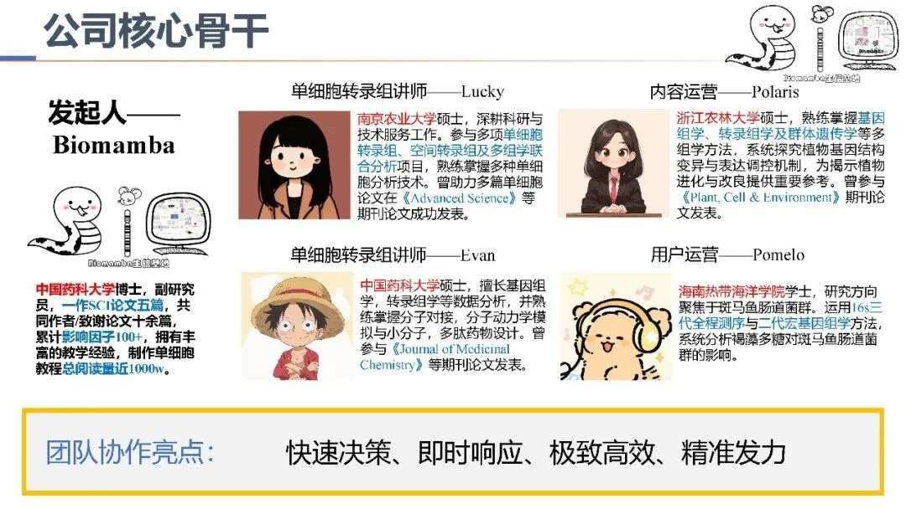

**
**

**[Biomamba生信基地招聘岗位一览，长期有效](<https://mp.weixin.qq.com/s?__biz=MzAwMzIzOTk5OQ==&mid=2247537674&idx=1&sn=9bce1e3738eb79419afa6722312fbd94&scene=21#wechat_redirect>)**

**[生信工程师招聘，长期有效](<https://mp.weixin.qq.com/s?__biz=MzAwMzIzOTk5OQ==&mid=2247533712&idx=3&sn=83c7eea13aa1f3dcd3bfcb6caa61b0cd&scene=21#wechat_redirect>)**

**[单细胞/空间组学讲师招聘(长期有效)](<https://mp.weixin.qq.com/s?__biz=MzAwMzIzOTk5OQ==&mid=2247537674&idx=3&sn=9b761a9cb37f9b8b4a22f10b6c07a5ac&scene=21#wechat_redirect>)**

[ 单细胞/空转生信工程师自测卷(入门级)](<https://mp.weixin.qq.com/s?__biz=MzAwMzIzOTk5OQ==&mid=2247524428&idx=1&sn=76fe575bad51f9d48a199d06520e07a4&scene=21&token=2143911808&lang=zh_CN&poc_token=HADrTWmj4XECGUvQoysTt-ivAXWcIR8LOIykgLMv#wechat_redirect>)

**[CADD、AIDD方向生信工程师招聘，长期有效](<https://mp.weixin.qq.com/s?__biz=MzAwMzIzOTk5OQ==&mid=2247537674&idx=2&sn=d4977089899917fef502df85bb9ee109&scene=21#wechat_redirect>)**

**[微生物组/基因组方向讲师招聘](<https://mp.weixin.qq.com/s?__biz=MzAwMzIzOTk5OQ==&mid=2247537674&idx=4&sn=0f1ed8ce2ac3f3bd64954728422205ba&scene=21#wechat_redirect>)**

**[Biomamba生信基地运营岗位招聘](<https://mp.weixin.qq.com/s?__biz=MzAwMzIzOTk5OQ==&mid=2247533712&idx=4&sn=1714ebbe4c40de1aed4a58641ded6813&scene=21#wechat_redirect>)**

**[Biomamba助理招聘](<https://mp.weixin.qq.com/s?__biz=MzAwMzIzOTk5OQ==&mid=2247533712&idx=5&sn=b6b82a1e3cbd24cba52e655cb7b51d14&scene=21#wechat_redirect>)**

**
**

**Biomamba 生信基地的那些事~**

[ 想了很久的生信基地](<https://mp.weixin.qq.com/s?__biz=MzAwMzIzOTk5OQ==&mid=2247522649&idx=1&sn=a3a3df860fd162691403281356dcbf1d&scene=21&token=2143911808&lang=zh_CN&poc_token=HN_qTWmjSRcry8zGVZ2yMj5Inafq5OhbkC0za64x#wechat_redirect>)

[2025年，生信基地终于建成啦！](<https://mp.weixin.qq.com/s?__biz=MzAwMzIzOTk5OQ==&mid=2247526229&idx=1&sn=0718f1702150ba77a7f7e3beadd6e0ba&scene=21&token=2143911808&lang=zh_CN&poc_token=HJnqTWmjXU6gbFi9XoybvIgGVXfbUW9ER3HXQIx8#wechat_redirect>)[直播中| scRNA-seq基因调控网络计算的四种方法！](<https://mp.weixin.qq.com/s?__biz=MzAwMzIzOTk5OQ==&mid=2247530399&idx=2&sn=8309134f1ba3e33bff5bab7baa817dfd&scene=21#wechat_redirect>)[直播文章复现| scRNA-seq揭示人纤维化皮肤病中的成纤维细胞异质性与增殖](<https://mp.weixin.qq.com/s?__biz=MzAwMzIzOTk5OQ==&mid=2247530696&idx=1&sn=c90298fbe01b150ad7779f77294c6a25&chksm=9b3c0198ac4b888e6a2dd5797a000ce744c5f66049227a4995fb5130c2606fecd1ba18cb9394&token=2135576976&lang=zh_CN&scene=21#wechat_redirect>)[听说你想两天学会单细胞分析？](<https://mp.weixin.qq.com/s?__biz=MzAwMzIzOTk5OQ==&mid=2247530824&idx=1&sn=3778953bc37fec93b90e6fb99821f856&chksm=9b3c0018ac4b890eb007d7e7c2ba38d5a87edd9a9a177b155b7afbbdfcd8eac6178028fc1b00&token=2135576976&lang=zh_CN&scene=21#wechat_redirect>)[看直播，免费学单细胞，还能拿礼物？](<https://mp.weixin.qq.com/s?__biz=MzAwMzIzOTk5OQ==&mid=2247530889&idx=1&sn=47ea304b2e85bab5707002fd8d482f54&chksm=9b3c00d9ac4b89cf811e3f825e9679a7342196addb96c3fdc71a49b261621b8020c3bc796010&token=2135576976&lang=zh_CN&scene=21#wechat_redirect>)[直播中，零代码学会单细胞画图、亚群分析、特征分析、拟时序分析、转录因子、细胞通讯、肿瘤异质性分析等](<https://mp.weixin.qq.com/s?__biz=MzAwMzIzOTk5OQ==&mid=2247531048&idx=2&sn=7643d21ed11c95b76b143edea305021d&chksm=9b3c0378ac4b8a6ee80e94ab0cf764144e41f6235cb915f90d76b916df1182f729dd2a4197e9&token=2135576976&lang=zh_CN&scene=21#wechat_redirect>)[做，做的就是生信培训](<https://mp.weixin.qq.com/s?__biz=MzAwMzIzOTk5OQ==&mid=2247531410&idx=1&sn=e0850491da199c8abaa538f2d64e0035&scene=21#wechat_redirect>)[生信人自己的双十一来啦！](<https://mp.weixin.qq.com/s?__biz=MzAwMzIzOTk5OQ==&mid=2247531933&idx=1&sn=d2dd6ac7a44832b154cdee2ffb67d3bf&chksm=9b3c04cdac4b8ddb51e294ac8c730f106a229e948bc8a864db0ad300aed38cc98307bdb8c393&token=2135576976&lang=zh_CN&scene=21#wechat_redirect>)[周边任选&资料、课程、服务器，统统九折~](<https://mp.weixin.qq.com/s?__biz=MzAwMzIzOTk5OQ==&mid=2247532005&idx=1&sn=5ac0102970601ee23a5abb2f8bdfe9b9&chksm=9b3c04b5ac4b8da39533e7376b65af18c6279c7c541aefa32340814d650db0feb0689c8e34e6&token=2135576976&lang=zh_CN&scene=21#wechat_redirect>)[一次性获取70篇生信学习手册，终身订阅九折！](<https://mp.weixin.qq.com/s?__biz=MzAwMzIzOTk5OQ==&mid=2247532023&idx=2&sn=228e8485600cdd564701b3182b272f6a&chksm=9b3c04a7ac4b8db1d1ec91c5a9920707e962d843c933e03aa5fefaf03001b14bbba2855920d5&token=2135576976&lang=zh_CN&scene=21#wechat_redirect>)[你还在使用没有root权限的服务器吗？](<https://mp.weixin.qq.com/s?__biz=MzAwMzIzOTk5OQ==&mid=2247532285&idx=2&sn=c6069cd45e5adb4f23b04539488ab0a9&chksm=9b3c07adac4b8ebb85c71bd9cfa8e77d273532ef9b9030c1c4131cf561092de838c51572277e&token=2135576976&lang=zh_CN&scene=21#wechat_redirect>)[为什么我们敢开放终身订阅](<https://mp.weixin.qq.com/s?__biz=MzAwMzIzOTk5OQ==&mid=2247532585&idx=1&sn=e265d2846ec66e5faaaf21403d274d2f&scene=21#wechat_redirect>)

[别再说自己R语言水平差啦](<https://mp.weixin.qq.com/s?__biz=MzAwMzIzOTk5OQ==&mid=2247532754&idx=2&sn=97eb002bdaa00e9d38efc8f33676f754&scene=21#wechat_redirect>)

[用R语言画生信基地圣诞树~](<https://mp.weixin.qq.com/s?__biz=MzAwMzIzOTk5OQ==&mid=2247533658&idx=1&sn=8c168f77110484d2777cb87ea3dd244a&chksm=9b3c3d0aac4bb41c1c20f254600b27ff38999cb4e66d4b0790c49d19e39002002b20eaad3e2f&token=2135576976&lang=zh_CN&scene=21#wechat_redirect>)

[SeekGene单细胞/空间多组学全家桶：scFAST、SeekSpace、scATAC一次学会](<https://mp.weixin.qq.com/s?__biz=MzAwMzIzOTk5OQ==&mid=2247534015&idx=1&sn=04da5c98bee2ac3497b6fe412e0efd41&chksm=9b3c3cefac4bb5f9f35b610d2bfe5f11d2fcf574c538b2d70a3b95554987a0d232e8305316ef&token=2135576976&lang=zh_CN&scene=21#wechat_redirect>)

[免费课程+学习手册|SeekGene单细胞/空间组学全家桶，属于你的“进阶通关包”](<https://mp.weixin.qq.com/s?__biz=MzAwMzIzOTk5OQ==&mid=2247534131&idx=1&sn=aa585b4d5da19d5563845acc5c624d3b&scene=21#wechat_redirect>)

[代发论文被骗7.5w？发文需认准正规渠道？](<https://mp.weixin.qq.com/s?__biz=MzAwMzIzOTk5OQ==&mid=2247534422&idx=1&sn=95bffa8e043ff16ab645aaa112fc003e&scene=21#wechat_redirect>)

[R人学习单细胞的最佳顺序](<https://mp.weixin.qq.com/s?__biz=MzAwMzIzOTk5OQ==&mid=2247534877&idx=1&sn=e96e4b6e31d94b860a466905609fc9ac&scene=21#wechat_redirect>)

[Python学习空间转录组的最佳顺序](<https://mp.weixin.qq.com/s?__biz=MzAwMzIzOTk5OQ==&mid=2247535282&idx=1&sn=ea2103b4dd55f40a09d0e76090775f7b&scene=21#wechat_redirect>)

[视频介绍，学单细胞你应该按照这个节奏](<https://mp.weixin.qq.com/s?__biz=MzAwMzIzOTk5OQ==&mid=2247536612&idx=1&sn=19032a541a2b5a9f07d64981cc22069f&scene=21#wechat_redirect>)

向下滑动查看更多

**
**

**Biomamba 生信基地"一作面对面"活动**

**[一作面对面第一期：《PHYTOMEDICINE》](<https://mp.weixin.qq.com/s?__biz=MzAwMzIzOTk5OQ==&mid=2247536583&idx=1&sn=9f7313dc171b036510b721db0ec4bc90&scene=21#wechat_redirect>)**

**[视频回放：《PHYTOMEDICINE》一作专访](<https://mp.weixin.qq.com/s?__biz=MzAwMzIzOTk5OQ==&mid=2247536875&idx=1&sn=4ced1e63556fec33fdbee053fa4582f4&scene=21#wechat_redirect>)**

**[一作面对面第二期：PANoptosis生信分析的DKD应用](<https://mp.weixin.qq.com/s?__biz=MzAwMzIzOTk5OQ==&mid=2247537574&idx=1&sn=c0afba508f074e417108f8822cce656c&scene=21#wechat_redirect>)**

**
**

**持续更新中~**

**实验基地**

不只是生信分析，我们也希望能够在湿实验方面给予大家充分的支持。长期以来Biomamba都在自己的媒体矩阵中分享生信分析技能。生命科学毕竟是物质的科学，脱离了实验总是玩不转的，大家的分析结果也需要去实验验证。为此我们组建了实验室。

[不光教你做实验，还可以帮你做实验](<https://mp.weixin.qq.com/s?__biz=MzAwMzIzOTk5OQ==&mid=2247537678&idx=1&sn=578993fdfa060d38c80e2df6fc200c39&scene=21#wechat_redirect>)

[细胞实验可预约，实验基地5、6月最新课表](<https://mp.weixin.qq.com/s?__biz=MzAwMzIzOTk5OQ==&mid=2247537678&idx=2&sn=1d329f22e35586dc794ce30aa6bd0ce4&scene=21#wechat_redirect>)

[不要让你的实验影响结果？](<https://mp.weixin.qq.com/s?__biz=MzAwMzIzOTk5OQ==&mid=2247533677&idx=1&sn=e5599ee5194815e153bf9012a47e2e24&scene=21#wechat_redirect>)

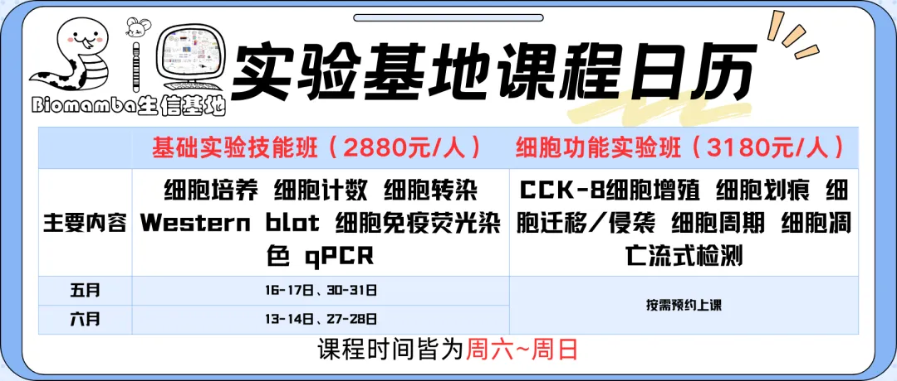

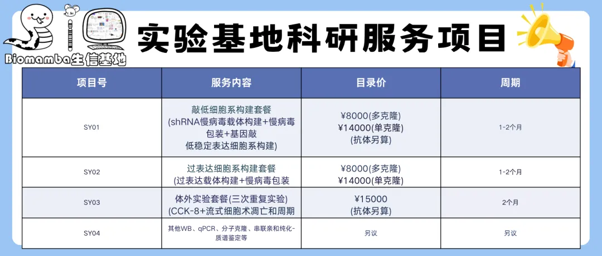

**湿实验**

[ 创造点实验条件](<https://mp.weixin.qq.com/s?__biz=MzAwMzIzOTk5OQ==&mid=2247522102&idx=1&sn=f7e5f2a52ac07e40d2a663582ff6c958&scene=21#wechat_redirect>)

[实验基地的序章](<https://mp.weixin.qq.com/s?__biz=MzAwMzIzOTk5OQ==&mid=2247522536&idx=1&sn=b47daa1eee437e0a7dbd74520e698620&scene=21#wechat_redirect>)
[第一次线下实验交流会完美收官！](<https://mp.weixin.qq.com/s?__biz=MzAwMzIzOTk5OQ==&mid=2247522520&idx=1&sn=ed4b850c2b2f51bbe7a90207bde5e010&scene=21#wechat_redirect>)
[实验基地第一次培训视频回顾](<https://mp.weixin.qq.com/s?__biz=MzAwMzIzOTk5OQ==&mid=2247522793&idx=2&sn=91ad22dfc84a6b071049895de5555933&scene=21#wechat_redirect>)
[实验基地第二次培训依旧免费（细胞培养+RT-QPCR实操）](<https://mp.weixin.qq.com/s?__biz=MzAwMzIzOTk5OQ==&mid=2247522793&idx=1&sn=65aa32a94e1eb6c768f2bf8612eebb57&scene=21#wechat_redirect>)
[两天手搓药物干扰细胞实验+RT-qPCR鉴定](<https://mp.weixin.qq.com/s?__biz=MzAwMzIzOTk5OQ==&mid=2247524184&idx=1&sn=9598fb4df3cb078ba29314eaab956e6d&scene=21#wechat_redirect>)
[Biomamba拍了拍你喊你来学细胞实验~](<https://mp.weixin.qq.com/s?__biz=MzAwMzIzOTk5OQ==&mid=2247524429&idx=1&sn=3cc29afc23958931070fdb1585a6d1cb&scene=21#wechat_redirect>)
[实验基地2024年最后一课| 免疫荧光+细胞实验](<https://mp.weixin.qq.com/s?__biz=MzAwMzIzOTk5OQ==&mid=2247524500&idx=2&sn=647f29c6128b31bf4bcd7caa6be2390e&scene=21#wechat_redirect>)
[实验技能培养计划开启！](<https://mp.weixin.qq.com/s?__biz=MzAwMzIzOTk5OQ==&mid=2247526459&idx=1&sn=124c0718b110110096aae0d17bd4c794&scene=21#wechat_redirect>)
[不堆组学，做WB也能发Nature](<https://mp.weixin.qq.com/s?__biz=MzAwMzIzOTk5OQ==&mid=2247527019&idx=1&sn=63464b0cbda9245eeed3dbcfdc69f7f8&scene=21#wechat_redirect>)[实验小白如何备战研究生复试](<https://mp.weixin.qq.com/s?__biz=MzAwMzIzOTk5OQ==&mid=2247527909&idx=1&sn=86ea63018bef869c6159bb82766e59e9&scene=21#wechat_redirect>)[五一研学上海南翔｜在实验基地开启"沉浸式"学习之旅](<https://mp.weixin.qq.com/s?__biz=MzAwMzIzOTk5OQ==&mid=2247528614&idx=1&sn=a3a89797ea503e0f7f7629350e644f1a&scene=21#wechat_redirect>)[实验基地全新升级！](<https://mp.weixin.qq.com/s?__biz=MzAwMzIzOTk5OQ==&mid=2247528762&idx=1&sn=8a021cadb30f65eae1ed242bffabc277&scene=21#wechat_redirect>)[第三次实验活动操作问题总结](<https://mp.weixin.qq.com/s?__biz=MzAwMzIzOTk5OQ==&mid=2247528762&idx=2&sn=03012ddc5a87452c60874caf1056de65&scene=21#wechat_redirect>)[常态化实验学习](<https://mp.weixin.qq.com/s?__biz=MzAwMzIzOTk5OQ==&mid=2247528769&idx=1&sn=53528029a1595c5dde109a461ec3708d&scene=21#wechat_redirect>)[实验基地斥巨资引进的流式细胞仪到了](<https://mp.weixin.qq.com/s?__biz=MzAwMzIzOTk5OQ==&mid=2247528861&idx=1&sn=7bd244adb4367b7013aeb9ba4faa8ff5&scene=21#wechat_redirect>)[一文了解细胞流式术](<https://mp.weixin.qq.com/s?__biz=MzAwMzIzOTk5OQ==&mid=2247529204&idx=1&sn=dc70f79b6460e9a134d8dbee531fc3c7&scene=21&token=2135576976&lang=zh_CN&poc_token=HDnJX2mjGQN8TZsBw-dSGmLSqMHuXN9wj8Q9D4UM#wechat_redirect>)[流式/磁珠分选指北](<https://mp.weixin.qq.com/s?__biz=MzAwMzIzOTk5OQ==&mid=2247529428&idx=1&sn=18a7bf6c013bab0cb2ecbde9c1c4e9af&scene=21#wechat_redirect>)[实验基地7月最新安排](<https://mp.weixin.qq.com/s?__biz=MzAwMzIzOTk5OQ==&mid=2247529675&idx=2&sn=df5b6921c67096cb7dbb20a90f092244&scene=21#wechat_redirect>)[承包你的暑期实验学习~](<https://mp.weixin.qq.com/s?__biz=MzAwMzIzOTk5OQ==&mid=2247530289&idx=2&sn=a381428cc21da59f5ba0ecdfeca69f1c&scene=21#wechat_redirect>)[八月九月实验室安排](<https://mp.weixin.qq.com/s?__biz=MzAwMzIzOTk5OQ==&mid=2247530621&idx=2&sn=13aed2b176e01c646828ae208d7b31de&scene=21#wechat_redirect>)[实验基地秋季学期来啦~](<https://mp.weixin.qq.com/s?__biz=MzAwMzIzOTk5OQ==&mid=2247531145&idx=1&sn=5cbe98083cb0fd67f2b0c18ea3c5fe74&scene=21#wechat_redirect>)[实验学期教学最新安排~](<https://mp.weixin.qq.com/s?__biz=MzAwMzIzOTk5OQ==&mid=2247531463&idx=2&sn=47b53ce445e3fb25ed4902f83416ab52&scene=21#wechat_redirect>)[空转分析靠谱吗？这些湿实验：给你“双重保证”！](<https://mp.weixin.qq.com/s?__biz=MzAwMzIzOTk5OQ==&mid=2247531463&idx=1&sn=5ee879442cf3b579ae46553dadcd526c&scene=21#wechat_redirect>)

向下滑动查看更多

**
**

读者问答****

我们解答并解决过很多读者的问题，欢迎大家继续向我们提问，我们永远会倾听大家的声音：

**你问我答**

[ 生信答疑，我有三不答](<https://mp.weixin.qq.com/s?__biz=MzAwMzIzOTk5OQ==&mid=2247532008&idx=1&sn=5ea5ceae42a9d3b4c77903d18c1f3f03&scene=21#wechat_redirect>)

[如何找到一个物种所有的线粒体编码基因](<https://mp.weixin.qq.com/s?__biz=MzAwMzIzOTk5OQ==&mid=2247498034&idx=1&sn=b379eb554c2b4148bcc59d7dd4729cfc&chksm=9b3c8062ac4b097425ce051ebcc0fb3fcc4996053d74b99207a68d90e8edc930f0dfd4d94657&scene=21&cur_album_id=2453318094304673794&search_click_id=#wechat_redirect>)

[如何在一张FeaturePlot上同时画多个基因](<https://mp.weixin.qq.com/s?__biz=MzAwMzIzOTk5OQ==&mid=2247499801&idx=1&sn=e9022989784d156e73da06640b16e0df&scene=21#wechat_redirect>)[答读者问（一）单基因究竟能否进行GSEA](<https://mp.weixin.qq.com/s?__biz=MzAwMzIzOTk5OQ==&mid=2247484175&idx=1&sn=3e45ad62b045a541874e5ae7ca03f849&scene=21#wechat_redirect>)[答读者问（二）为什么我的PCA分析报错了？](<https://mp.weixin.qq.com/s?__biz=MzAwMzIzOTk5OQ==&mid=2247484248&idx=1&sn=b1fe7174a28562d01422e43609f41709&scene=21#wechat_redirect>)[答读者问（三）单细胞测序前景](<https://mp.weixin.qq.com/s?__biz=MzAwMzIzOTk5OQ==&mid=2247484280&idx=2&sn=844af02070012a1c2681880596ba51a2&scene=21#wechat_redirect>)[答读者问（四）：如何分析细胞亚群](<https://mp.weixin.qq.com/s?__biz=MzAwMzIzOTk5OQ==&mid=2247484316&idx=2&sn=e8d02fddc80d1137bb64c55541f1651d&scene=21#wechat_redirect>)[答读者问（五）如何实现各物种基因的ID/symbol的转换](<https://mp.weixin.qq.com/s?__biz=MzAwMzIzOTk5OQ==&mid=2247484353&idx=2&sn=8fccb88c871a42c803e313be157ab293&scene=21#wechat_redirect>)[Seurat中如何让细胞听你指挥](<https://mp.weixin.qq.com/s?__biz=MzAwMzIzOTk5OQ==&mid=2247497669&idx=3&sn=ac3408c7dd28425426d954f81d283252&scene=21#wechat_redirect>)[答读者问（七）有人问我Biomamba何解](<https://mp.weixin.qq.com/s?__biz=MzAwMzIzOTk5OQ==&mid=2247484550&idx=1&sn=ec4466084c1c9eba7eb292e95f33b5bb&scene=21#wechat_redirect>)[答读者问（八）为什么Read10X也会报错?](<https://mp.weixin.qq.com/s?__biz=MzAwMzIzOTk5OQ==&mid=2247485012&idx=1&sn=6007c8d7cb2a236dd7240a678dac0391&scene=21#wechat_redirect>)[答读者问（九） 如何将数百个文件整合为一个矩阵](<https://mp.weixin.qq.com/s?__biz=MzAwMzIzOTk5OQ==&mid=2247485032&idx=1&sn=7d4777589fa1f92d26ad05ffe3e02f6a&scene=21#wechat_redirect>)[答读者问（十）整合后的表达矩阵，如何拆分出分组信息？](<https://mp.weixin.qq.com/s?__biz=MzAwMzIzOTk5OQ==&mid=2247485134&idx=1&sn=13f5f8c47d8af2beeca4e103a5f5e26d&scene=21#wechat_redirect>)[答读者问（十一）如何一次性读取一个目录下的cellranger输出文件？](<https://mp.weixin.qq.com/s?__biz=MzAwMzIzOTk5OQ==&mid=2247485145&idx=1&sn=402cb28c16aba0dc647037c9b7aba8f7&scene=21#wechat_redirect>)[答读者问（十三）查看Seurat对象时的ERROR：type='text'](<https://mp.weixin.qq.com/s?__biz=MzAwMzIzOTk5OQ==&mid=2247485859&idx=1&sn=a014c4cb6034551e57c70820c7781e49&scene=21#wechat_redirect>)[答读者问（十四）Seurat中分类变量处理技巧](<https://mp.weixin.qq.com/s?__biz=MzAwMzIzOTk5OQ==&mid=2247486134&idx=1&sn=e581b8ac20bbc968aeef3f9cf56f3a0f&scene=21#wechat_redirect>)[答读者问（十五）稀疏矩阵转matrix, as.matrix函数是下下策](<https://mp.weixin.qq.com/s?__biz=MzAwMzIzOTk5OQ==&mid=2247486259&idx=1&sn=97de5c9e15e48cb62c8a680376a4ee0d&scene=21#wechat_redirect>)[答读者问（十七）调用的线程越多就算的越快嘛?](<https://mp.weixin.qq.com/s?__biz=MzAwMzIzOTk5OQ==&mid=2247488995&idx=1&sn=7140e0d037671542fb37dff3a3c94b28&scene=21#wechat_redirect>)[答读者问（十八）、一个我至少被问过30遍的monocle报错](<https://mp.weixin.qq.com/s?__biz=MzAwMzIzOTk5OQ==&mid=2247490010&idx=1&sn=24c55fa4bd5d7d829625cb67dbaf321a&scene=21#wechat_redirect>)[答读者问(十九): R语言内存问题-Error: cannot allocate vector of size ** Gb](<https://mp.weixin.qq.com/s?__biz=MzAwMzIzOTk5OQ==&mid=2247492912&idx=1&sn=c721a8d64e621832bf5518ab1f26d9fe&scene=21#wechat_redirect>)[答读者问（二十）四个单细胞样本只给了一套文件怎么读](<https://mp.weixin.qq.com/s?__biz=MzAwMzIzOTk5OQ==&mid=2247494879&idx=1&sn=c2287ab3684792747dfac53d6704462b&scene=21#wechat_redirect>)[答读者问| 21.申请生信博士需要满足什么条件](<https://mp.weixin.qq.com/s?__biz=MzAwMzIzOTk5OQ==&mid=2247494904&idx=1&sn=207c0ee573206c5d7f282f8f14680394&scene=21#wechat_redirect>)[答读者问| 22.object 'CsparseMatrix_validate' not found](<https://mp.weixin.qq.com/s?__biz=MzAwMzIzOTk5OQ==&mid=2247496273&idx=1&sn=fd5a92dd7fdc349b1624784ca74b1220&scene=21#wechat_redirect>)[用Excel他不香么？](<https://mp.weixin.qq.com/s?__biz=MzAwMzIzOTk5OQ==&mid=2247484071&idx=1&sn=58d09c6198e3ee0ad6a87281b2686f7b&scene=21#wechat_redirect>)[有奖提问,这个smart-Seq2数据实战的比对率为何如此低？](<https://mp.weixin.qq.com/s?__biz=MzAwMzIzOTk5OQ==&mid=2247488441&idx=1&sn=dac4efc4a8901a4abb133f9e5c80831e&chksm=9b3f6ae9ac48e3fff5a7112a0127726441ccb9dc2c3369d4a0fe98a2120df991954ff0567732&scene=21&cur_album_id=2453318094304673794&search_click_id=#wechat_redirect>)[Rstudio-server为什么总是登不进去](<https://mp.weixin.qq.com/s?__biz=MzAwMzIzOTk5OQ==&mid=2247524106&idx=5&sn=41b532ad40d8732e3f0d39721153d7e6&scene=21#wechat_redirect>)[Cellranger报错：Unable to distinguish between [SC5P-R2, SC3Pv2] ...](<https://mp.weixin.qq.com/s?__biz=MzAwMzIzOTk5OQ==&mid=2247504739&idx=2&sn=e4e6ad0559b9b6a703d6ab37c2a8fdb0&scene=21#wechat_redirect>)[Linux也有百度云喔~](<https://mp.weixin.qq.com/s?__biz=MzAwMzIzOTk5OQ==&mid=2247521009&idx=1&sn=06a9e3d1c7564992399ca1e4055dc293&chksm=9b3ceba1ac4b62b7d39ce16b55b272599a3f1491977dc9feb64ac114b8c0d7a0961603c0d556&scene=21&cur_album_id=2453318094304673794&search_click_id=#wechat_redirect>)[应审稿人要求| pseudo bulk差异分析](<https://mp.weixin.qq.com/s?__biz=MzAwMzIzOTk5OQ==&mid=2247521437&idx=1&sn=d47b48170f7189b8fb74b2316d0c4898&chksm=9b3cedcdac4b64db43487176203e52e53fe08e01ce819a1615fa1e2f9f8d513bbd4efdee5558&scene=21&cur_album_id=2453318094304673794&search_click_id=#wechat_redirect>)[30w单细胞数据会吃掉多少内存？](<https://mp.weixin.qq.com/s?__biz=MzAwMzIzOTk5OQ==&mid=2247525849&idx=1&sn=aa48c5e9405afcf28ffccb7bb4312e70&scene=21#wechat_redirect>)[稀疏的单细胞](<https://mp.weixin.qq.com/s?__biz=MzAwMzIzOTk5OQ==&mid=2247529675&idx=1&sn=4d16321d68430f9a1c2d20fb77234d24&chksm=9b3c0d9bac4b848d10045533515ce8009c5548e5c7883c7778cd0ed9bf3aec1864f67baef1f8&scene=21&cur_album_id=2453318094304673794&search_click_id=#wechat_redirect>)[怎么就不会合并单细胞数据了呢](<https://mp.weixin.qq.com/s?__biz=MzAwMzIzOTk5OQ==&mid=2247529812&idx=1&sn=cb6b4244cafe8fa0575c07f106e78ff6&chksm=9b3c0c04ac4b8512e69a1b430464eb920563486e10e689384ee03aeab528f6c68d267cc0d0a3&scene=21&cur_album_id=2453318094304673794&search_click_id=#wechat_redirect>)
[不足3个细胞怎么做差异分析？](<https://mp.weixin.qq.com/s?__biz=MzAwMzIzOTk5OQ==&mid=2247530311&idx=1&sn=3cfbe93216b11c76923f326dd7b44439&chksm=9b3c0e17ac4b8701e1af4b7197600f23f02c6c06a6f299e58d1b9adb2888f89790ece848c126&scene=21&cur_album_id=2453318094304673794&search_click_id=#wechat_redirect>)
[人生苦短，我downsample](<https://mp.weixin.qq.com/s?__biz=MzAwMzIzOTk5OQ==&mid=2247530367&idx=1&sn=f7452a93145295bd6dfc4a7e571413d6&chksm=9b3c0e2fac4b8739955570686f8761eabcbc635414ed7651dd4e91bfd9ffad98035a12be9962&scene=21&cur_album_id=2453318094304673794&search_click_id=#wechat_redirect>)[掌握数据格式，才不怕报错](<https://mp.weixin.qq.com/s?__biz=MzAwMzIzOTk5OQ==&mid=2247535927&idx=1&sn=6a24970ba3c55977ac8b6799fb7f2c06&scene=21#wechat_redirect>)

向下滑动查看更多

**
**

**粉丝来稿**

另外，我们也十分欢迎大家加入到我们的创作队列中，Biomamba 生信基地也有大家贡献的智慧：

**共筑生信基地**

[ 粉丝来稿|1. Seurat4相较于Seurat3的几点改动](<https://mp.weixin.qq.com/s?__biz=MzAwMzIzOTk5OQ==&mid=2247494516&idx=1&sn=cb2d4e6b182428ce7b98e7fff2e8729a&chksm=9b3c9224ac4b1b32c4fe99758960305c4845395cfe03851d70a0407043ee36250e55d20106fc&scene=21&cur_album_id=2649634741759279105&search_click_id=#wechat_redirect>)

[粉丝来稿|2. ERROR：type='text'的另一种解法](<https://mp.weixin.qq.com/s?__biz=MzAwMzIzOTk5OQ==&mid=2247497842&idx=1&sn=5d109d3cfc74c64c4499fce90febeabb&chksm=9b3c8122ac4b0834157220d5c21f1f88dfa7a4eeb5ff44454df126b75648e41a8621833fb8e2&scene=21&cur_album_id=2649634741759279105&search_click_id=#wechat_redirect>)

[WGCNA+cytoscape构建基因表达模块网络图](<https://mp.weixin.qq.com/s?__biz=MzAwMzIzOTk5OQ==&mid=2247499271&idx=1&sn=69ae605ffe6fe60925ed144c88b8803b&chksm=9b3c8757ac4b0e41ca67ce8fb023ca849da7cbe828a7d3116bdcd96d2a9c9b6293c010cc7465&scene=21&cur_album_id=2649634741759279105&search_click_id=#wechat_redirect>)[百万级单细胞多组学数据集成](<https://mp.weixin.qq.com/s?__biz=MzAwMzIzOTk5OQ==&mid=2247499336&idx=1&sn=864c535b38ce630487fccc602d893a80&chksm=9b3c8718ac4b0e0e8a0e2560a83546167a82616d99503606e3ac0ef29e90b01cc762e95d64e6&scene=21&cur_album_id=2649634741759279105&search_click_id=#wechat_redirect>)[在TCGA数据库里挖呀挖呀挖](<https://mp.weixin.qq.com/s?__biz=MzAwMzIzOTk5OQ==&mid=2247499735&idx=1&sn=9ecdf418d3d177e091c0fca41fcb4f60&chksm=9b3c8687ac4b0f9103d09f4546ecd2bde88a197180f8101bb7778263fd2c0f23237c52b052b2&scene=21&cur_album_id=2649634741759279105&search_click_id=#wechat_redirect>)[单细胞数据在R中的读取及存储速度太慢怎么办？这个神包来帮你！](<https://mp.weixin.qq.com/s?__biz=MzAwMzIzOTk5OQ==&mid=2247500270&idx=1&sn=11bdf3c7f9042fc03f9ed237a9b9677b&chksm=9b3cb8beac4b31a8bf1d9fb862553ed32ac9a56f4a6e0f2d38c9478132f87327d8c6b6940573&scene=21&cur_album_id=2649634741759279105&search_click_id=#wechat_redirect>)[单细胞分群分辨率选择困难症](<https://mp.weixin.qq.com/s?__biz=MzAwMzIzOTk5OQ==&mid=2247501241&idx=1&sn=9e15d23f721ad7f4ae1335ce5362031b&chksm=9b3cbce9ac4b35ff43434c0384afbbf5689f5b62a677e55e8a635d4812da57593d85a73cf48b&scene=21&cur_album_id=2649634741759279105&search_click_id=#wechat_redirect>)

[骨肉瘤治疗的新视野](<https://mp.weixin.qq.com/s?__biz=MzAwMzIzOTk5OQ==&mid=2247501812&idx=1&sn=eba61d662c1720fb5cee42817334aa9c&chksm=9b3cbea4ac4b37b25470795268a041806ffa385641ff2d41bbcf86f7ebdc8f2f10bf28cac604&scene=21&cur_album_id=2649634741759279105&search_click_id=#wechat_redirect>)

[《Nature》: 单细胞解析大脑感知流感过程](<https://mp.weixin.qq.com/s?__biz=MzAwMzIzOTk5OQ==&mid=2247503508&idx=1&sn=72781ff97ecae1c32815fe2c4d71b24e&chksm=9b3cb7c4ac4b3ed2b46c8c22f4ce8f93e3f93004ee76542bdd92039d301cec4a10077bb973db&scene=21&cur_album_id=2649634741759279105&search_click_id=#wechat_redirect>)

[单细胞复写|4. GSE157783数据集复现及差异分析](<https://mp.weixin.qq.com/s?__biz=MzAwMzIzOTk5OQ==&mid=2247503585&idx=1&sn=0035977a80621f09d0774d3c9b0a86cd&chksm=9b3cb7b1ac4b3ea76685ed44abcfb031c698835d9b9b42b269496f6104cd8c9d45467de7eddd&scene=21&cur_album_id=2649634741759279105&search_click_id=#wechat_redirect>)

[《NC》：翻译调控子MHZ9调节水稻中的乙烯信号通路](<https://mp.weixin.qq.com/s?__biz=MzAwMzIzOTk5OQ==&mid=2247504327&idx=2&sn=0fccf3451e3cde354027d99037804ec7&chksm=9b3ca897ac4b21816a9805354728ec17fc107c3472e2c4824c5ea7bf8803c12c4f03b3cfbc45&scene=21&cur_album_id=2649634741759279105&search_click_id=#wechat_redirect>)

[WGCNA代码及结果解读](<https://mp.weixin.qq.com/s?__biz=MzAwMzIzOTk5OQ==&mid=2247505146&idx=1&sn=c7a28170c40d3c58afb16ffd6441ae81&chksm=9b3cadaaac4b24bc0b762f9bfe704d8aba2bef74359abfb6d725b4b54491e037df7d9fbeb56e&scene=21&cur_album_id=2649634741759279105&search_click_id=#wechat_redirect>)

[CAR-T治疗急性髓细胞性白血病的scRNA-Seq图谱](<https://mp.weixin.qq.com/s?__biz=MzAwMzIzOTk5OQ==&mid=2247506371&idx=1&sn=a9f44bdfd795a4d04615bc307cd23cf5&chksm=9b3ca093ac4b29853f7f068e3969384ed07cd2cf4d64a55c423cd74bce83b914c96844a4cb3d&scene=21&cur_album_id=2649634741759279105&search_click_id=#wechat_redirect>)

[如何将已经构建好的Seurat空转对象转存为原始文件？](<https://mp.weixin.qq.com/s?__biz=MzAwMzIzOTk5OQ==&mid=2247508133&idx=1&sn=297b8fb9cc8f33a1d19167dba1104e97&chksm=9b3cd9f5ac4b50e36df53e3e18bb2990d9635d88a725f1e54fc5eb5967ac9f0934b79cbb8b34&scene=21&cur_album_id=2649634741759279105&search_click_id=#wechat_redirect>)

[《Nature》经典综述：空间转录组学探索组织结构](<https://mp.weixin.qq.com/s?__biz=MzAwMzIzOTk5OQ==&mid=2247509228&idx=1&sn=0b7853dc07f86697b8e73fe47b83c499&chksm=9b3cddbcac4b54aa96f34acd40631de6938f491b69b1a15c4fc5f15e83d949d01a4b29399807&scene=21&cur_album_id=2649634741759279105&search_click_id=#wechat_redirect>)

[一文了解染色质可及性和表观基因组调控](<https://mp.weixin.qq.com/s?__biz=MzAwMzIzOTk5OQ==&mid=2247510114&idx=1&sn=f7e8b1df1804a6bba0d79b1ffec2467c&chksm=9b3cd132ac4b58243d6353871aba6648e3bdc3d36e17cac6235057c7a38a7f29ed7fd6159da3&scene=21&cur_album_id=2649634741759279105&search_click_id=#wechat_redirect>)

[鼻咽癌的Bulk RNA-Seq与scRNA-Seq联合分析](<https://mp.weixin.qq.com/s?__biz=MzAwMzIzOTk5OQ==&mid=2247510548&idx=1&sn=58048c46e837b1d56dffa282272c6d96&chksm=9b3cd344ac4b5a52369e91b4e61fa0a2c951b82cc21165b99f42ba2c2191d4add803bd73c928&scene=21&cur_album_id=2649634741759279105&search_click_id=#wechat_redirect>)

[如何在没有root权限的情况下使用R语言](<https://mp.weixin.qq.com/s?__biz=MzAwMzIzOTk5OQ==&mid=2247510663&idx=1&sn=4d572352e146e60668ed667f42efc070&chksm=9b3cd3d7ac4b5ac1c47b4cc7cc17823c2c37091fc89d07054844bd539f3eb251f1c540269590&scene=21&cur_album_id=2649634741759279105&search_click_id=#wechat_redirect>)

[在VSCode中调用Jupyterlab和R](<https://mp.weixin.qq.com/s?__biz=MzAwMzIzOTk5OQ==&mid=2247523095&idx=1&sn=69546c915d4c7f33c24b3600a78231ff&chksm=9b3ce247ac4b6b510c8bf60fa8eb69d0d77c369ada147642b2135a4afa7cbc46547c99b0478e&scene=21&cur_album_id=2649634741759279105&search_click_id=#wechat_redirect>)

[《Nature Methods》|单细胞联合类器官技术解析人脑发育特征](<https://mp.weixin.qq.com/s?__biz=MzAwMzIzOTk5OQ==&mid=2247528124&idx=1&sn=dc5e4d511f14f9ce2ad0f63819dab0c1&chksm=9b3c17ecac4b9efa0e3b5cfc8bb91ff4e550da211c5129253799e2e343f9ecd52b5ea9e42049&scene=21&cur_album_id=2649634741759279105&search_click_id=#wechat_redirect>)

[零代码复现| scRNA-seq解析胃癌患者器官特异性转移](<https://mp.weixin.qq.com/s?__biz=MzAwMzIzOTk5OQ==&mid=2247528326&idx=1&sn=1979536cb00756f263031d5e640177d3&chksm=9b3c16d6ac4b9fc0259d5d48daf533e8c39c2d3736f99ec452a5016b82b178255c4d84eace95&scene=21&cur_album_id=2649634741759279105&search_click_id=#wechat_redirect>)

[《Nature Methods》| Cellpose3：一键式改善细胞分割效果](<https://mp.weixin.qq.com/s?__biz=MzAwMzIzOTk5OQ==&mid=2247528351&idx=1&sn=eab3f3d27d5521619340f52b4e7a1b83&chksm=9b3c16cfac4b9fd9a14ee2ab2fea3b88369487df802505275c8aa7d78969cb64debcd3e1c237&scene=21&cur_album_id=2649634741759279105&search_click_id=#wechat_redirect>)

[零代码复现《Genome Medicine》|scRNA-seq解析CXCL16/CXCR6驱动驻留T细胞促进突触消除](<https://mp.weixin.qq.com/s?__biz=MzAwMzIzOTk5OQ==&mid=2247528493&idx=1&sn=d7e31fc84bef96bbad9e9fde06e55726&chksm=9b3c097dac4b806bce7b76a87c03c966b167acaec87729f64dbc5703fb4ff8a9a5360dcb131b&scene=21&cur_album_id=2649634741759279105&search_click_id=#wechat_redirect>)

向下滑动查看更多

**
**

**基金申报**

生物信息学在国自然申请中扮演着至关重要的角色，它不仅是处理和分析海量生物数据的关键工具，更是推动生命科学研究从数据驱动向知识发现转变的核心驱动力。我们也联合寻因生物&青椒医学推出了基金申报方面的分享：

[2026国自然单细胞多组学大红书申报宝典](<https://mp.weixin.qq.com/s?__biz=MzAwMzIzOTk5OQ==&mid=2247533659&idx=1&sn=d8b3d8c80e549874bacedce84571d77c&scene=21#wechat_redirect>)

[早早就要交明年的国自然标书了](<https://mp.weixin.qq.com/s?__biz=MzAwMzIzOTk5OQ==&mid=2247533659&idx=1&sn=d8b3d8c80e549874bacedce84571d77c&scene=21#wechat_redirect>)

[官方：2026年国自然申请书改版！](<https://mp.weixin.qq.com/s?__biz=MzAwMzIzOTk5OQ==&mid=2247533827&idx=3&sn=389b89fa52f12cf7e02be5f4f5d9198a&scene=21#wechat_redirect>)

**国自然**

[ 国自然中的单细胞测序](<https://mp.weixin.qq.com/s?__biz=MzAwMzIzOTk5OQ==&mid=2247520196&idx=1&sn=01a5fc52ae42183af162822fbdfaf374&scene=21#wechat_redirect>)

[国自然十大热点| 单细胞&空转系列专题](<https://mp.weixin.qq.com/s?__biz=MzAwMzIzOTk5OQ==&mid=2247522608&idx=1&sn=4af2c0ca8a2b26d1ace78f5c176af2a1&scene=21#wechat_redirect>)
[国自然，说点心里话](<https://mp.weixin.qq.com/s?__biz=MzAwMzIzOTk5OQ==&mid=2247523515&idx=2&sn=758232ae812ed6b864d7df127b77a06a&scene=21#wechat_redirect>)
[多读论文，才能写好国自然标书](<https://mp.weixin.qq.com/s?__biz=MzAwMzIzOTk5OQ==&mid=2247523515&idx=1&sn=21d9ad1ed0cb3cb3aaf06b21ffc46a2e&scene=21#wechat_redirect>)
[生信基地第三课| 手把手教你写国自然](<https://mp.weixin.qq.com/s?__biz=MzAwMzIzOTk5OQ==&mid=2247524439&idx=1&sn=20a57b5a0fd46eb60a7a2718b2ced354&scene=21#wechat_redirect>)
[2025国自然必中交流群](<https://mp.weixin.qq.com/s?__biz=MzAwMzIzOTk5OQ==&mid=2247524808&idx=1&sn=b064024a117f8580c5de0708775b6909&scene=21#wechat_redirect>)
[国自然中标宝典](<https://mp.weixin.qq.com/s?__biz=MzAwMzIzOTk5OQ==&mid=2247525030&idx=2&sn=d5bde9346a2b83a19f939dd41e91de72&scene=21#wechat_redirect>)
[揭示肿瘤巨噬细胞异质性的全新视角|单细胞与空间转录组](<https://mp.weixin.qq.com/s?__biz=MzAwMzIzOTk5OQ==&mid=2247525650&idx=6&sn=56a0c83b87534867de6290d00b02cf0f&scene=21#wechat_redirect>)
[国自然瘤内菌研究新维度：单细胞技术助力解开生命奥秘](<https://mp.weixin.qq.com/s?__biz=MzAwMzIzOTk5OQ==&mid=2247525650&idx=5&sn=14198ddd67bcd2b5c68549b2ce70d880&scene=21#wechat_redirect>)
[肿瘤免疫治疗新方向|单细胞-空间测序技术助力](<https://mp.weixin.qq.com/s?__biz=MzAwMzIzOTk5OQ==&mid=2247525650&idx=4&sn=a4dce54ffb48e4250ad2f7f7fb9d1957&scene=21#wechat_redirect>)
[单细胞空间转录组技术助力探索大脑的奥秘](<https://mp.weixin.qq.com/s?__biz=MzAwMzIzOTk5OQ==&mid=2247525650&idx=3&sn=6a9c133557091c2d9c16583775d0a387&scene=21#wechat_redirect>)
[铁死亡研究新维度：SeekSpace®单细胞空间转录组技术](<https://mp.weixin.qq.com/s?__biz=MzAwMzIzOTk5OQ==&mid=2247525650&idx=2&sn=3b96ff98786a778be5167cd398a58244&scene=21#wechat_redirect>)
[血管新生的基因密码：空间转录组技术在肿瘤血管研究中的突破](<https://mp.weixin.qq.com/s?__biz=MzAwMzIzOTk5OQ==&mid=2247525650&idx=1&sn=3f37b20980b352033c8ca4a838e6599c&scene=21#wechat_redirect>)
[国自然利器| 单细胞转录组&空间转录组学探秘](<https://mp.weixin.qq.com/s?__biz=MzAwMzIzOTk5OQ==&mid=2247522836&idx=1&sn=50871e92dce848d19ab5fb8fa52fd1ac&scene=21#wechat_redirect>)

向下滑动查看更多

**
**

文献速递****

我们给大家做过一百多篇生物 &医药文献分享，这里就不逐一插入了：[文献速递点击跳转](<https://mp.weixin.qq.com/mp/appmsgalbum?__biz=MzAwMzIzOTk5OQ==&action=getalbum&album_id=2802463431357661184#wechat_redirect>)

漫谈胡侃****

另外，Biomamba 时常会发出一些犀利点评，这些内容就不在此逐一呈现了 ：[漫谈胡侃](<https://mp.weixin.qq.com/mp/appmsgalbum?__biz=MzAwMzIzOTk5OQ==&action=getalbum&album_id=2697849917016670209&token=2143911808&lang=zh_CN#wechat_redirect>)

求职、求学、招聘****

谁苦读多年，不是想来份钱多事少离家近的工作，我们长期帮助大家发布求职/招聘的推送，详见合辑：[ 求职、求学、招聘](<https://mp.weixin.qq.com/mp/appmsgalbum?__biz=MzAwMzIzOTk5OQ==&action=getalbum&album_id=2672902529483309057#wechat_redirect>)

千里姻缘一线牵****

学习固然要紧，但也别光顾着埋头读书，闲暇时也留意留意，给自己找个合适的对象吧~[ 开一个相亲板块~](<https://mp.weixin.qq.com/s?__biz=MzAwMzIzOTk5OQ==&mid=2247522720&idx=1&sn=8255dd6eed068775bf40ff16758b63a8&scene=21&token=2143911808&lang=zh_CN&poc_token=HL0GTmmjiToKiJt8f7oMQwok6yseHRa2S0ENg-Ed#wechat_redirect>)[科研硕博相亲交流群](<https://mp.weixin.qq.com/s?__biz=MzAwMzIzOTk5OQ==&mid=2247528124&idx=2&sn=6fc448ece5499676dde4a84e49070ca1&scene=21&token=2143911808&lang=zh_CN&poc_token=HNkGTmmj8M9T_eCtUjcrKm5oW2fMOaQM-wPI1dll#wechat_redirect>)

送周边****

Biomamba 生信基地共有七种 周边：[R语言scRNA-seq全程班](<https://mp.weixin.qq.com/s?__biz=MzAwMzIzOTk5OQ==&mid=2247535927&idx=2&sn=86947f0522de0d9785865bd24115b002&scene=21#wechat_redirect>)超大鼠标垫、[Python scRNA-seq全程班](<https://mp.weixin.qq.com/s?__biz=MzAwMzIzOTk5OQ==&mid=2247533067&idx=1&sn=7ef76058cbcf7bd45f58147766c75854&scene=21#wechat_redirect>)超大鼠标垫、[Python空间转录组全程班](<https://mp.weixin.qq.com/s?__biz=MzAwMzIzOTk5OQ==&mid=2247533721&idx=1&sn=9648ed4701224e5d2e4c704d7046d9de&scene=21#wechat_redirect>)超大鼠标垫、金士顿64GB超大U盘、Biomamba同款胸包、[Linux速查](<https://mp.weixin.qq.com/s?__biz=MzAwMzIzOTk5OQ==&mid=2247505777&idx=1&sn=f3efae390566b838a445ab9f832323c8&scene=21#wechat_redirect>)超大鼠标垫(80cmX30cm)、Biomamba精品咖啡杯。我们的周边不仅仅局限这些，后期我们会不定期的给大家发放Biomamba 生信基地周边，请大家多多关注我们公众号发布的活动通知~

主打一个字：送！

[R语言scRNA-seq数据分析](<https://mp.weixin.qq.com/s?__biz=MzAwMzIzOTk5OQ==&mid=2247535927&idx=2&sn=86947f0522de0d9785865bd24115b002&scene=21#wechat_redirect>)超大[鼠标垫](<https://mp.weixin.qq.com/s?__biz=MzAwMzIzOTk5OQ==&mid=2247534804&idx=1&sn=4fd3fb71c1ebc87875a2fa2a67987fe1&scene=21#wechat_redirect>)

[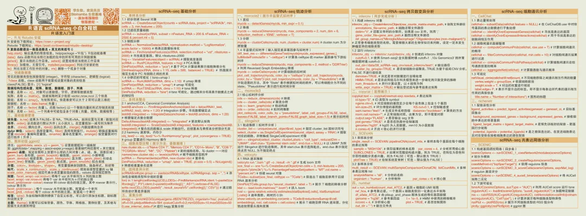](<https://mp.weixin.qq.com/s?__biz=MzAwMzIzOTk5OQ==&mid=2247535927&idx=2&sn=86947f0522de0d9785865bd24115b002&scene=21#wechat_redirect>)
[Python scRNA-seq数据分析](<https://mp.weixin.qq.com/s?__biz=MzAwMzIzOTk5OQ==&mid=2247534762&idx=2&sn=60d56d856036cf523f1dfcf7ea284d18&scene=21&token=963453299&lang=zh_CN&poc_token=HER0ummjLKkVvwENbbt6gBn5YKZdJjDc2oTJpCfm#wechat_redirect>)鼠标垫[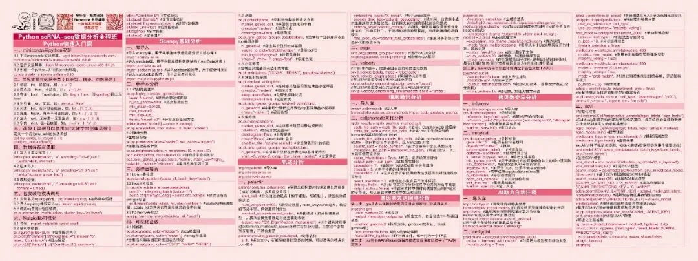](<https://mp.weixin.qq.com/s?__biz=MzAwMzIzOTk5OQ==&mid=2247534762&idx=2&sn=60d56d856036cf523f1dfcf7ea284d18&scene=21&token=963453299&lang=zh_CN&poc_token=HCiqu2mjp9m86LQFBLc7BRUrZcE1gjTYGl01vKMJ#wechat_redirect>)
[Python空间转录组数据分析](<https://mp.weixin.qq.com/s?__biz=MzAwMzIzOTk5OQ==&mid=2247535282&idx=2&sn=33c0965569d33a3499b1b7fd1a23d811&scene=21#wechat_redirect>)鼠标垫[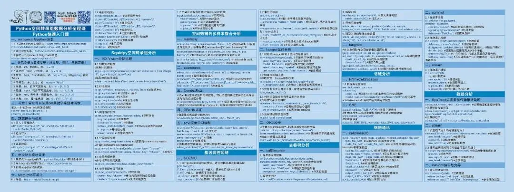](<https://mp.weixin.qq.com/s?__biz=MzAwMzIzOTk5OQ==&mid=2247535282&idx=2&sn=33c0965569d33a3499b1b7fd1a23d811&scene=21&token=963453299&lang=zh_CN&poc_token=HLWpu2mj9Rcxgfd-aiIzQaHYVqLrHNL65hfF1OaL#wechat_redirect>)
[Linux](<https://mp.weixin.qq.com/s?__biz=MzAwMzIzOTk5OQ==&mid=2247505777&idx=1&sn=f3efae390566b838a445ab9f832323c8&scene=21#wechat_redirect>)鼠标垫[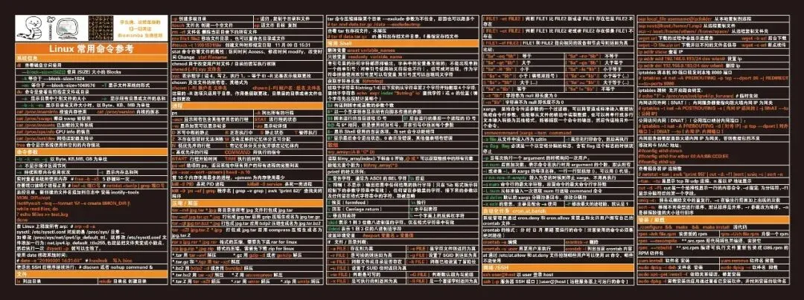](<https://mp.weixin.qq.com/s?__biz=MzAwMzIzOTk5OQ==&mid=2247505777&idx=1&sn=f3efae390566b838a445ab9f832323c8&scene=21#wechat_redirect>)
Biomamba同款背包与词云展示：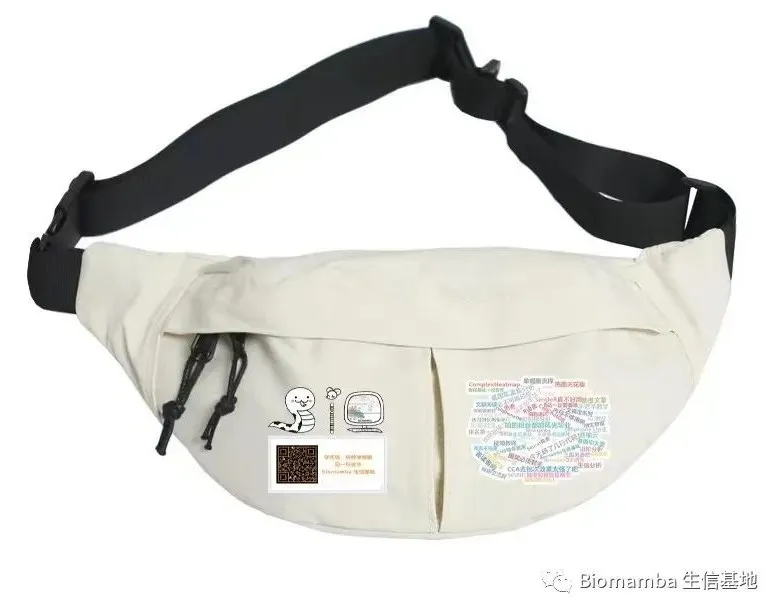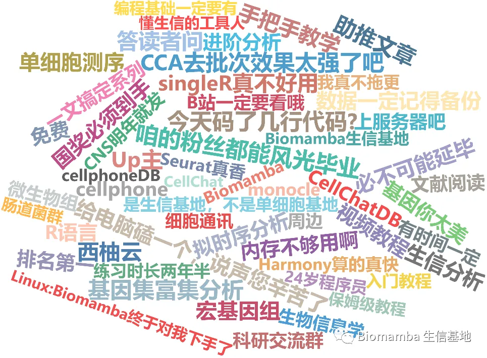

金士顿64GB、3.0存储高速U盘：


**精美咖啡杯，生信基地的小伙伴人手一个！**

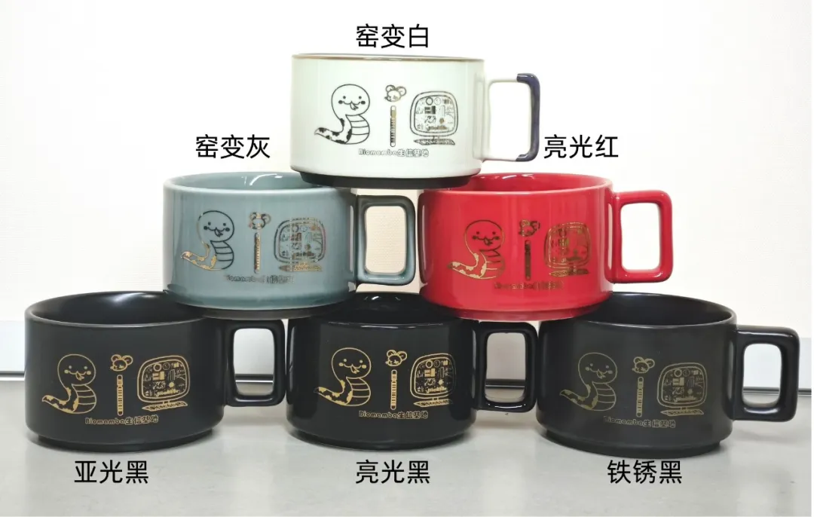

交流群****

我们维护了多个群聊，方便大家交流各个方向的问题，大家都可以联系我们的任意一个微信号，发送下面的关键词加群：

[ 影像组学交流群](<https://mp.weixin.qq.com/s?__biz=MzAwMzIzOTk5OQ==&mid=2247506244&idx=2&sn=59dcbfee0181a00a6dbcfc9876ac2014&scene=21#wechat_redirect>)

[2025国自然必中交流群](<https://mp.weixin.qq.com/s?__biz=MzAwMzIzOTk5OQ==&mid=2247524808&idx=1&sn=b064024a117f8580c5de0708775b6909&scene=21#wechat_redirect>)

[测序交流群](<https://mp.weixin.qq.com/s?__biz=MzAwMzIzOTk5OQ==&mid=2247528272&idx=2&sn=bb7bfedaad5a37f4d245385a1bb615e2&scene=21#wechat_redirect>)

[实验基地交流群](<https://mp.weixin.qq.com/s?__biz=MzAwMzIzOTk5OQ==&mid=2247528614&idx=2&sn=971fa3a46c01eef82ea58a9a260463ec&scene=21#wechat_redirect>)

[生信Linux交流群](<https://mp.weixin.qq.com/s?__biz=MzAwMzIzOTk5OQ==&mid=2247528896&idx=1&sn=d06db51cab9a61ebd9e1865a9d6ca28b&scene=21#wechat_redirect>)

[SeekGene全家桶交流群](<https://mp.weixin.qq.com/s?__biz=MzAwMzIzOTk5OQ==&mid=2247529409&idx=2&sn=588542565efa206a64016ac895780f11&scene=21&token=2056463462&lang=zh_CN&poc_token=HFd9X2mjCkxWGSznFjsqz5Kj_wNosKT_psPbV9Hp#wechat_redirect>)

[SeekSoulOnline云平台交流群](<https://mp.weixin.qq.com/s?__biz=MzAwMzIzOTk5OQ==&mid=2247530889&idx=2&sn=f4114c69ce6824248ed76b83a94c8863&scene=21#wechat_redirect>)[科研硕博相亲交流群](<https://mp.weixin.qq.com/s?__biz=MzAwMzIzOTk5OQ==&mid=2247528124&idx=2&sn=6fc448ece5499676dde4a84e49070ca1&scene=21#wechat_redirect>)[跟人工智能聊天哪有跟人聊天有意思](<https://mp.weixin.qq.com/s?__biz=MzAwMzIzOTk5OQ==&mid=2247536307&idx=2&sn=2d030173f51d24a4fee43bd0d83da03b&scene=21#wechat_redirect>)


**欢迎致谢**

如果以上内容对你有帮助，欢迎在文章的Acknowledgement中加上这一段，联系客服微信可以发放奖励：
```
Since Biomamba and his wechat public account team produce bioinformatics tutorials and share code with annotation, we thank Biomamba for their guidance in bioinformatics and data analysis for the current study.
```

**欢迎在发文/毕业时向我们分享你的喜悦~**

**已致谢文章**

[ 鼻咽癌的Bulk RNA-Seq与scRNA-Seq联合分析](<https://mp.weixin.qq.com/s?__biz=MzAwMzIzOTk5OQ==&mid=2247510548&idx=1&sn=58048c46e837b1d56dffa282272c6d96&chksm=9b3cd344ac4b5a52369e91b4e61fa0a2c951b82cc21165b99f42ba2c2191d4add803bd73c928&scene=21&cur_album_id=3425248581018714114#wechat_redirect>)

[13分+文章利用scRNA-Seq揭示地铁细颗粒物引起肺部炎症的分子机制](<https://mp.weixin.qq.com/s?__biz=MzAwMzIzOTk5OQ==&mid=2247511886&idx=1&sn=31c712d00377b0f0ed33703b5b4fbfd8&chksm=9b3cd61eac4b5f084fde14a2eb50356f2f40a66c608d38909f12a3d81f48cff029a09ce2ee8c&token=1453608870&lang=zh_CN&scene=21#wechat_redirect>)

[除了铁死亡，还有铜死亡？！](<https://mp.weixin.qq.com/s?__biz=MzAwMzIzOTk5OQ==&mid=2247518144&idx=1&sn=d036f1bb04b09eb73f53e2104d69404c&chksm=9b3cfe90ac4b77862f2f463b42132c7bfdb687a1b61d350dcf656117b1331271e179710fd4fa&scene=21&cur_album_id=3425248581018714114#wechat_redirect>)

[IF14.3| scRNA-seq+脂质组多组学分析揭示宫内生长受限导致肝损伤的性别差异](<https://mp.weixin.qq.com/s?__biz=MzAwMzIzOTk5OQ==&mid=2247520900&idx=1&sn=157134292ffc2e5df730c5ba8a357b61&chksm=9b3cebd4ac4b62c286543c30381e9b4fdb8b44b28d4fa902fb963bbd45b28e1d3f1bc98eb148&scene=21&cur_album_id=3425248581018714114#wechat_redirect>)[银屑病和脂肪肝病中共同病理和免疫特征](<https://mp.weixin.qq.com/s?__biz=MzAwMzIzOTk5OQ==&mid=2247521069&idx=1&sn=4ef441a885cb2525ee3b5c81001feddf&chksm=9b3cea7dac4b636be9f10ffdf75e13531fccae62129944b21a457db2e08c3f2db1e1b553ac34&scene=21&cur_album_id=3425248581018714114#wechat_redirect>) [《Advanced Science》新型Arf1抑制剂促进癌症干细胞衰老并增强抗肿瘤免疫](<http://mp.weixin.qq.com/s?__biz=MzAwMzIzOTk5OQ==&mid=2247522233&idx=1&sn=287a380de741ff55f0ce78dc9c727985&chksm=9b3ceee9ac4b67ffd925abafeba2cb215a5984e6dc85f0d8607340a07ec9208f1d19eae0e04b&scene=21#wechat_redirect>)

[scRNA-seq揭示脓毒症预后水平预测的关键靶点！](<http://mp.weixin.qq.com/s?__biz=MzAwMzIzOTk5OQ==&mid=2247522281&idx=1&sn=f95eb12fdc340b8da1123ec6253e6fac&chksm=9b3ceeb9ac4b67afa587e5fa3a2a8960e9bb28a1ad6dc48e49120a76154417a4c8be95af90b0&scene=21#wechat_redirect>)

[机器学习+生信多组学联合构建牙周炎"线粒体功能障碍与免疫微环境"关联网络](<https://mp.weixin.qq.com/s?__biz=MzAwMzIzOTk5OQ==&mid=2247527168&idx=1&sn=0791d2bf53a9a60015577f892b10d370&scene=21#wechat_redirect>)

[KIF18A在肝细胞癌转移中的双重角色](<https://mp.weixin.qq.com/s?__biz=MzAwMzIzOTk5OQ==&mid=2247528014&idx=1&sn=d285c9ebd415be328fc682d00e6182c0&scene=21#wechat_redirect>)

[bulk+scRNA-seq挖掘BCL2-MAPK14-TXN氧化应激诊断模型，鉴定脓毒症中氧化应激关键基因](<https://mp.weixin.qq.com/s?__biz=MzAwMzIzOTk5OQ==&mid=2247530000&idx=1&sn=e8ddca4e1b2e60839cdf2a7fe87b3dfe&chksm=9b3c0f40ac4b86562e0e307b9dbb8688159e72b3c19d9ceebf8a4bb2e21638896f005b497b11&scene=21&cur_album_id=3425248581018714114&search_click_id=#wechat_redirect>)

[致谢文章+1，中科院1区，scRNA-seq揭示麻黄-甘草配对治疗呼吸系统症状和多(I:C)诱发肺炎模型机制](<https://mp.weixin.qq.com/s?__biz=MzAwMzIzOTk5OQ==&mid=2247536407&idx=1&sn=4da88e13f112662a02fea89d1b7798e9&scene=21#wechat_redirect>)

[致谢文章又+1，生物信息学+机器学习鉴定驱动糖尿病肾病免疫激活和小管间隙损伤的PANoptosis枢纽基因](<https://mp.weixin.qq.com/s?__biz=MzAwMzIzOTk5OQ==&mid=2247537544&idx=1&sn=6e5bb738eb11af53173f9fef67b977df&scene=21#wechat_redirect>)

向下滑动查看更多

欢迎大家致谢~


**如何联系我们**


 留一个领取[资料](<https://mp.weixin.qq.com/s?__biz=MzAwMzIzOTk5OQ==&mid=2247535983&idx=1&sn=99378a252908b06f56432eb08741d278&scene=21#wechat_redirect>)、[开箱即用的单细胞分析镜像](<https://mp.weixin.qq.com/s?__biz=MzAwMzIzOTk5OQ==&mid=2247536307&idx=1&sn=8d03259be06f54521aac5251dec988d5&scene=21#wechat_redirect>)的**微信号[Biomamba_zhushou]**，方便各位随时交流。同时我们也构建了[交流群矩阵](<https://mp.weixin.qq.com/s?__biz=MzAwMzIzOTk5OQ==&mid=2247536307&idx=2&sn=2d030173f51d24a4fee43bd0d83da03b&scene=21#wechat_redirect>)，欢迎大家入群讨论。

大家可以阅读完这几篇之后添加[给生信入门初学者的小贴士](<http://mp.weixin.qq.com/s?__biz=MzAwMzIzOTk5OQ==&mid=2247493329&idx=1&sn=597870b7f7ce10346da3561e7c281627&chksm=9b3c9f81ac4b169794088ce9abbcacb5f18e9fd174fc0d7e28da62d78facadf3100ef38aaf22&scene=21#wechat_redirect>)
[没有检索，就没有发言权](<https://mp.weixin.qq.com/s?__biz=MzAwMzIzOTk5OQ==&mid=2247529398&idx=2&sn=5a429852d61721916a405712677d5905&scene=21#wechat_redirect>)

**已有生信基地联系方式的同学****无需重复添加**

 您点的每个赞和在看，我都认真当成了喜欢
