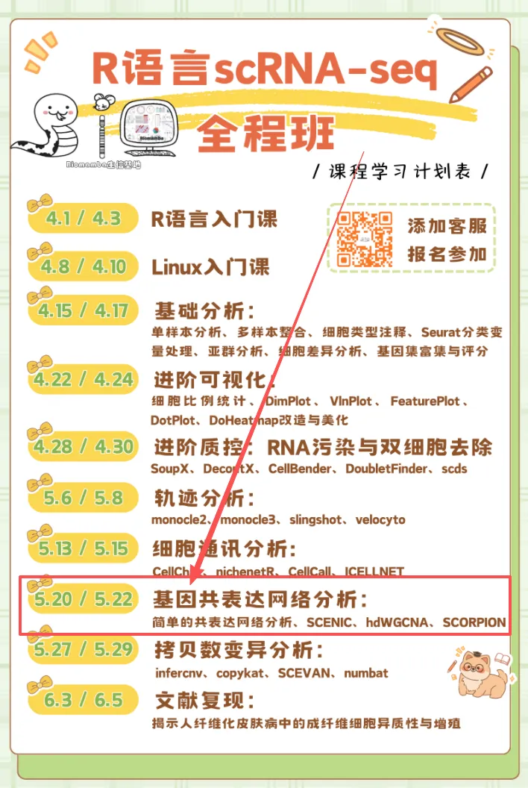
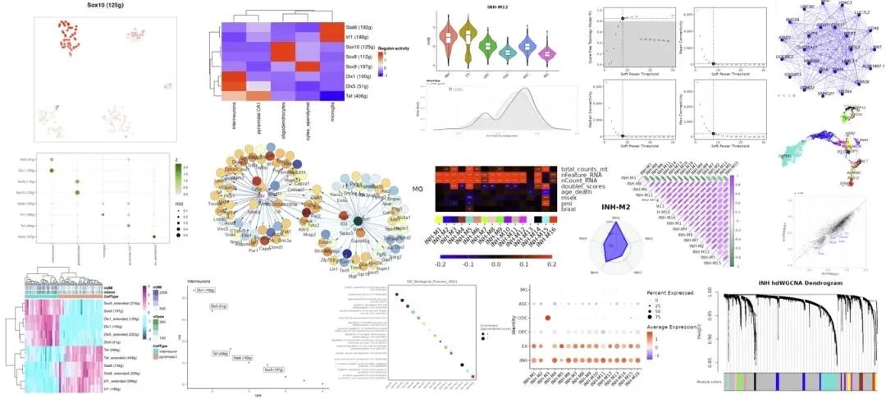
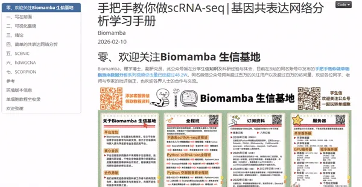
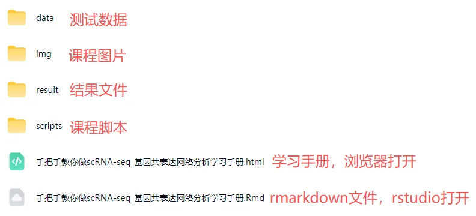

# 周三周五，直播教学，手把手教你scRNA-seq基因共表达网络分析

> 原文：https://mp.weixin.qq.com/s?__biz=MzAwMzIzOTk5OQ==&mid=2247537996&idx=2&sn=a2660712893f1a6eec12faeba6fc43d7&chksm=9b3c2c1cac4ba50a57d477ac223acc3ab1b0232fa36bb3e8fee80842ea41a9b59be6a9f1797e#rd
> 合集：生信基地

下周三、周五09:00（5月20号、22号）进行[R语言scRNA-seq基因共表达网络分析专题](<https://mp.weixin.qq.com/s?__biz=MzAwMzIzOTk5OQ==&mid=2247535877&idx=5&sn=23f42e58509a93e1f91c09cad53ccbdf&scene=21#wechat_redirect>)教学，详细介绍与课程大纲可见：[视频介绍，学单细胞你应该按照这个节奏](<https://mp.weixin.qq.com/s?__biz=MzAwMzIzOTk5OQ==&mid=2247536612&idx=1&sn=19032a541a2b5a9f07d64981cc22069f&scene=21#wechat_redirect>)，还没有报名的同学，可联系客服微信[Biomamba_zhushou]报名参加课程哦~课程直播链接：https://meeting.tencent.com/dm/zTy2CEbGtanU

单细胞基因共表达网络分析教学内容

同我们以前的课程一样，我们给大家准备了学习手册和学习资料，大家可联系客服微信[Biomamba_zhushou]领取：

教程图片集锦：

# 

# **
**

# ****[基因共表达网络分析学习手册](<https://mp.weixin.qq.com/s?__biz=MzAwMzIzOTk5OQ==&mid=2247529410&idx=1&sn=9bbaf955d93ddce60874e1cdc2f16115&scene=21#wechat_redirect>)****

# ********

基因共表达网络分析教程目录：

一、写在前面

二、可视化集锦

三、绪论

3.1 研究背景

3.2 主要结果

（1）合成网络数据集

（2）精选模型数据

（3）实验性的单细胞RNA-Seq数据集

3.3 小结

四、简单的共表达网络分析

4.1 加载R包

4.2 计算相关性

五、SCENIC

5.1 软件安装

5.2 加载R包

5.3 官方手册

5.4 测试数据

（1）直接读取loom文件

（2）创建loom文件

5.5 RcisTarget数据库

（1）文件获取

（2）RcisTarget数据库文件初始化

5.6 分析流程

（1）初步设置

（2）共表达网络(Co-expression network)计算

（3）构建基因调控网络(Gene regulatory network, GRN)

（4）runSCENIC_3_scoreCells()分解步骤

（5）二元矩阵及可视化

（6）对regulon活性进行聚类分群、降维分析

5.7 下游探索工作

（1）交互式的探索

（2）在tSNE中绘制TF的表达水平

（3）探究regulon，靶基因，motif的关系

（4）用热图探究细胞与regulon的关系

（5）调控网络的绘制

六、hdWGCNA

6.1 数据准备

（1）加载R包

6.2 数据读入

6.3 为 WGCNA 设置 Seurat 对象

6.4 创建metacells

6.5 构建共表达网络

（1）设置表达矩阵

（2）设置软阈值

6.6 可视化

（1）模块特征图

（2）雷达图

（3）相关性热图

（4）DotPlot

（5）VlnPlot

（6）网络图

（7）UMAP图

（8）module与表型数据相关性分析

（9）Enrichment analysis基因集（module）富集分析

（10）模块之间的差异分析

七、SCORPION

7.1 安装R包

7.2 加载R包

7.3 示例数据展示

7.4 小鼠肠上皮单细胞数据

（1）安装R包

（2）数据准备

（3）scorpion分析

7.5 人类胚胎干细胞

（1）定义QC质控函数

（2）导入单细胞数据

（3）单细胞数据处理

（4）单细胞分群展示

（5）8C-like细胞鉴定

（6）8C-like和其他亚群差异基因鉴定

（7）导入TF和PPT网络

（8）scorpion分析

7.6 结果可视化和解读

（1）导入Hnf4α和Hnf4γ分析结果

（2）Hnf4a密度图

（3）Hnf4a差异值分布

（4）Hnf4g密度图

（5）Hnf4g差异值分布

（6）Hnf4a线性回归与靶基因富集分析

（7）Hnf4g线性回归与靶基因富集分析

（8）加载DUX4分析结果

（9）转录因子调控分布散点图

（10）DUX4密度图

（11）DUX4差异值分布

（12）DUX4线性回归与靶基因富集分析

八、参考

九、环境版本信息

十、单细胞教程全收录

十一、欢迎致谢

****

测试文件，总大小 12.53GB

还想要了解更多单细胞/空转课程：[共计251小时视频教程，保姆级单细胞&空转教学](<https://mp.weixin.qq.com/s?__biz=MzAwMzIzOTk5OQ==&mid=2247536399&idx=2&sn=6c73155a0393ed9c246fee69cb06341f&scene=21#wechat_redirect>)，都欢迎找我们聊聊~

**如何联系我们**

 留一个领取[资料](<https://mp.weixin.qq.com/s?__biz=MzAwMzIzOTk5OQ==&mid=2247535983&idx=1&sn=99378a252908b06f56432eb08741d278&scene=21#wechat_redirect>)、[免费两周学习版](<https://mp.weixin.qq.com/s?__biz=MzAwMzIzOTk5OQ==&mid=2247532717&idx=2&sn=eb98e578098b9f432ea6ecbdc3c0d74b&scene=21#wechat_redirect>)服务器的**微信号[Biomamba_zhushou]**，方便各位随时交流。同时我们也构建了[交流群矩阵](<https://mp.weixin.qq.com/s?__biz=MzAwMzIzOTk5OQ==&mid=2247536307&idx=2&sn=2d030173f51d24a4fee43bd0d83da03b&scene=21#wechat_redirect>)，欢迎大家入群讨论。
大家可以阅读完这几篇之后添加[给生信入门初学者的小贴士](<http://mp.weixin.qq.com/s?__biz=MzAwMzIzOTk5OQ==&mid=2247493329&idx=1&sn=597870b7f7ce10346da3561e7c281627&chksm=9b3c9f81ac4b169794088ce9abbcacb5f18e9fd174fc0d7e28da62d78facadf3100ef38aaf22&scene=21#wechat_redirect>)
[如何搜索公众号过往发布内容](<http://mp.weixin.qq.com/s?__biz=MzAwMzIzOTk5OQ==&mid=2247506266&idx=2&sn=22b1164bc9602c25620d058847785422&chksm=9b3ca00aac4b291c16d738271746ffb90149282a728f484e8a1952463c46a8e7dc4f883ab928&scene=21#wechat_redirect>)

**已有生信基地联系方式的同学****无需重复添加**

 您点的每个赞和在看，我都认真当成了喜欢
