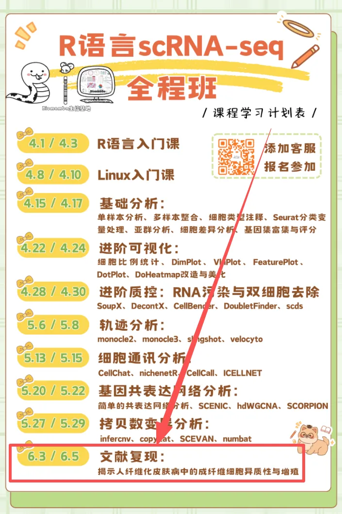
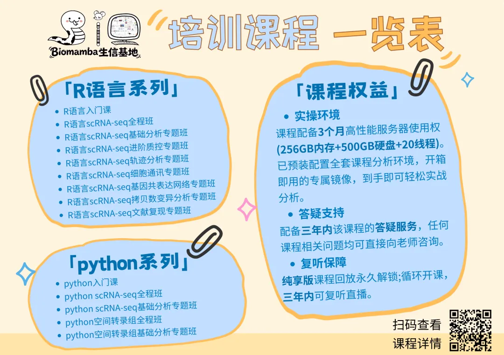

# 最后一周直播教学，手把手教你单细胞文献复现

> 原文：https://mp.weixin.qq.com/s?__biz=MzAwMzIzOTk5OQ==&mid=2247538556&idx=2&sn=a041a7769ec29c4d3164b04ae53c7e37&chksm=9b3c2e2cac4ba73ae125f074acc324a6a89104d6d4c403c9c822cdbba79d412089b8f0350744#rd
> 合集：生信基地

今天和后天09:00（6月3号、5号）进行[R语言scRNA-seq文献复现专题](<https://mp.weixin.qq.com/s?__biz=MzAwMzIzOTk5OQ==&mid=2247535877&idx=7&sn=b716aeb8e86eba4acd50b982beb0c963&scene=21#wechat_redirect>)教学，详细介绍与课程大纲可见：[视频介绍，学单细胞你应该按照这个节奏](<https://mp.weixin.qq.com/s?__biz=MzAwMzIzOTk5OQ==&mid=2247536612&idx=1&sn=19032a541a2b5a9f07d64981cc22069f&scene=21#wechat_redirect>)，还没有报名的同学，可联系客服微信[Biomamba_zhushou]报名参加课程哦~课程直播链接：https://meeting.tencent.com/dm/QgRA9qBg0LHh

单细胞文献复现内容

同我们以前的课程一样，我们给大家准备了学习手册和学习资料，大家可联系客服微信[Biomamba_zhushou]领取：

教程图片集锦：

# 

# ****

# ****
****

# ****[文献复现学习手册](<https://mp.weixin.qq.com/s?__biz=MzAwMzIzOTk5OQ==&mid=2247530338&idx=1&sn=2d092e76080359f5a169ec14d54d1241&scene=21#wechat_redirect>)****

# ********

文献复现教程目录：

一、文献解读

1.0 复现集锦

(1)原文集锦

(2)代码复现集锦

1.1 背景介绍

1.2 主要内容

(1)scRNA-seq揭示正常瘢痕和纤维性皮肤病真皮组织的细胞异质

(2)瘢痕疙瘩和正常瘢痕中成纤维细胞形成不同的细胞亚群

(3)纤维化皮肤病中间充质成纤维细胞特征的鉴定

(4)成纤维细胞亚群中的配体-受体相互作用分析

(5)间充质成纤维细胞通过POSTN促进瘢痕中胶原蛋白表达

(6)sC4成纤维细胞比sC1成纤维细胞更像间充质细胞

(7)间充质成纤维细胞在硬皮病中增加

1.3 总结讨论

二、准备工作

2.1 硬件准备

2.2 单细胞基础

三、数据下载、处理和可视化

1\. 数据下载

2\. 读取数据（10X标准数据）（barcodes、features、matrix）

3\. 数据整合

4\. Seurat标准流程(harmony去批次)

5\. 细胞注释

6\. 细胞周期计算

7\. 数据可视化

（1）分样本细胞比例柱形图

（2）分样本细胞比例桑基图

（3）UMAP降维图

（4）Marker小提琴图

（5）Marker FeaturePlot

（6）Marker DotPlot

（7）Marker热图

8\. 成纤维细胞亚群

（1）亚群细分

（2）分样本细胞比例柱形图

（3）亚群分样本降维图

（4）基因差异表达提琴图

（5）细分注释

（6）注释后Marker展示

（7）Mesenchymal_Fib组间差异分析

（8）Mesenchymal_Fib差异基因富集分析

9\. 间充质成纤维细胞在纤维化皮肤疾病中的特性

（1）分样本基因表达FeaturePlot

（2）分组基因表达箱线图

（3）亚群间差异基因热图

（4）Mesenchymal_Fib相对其他FIB亚群上调差异基因富集

（5）marker基因堆叠小提琴图

10\. 细胞通讯分析

（1）亚群标签映射回细胞大类

（2）Normal组细胞通讯

（3）Keloid组细胞通讯

（4）细胞通讯热图

11\. 拟时序分析

12\. Mesenchymal_Fib两个亚群间差异和富集

****

测试文件，总大小 12.17GB

还想要了解更多单细胞/空转课程：

**如何联系我们**

 留一个领取[资料](<https://mp.weixin.qq.com/s?__biz=MzAwMzIzOTk5OQ==&mid=2247535983&idx=1&sn=99378a252908b06f56432eb08741d278&scene=21#wechat_redirect>)、[免费两周学习版](<https://mp.weixin.qq.com/s?__biz=MzAwMzIzOTk5OQ==&mid=2247532717&idx=2&sn=eb98e578098b9f432ea6ecbdc3c0d74b&scene=21#wechat_redirect>)服务器的**微信号[Biomamba_zhushou]**，方便各位随时交流。同时我们也构建了[交流群矩阵](<https://mp.weixin.qq.com/s?__biz=MzAwMzIzOTk5OQ==&mid=2247536307&idx=2&sn=2d030173f51d24a4fee43bd0d83da03b&scene=21#wechat_redirect>)，欢迎大家入群讨论。
大家可以阅读完这几篇之后添加[给生信入门初学者的小贴士](<http://mp.weixin.qq.com/s?__biz=MzAwMzIzOTk5OQ==&mid=2247493329&idx=1&sn=597870b7f7ce10346da3561e7c281627&chksm=9b3c9f81ac4b169794088ce9abbcacb5f18e9fd174fc0d7e28da62d78facadf3100ef38aaf22&scene=21#wechat_redirect>)
[如何搜索公众号过往发布内容](<http://mp.weixin.qq.com/s?__biz=MzAwMzIzOTk5OQ==&mid=2247506266&idx=2&sn=22b1164bc9602c25620d058847785422&chksm=9b3ca00aac4b291c16d738271746ffb90149282a728f484e8a1952463c46a8e7dc4f883ab928&scene=21#wechat_redirect>)

**已有生信基地联系方式的同学****无需重复添加**

 您点的每个赞和在看，我都认真当成了喜欢
