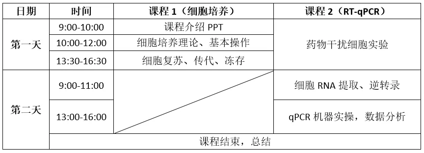
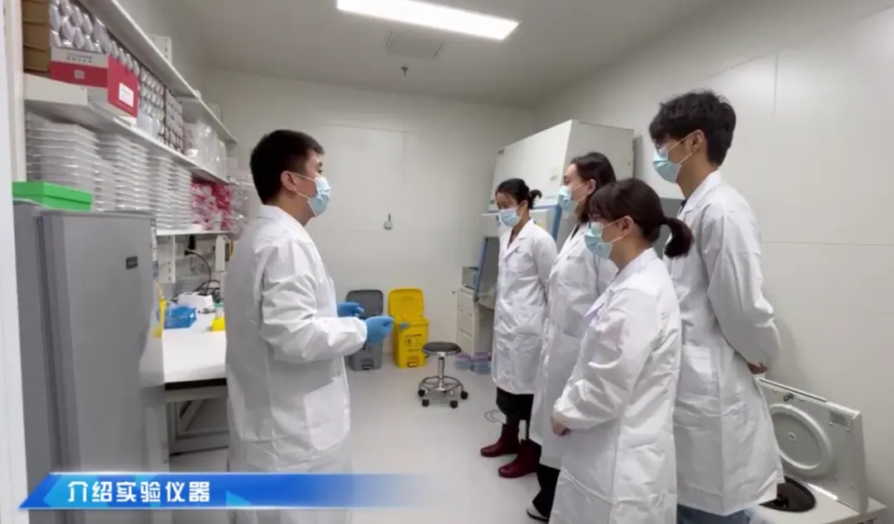
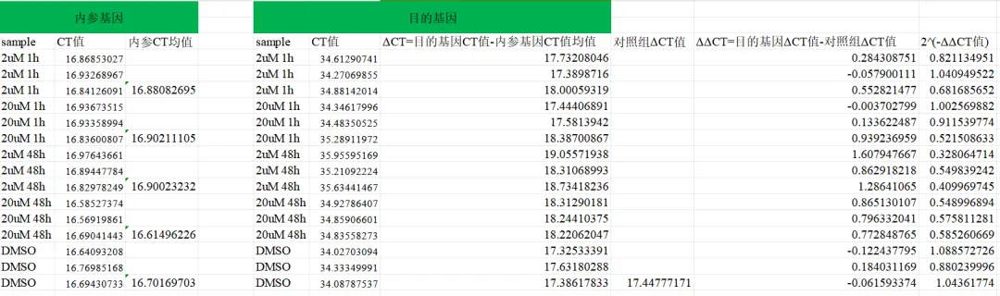
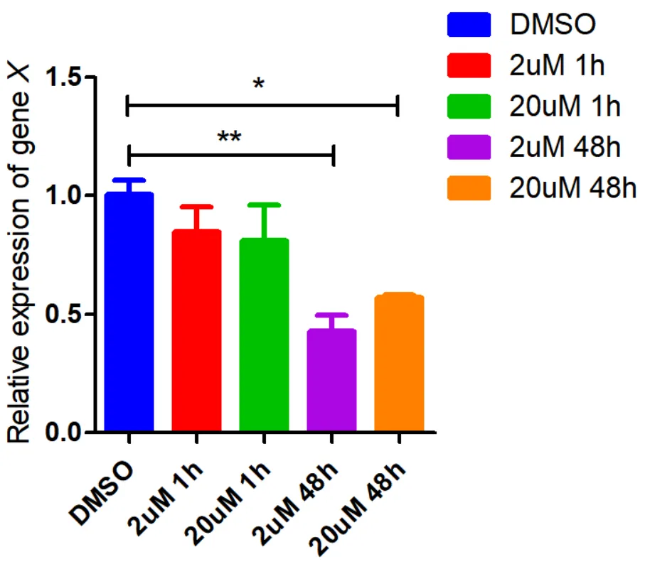
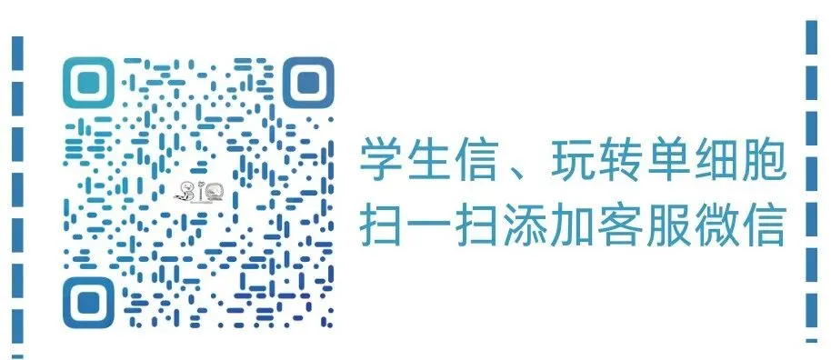

# 两天手搓药物干扰细胞实验+RT-qPCR鉴定

> 原文：https://mp.weixin.qq.com/s?__biz=MzAwMzIzOTk5OQ==&mid=2247524184&idx=1&sn=9598fb4df3cb078ba29314eaab956e6d&chksm=9b3ce608ac4b6f1e4a53f1b0ec9fb8c9e23890e537b48a2d7f596bdafd2982c637b3e3e9ab7e#rd
> 合集：实验基地

完美收官！

Biomamba联合**浙江大学博士团队** 组建的[实验基地](<https://mp.weixin.qq.com/s?__biz=MzAwMzIzOTk5OQ==&mid=2247522102&idx=1&sn=f7e5f2a52ac07e40d2a663582ff6c958&chksm=9b3cee66ac4b677053a440ab4c71bfa20453616948c0c7ff6a348859868ec554ce62832b48ac&scene=21&token=726055537&lang=zh_CN#wechat_redirect>)，base上海张江。在大家的支持下已经完成了两次线下实验交流活动([第一次线下实验交流会完美收官！](<https://mp.weixin.qq.com/s?__biz=MzAwMzIzOTk5OQ==&mid=2247522520&idx=1&sn=ed4b850c2b2f51bbe7a90207bde5e010&scene=21#wechat_redirect>))。第二次实验培训的课表如下：

****

**实验现场：**

**实验集锦：** 本实验探究一细胞表面受体对**肿瘤细胞生长** 的作用。通过前期单细胞转录组分析，我们发现在表达该受体的癌细胞中，某基因变化差异显著，因此我们利用**qPCR** 进行了相关检测。经查阅文献，我们选择了不同浓度的受体激动剂进行不同时间的处理，发现在**2uM** 浓度处理48h时，该基因显著下调。给我们后续探究该受体在肿瘤发生发展中的作用机制提供了前期的参考依据。数据分析模板：

qPCR结果的可视化图片如下，两天手搓一张**发表级图片** ：

小小的记录一下两天的学习过程：

反馈

实验室目前还是百业待兴，大家有什么想法可以**填写问卷** 跟咱反馈反馈：

问卷链接，文末阅读原文可直达：https://www.wjx.cn/vm/tpYsP8D.aspx# 问卷二维码：

欢迎加入

我们给大家组建了实验基地交流群，大家可以添加客服微信，备注“**实验基地** ”拉群。

**如何联系我们**

 公众号后台消息更新不及时，超过48h便不许回复读者消息，这里给大家留一下领取资料及免费服务器([生信分析为什么要使用服务器？](<http://mp.weixin.qq.com/s?__biz=MzAwMzIzOTk5OQ==&mid=2247504843&idx=2&sn=c2ba75edc0382855cfc914c3bb713e7e&chksm=9b3caa9bac4b238d0690d2aa5a236c18c8ad8f0d7a23421eb63b5236ff1201c9ec99e12efc8f&scene=21#wechat_redirect>))的**微信号** ，方便各位随时交流、提建议（科研任务繁重，回复不及时请见谅）。此外呼声一直很高的**交流群** 也建好了，欢迎大家入群讨论：

[永久免费的千人生信、科研交流群](<http://mp.weixin.qq.com/s?__biz=MzAwMzIzOTk5OQ==&mid=2247492981&idx=1&sn=aed903c4b853113d8c89e13848ea3365&chksm=9b3c9c25ac4b1533feb5f42f94ab4b6023a160313db4bc6a2f142e54d26627e3ea94b53e9031&scene=21#wechat_redirect>)

大家可以阅读完这几篇之后添加[给生信入门初学者的小贴士](<http://mp.weixin.qq.com/s?__biz=MzAwMzIzOTk5OQ==&mid=2247493329&idx=1&sn=597870b7f7ce10346da3561e7c281627&chksm=9b3c9f81ac4b169794088ce9abbcacb5f18e9fd174fc0d7e28da62d78facadf3100ef38aaf22&scene=21#wechat_redirect>)
[如何搜索公众号过往发布内容](<http://mp.weixin.qq.com/s?__biz=MzAwMzIzOTk5OQ==&mid=2247488966&idx=1&sn=9e9e7659b4cf00ac3173d21e88e1602b&chksm=9b3f6c96ac48e580efe53f966430f6598785e5c5c6bcc20f5eef019e723e49baaaea6d73fb7b&scene=21#wechat_redirect>)

您点的每个赞和在看，我都认真当成了喜欢
