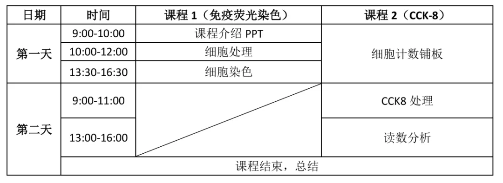
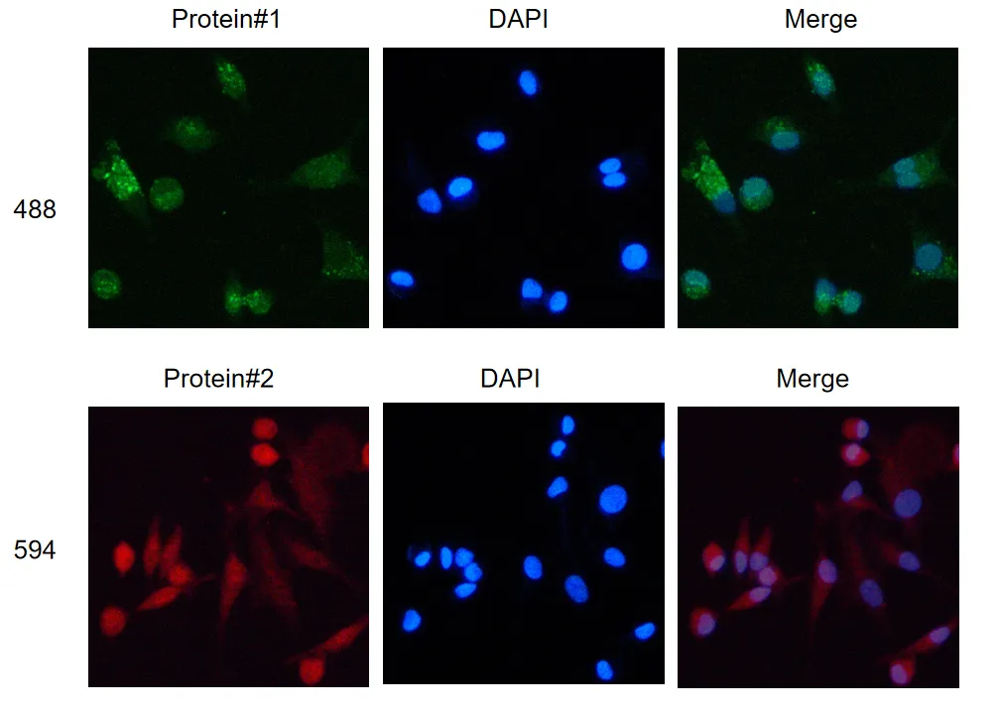
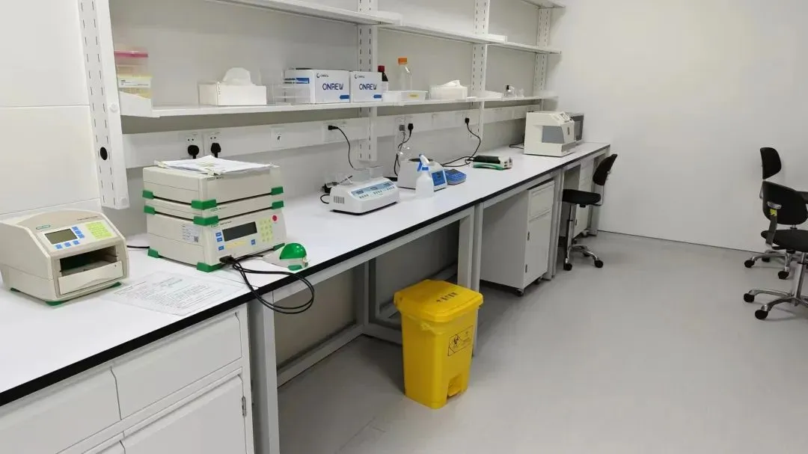
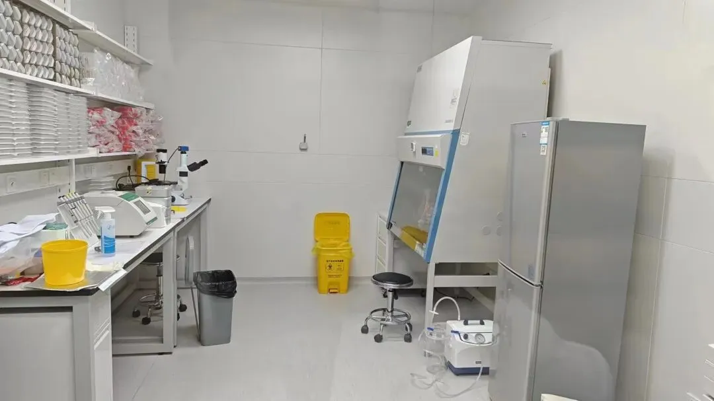
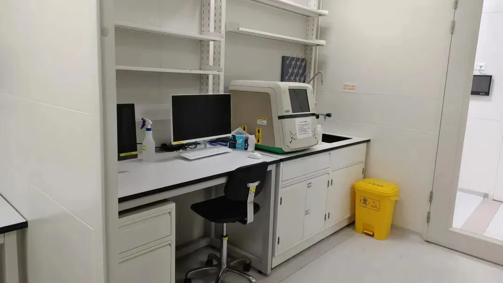
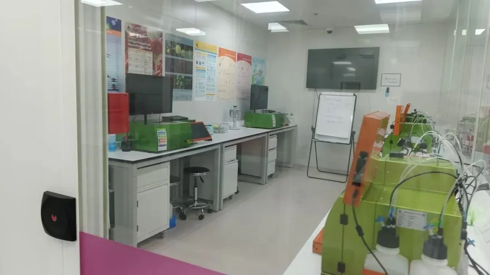

# 实验技能培养计划开启！

> 原文：https://mp.weixin.qq.com/s?__biz=MzAwMzIzOTk5OQ==&mid=2247526459&idx=1&sn=124c0718b110110096aae0d17bd4c794&chksm=9b3c116bac4b987dfee402d9fc00b173024cf0782680a827b8fc133b7507ffbc175becd7cab4#rd
> 合集：实验基地

实验基地第三次线下培训完结

Biomamba实验基地此前已经落地：[实验基地的序章](<http://mp.weixin.qq.com/s?__biz=MzAwMzIzOTk5OQ==&mid=2247522536&idx=1&sn=b47daa1eee437e0a7dbd74520e698620&chksm=9b3ce1b8ac4b68aeee8bd63d06f70b76202de69c711eec69ea1a252cb00b81734f22f2dced78&scene=21#wechat_redirect>)，空着也是空着，给大家提供一个为期两天的**线下****小班** 教学，由**浙大博士** 手把手教学。课程**已于** 2024年**12.21-12.22** 期间举行，日程安排如下

没有赶上此次课程的小伙伴也可以联系我们参与后续培训(往期实验活动可见：[实验基地](<https://mp.weixin.qq.com/mp/appmsgalbum?__biz=MzAwMzIzOTk5OQ==&action=getalbum&album_id=3674593374767628288#wechat_redirect>))，目前我们可以提供**基础实验技能培训班（套餐）**
**套餐内容** ：

1.细胞培养

2.分子克隆

3.细胞转染

4.蛋白印记（WB）实验

5.RT-qPCR验证

6.CCK-8增殖/抑制

7.免疫荧光染色

**套餐价格** ：**2500￥** /人 2025年1月尝鲜价

**套餐时限** ：**6个月**(少年班都没这有性价比)

**培训形式** ：**灵活** 开班与**固定** 开班

**灵活开班** ：基地根据实验项目灵活提前发布实验信息，凡有时间的学员即可参加学习。

**固定开班** ：基地根据需求，每隔2-3周，利用周六日时间开展学习；根据学员需求，利用较长的假期开展系统培训。

**报名方式** ：以月为单位成立学习班，每月最后一个工作日截止报名。下个月1号，正式开始培训。

我们的宗旨是让每个学员真正掌握实验技能，而**非一次性** 的教学，最终实现基地与学员共同成长。
**报名联系方式(已有生信基地联系方式的同学****无需重复添加****)** ：

实验结果

一起来看看大家都收获了什么吧~

**肿瘤细胞爬片后的免疫荧光结果图**

1.两种蛋白质（Protein#1 和 Protein#2）都被成功染色，大家已经成功掌握了针对特定蛋白质的染色方法。2.图片清晰，大家也成功掌握了荧光显微镜的拍摄技术~3.结合 DAPI 染色的细胞核和蛋白质的图像，可以分析出蛋白质与细胞核的相对位置

实验基地

长期以来Biomamba都在自己的媒体矩阵中分享生信分析技能。生命科学毕竟是物质的科学，脱离了**实验** 总是玩不转的，大家的分析结果也需要去实验验证。一方面自己想在不同的领域里开疆扩土，追寻些新的可能；另一方面也想为大家的科研生涯全方面保驾护航，未来给大家提供新的服务、交流交流实验技能。所以，Biomamba联合**浙江大学博士团队** 组建了一个自己的实验室(Biomamba生信基地**终于有基地** 啦！)，base上海张江。目前还是百业待兴，大家有什么想法可以**填写问卷** 跟咱反馈反馈：问卷链接，文末阅读原文可直达：https://www.wjx.cn/vm/tpYsP8D.aspx# 问卷二维码：

更多想法也可以直接添加我们的客服微信[**Biomamba_yunying**]聊聊，我们也有专门的实验基地交流群。
实验室环境：

对外开放~

诚然，公益培训也不是长久之计。目前实验室的**固定开支** 大概在**四位数/天**(不包含人员开支)，在为大家解决困难的同时，我们也需要考虑到**存续** 的问题。此前的实验培训中，有同学希望把自己课题组实验放在Biomamba实验基地中完成，由我们的老师指导或协助完成过程。我们当然愿意伸出援手。为保证实验质量，我们将限制实验项目/进驻人员的数量。以下是目前实验室可以进行实验列表。需要说明的是，实验室只协助完成**合规实验** ，并客观呈现结果(真实验、真科研)且没有论文工厂类的服务！一定要获得阳性结果的同学请不要浪费彼此的时间！

**项目**| **价格(详细数字添加下方微信商议)**
---|---
基因敲低验证| 1xxxx
基因过表达| 8xxx
CCK8细胞增殖实验| 1xxx
细胞划痕实验| 1xxx
细胞周期| 2xxx
细胞凋亡| 2xxx
细胞侵袭| 2xxx
细胞迁移| 1xxx
单克隆形成实验| 8xx
CO-IP| 3xxx
核/质 WB| 8xx
WB| 6xx
RT-qPCR| 1xx
免疫荧光染色| 1xxx
串联亲和纯化| 5xxx
其他分子细胞实验| 另议

详情可咨询文末微信

**如何联系我们**

 公众号后台消息回复不便，这里给大家留一下领取资料及免费服务器([足够支持你完成硕博生涯的生信环境](<http://mp.weixin.qq.com/s?__biz=MzAwMzIzOTk5OQ==&mid=2247507693&idx=1&sn=d9517a0803ad75cb7be430806834e7b8&chksm=9b3ca7bdac4b2eaba1ad01ed04ab1fbcbafcf4f6ddfe9e4f76ed9229707f545fe7d9c9ffd6ae&scene=21#wechat_redirect>))的**微信号** ，方便各位随时交流（别问在么，添加时直接说来意）。呼声很高的**交流群** 也建好了，欢迎大家入群讨论：

[永久免费的生信、科研交流群](<http://mp.weixin.qq.com/s?__biz=MzAwMzIzOTk5OQ==&mid=2247505868&idx=2&sn=20c81313eaef9a7031a84ef3a691d1b5&chksm=9b3cae9cac4b278a42c8de97e864c7664a37e9a4adb5973625fe3f8dd1093e55aeda88d443aa&scene=21#wechat_redirect>)

大家可以阅读完这几篇之后添加[给生信入门初学者的小贴士](<http://mp.weixin.qq.com/s?__biz=MzAwMzIzOTk5OQ==&mid=2247493329&idx=1&sn=597870b7f7ce10346da3561e7c281627&chksm=9b3c9f81ac4b169794088ce9abbcacb5f18e9fd174fc0d7e28da62d78facadf3100ef38aaf22&scene=21#wechat_redirect>)
[如何搜索公众号过往发布内容](<http://mp.weixin.qq.com/s?__biz=MzAwMzIzOTk5OQ==&mid=2247506266&idx=2&sn=22b1164bc9602c25620d058847785422&chksm=9b3ca00aac4b291c16d738271746ffb90149282a728f484e8a1952463c46a8e7dc4f883ab928&scene=21#wechat_redirect>)

**已有生信基地联系方式的同学****无需重复添加**

 您点的每个赞和在看，我都认真当成了喜欢
