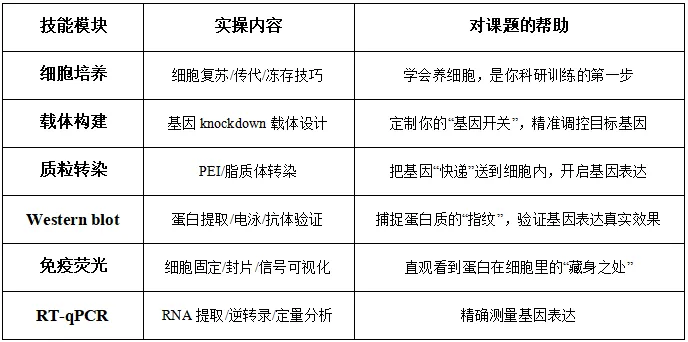
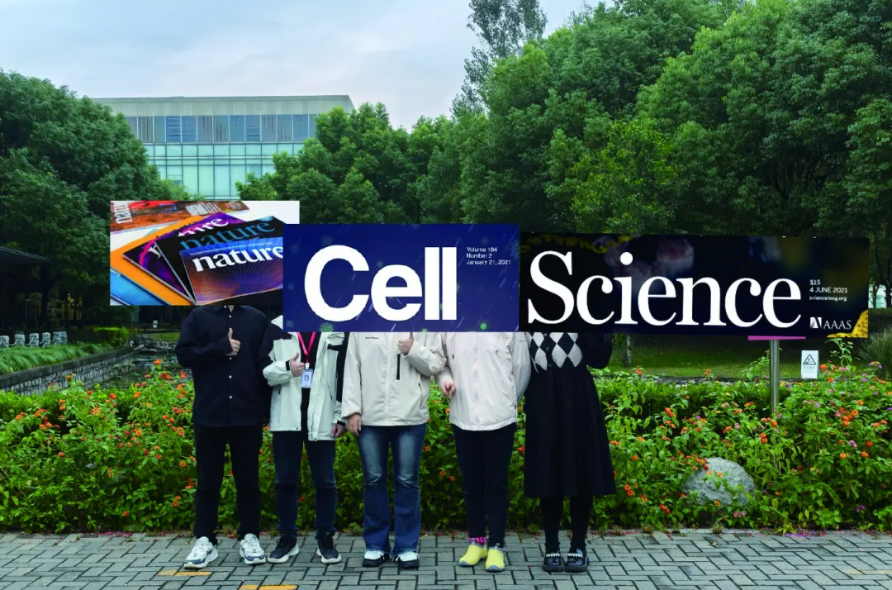
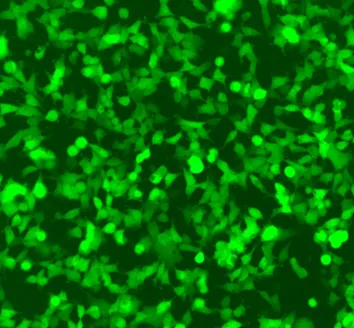
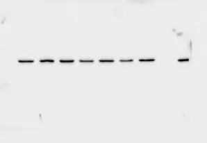

# 常态化实验学习

> 原文：https://mp.weixin.qq.com/s?__biz=MzAwMzIzOTk5OQ==&mid=2247528769&idx=1&sn=53528029a1595c5dde109a461ec3708d&chksm=9b3c0811ac4b81075d9403e79d4f93d3f8ce75fc83625b352618fbb262342a59d34f585be6ed#rd
> 合集：实验基地

五月安排

[实验基地全新升级](<https://mp.weixin.qq.com/s?__biz=MzAwMzIzOTk5OQ==&mid=2247528762&idx=1&sn=8a021cadb30f65eae1ed242bffabc277&scene=21#wechat_redirect>)，以后会开展常态化的学习计划，为没有实验环境或技能的小伙伴提供一个规范化、科学化、高端化的实验环境。基础实验技能培养计划定在五月的16-17-18以及23-24-25两个周末，每次三天(错过这个课程的小伙伴也可以随时加入)。本次的内容如下：注：交通、食宿等请大家自理哦~
本期技能实操训练依旧采用小班化模式，计划招募6名学员，名额有限哦。

本期培训特点 ：

1\. 纯小班教学，强化实操练习

2\. 浙大博士陪伴式指导

3\. 课程设计由浅入深，基础+拔高

4\. 长期答疑、长期指导

培训时间：五月的16-17-18以及23-24-25套餐价格：3800￥/人套餐时限：6个月；即参加本次培训的学员，在6个月内有任何套餐内的实验问题均可重复实地学习或线上沟通报名方式：编辑姓名+单位+联系方式+邮箱发送至生信基地任意完成报名，线上缴费后等待开班建群，按时参加培训培训地点：上海市嘉定区翔乐路28号上海南翔精准医学产业园4号楼一楼生信基地来往交通：上海虹桥火车站，打车约15分钟；上海站，地铁至南翔站，骑车约10分钟；南翔北站，骑车约10分钟这个五一，让我们在南翔的青石板路上，脚踏着历史的纹章，手握着未来的密钥，让求知与旅行在诗意中剧烈碰撞。实验基地将长期给大家提供实验技能学习平台，后续需要参加学习的小伙伴可随时联系，三人成团、即刻开班。

往期活动回顾

**收官合影**

****
****

****实验讲解ing****

在两天的时间里，在殿堂级实验大师张博的带领下，我们的小伙伴们完成了分子克隆、WB检测相关的实操教程，先展示一下我们的实验结果：

GFP质粒转染结果，一片绿，报告基因表达成功！

菌落PCR结果均呈现集中的阳性条带！

WB条带清晰美观，学员全程自制SDS-PAGE凝胶、自行上样！

**细胞分子实验集锦：** 本实验探究一细胞表面受体对**肿瘤细胞生长** 的作用。通过前期单细胞转录组分析，我们发现在表达该受体的癌细胞中，某基因变化差异显著，因此我们利用**qPCR** 进行了相关检测。经查阅文献，我们选择了不同浓度的受体激动剂进行不同时间的处理，发现在**2uM** 浓度处理48h时，该基因显著下调。给我们后续探究该受体在肿瘤发生发展中的作用机制提供了前期的参考依据。数据分析模板：qPCR结果的可视化图片如下，两天手搓一张**发表级图片** ：

实验基地

长期以来Biomamba都在自己的媒体矩阵中分享生信技能。生命科学毕竟是物质的科学，脱离了**实验** 总是玩不转的，分析结果也需要去实验验证。我们也希望为大家的科研生涯全方面保驾护航，给大家提供新的服务、交流实验技能的平台。所以，Biomamba联合**浙江大学博士团队** 组建了一个自己的实验室(Biomamba生信基地**终于有 实验基地**啦！)，base上海南翔。大家有什么想法可以**填写问卷** 跟咱反馈反馈：问卷链接，文末阅读原文可直达：https://www.wjx.cn/vm/tpYsP8D.aspx# 问卷二维码：更多想法也可以直接添加我们的客服微信[**Biomamba_zhushou**]聊聊，我们也有专门的实验基地交流群。

**如何联系我们**

 留一个领取资料、[免费两周学习版](<https://mp.weixin.qq.com/s?__biz=MzAwMzIzOTk5OQ==&mid=2247527585&idx=1&sn=fa32112c11b215b33096cab43baf08ea&scene=21#wechat_redirect>)服务器的**微信号[Biomamba_zhushou]**，方便各位随时交流。同时我们也构建了[交流群矩阵](<https://mp.weixin.qq.com/s?__biz=MzAwMzIzOTk5OQ==&mid=2247528057&idx=1&sn=bb348c2a88c977c7cce67ee6731a3591&scene=21#wechat_redirect>)，欢迎大家入群讨论。
大家可以阅读完这几篇之后添加[给生信入门初学者的小贴士](<http://mp.weixin.qq.com/s?__biz=MzAwMzIzOTk5OQ==&mid=2247493329&idx=1&sn=597870b7f7ce10346da3561e7c281627&chksm=9b3c9f81ac4b169794088ce9abbcacb5f18e9fd174fc0d7e28da62d78facadf3100ef38aaf22&scene=21#wechat_redirect>)
[如何搜索公众号过往发布内容](<http://mp.weixin.qq.com/s?__biz=MzAwMzIzOTk5OQ==&mid=2247506266&idx=2&sn=22b1164bc9602c25620d058847785422&chksm=9b3ca00aac4b291c16d738271746ffb90149282a728f484e8a1952463c46a8e7dc4f883ab928&scene=21#wechat_redirect>)

**已有生信基地联系方式的同学****无需重复添加**

 您点的每个赞和在看，我都认真当成了喜欢
