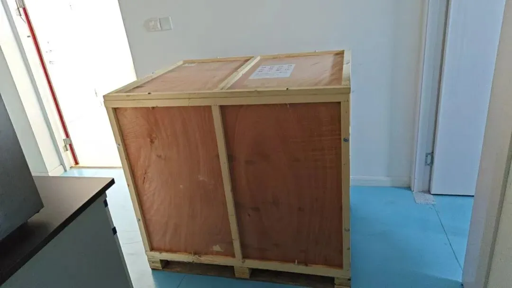
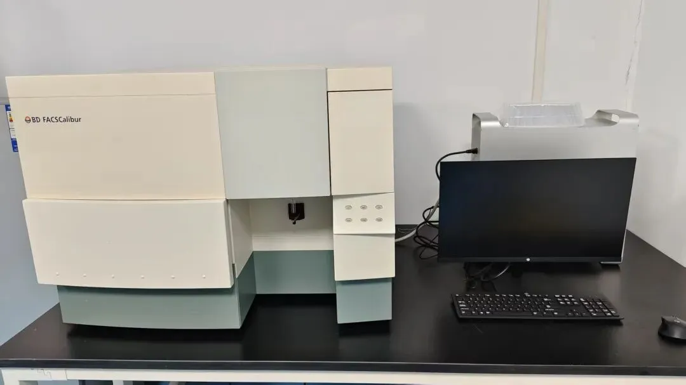
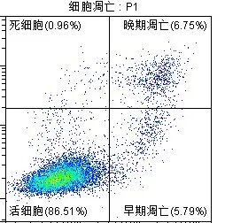
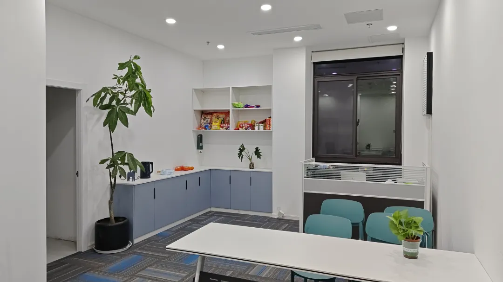

# 实验基地斥巨资引进的流式细胞仪到了！

> 原文：https://mp.weixin.qq.com/s?__biz=MzAwMzIzOTk5OQ==&mid=2247528861&idx=1&sn=7bd244adb4367b7013aeb9ba4faa8ff5&chksm=9b3c08cdac4b81dbcd62087d84cdee4a26ba08ecd8094c34ffd1db165cd26cdfc6e0d183a085#rd
> 合集：实验基地

流式细胞仪到了！撒花

之前有粉丝问到，“如果要看下某一个基因敲除或药物治疗是否可以导致肿瘤细胞凋亡，怎么来做实验呢？”其实流式细胞就可以很简单的解决。
流式细胞是实验中经常会用到的技术，但它相当昂贵，所以很多单位都不一定有，好的实验技巧和技术又对实验结果有重要影响，很多时候，是实验方法和技巧不对导致无法获得预期结果，这是很让人痛心的。
为了解决以上问题，生信基地实验室斥巨资引进BD流式细胞仪：

谍照

新机器调试校准中

在流式细胞仪品牌中，BD无疑是最老牌，技术最成熟的。FACSCanto II流式细胞仪是一款高性能分析型流式细胞仪，具备双激光配置，可实现4-8色荧光检测。

而开头讲到的细胞凋亡检测，只需要用到2个颜色（比如带FITC的Annexin V和PI）就可以解决。为啥这2个可以用来检测细胞凋亡呢，大家可以先自己查一查。
最后会出来类似这样的图，四种凋亡状态，是不是一目了然

除了细胞凋亡，流式在科研中的应用实在太广泛，比如免疫学研究（如免疫表型分析、细胞因子检测）、临床诊断（白血病分型、CD4+/CD8+绝对计数）、肿瘤微环境分析、干细胞鉴定、药物靶点评估（细胞周期）及传染病研究（病原宿主反应、疫苗效价评价）等等等等。
之后我们将开展流式细胞术的专题培训，请关注后期通知。学好流式技术，你绝对会在课题组成为香饽饽。

* * *

经过精心筹备，实验基地的全新实验室正式落址上海南翔古镇(总占地200㎡，尽情发挥)，现对外开放！全新的场地，全新的配套！实验基地场地配套：独立的办公场地、二级生物实验室(细胞房、分子实验室)

实验基地仪器配套：生物安全柜，倒置荧光显微镜；高速冷冻离心机；qPCR仪；普通PCR仪；化学发光成像系统；酶标仪；紫外分光光度计；蛋白电泳设备，核酸电泳设备；半干转仪；单细胞仪。其他大型设备正逐步进场，小伙伴们有想要的仪器也可以留言或私信我们。
实验场地与仪器一应俱全：

细胞房与超净台也替大家试运行过啦：

我们还开设有实验基地交流群，欢迎大家入群讨论

**已有生信基地联系方式的同学****无需重复添加**

实验基地线下实验走起

基础实验技能培养计划定在五月的16-17-18以及23-24-25两个周末，每次三天(错过这个课程的小伙伴也可以随时加入)。本次的内容如下：注：交通、食宿等请大家自理哦~
本期技能实操训练依旧采用小班化模式，计划招募6名学员，名额有限哦。

本期培训特点 ：

1\. 纯小班教学，强化实操练习

2\. 浙大博士陪伴式指导

3\. 课程设计由浅入深，基础+拔高

4\. 长期答疑、长期指导

培训时间：五月的16-17-18以及23-24-25套餐价格：3800￥/人套餐时限：6个月；即参加本次培训的学员，在6个月内有任何套餐内的实验问题均可重复实地学习或线上沟通报名方式：编辑姓名+单位+联系方式+邮箱发送至生信基地任意完成报名，线上缴费后等待开班建群，按时参加培训培训地点：上海市嘉定区翔乐路28号上海南翔精准医学产业园4号楼一楼生信基地来往交通：上海虹桥火车站，打车约15分钟；上海站，地铁至南翔站，骑车约10分钟；南翔北站，骑车约10分钟这个五一，让我们在南翔的青石板路上，脚踏着历史的纹章，手握着未来的密钥，让求知与旅行在诗意中剧烈碰撞。实验基地将长期给大家提供实验技能学习平台，后续需要参加学习的小伙伴可随时联系，三人成团、即刻开班。

往期活动回顾

**收官合影**

****
****

****实验讲解ing****

在两天的时间里，在殿堂级实验大师张博的带领下，我们的小伙伴们完成了分子克隆、WB检测相关的实操教程，先展示一下我们的实验结果：

GFP质粒转染结果，一片绿，报告基因表达成功！

菌落PCR结果均呈现集中的阳性条带！

WB条带清晰美观，学员全程自制SDS-PAGE凝胶、自行上样！

**细胞分子实验集锦：** 本实验探究一细胞表面受体对**肿瘤细胞生长** 的作用。通过前期单细胞转录组分析，我们发现在表达该受体的癌细胞中，某基因变化差异显著，因此我们利用**qPCR** 进行了相关检测。经查阅文献，我们选择了不同浓度的受体激动剂进行不同时间的处理，发现在**2uM** 浓度处理48h时，该基因显著下调。给我们后续探究该受体在肿瘤发生发展中的作用机制提供了前期的参考依据。数据分析模板：qPCR结果的可视化图片如下，两天手搓一张**发表级图片** ：

实验基地

长期以来Biomamba都在自己的媒体矩阵中分享生信技能。生命科学毕竟是物质的科学，脱离了**实验** 总是玩不转的，分析结果也需要去实验验证。我们也希望为大家的科研生涯全方面保驾护航，给大家提供新的服务、交流实验技能的平台。所以，Biomamba联合**浙江大学博士团队** 组建了一个自己的实验室(Biomamba生信基地**终于有 实验基地**啦！)，base上海南翔。大家有什么想法可以**填写问卷** 跟咱反馈反馈：问卷链接，文末阅读原文可直达：https://www.wjx.cn/vm/tpYsP8D.aspx# 问卷二维码：更多想法也可以直接添加我们的客服微信[**Biomamba_zhushou**]聊聊，我们也有专门的实验基地交流群。

**如何联系我们**

 留一个领取资料、[免费两周学习版](<https://mp.weixin.qq.com/s?__biz=MzAwMzIzOTk5OQ==&mid=2247527585&idx=1&sn=fa32112c11b215b33096cab43baf08ea&scene=21#wechat_redirect>)服务器的**微信号[Biomamba_zhushou]**，方便各位随时交流。同时我们也构建了[交流群矩阵](<https://mp.weixin.qq.com/s?__biz=MzAwMzIzOTk5OQ==&mid=2247528057&idx=1&sn=bb348c2a88c977c7cce67ee6731a3591&scene=21#wechat_redirect>)，欢迎大家入群讨论。
大家可以阅读完这几篇之后添加[给生信入门初学者的小贴士](<http://mp.weixin.qq.com/s?__biz=MzAwMzIzOTk5OQ==&mid=2247493329&idx=1&sn=597870b7f7ce10346da3561e7c281627&chksm=9b3c9f81ac4b169794088ce9abbcacb5f18e9fd174fc0d7e28da62d78facadf3100ef38aaf22&scene=21#wechat_redirect>)
[如何搜索公众号过往发布内容](<http://mp.weixin.qq.com/s?__biz=MzAwMzIzOTk5OQ==&mid=2247506266&idx=2&sn=22b1164bc9602c25620d058847785422&chksm=9b3ca00aac4b291c16d738271746ffb90149282a728f484e8a1952463c46a8e7dc4f883ab928&scene=21#wechat_redirect>)

**已有生信基地联系方式的同学****无需重复添加**

 您点的每个赞和在看，我都认真当成了喜欢
