# 实验基地7月最新安排

> 原文：https://mp.weixin.qq.com/s?__biz=MzAwMzIzOTk5OQ==&mid=2247529675&idx=2&sn=df5b6921c67096cb7dbb20a90f092244&chksm=9b3c0d9bac4b848d1c692b6a1e4a7f38a08a8a01f3ca3923b61e0f2fb2e8dba6ad328322c6ed#rd
> 合集：实验基地

盛夏的实验室里，空调嗡嗡作响，却挡不住科研人的学习热情。七月我们继续给大家送上了一份“知识清凉”。

学习时间如下：

基础实验技能班：7月12-13日

细胞功能实验班：7月26-27日

具体课程内容

**基础实验班：**

内容：细胞培养细胞计数细胞转染 Western blot 细胞免疫荧光染色 qPCR

价格：3180元/人（实操）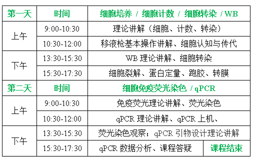

**细胞功能实验班：**

内容：CCK-8细胞增殖 细胞划痕 细胞迁移/侵袭 细胞周期 细胞凋亡流式检测价格：3580元/人（实操）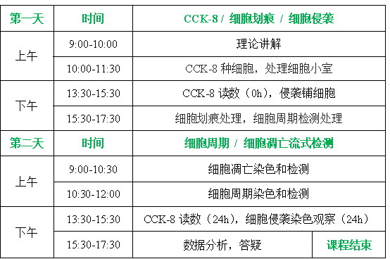

6月活动精彩回顾：

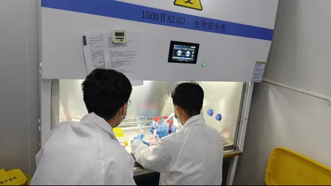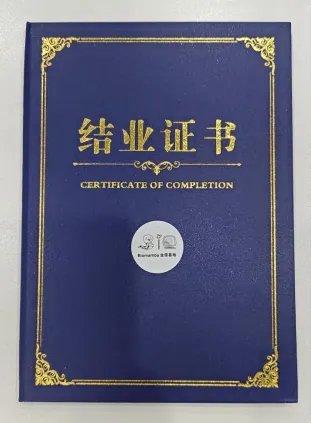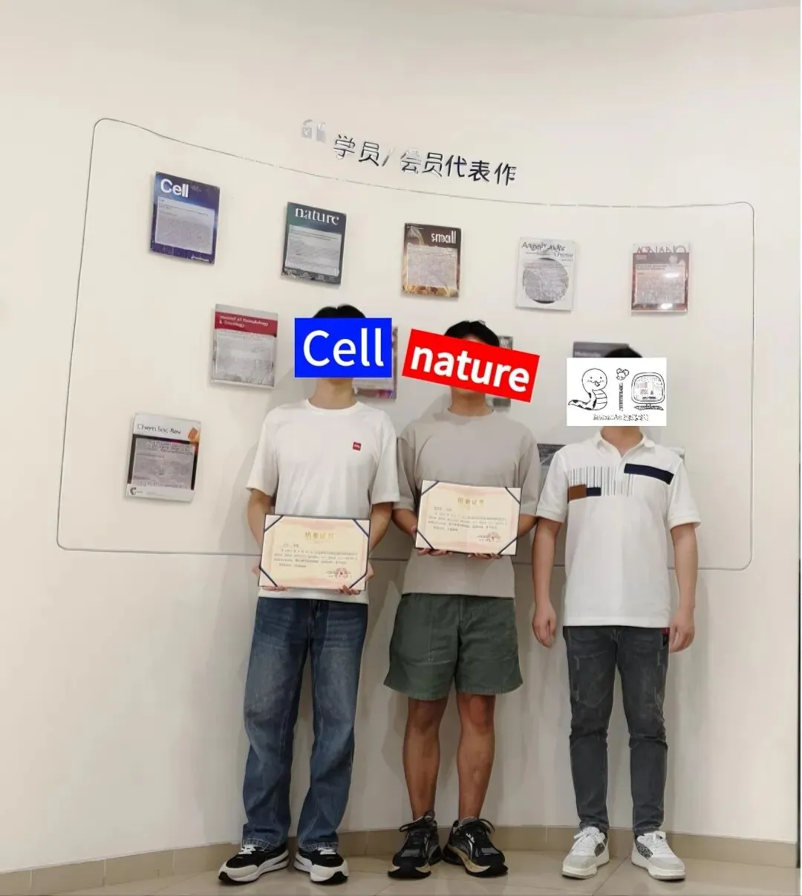

实验基地

长期以来Biomamba都在自己的媒体矩阵中分享生信分析技能。生命科学毕竟是物质的科学，脱离了**实验** 总是玩不转的，大家的分析结果也需要去实验验证。一方面自己想在不同的领域里开疆扩土，追寻些新的可能；另一方面也想为大家的科研生涯全方面保驾护航，未来给大家提供新的服务、交流交流实验技能。所以，Biomamba联合**浙江大学博士团队** 组建了一个自己的实验室(Biomamba生信基地**终于有基地** 啦！)，base上海张江。目前还是百业待兴，大家有什么想法可以**填写问卷** 跟咱反馈反馈：
问卷链接：https://www.wjx.cn/vm/tpYsP8D.aspx# 问卷二维码：
更多想法也可以直接添加我们的客服微信[**Biomamba_zhushou**]聊聊，我们也有专门的实验基地交流群。

实验基地环境一览

经过精心筹备，实验基地的全新实验室正式落址上海南翔古镇(总占地200㎡，尽情发挥)，现对外开放！全新的场地，全新的配套！实验基地场地配套：独立的办公场地、二级生物实验室(细胞房、分子实验室)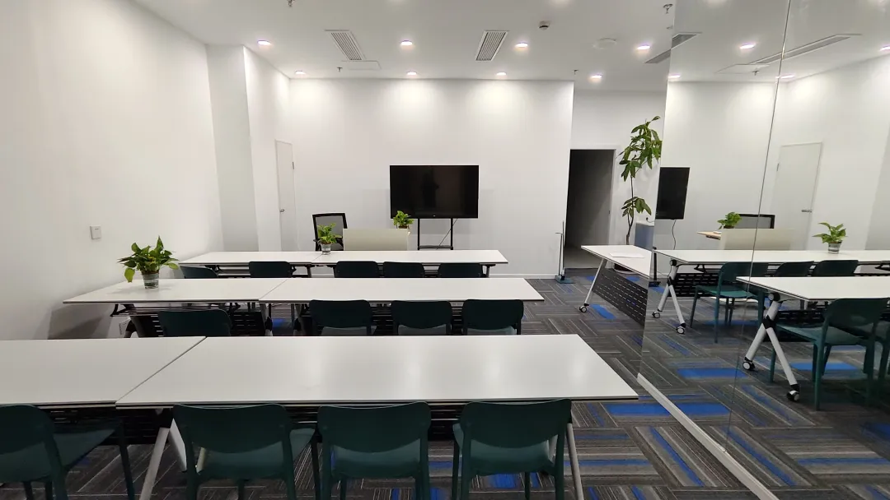

实验基地仪器配套：生物安全柜，倒置荧光显微镜；高速冷冻离心机；qPCR仪；普通PCR仪；化学发光成像系统；酶标仪；紫外分光光度计；蛋白电泳设备，核酸电泳设备；半干转仪；单细胞仪。其他大型设备正逐步进场，小伙伴们有想要的仪器也可以留言或私信我们。
实验场地与仪器一应俱全：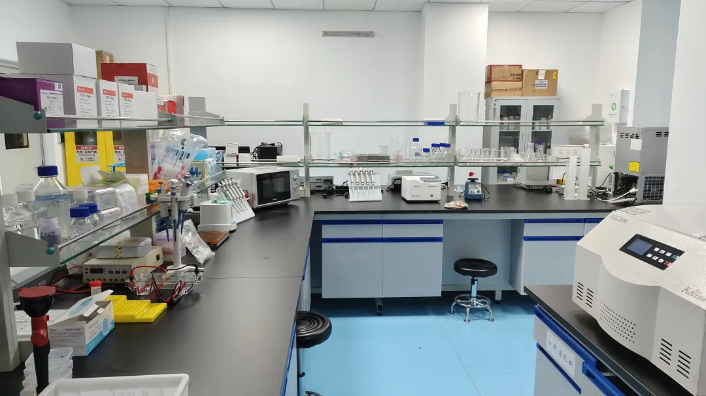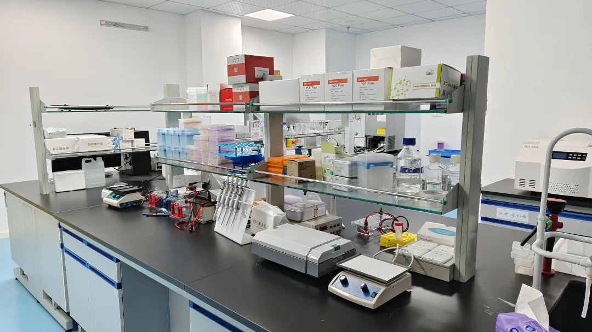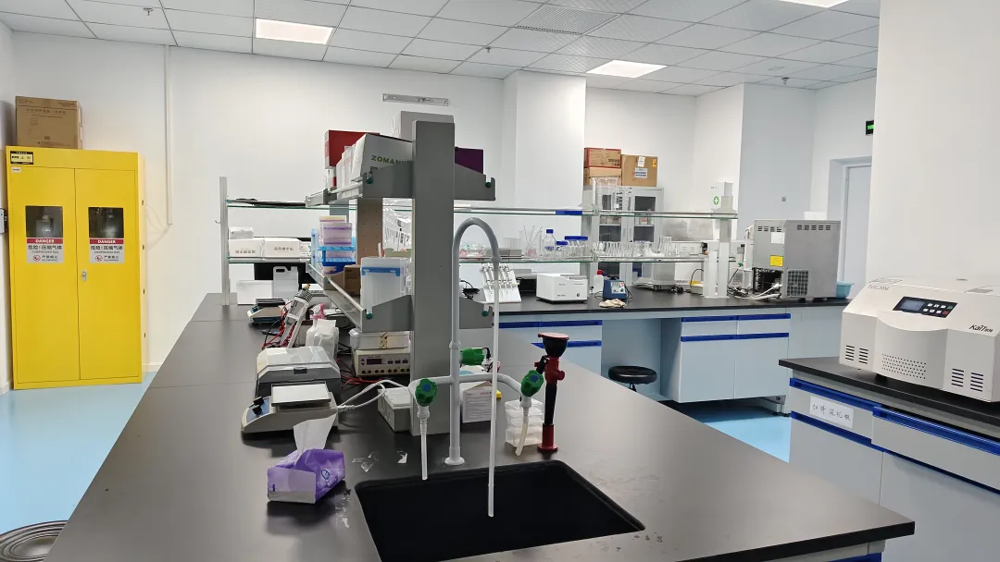
细胞房与超净台也替大家试运行过啦：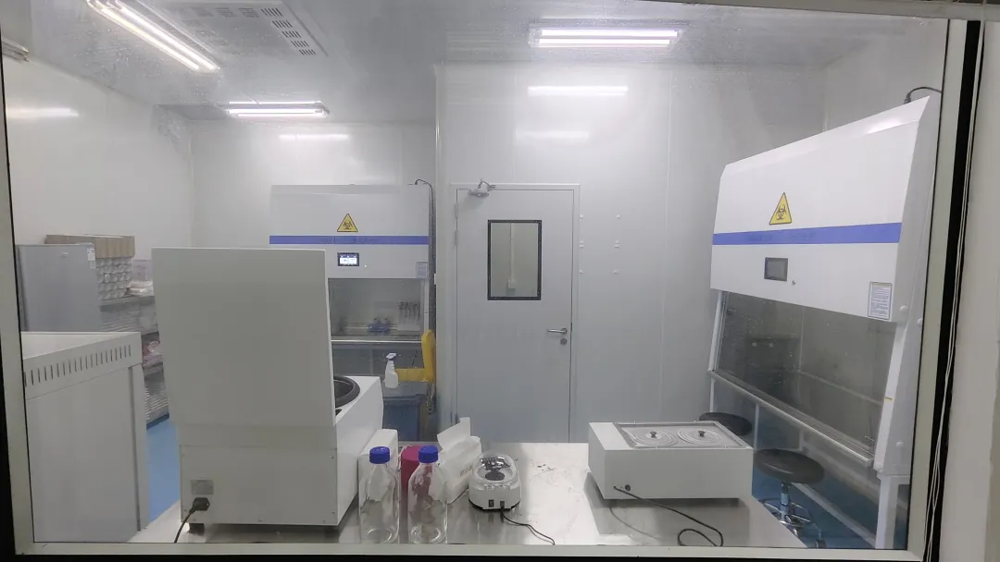
[实验基地斥巨资引进的流式细胞仪到了！](<https://mp.weixin.qq.com/s?__biz=MzAwMzIzOTk5OQ==&mid=2247528861&idx=1&sn=7bd244adb4367b7013aeb9ba4faa8ff5&scene=21#wechat_redirect>)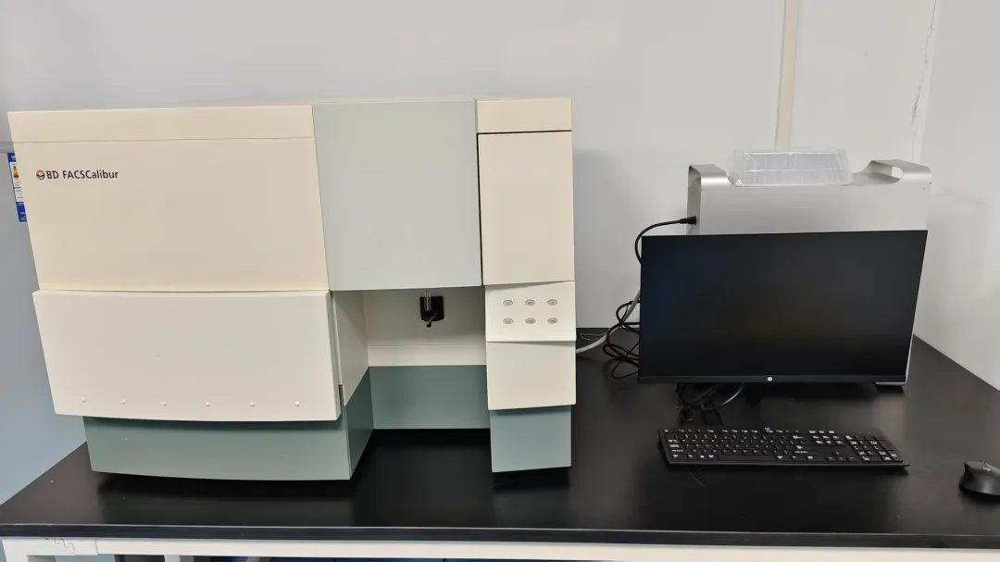
我们还开设有实验基地交流群，欢迎大家入群讨论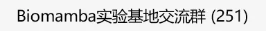

**已有生信基地联系方式的同学****无需重复添加**

**如何联系我们**

 留一个领取资料、[免费两周学习版](<https://mp.weixin.qq.com/s?__biz=MzAwMzIzOTk5OQ==&mid=2247527585&idx=1&sn=fa32112c11b215b33096cab43baf08ea&scene=21#wechat_redirect>)服务器的**微信号[Biomamba_zhushou]**，方便各位随时交流。同时我们也构建了[交流群矩阵](<https://mp.weixin.qq.com/s?__biz=MzAwMzIzOTk5OQ==&mid=2247528057&idx=1&sn=bb348c2a88c977c7cce67ee6731a3591&scene=21#wechat_redirect>)，欢迎大家入群讨论。
大家可以阅读完这几篇之后添加[给生信入门初学者的小贴士](<http://mp.weixin.qq.com/s?__biz=MzAwMzIzOTk5OQ==&mid=2247493329&idx=1&sn=597870b7f7ce10346da3561e7c281627&chksm=9b3c9f81ac4b169794088ce9abbcacb5f18e9fd174fc0d7e28da62d78facadf3100ef38aaf22&scene=21#wechat_redirect>)
[没有检索，就没有发言权](<https://mp.weixin.qq.com/s?__biz=MzAwMzIzOTk5OQ==&mid=2247529398&idx=2&sn=5a429852d61721916a405712677d5905&scene=21#wechat_redirect>)

**已有生信基地联系方式的同学****无需重复添加**

 您点的每个赞和在看，我都认真当成了喜欢
