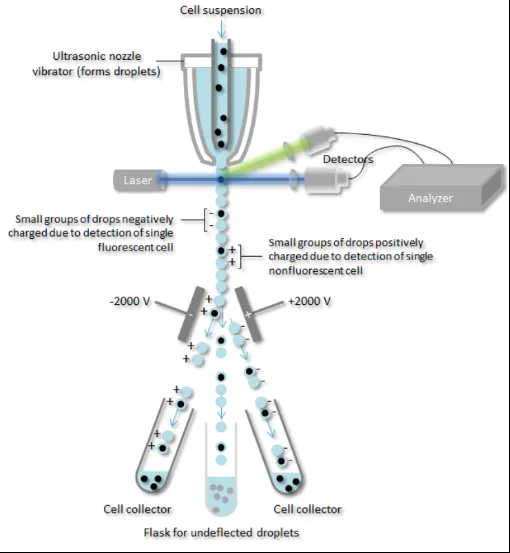
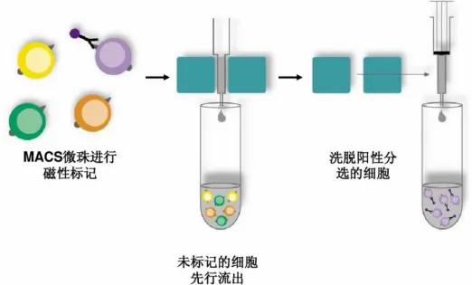
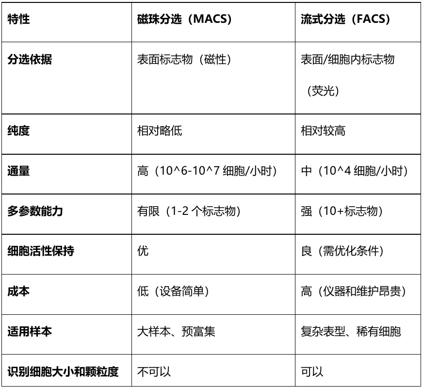
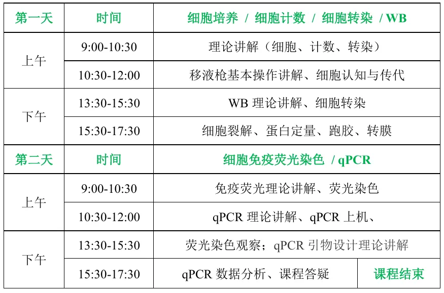
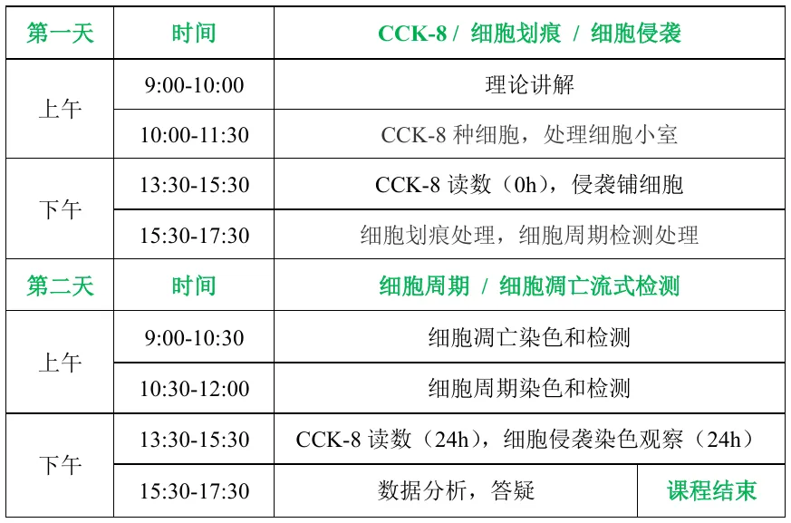

# 流式/磁珠分选指北

> 原文：https://mp.weixin.qq.com/s?__biz=MzAwMzIzOTk5OQ==&mid=2247529428&idx=1&sn=18a7bf6c013bab0cb2ecbde9c1c4e9af&chksm=9b3c0a84ac4b83924bec6fe5f58d3266c6976524c79d9d495508cf581ab3e15af43804f52f98#rd
> 合集：实验基地

[实验基地斥巨资引进的流式细胞仪到了](<https://mp.weixin.qq.com/s?__biz=MzAwMzIzOTk5OQ==&mid=2247528861&idx=1&sn=7bd244adb4367b7013aeb9ba4faa8ff5&scene=21#wechat_redirect>)，[实验基地六月课表](<https://mp.weixin.qq.com/s?__biz=MzAwMzIzOTk5OQ==&mid=2247529131&idx=1&sn=e7edf0422aa1d122d5ec0105c37e9688&scene=21#wechat_redirect>)已包含。为高效地分选所需要的目的细胞，进一步对其进行表型分析或功能试验。常用的细胞分选方法：荧光激活细胞分选方法（Fluorescence-activated cell sorting，FACS）和磁性激活细胞分选法（Magnetic-activated cell separation，MACS）。

流式分选

**原理**

流式分选仪主要由液流、光路、气路、电子和分选系统构成。在分选过程中，带有荧光标记的单细胞悬液被鞘液包裹，形成单细胞队列并通过流动室。这些细胞在激光的照射下发出荧光，这些荧光信号被收集并由电脑进行分析，随后转化为电信号。研究人员可以利用这些信号在软件中圈定出目标细胞。当液流形成包裹单个细胞的微小液滴时，这些液滴会被赋予不同的电荷。当这些带电液滴通过电极偏转板时，它们会受到电场力的作用而发生偏转，从而被导向下方不同的收集容器中。这样，就成功地实现了对细胞的分选。

**优缺点**

优点：高纯度：可达99%以上，尤其适合稀有细胞分选；多参数：可同时基于多个标志物（如10色以上）进行复杂分选；灵活性：支持复杂门控策略（如活细胞、特定细胞周期阶段）。缺点：仪器成本高：流式细胞仪设备和实验耗材以及维护成本相对较高，对于实验室条件有一定要求；操作复杂：流式分选需要对仪器的操作和维护都有一定的技术要求，需要经过专门的培训和熟练的技能；细胞活力受损：流式细胞仪中的细胞经过细胞流动、压力和激光照射等过程，可能会对细胞的活力和功能造成一定影响；低密度样本难处理：对于低密度的样本，流式分选可能无法达到足够的分选效果。

**磁珠分选**

**1**

**原理**

主要作用是确保细胞单个排列通过，实现细胞的顺序流动，每次分析一个细胞，为信号检测提供良好的条件。磁珠分选技术结合了偶联磁珠的抗体、磁场和细胞三个关键要素。其操作流程首先涉及使用偶联有特定抗体的磁珠来标记目标细胞。随后，这些被标记的细胞会通过一个带有磁力的分离柱。在分离柱中，由于磁力的作用，标记有抗体的细胞会被牢牢吸附在柱子上，而未被标记的细胞则会随上清液首先被洗脱出来。接着，通过特定的洗脱步骤，被磁珠结合的细胞（即目的细胞）会从分离柱上被洗脱下来，从而实现细胞的分离。磁珠分选法根据其应用方式可分为正选法和负选法。在正选法中，磁珠结合的细胞即为所需的目的细胞；而在负选法中，磁珠则是结合那些不需要的细胞，目的细胞则游离于上清液中，并最终通过其他方式被收集。这两种方法共同构成了磁珠分选技术的核心。

**2**

**优缺点**

优点：速度快：分选过程仅需几分钟至几十分钟；温和：对细胞活性影响小，适合后续培养或功能实验；高通量：可处理大量样本（如全血、脾脏悬液等）；成本低：设备简单（仅需磁架），试剂成本低于流式。缺点：纯度受限：依赖抗体特异性，可能因非特异性结合或细胞聚集影响纯度。（通常80-95%）；单参数为主：通常基于1-2个表面标志物分选；无法多路复用：一次分选仅分离一种目标细胞。

**流式分选与磁珠分选对比**

注意事项

总而言之，磁珠分选适用于需要快速分离特定细胞亚群（如CD4+ T细胞、造血干细胞）；大样本预富集或粗分选；对细胞活性要求高的实验（如原代细胞培养、移植）等应用场景。流式分选适用于需要高纯度或复杂表型的分选（如干细胞亚群、肿瘤异质性研究）；多参数分析（如免疫细胞分型、信号通路研究）；单细胞分选（如单细胞测序、克隆培养）等应用场景，可根据不同的后续实验要求进行选择或联合使用。

实验基地[实验基地六月课表](<https://mp.weixin.qq.com/s?__biz=MzAwMzIzOTk5OQ==&mid=2247529131&idx=1&sn=e7edf0422aa1d122d5ec0105c37e9688&scene=21#wechat_redirect>)进行中：

一、基础实验技能周末学习班（2天）
课程介绍：

本课程旨在帮助学员完成生物医学基础实验的入门。本学习内容涵盖了最常规的的基础实验，分别从细胞认识，细胞处理，实验鉴定三个层面帮助学员细致了解相关基础实验流程，掌握步骤要领，独立完成相关实验操作。

学习内容：

细胞培养 细胞计数 细胞转染 Western blot 细胞免疫荧光染色qPCR

课程定价：

3180元/人（此基础上九折）

课表安排：

二、细胞功能实验周末学习班（2天）
课程介绍：本课程旨在帮助学员完成肿瘤相关细胞功能实验的入门。本学习内容涵盖了最常规的的肿瘤细胞实验，手把手指导学员细致了解相关基础实验流程，掌握步骤要领，独立完成相关实验操作。学习内容：CCK-8细胞增殖 细胞划痕 细胞迁移/侵袭 细胞周期 [细胞凋亡流式检测](<https://mp.weixin.qq.com/s?__biz=MzAwMzIzOTk5OQ==&mid=2247528861&idx=1&sn=7bd244adb4367b7013aeb9ba4faa8ff5&scene=21#wechat_redirect>)课程定价：3580元/人（此基础上九折）课表安排：
本期技能实操训练依旧采用小班化模式，计划招募6名学员，名额有限哦。

本期培训特点 ：

1\. 纯小班教学，强化实操练习

2\. 浙大博士陪伴式指导

3\. 课程设计由浅入深，基础+拔高

4\. 长期答疑、长期指导

实验基地

长期以来Biomamba都在自己的媒体矩阵中分享生信分析技能。生命科学毕竟是物质的科学，脱离了**实验** 总是玩不转的，大家的分析结果也需要去实验验证。一方面自己想在不同的领域里开疆扩土，追寻些新的可能；另一方面也想为大家的科研生涯全方面保驾护航，未来给大家提供新的服务、交流交流实验技能。所以，Biomamba联合**浙江大学博士团队** 组建了一个自己的实验室(Biomamba生信基地**终于有基地** 啦！)，base上海张江。目前还是百业待兴，大家有什么想法可以**填写问卷** 跟咱反馈反馈：
问卷链接，文末阅读原文可直达：https://www.wjx.cn/vm/tpYsP8D.aspx# 问卷二维码：
更多想法也可以直接添加我们的客服微信[**Biomamba_zhushou**]聊聊，我们也有专门的实验基地交流群。
实验室环境：

**如何联系我们**

 留一个领取资料、[免费两周学习版](<https://mp.weixin.qq.com/s?__biz=MzAwMzIzOTk5OQ==&mid=2247527585&idx=1&sn=fa32112c11b215b33096cab43baf08ea&scene=21#wechat_redirect>)服务器的**微信号[Biomamba_zhushou]**，方便各位随时交流。同时我们也构建了[交流群矩阵](<https://mp.weixin.qq.com/s?__biz=MzAwMzIzOTk5OQ==&mid=2247528057&idx=1&sn=bb348c2a88c977c7cce67ee6731a3591&scene=21#wechat_redirect>)，欢迎大家入群讨论。
大家可以阅读完这几篇之后添加[给生信入门初学者的小贴士](<http://mp.weixin.qq.com/s?__biz=MzAwMzIzOTk5OQ==&mid=2247493329&idx=1&sn=597870b7f7ce10346da3561e7c281627&chksm=9b3c9f81ac4b169794088ce9abbcacb5f18e9fd174fc0d7e28da62d78facadf3100ef38aaf22&scene=21#wechat_redirect>)
[没有检索，就没有发言权](<https://mp.weixin.qq.com/s?__biz=MzAwMzIzOTk5OQ==&mid=2247529398&idx=2&sn=5a429852d61721916a405712677d5905&scene=21#wechat_redirect>)

**已有生信基地联系方式的同学****无需重复添加**

 您点的每个赞和在看，我都认真当成了喜欢
