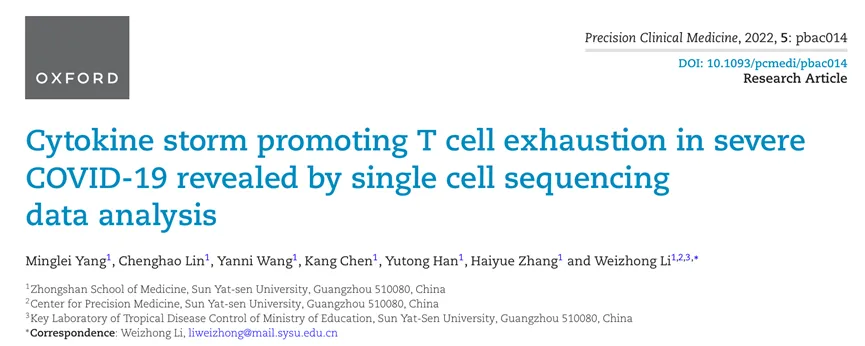
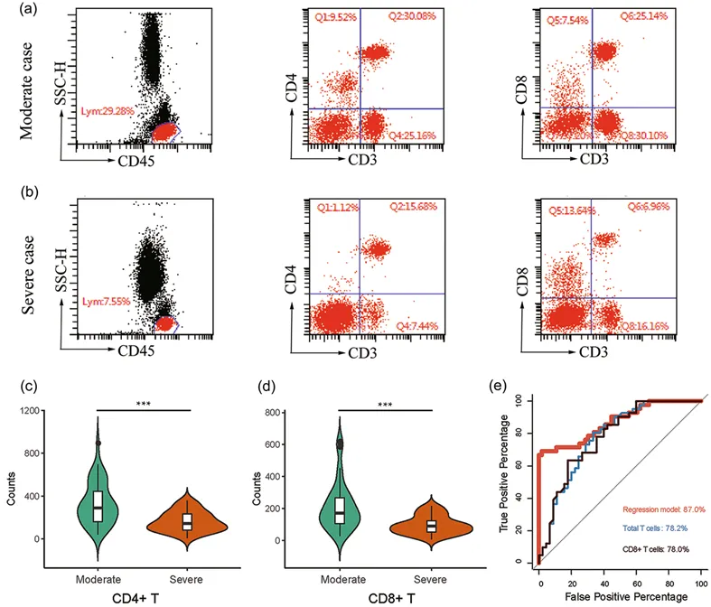
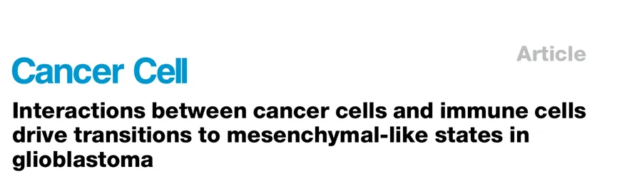
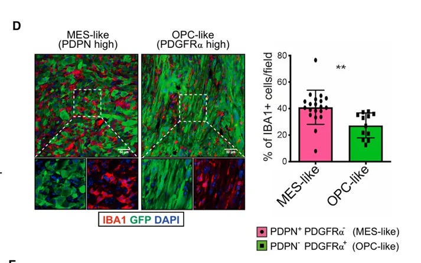
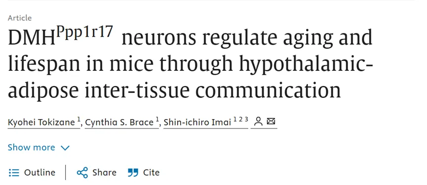
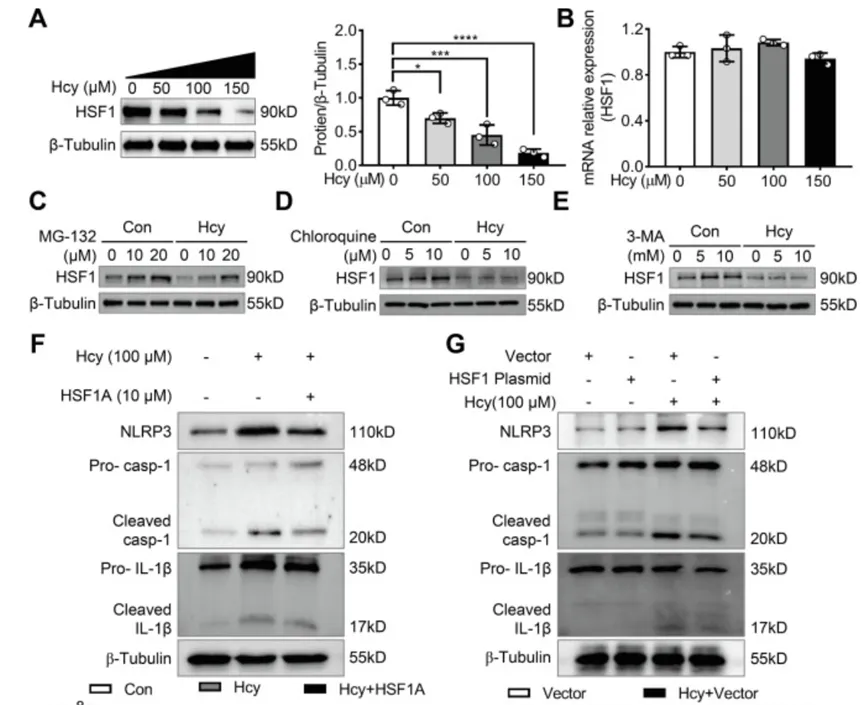
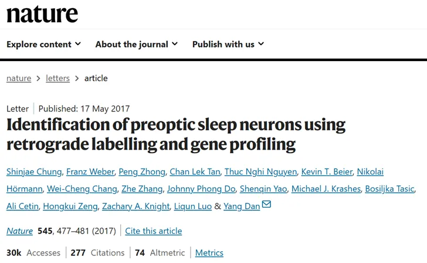
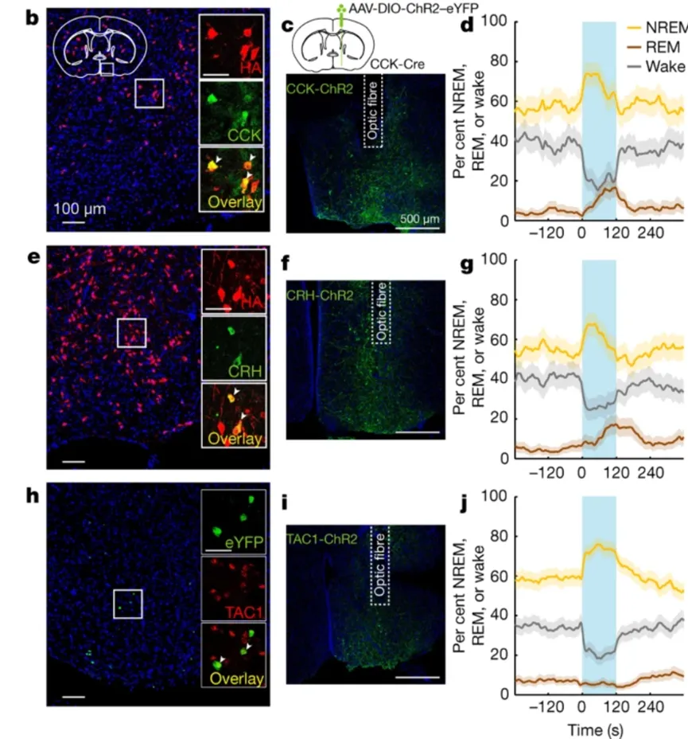
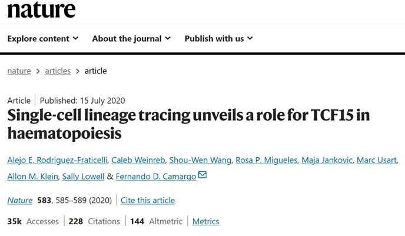
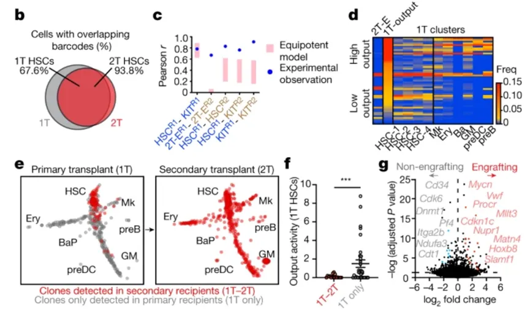

# 《Nature》和《Cancer Cell》都是怎么验证单细胞分析结果的？

> 原文：https://mp.weixin.qq.com/s?__biz=MzAwMzIzOTk5OQ==&mid=2247530661&idx=1&sn=5c37f5224014f0e4257bd443e6fcd05a&chksm=9b3c01f5ac4b88e3c32d4ebf48161d681610febc27437e1edf92a539d5e9a8609045590122cb#rd
> 合集：实验基地

众所周知，纯生信现在发文是没啥指望了。所以，在提供[scRNA-seq小学期](<https://mp.weixin.qq.com/s?__biz=MzAwMzIzOTk5OQ==&mid=2247530022&idx=2&sn=5c6aa081663719ce2f0f9b7f4d173c93&scene=21#wechat_redirect>)的同时，我们也为大家提供[实验基地小学期~](<https://mp.weixin.qq.com/s?__biz=MzAwMzIzOTk5OQ==&mid=2247530174&idx=1&sn=c3b0499adcc9093546e4ba1cfffba7bd&scene=21#wechat_redirect>)本次推送我们共搜集解读了五篇高分单细胞文章，让我们看看大神们都是如何对自己的单细胞结果进行验证的吧：

**流式细胞术**

流式细胞术是现代生命科学和医学研究中不可或缺的强大分析工具。它通过让细胞“排队”经过激光束，快速、定量地获取单个细胞的多种信息（大小、颗粒度、特定分子表达等），并能分离特定细胞群体。其高通量、多参数、单细胞水平分析的能力，使其在免疫学、血液学、肿瘤学、细胞生物学、药物研发等领域发挥着至关重要的作用。

案例：新冠肺炎重症患者肺部T细胞耗竭机制验证（DOI: 10.1093/pcmedi/pbac014）

样本：重症COVID-19患者支气管肺泡灌洗液（BALF）

**单细胞测序发现**

  1. 发现新型耗竭T细胞亚群（CD8+T_EXH），占比显著高于轻症组（scRNA-seq：23% vs. 5%）

  2. 该亚群高表达免疫检查点 LAG-3 和耗竭相关转录因子 TOX。

  3. scRNA-seq显示T_EXH细胞 糖酵解通路 上调（HK2、LDHA基因高表达）。

**流式验证实验方案**

一、细胞亚群比例验证

  1. 样本匹配：同一批患者BALF样本（重症n=8，轻症n=8）。

  2. CD45-APC | CD3-PerCP | CD8-BV421 | PD-1-PE | LAG-3-FITC | TOX-Alexa647等流式抗体。

  3. 检测结果：重症组CD8+ T_EXH占比 18-25%（与scRNA-seq的23%一致）。

二、标志物表达一致性验证

  1. 先表面染色 → 固定/破膜 → 胞内染色（避免表位破坏）

  2. 使用 Foxp3/Transcription Factor Buffer Set（eBioscience）

  3. 检测结果显示LAG-3和TOX的流式阳性率与scRNA-seq表达率一致。

三、功能表型关联验证

  1. 代谢流检测分选T_EXH细胞（CD8+PD-1+LAG-3+），加载2-BDG荧光葡萄糖探针，37℃孵育30min → 流式检测荧光强度。

  2. 结果显示T_EXH细胞葡萄糖摄取量3倍于普通CD8+T细胞（p<0.001），与单细胞代谢评分高度相关（R=0.91）

**免疫组化或免疫荧光技术**

免疫组化是一种在显微镜下观察的实验室技术，用来检测组织切片中特定蛋白质（抗原）的存在和位置。免疫荧光技术是一种利用“抗体”和“发光染料”相结合，在显微镜下精确定位抗原的技术。前者用显色底物，后者用荧光标记。

案例：胶质母细胞瘤（GBM）中肿瘤干细胞微环境的空间验证（DOI: 10.1016/j.ccell.2021.05.002）

样本： 8例初诊GBM患者的肿瘤组织

**单细胞测序发现**

  1. CD133+肿瘤干细胞（CSCs）存在两种新亚群：侵袭型（CSC-INV）：高表达 VIM（波形蛋白）；SNAI1静息型（CSC-QUIES）高表达 CD36（脂肪酸受体）、HIF1A。

  2. CSC-INV与TAMs（肿瘤相关巨噬细胞）共定位，且分泌 IL-6→STAT3 信号激活。

**免疫荧光验证方案**

一、标志物空间定位验证

  1. 抗体组合

CD133标记肿瘤细胞，Vim标记侵袭型CSC，CD36标记静息CSC

  2. 验证结果：

CSC-INV（CD133+VIM+）主要位于肿瘤边缘（侵袭前沿）；CSC-QUIES（CD133+CD36+）富集于坏死区周围；单细胞预测和IHC定量趋于一致。

二、细胞互作机制验证

  1. 连续切片染色，Slide 1：CD133 + VIM（定位CSC-INV），Slide 2：CD68（巨噬细胞） + p-STAT3（信号激活标志）。

  2. 空间距离分析，在CSC-INV周围100μm范围内，巨噬细胞p-STAT3+比例 升高4.2倍。

**免疫印迹法**

一种用于检测特定蛋白质在复杂生物样本中表达水平、分子量及翻译后修饰（如磷酸化、乙酰化）的经典分子生物学技术。

案例：肥胖症中脂肪组织巨噬细胞（ATM）的炎症机制验证（DOI:10.1016/j.cmet.2023.12.011）

样本：肥胖患者 vs 健康对照的皮下脂肪组织

**单细胞测序发现**

促炎型ATM亚群 中HSF1-HSP90 通路激活（HSF1基因表达上调2.8倍，HSP90表达上调3.5倍）且HSF1 磷酸化位点 Ser326 预测为关键修饰位点。

**免疫印迹法验证方案**

**一、靶点蛋白表达验证**

  1. 选取样本肥胖组（OB）：n=5，脂肪组织裂解液，健康组（HC）：n=5，脂肪组织裂解液

  2. WB结果显示OB组 NLRP3蛋白表达量上调3.1倍（p<0.01），与单细胞RNA表达趋势一致（上调3.3倍）。

二、信号通路激活验证

ATM-INFLAM中 HSF1-HSP90 通路激活 ，之后驱动NLRP3炎症小体组装。WB通过p-HSF1 (Ser326)的磷酸化抗体，检测HSF1磷酸化的激活情况。

**FISH**

FISH是指荧光原位杂交技术(Fluorescene in situ hybridization, FISH)的缩写。FISH利用DNA碱基互补配对的特点，在体外一定的条件下，使同源的DNA链或DNA-RNA单链结合成双链，以荧光标记取代同位素标记而形成的一种新的原位杂交方法。

案例：逆行标记+单细胞测序锁定睡眠调控核心靶点（DOI: 10.1038/nature22350）

样本：小鼠的靶向POA睡眠激活区

**单细胞测序发现**

聚类发现两群促眠神经元

Cluster1：高表达 Gal（甘丙肽）→ 慢波睡眠调控

Cluster2：高表达 Pdgfra（血小板生因子受体α）→ REM睡眠调控

**FISH验证方案**

  1. 取材：逆行标记（AAV-retro-mCherry注射）后的小鼠脑组织，视前区（POA）冠状切片 厚度20μm

  2. 0.1M HCl处理10min → 去除脂褐素自发荧光（老年脑组织高发），蛋白酶K（1μg/ml）消化5min → 增加探针渗透。

  3. 进行Gal, Pdgfra和mCherry的探针杂交。

  4. 共聚焦显微镜（Zeiss LSM 980）Z-stack扫描。

  5. 实验结果发现92.3%的 Gal+ 神经元同时表达 mCherry（病毒标记的睡眠神经元），Gal 转录本在POA腹外侧核（VLPO）富集（密度 15.7斑点/细胞 vs 其他区域<2），与单细胞测序结果一致。

**谱系追踪**

谱系追踪(Lineage Tracing)是一种用于追踪特定细胞及其后代的分子生物学技术。通过标记或追踪细胞及其衍生细胞的分布、分化和功能变化，谱系追踪能够帮助研究者了解细胞的起源、发育过程以及在组织再生、发育或疾病中的动态变化。

案例：利用CRISPR条形码谱系追踪验证造血干细胞演化路径（DOI: 10.1038/s41586-020-2503-6）

样本：造血干细胞（HSCs）

**单细胞测序发现**

  1. Tcf15高表达细胞 → 优先向 巨核-红系（MegE） 分化（OR=8.7, p<0.001）

  2. Tcf15沉默细胞 → 倾向 淋系分化（T/B细胞）

**CRISPR-Cas9谱系追踪验证**

  1. 用 Cre-loxP-荧光报告系统 标记小鼠 HSC（c-Kit+）,报告基因：ZsGreen（绿） + tdTomato（红）

  2. 移植标记HSC至辐照小鼠 → 在 1/3/6周 分选骨髓细胞, 流式检测 子代细胞荧光（如：T细胞→CD3+ZsGreen+）

  3. 10x Genomics测序 12,860个骨髓细胞,构建 HSC分化轨迹树（Monocle3算法）。

  4. 结果显示：Tcf15+ HSC 定向迁移至骨内膜，分化过程持续 48±6小时。

  5. 总结讨论：通过单细胞测序分析方法得到的这些研究结果再利用实验方法进行验证，能够使文章结果更有说服力，研究结论更有深度。大家可以根据自己的研究内容，实验周期等设计湿实验进行验证。

实验基地

长期以来Biomamba都在自己的媒体矩阵中分享生信分析技能。生命科学毕竟是物质的科学，脱离了**实验** 总是玩不转的，大家的分析结果也需要去实验验证。一方面自己想在不同的领域里开疆扩土，追寻些新的可能；另一方面也想为大家的科研生涯全方面保驾护航，未来给大家提供新的服务、交流交流实验技能。所以，Biomamba联合**浙江大学博士团队** 组建了一个自己的实验室(Biomamba生信基地**终于有基地** 啦！)，base上海张江。目前还是百业待兴，大家有什么想法可以**填写问卷** 跟咱反馈反馈：
问卷链接，文末阅读原文可直达：https://www.wjx.cn/vm/tpYsP8D.aspx# 问卷二维码：
更多想法也可以直接添加我们的客服微信[**Biomamba_zhushou**]聊聊，我们也有专门的实验基地交流群。
实验室环境：

参考文献

DOI: 10.1093/pcmedi/pbac014

**DOI: 10.1016/j.ccell.2021.05.002**

**DOI:10.1016/j.cmet.2023.12.011**

**DOI: 10.1038/nature22350**

**DOI: 10.1038/s41586-020-2503-6**

**如何联系我们**

 留一个领取[资料](<https://mp.weixin.qq.com/s?__biz=MzAwMzIzOTk5OQ==&mid=2247530154&idx=2&sn=e5d0a63646094c3094b7b916350d22ad&scene=21#wechat_redirect>)、[开箱即用的单细胞分析镜像](<https://mp.weixin.qq.com/s?__biz=MzAwMzIzOTk5OQ==&mid=2247528410&idx=2&sn=0f2bac25479cf8d20dab5d82ae986f2e&scene=21#wechat_redirect>)的**微信号[Biomamba_zhushou]**，方便各位随时交流。同时我们也构建了[交流群矩阵](<https://mp.weixin.qq.com/s?__biz=MzAwMzIzOTk5OQ==&mid=2247528057&idx=1&sn=bb348c2a88c977c7cce67ee6731a3591&scene=21#wechat_redirect>)，欢迎大家入群讨论。
大家可以阅读完这几篇之后添加[给生信入门初学者的小贴士](<http://mp.weixin.qq.com/s?__biz=MzAwMzIzOTk5OQ==&mid=2247493329&idx=1&sn=597870b7f7ce10346da3561e7c281627&chksm=9b3c9f81ac4b169794088ce9abbcacb5f18e9fd174fc0d7e28da62d78facadf3100ef38aaf22&scene=21#wechat_redirect>)
[没有检索，就没有发言权](<https://mp.weixin.qq.com/s?__biz=MzAwMzIzOTk5OQ==&mid=2247529398&idx=2&sn=5a429852d61721916a405712677d5905&scene=21#wechat_redirect>)

**已有生信基地联系方式的同学****无需重复添加**

 您点的每个赞和在看，我都认真当成了喜欢
