# 空转分析靠谱吗？这些湿实验：给你“双重保证”！

> 原文：https://mp.weixin.qq.com/s?__biz=MzAwMzIzOTk5OQ==&mid=2247531463&idx=1&sn=5ee879442cf3b579ae46553dadcd526c&chksm=9b3c0297ac4b8b8167aced2b2222346d9d6b9f5c6214517fc5451b4efb4ced43ba70633febc4#rd
> 合集：实验基地

众所周知，纯生信现在发文是没啥指望了。所以，在提供[scRNA-seq小学期](<https://mp.weixin.qq.com/s?__biz=MzAwMzIzOTk5OQ==&mid=2247530022&idx=2&sn=5c6aa081663719ce2f0f9b7f4d173c93&scene=21#wechat_redirect>)、[空间转录组分析全程班](<https://mp.weixin.qq.com/s?__biz=MzAwMzIzOTk5OQ==&mid=2247531284&idx=1&sn=cc785f60e85a3caa8117792de60e1393&scene=21#wechat_redirect>)的同时，我们也为大家提供[实验基地秋季学期来啦~](<https://mp.weixin.qq.com/s?__biz=MzAwMzIzOTk5OQ==&mid=2247531145&idx=1&sn=5cbe98083cb0fd67f2b0c18ea3c5fe74&scene=21#wechat_redirect>)欢迎联系客服微信[Biomamba_zhushou]！本次推送我们共搜集解读了三篇高分单细胞文章，让我们看看大神们都是如何对自己的单细胞结果进行验证的吧：

**参考案例**

**1**

**案例一**

案例：整合空间转录组学和单细胞转录组学揭示PAK激酶作为特发性肺纤维化中成纤维细胞灶和致密纤维化的治疗靶点（DOI: 10.1183/13993003.00022-2025）

样本：IPF患者的9个肺组织切片

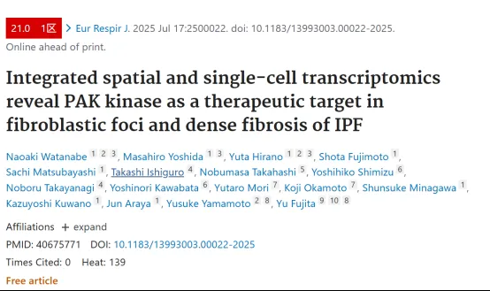

**1**

**案例二**

案例：发育生物学-胚胎腭成骨的多模态时空转录组分析 （DOI: 10.1038/s41467-023-41349-9）

样本：小鼠模型（n=3）两个过渡阶段的腭中部冠状切片（腭架接触E14.5和腭部融合E15.5）

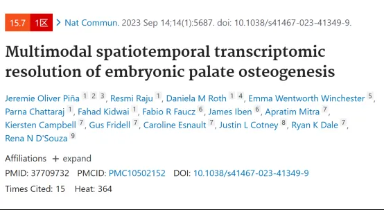

**1**

**案例三**

案例：肿瘤研究案例-人肝癌浸润区细胞串扰、局部免疫抑制和肿瘤进展（DOI: 10.1038/s41422-023-00831-1）

样本：21位原发性肝癌患者，共98张切片空转

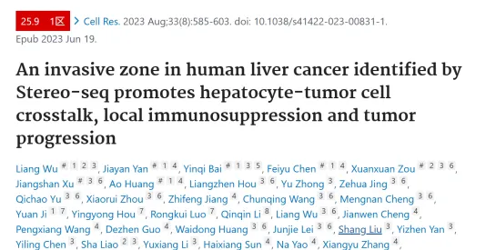

**HE染色及免疫组化染色或免疫荧光染色**

HE染色是苏木精 - 伊红（Hematoxylin - Eosin Staining）染色法的简称。细胞核中的染色质含有酸性物质，如DNA等，可以被碱性的苏木精染成蓝色。而细胞质中的成分，如细胞质内的核糖体、线粒体等富含碱性物质，能够被酸性的伊红染成红色。通过这种染色，可以清晰地显示出细胞核和细胞质的结构差异。

免疫组化染色（Immunohistochemistry，IHC）是一种利用抗原 - 抗体特异性结合的原理，通过化学反应使标记抗体的显色剂（如酶、荧光素、金属离子等）显色来确定组织细胞内抗原（多肽和蛋白质）的位置和含量的技术。它将免疫学的特异性识别和组织化学的显色技术相结合，是一种非常重要的病理诊断和研究工具。

参考案例一

**空间转录组测序发现**

对相同IPF患者及3名健康对照的肺组织进行scRNA-seq，发现IPF肺中细胞类型组成与健康对照存在差异，存在明显的成纤维细胞灶。

**病理学检测验证方案**

  1. H&E染色在组织中识别出成纤维细胞灶。

  2. 经免疫组化技术通过检测COL1A1、POSTN、CTHRC1等已知成纤维细胞标记物的空间分布，验证了空间转录组学中检测点的准确性。

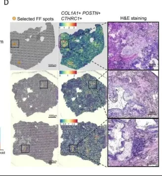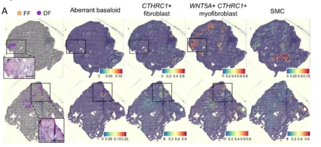

**免疫印迹法**

一种用于检测特定蛋白质在复杂生物样本中表达水平、分子量及翻译后修饰（如磷酸化、乙酰化）的经典分子生物学技术。

参考案例一

**空间转录组测序发现**

通过对测序数据中差异基因和IPA通路分析，发现PAK2在FF中激活，其靶基因在高FF指数的促纤维化成纤维细胞中高表达，且在FF和DF区域周围富集，与CTHRC1+成纤维细胞（FF中）和WNT5A+ CTHRC1+肌成纤维细胞（DF中）的分布一致。

**免疫印迹法验证方案——靶点蛋白表达验证及信号通路激活验证**

在成纤维细胞中敲低PAK1或PAK2可减少TGF-β诱导的细胞胞外基质产生及促进因子CTHRC1和WNT5A表达；PAK抑制剂FRAX486和FRAX597以剂量依赖方式抑制TGF-β诱导的α-SMA和I型胶原表达，效果优于吡非尼酮和尼达尼布，且可抑制PAK2及其下游分子的表达和磷酸化，但不影响SMAD2/3。在IPF来源的成纤维细胞中，两种抑制剂也能降低α-SMA和I型胶原表达，抑制PAK2下游信号。

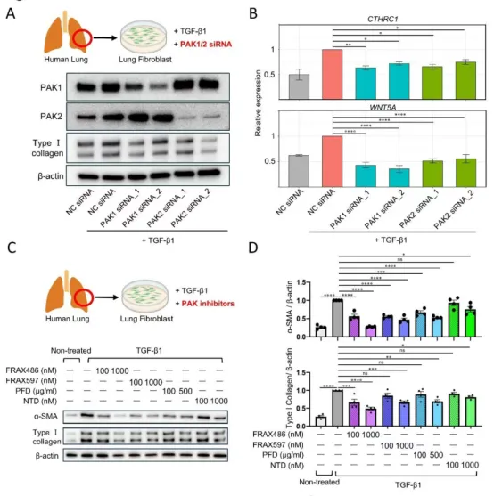

**动物实验**

博莱霉素（Bleomycin, BLM）诱导的肺纤维化模型是研究特发性肺纤维化（Idiopathic Pulmonary Fibrosis, IPF）及其他纤维化性肺疾病的重要工具。该模型能够模拟IPF的关键病理特征，包括炎症反应和纤维化过程，为研究发病机制和筛选潜在治疗药物提供了重要平台。

参考案例一

**动物实验验证方案**

在博来霉素诱导的肺纤维化小鼠模型中，成纤维细胞中PAK2表达及磷酸化水平升高；选择PAK抑制剂FRAX486给药后，发现其可恢复模型小鼠体重，通过羟脯氨酸测定、Masson三色染色证实给药后显著减少胶原沉积和纤维化程度，且显著降低肺组织中p-PAK2表达及WNT5A+ CTHRC1+成纤维细胞数量。

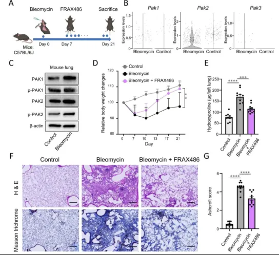

**原位杂交（FISH）**

原位杂交(In situ hybridization，ISH)是一种分子生物学技术，主要用于检测和定位细胞或组织切片中特定的核酸序列(DNA或RNA)。

参考案例二

**空间转录组测序发现**

腭骨形成始于融合期, 从E14.5到E15.5，成骨细胞谱系分化在次腭间质内显著增加，揭示了在腭成骨间充质细胞中富集的三个未报道过的参与纤毛功能的腭部融合相关基因，在E15.5阶段定位于腭部带纤毛的鼻上皮，表明鼻上皮细胞可能在腭架融合的过程中发挥了促进细胞迁移的特殊作用。

**原位杂交实验验证**

实验结果显示成骨细胞前标记物 Runx2 和 Sparc 的表达位于整个发育中的腭间充质，在中央骨化中心有明显的弥漫性信号，且高度特异性的骨细胞标记物 Sost 在 E14.5处定位，之后会在后腭融合后E15.5显著增加。

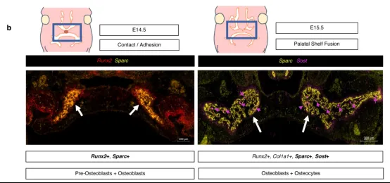

**FACS**

流式细胞术（Flow Cytometry, FACS）是一种强大的实验技术，广泛应用于细胞生物学、免疫学、肿瘤学、血液学等多个领域。它能够快速、准确地对细胞进行多参数分析和分选，为研究细胞的表型、功能、周期状态等提供了重要工具。

参考案例三

**空间转录组测序发现**

在肿瘤边界周围500微米的浸润区，检测到强烈的免疫抑制、代谢重编程和严重受损的肝细胞亚型。受邻恶性细胞CXCL6过表达诱导，附近肝细胞JAK-STAT3通路激活，导致肝细胞中血清淀粉样蛋白A1和A2(统称SAAs）表达增加。进一步加剧巨噬细胞募集和M2极化，促进局部免疫抑制和肿瘤进展。

**FACS实验验证**

结果显示SAA诱导的M2表型（CD68+CD206+）巨噬细胞明显增加，TLR2抑制剂处理可以显著降低M2的比例，进一步验证了恶性细胞诱导的损伤肝细胞可以通过分泌SAAs在侵袭区募集M2极化巨噬细胞。

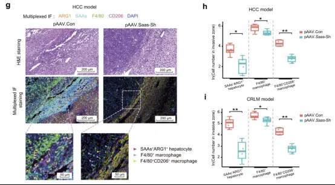

总结讨论：

空间转录组测序（Spatial Transcriptomics, ST）技术近年来发展迅速，能够提供组织中基因表达的空间信息，为研究细胞在组织中的分布和功能提供了新的视角。然而，仅依靠空间转录组测序数据往往不足以完全验证研究结果的可靠性和生物学意义。因此，结合湿实验进行验证是至关重要的。

实验基地

秋季开学啦~越来越多的同学通过客服微信[Biomamba_zhushou]表示希望推出一款兼顾实验操作基础知识和细胞功能学习的课程的愿望。为此，[实验基地](<https://mp.weixin.qq.com/s?__biz=MzAwMzIzOTk5OQ==&mid=2247528762&idx=1&sn=8a021cadb30f65eae1ed242bffabc277&scene=21#wechat_redirect>)基于大家最基本的实验需求，推出了组合实验技能班，涵盖细胞培养、WB（蛋白质印迹）、qPCR（实时荧光定量PCR）以及流式细胞凋亡检测内容。

学习时间如下：

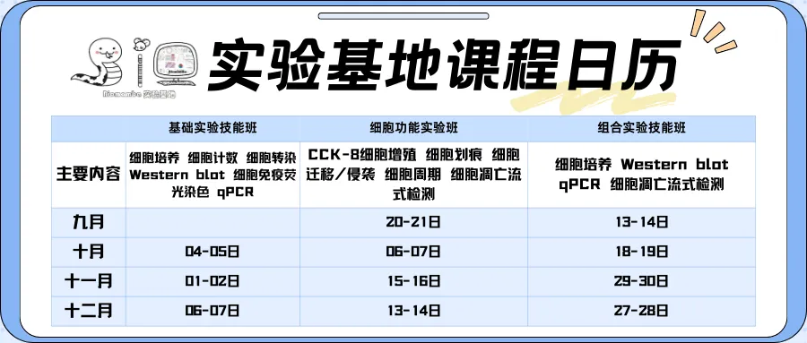

**具体课程内容**

**基础实验班：**

内容：细胞培养细胞计数细胞转染Western blot细胞免疫荧光染色 qPCR

价格：3180元/人（实操）

**细胞功能实验班：**

内容：CCK-8细胞增殖 细胞划痕 细胞迁移/侵袭 细胞周期 细胞凋亡流式检测

价格：3580元/人（实操）

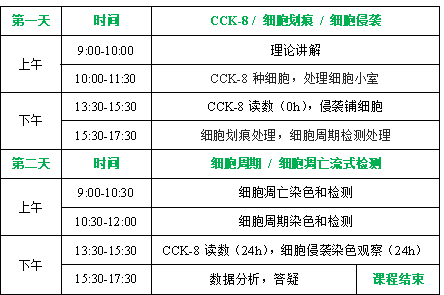

**组合实验技能班：**

内容：细胞培养 Western blot qPCR细胞凋亡流式检测

价格：2680元/人（实操）

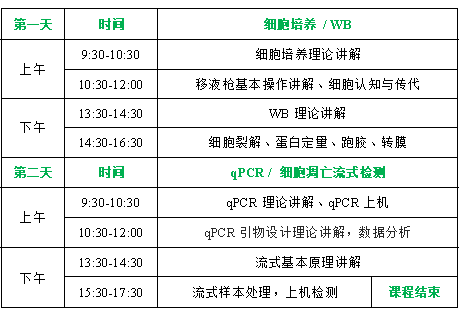长期以来Biomamba都在自己的媒体矩阵中分享生信分析技能。生命科学毕竟是物质的科学，脱离了**实验** 总是玩不转的，大家的分析结果也需要去实验验证。一方面自己想在不同的领域里开疆扩土，追寻些新的可能；另一方面也想为大家的科研生涯全方面保驾护航，未来给大家提供新的服务、交流交流实验技能。所以，Biomamba联合**浙江大学博士团队** 组建了一个自己的实验室(Biomamba生信基地**终于有基地** 啦！)，base上海张江。目前还是百业待兴，大家有什么想法可以**填写问卷** 跟咱反馈反馈：
问卷链接，文末阅读原文可直达：https://www.wjx.cn/vm/tpYsP8D.aspx# 问卷二维码：
更多想法也可以直接添加我们的客服微信[**Biomamba_zhushou**]聊聊，我们也有专门的实验基地交流群。
实验室环境：

参考文献

**DOI: 10.1183/13993003.00022-2025**

**DOI: 10.1038/s41467-023-41349-9**

**DOI: 10.1038/s41422-023-00831-1 **

**如何联系我们**

 留一个领取[资料](<https://mp.weixin.qq.com/s?__biz=MzAwMzIzOTk5OQ==&mid=2247530154&idx=2&sn=e5d0a63646094c3094b7b916350d22ad&scene=21#wechat_redirect>)、[开箱即用的单细胞分析镜像](<https://mp.weixin.qq.com/s?__biz=MzAwMzIzOTk5OQ==&mid=2247528410&idx=2&sn=0f2bac25479cf8d20dab5d82ae986f2e&scene=21#wechat_redirect>)的**微信号[Biomamba_zhushou]**，方便各位随时交流。同时我们也构建了[交流群矩阵](<https://mp.weixin.qq.com/s?__biz=MzAwMzIzOTk5OQ==&mid=2247528057&idx=1&sn=bb348c2a88c977c7cce67ee6731a3591&scene=21#wechat_redirect>)，欢迎大家入群讨论。
大家可以阅读完这几篇之后添加[给生信入门初学者的小贴士](<http://mp.weixin.qq.com/s?__biz=MzAwMzIzOTk5OQ==&mid=2247493329&idx=1&sn=597870b7f7ce10346da3561e7c281627&chksm=9b3c9f81ac4b169794088ce9abbcacb5f18e9fd174fc0d7e28da62d78facadf3100ef38aaf22&scene=21#wechat_redirect>)
[没有检索，就没有发言权](<https://mp.weixin.qq.com/s?__biz=MzAwMzIzOTk5OQ==&mid=2247529398&idx=2&sn=5a429852d61721916a405712677d5905&scene=21#wechat_redirect>)

**已有生信基地联系方式的同学****无需重复添加**

 您点的每个赞和在看，我都认真当成了喜欢
