# Biomamba劝学

> 原文：https://mp.weixin.qq.com/s?__biz=MzAwMzIzOTk5OQ==&mid=2247527884&idx=1&sn=c544cb33b90afd2cecfb3a88993d3c35&chksm=9b3c149cac4b9d8aa261d9927a0fedc5a40123d159bae2f06ba172af2348471eb779de175e8b#rd
> 合集：漫谈胡侃

写在前面

最近也有个事，值得说道一下。我们的[足够支持你完成硕博生涯的生信环境](<https://mp.weixin.qq.com/s?__biz=MzAwMzIzOTk5OQ==&mid=2247526504&idx=2&sn=417d07347cebe0a1bd403f6c3e7d9b29&scene=21#wechat_redirect>)，给大家提供的是生信环境、算力，而不是生信辅导。况且我们还给大家提供了五次技术支持工单：[白嫖五次技术支持](<https://mp.weixin.qq.com/s?__biz=MzAwMzIzOTk5OQ==&mid=2247520567&idx=1&sn=6800842ddd5ad1c17224c4b20ca1d145&scene=21#wechat_redirect>)。即使是这样，大家在问我们服务器使用相关的问题时，其实我们还是会给大家答疑的。不过还是希望大家能给听从我们的建议，先行学习：[十小时学会Linux](<https://mp.weixin.qq.com/s?__biz=MzAwMzIzOTk5OQ==&mid=2247505777&idx=1&sn=f3efae390566b838a445ab9f832323c8&scene=21#wechat_redirect>)。这就有一个悖论，如果给大家无休止的答疑，就远远超出了我们的义务范围以及承受能力。若是不给大家答疑，大家又觉得是服务器产品的问题。实际在我们观察中，用户问到的问题99.99%都是因为Linux知识不足所导致的。所以，大家想要顺利的学习生信，最好还是先撸一遍这些编程教程：

[十小时学会Linux](<http://mp.weixin.qq.com/s?__biz=MzAwMzIzOTk5OQ==&mid=2247505777&idx=1&sn=f3efae390566b838a445ab9f832323c8&chksm=9b3cae21ac4b2737f5923b246470d699474c041bb78de50d2b71b99d537f9f44ca2938002cda&scene=21#wechat_redirect>)
[生信Linux及服务器使用技巧](<https://mp.weixin.qq.com/mp/appmsgalbum?__biz=MzAwMzIzOTk5OQ==&action=getalbum&album_id=2980604042328702978#wechat_redirect>)[R语言基础学习手册](<https://mp.weixin.qq.com/mp/appmsgalbum?__biz=MzAwMzIzOTk5OQ==&action=getalbum&album_id=3209936257267826692&scene=173&subscene=&sessionid=svr_bfce2550504&enterid=1740209317&from_msgid=2247506720&from_itemidx=1&count=3&nolastread=1#wechat_redirect>)[生信Python速通](<https://mp.weixin.qq.com/mp/appmsgalbum?__biz=MzAwMzIzOTk5OQ==&action=getalbum&album_id=2914943677591224321&scene=173&subscene=&sessionid=svr_e420d2797f3&enterid=1740209462&from_msgid=2247499921&from_itemidx=1&count=3&nolastread=1#wechat_redirect>)

已经在努力给大家服务了

下面这个例子便是让我们哭笑不得，由于用户没有Linux基础，我们持续在群里进行了一个月的答疑。告诉他的知识理解不了，好像告诉他我们有免费的课程也不愿意学，答疑了一个月实在没法答下去了，就对我们有意见了。我们的付出并不是理所当然的。当个博主正经挺难的，经常遇到对我们过分的要求：[啊这](<https://mp.weixin.qq.com/s?__biz=MzAwMzIzOTk5OQ==&mid=2247500435&idx=1&sn=0c02d9155e46867579096469fee12c9d&scene=21#wechat_redirect>)。

例如，用户分不清内存和硬盘的差别，质疑我们减配😭

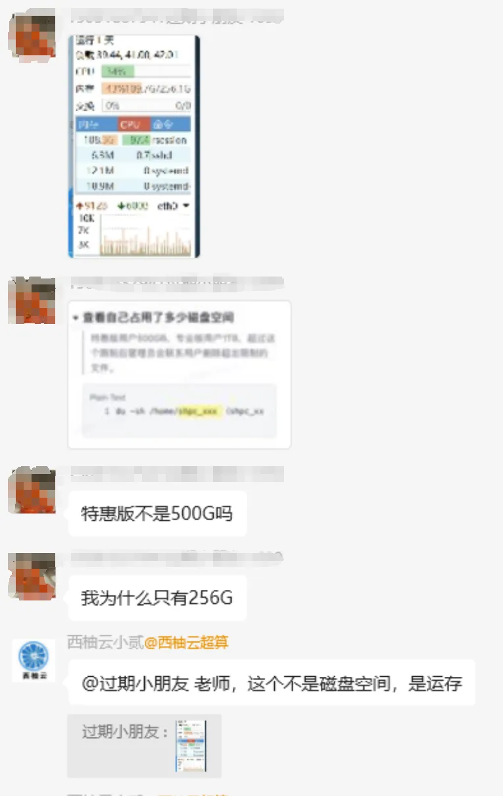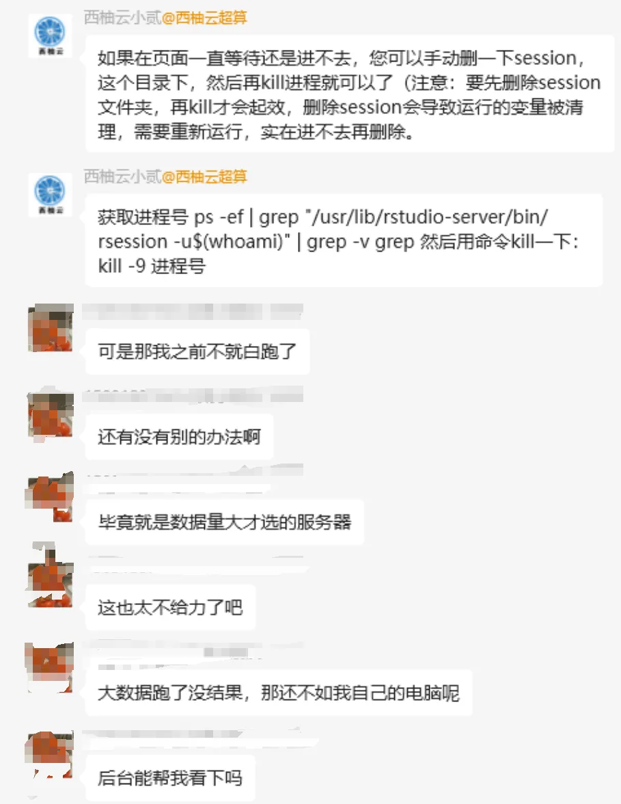

另外，输错了密码也觉得是我们安全系统没做好，甚至还怀疑我们偷账号。这真的没必要，毕竟我们有上万个账号。

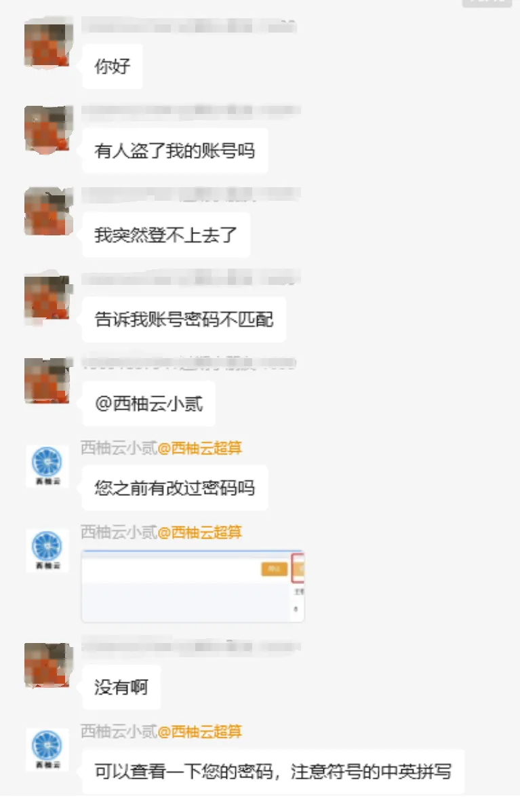

例如，R语言的包有超过两万种，我们一直说我们给大家预安装了上千个R包，不能说有包没装，就说我们虚假宣传😷

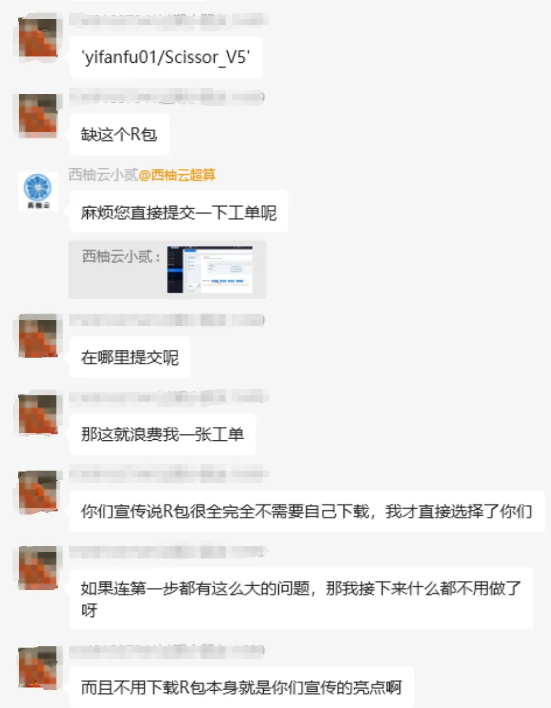

下面这个问题也比较经典，Rstudio-server的老毛病了，可以参考我们此前的教程：[Rstudio-server为什么总是登不进去](<https://mp.weixin.qq.com/s?__biz=MzAwMzIzOTk5OQ==&mid=2247524106&idx=5&sn=41b532ad40d8732e3f0d39721153d7e6&scene=21#wechat_redirect>)

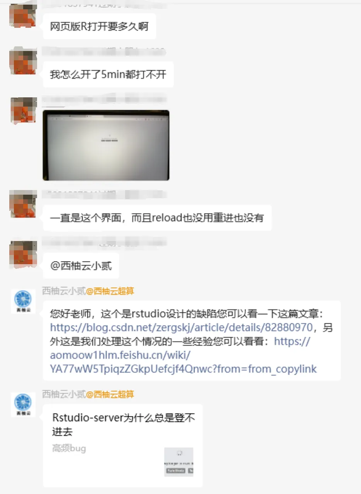

我们也介绍过很多把任务挂在后台执行的方法，可供大家学习：[程序可以自己跑的，不用盯着](<https://mp.weixin.qq.com/s?__biz=MzAwMzIzOTk5OQ==&mid=2247511096&idx=1&sn=14191291fa6fbdb625b9601d230509f7&scene=21#wechat_redirect>)。

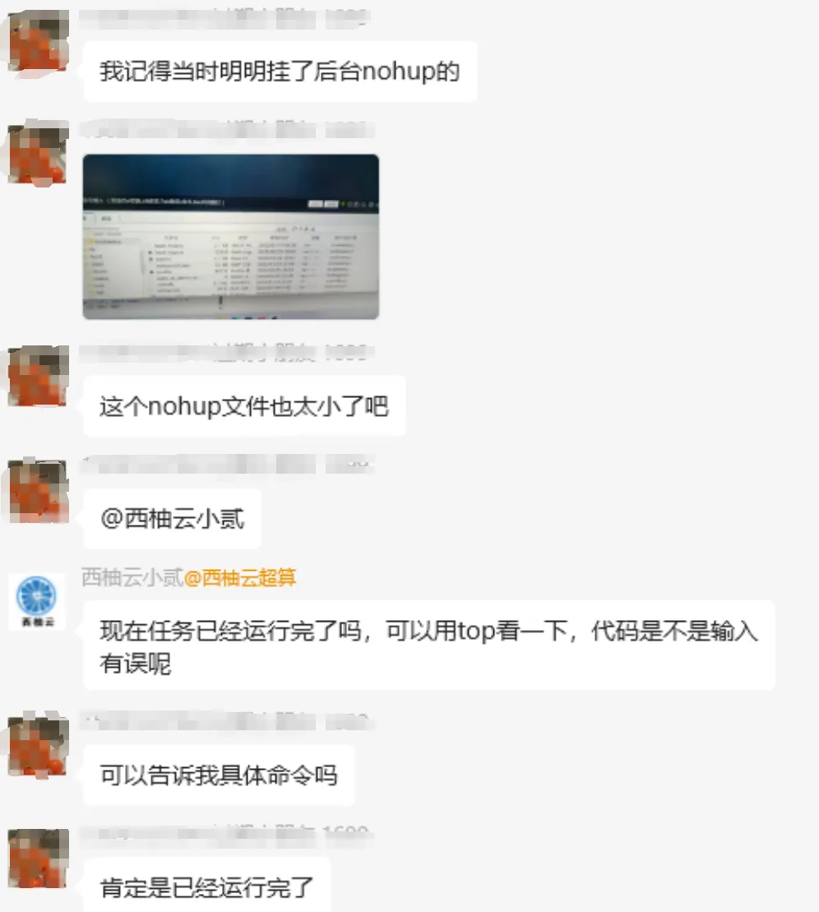

我们给用户提供了教程，ta并不愿意看，一定要我们提供一个“简单教程”：

答疑了一个月无果，说知识点听不明白，还是不愿意学习Linux，并且要求退款，真的累了：

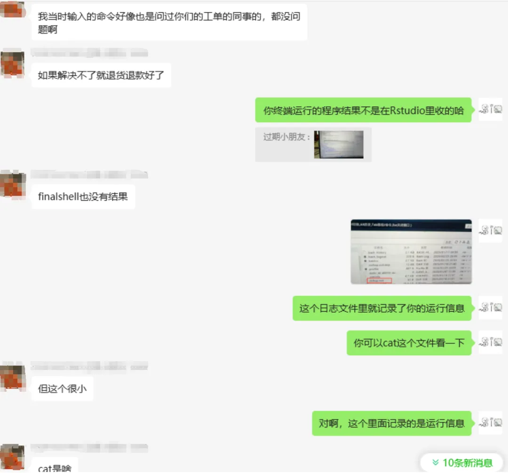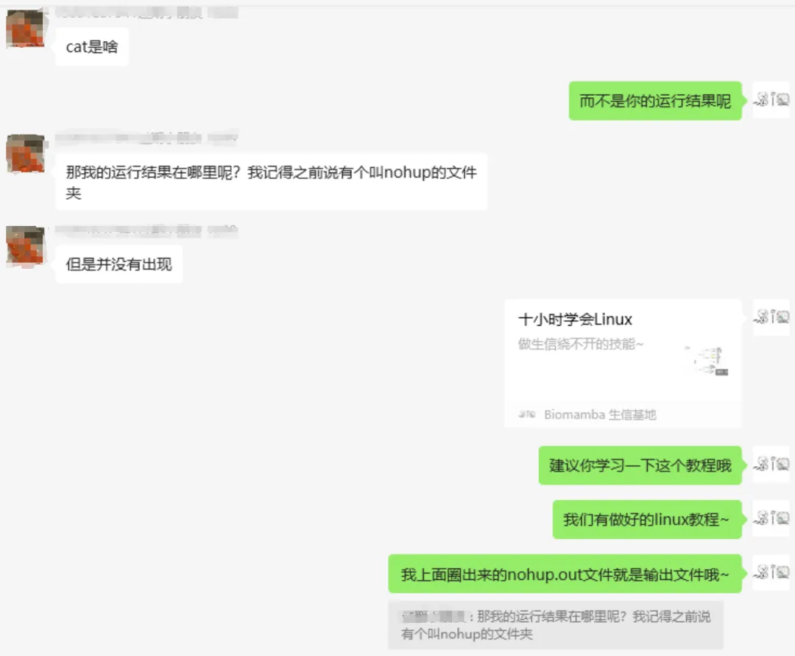

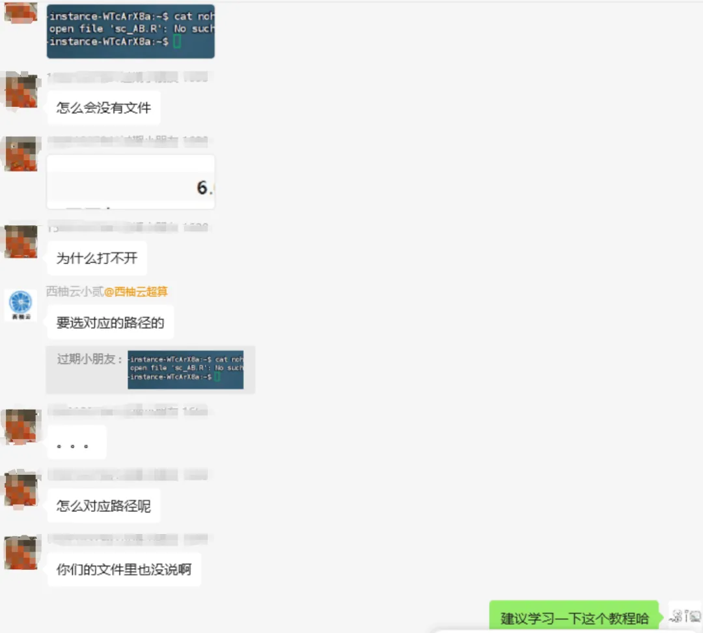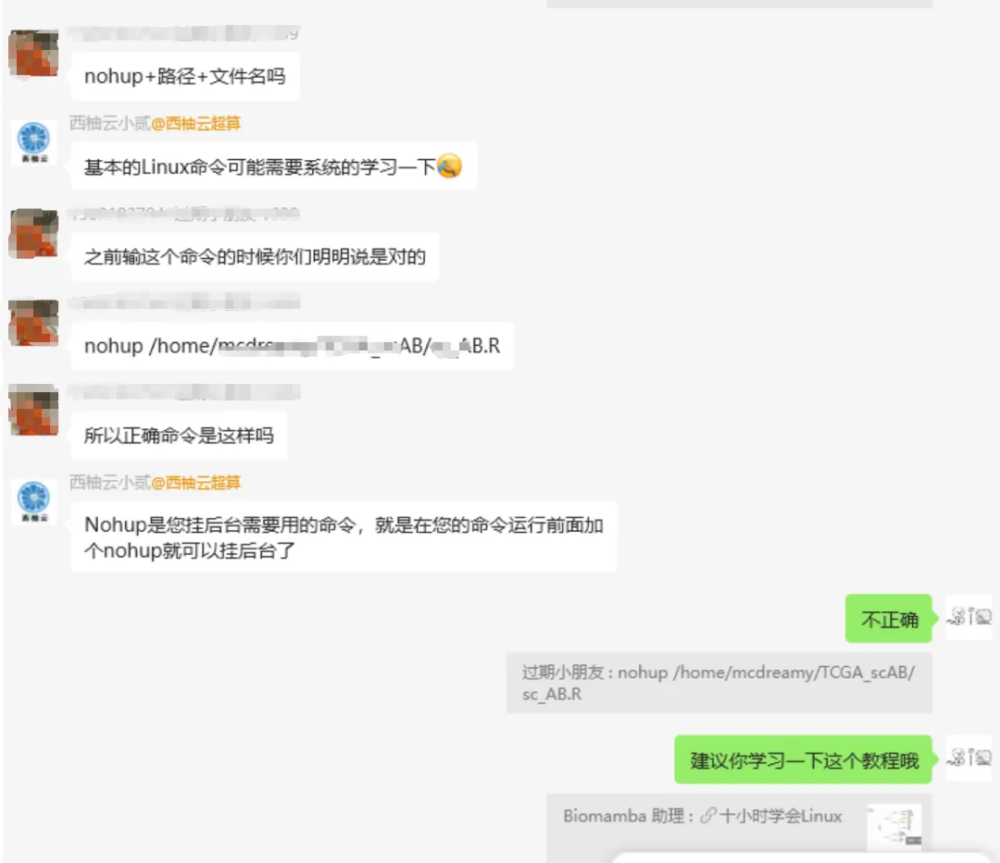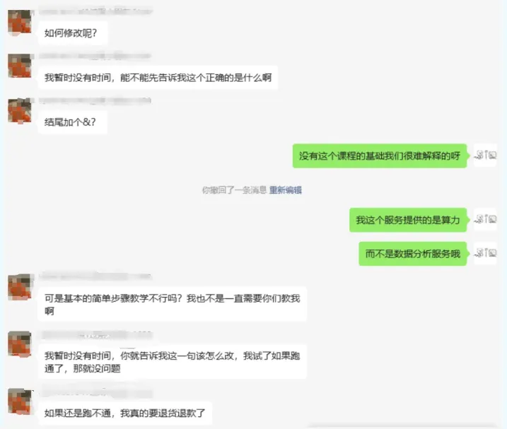

**如何联系我们**

 公众号后台消息回复不便，这里给大家留一下领取资料及免费服务器([足够支持你完成硕博生涯的生信环境](<http://mp.weixin.qq.com/s?__biz=MzAwMzIzOTk5OQ==&mid=2247507693&idx=1&sn=d9517a0803ad75cb7be430806834e7b8&chksm=9b3ca7bdac4b2eaba1ad01ed04ab1fbcbafcf4f6ddfe9e4f76ed9229707f545fe7d9c9ffd6ae&scene=21#wechat_redirect>))的**微信号** ，方便各位随时交流（别问在么，添加时直接说来意）。呼声很高的**交流群** 也建好了，欢迎大家入群讨论：

[永久免费的生信、科研交流群](<http://mp.weixin.qq.com/s?__biz=MzAwMzIzOTk5OQ==&mid=2247505868&idx=2&sn=20c81313eaef9a7031a84ef3a691d1b5&chksm=9b3cae9cac4b278a42c8de97e864c7664a37e9a4adb5973625fe3f8dd1093e55aeda88d443aa&scene=21#wechat_redirect>)

大家可以阅读完这几篇之后添加[给生信入门初学者的小贴士](<http://mp.weixin.qq.com/s?__biz=MzAwMzIzOTk5OQ==&mid=2247493329&idx=1&sn=597870b7f7ce10346da3561e7c281627&chksm=9b3c9f81ac4b169794088ce9abbcacb5f18e9fd174fc0d7e28da62d78facadf3100ef38aaf22&scene=21#wechat_redirect>)
[如何搜索公众号过往发布内容](<http://mp.weixin.qq.com/s?__biz=MzAwMzIzOTk5OQ==&mid=2247506266&idx=2&sn=22b1164bc9602c25620d058847785422&chksm=9b3ca00aac4b291c16d738271746ffb90149282a728f484e8a1952463c46a8e7dc4f883ab928&scene=21#wechat_redirect>)

**已有生信基地联系方式的同学****无需重复添加**

 您点的每个赞和在看，我都认真当成了喜欢
