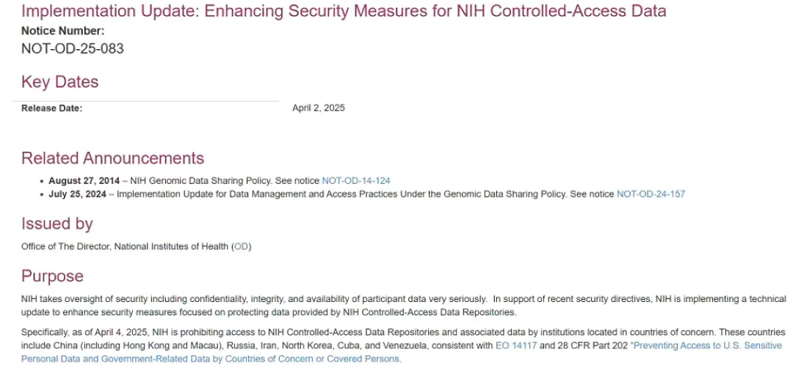
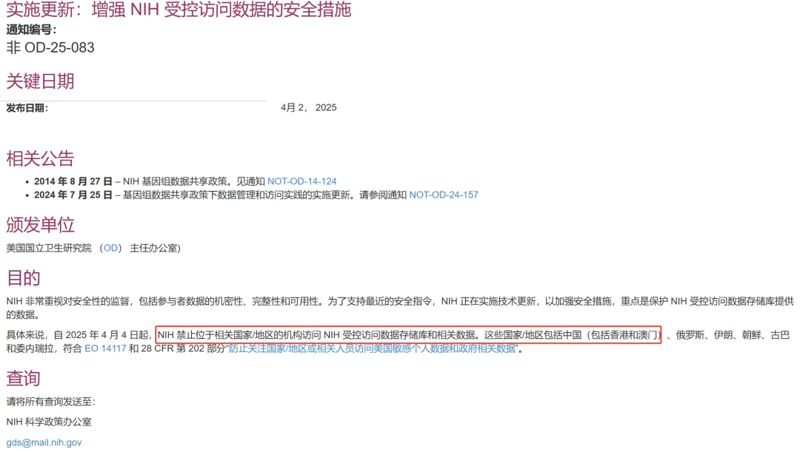
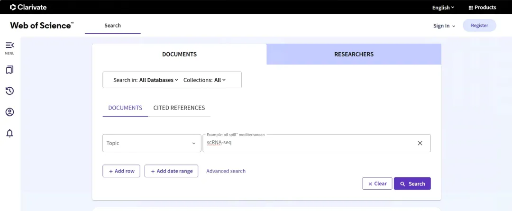
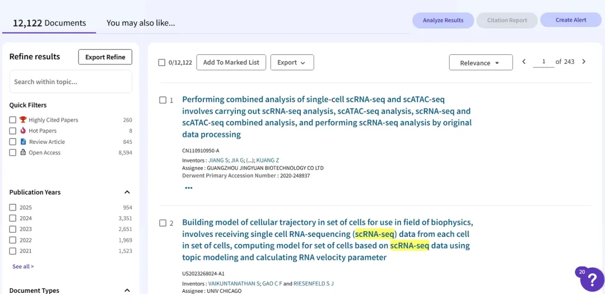
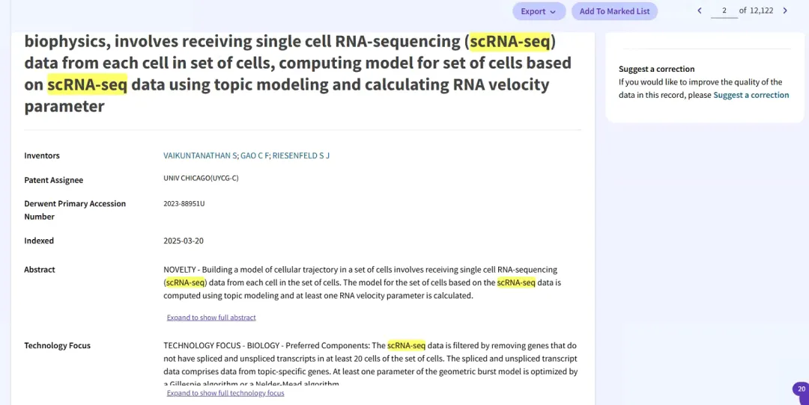
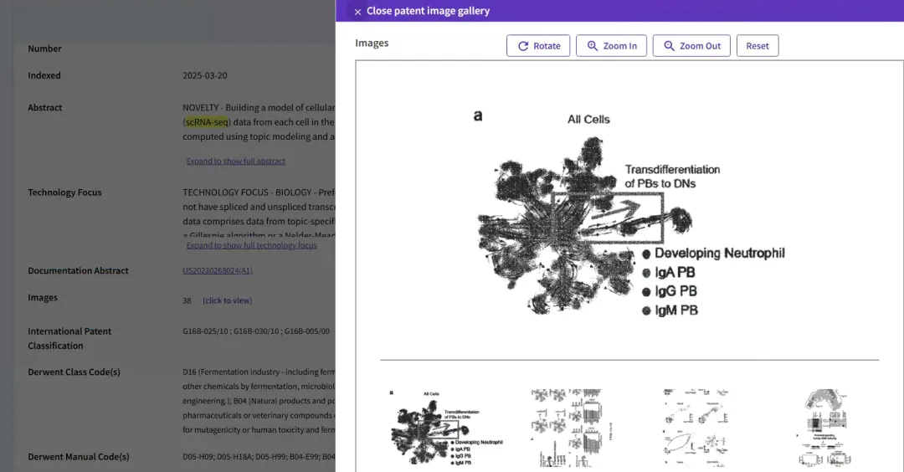
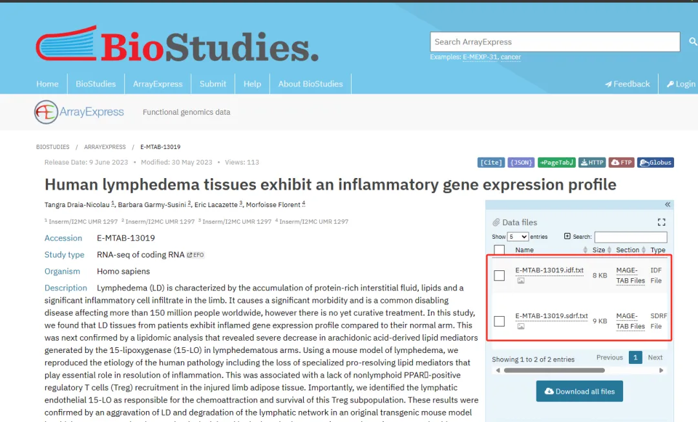
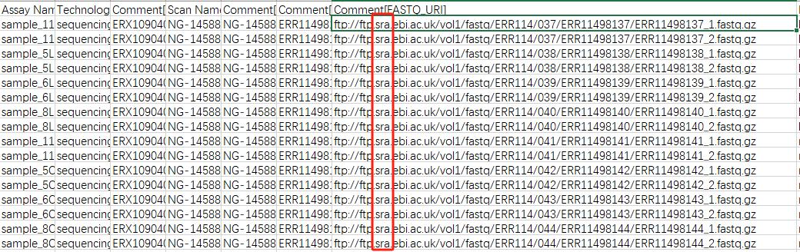
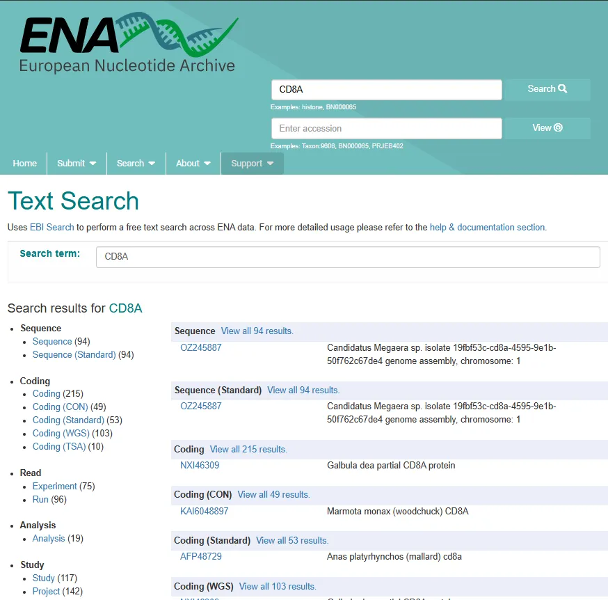

# NIH如果禁止访问，我们还有哪些平替？

> 原文：https://mp.weixin.qq.com/s?__biz=MzAwMzIzOTk5OQ==&mid=2247528376&idx=1&sn=05a8c568e8d0a01ab97e3d7c0a4ece36&chksm=9b3c16e8ac4b9ffeb0d7ac612cd527e58ca332cf116a02b8bd8ef4f7181c0158aed5bf72cb42#rd
> 合集：漫谈胡侃

**一、写在前面**

最近有个事炸锅了，NIH将限制国人访问NIH相关的数据库和站点。大家最关心的肯定是以后能不能访问NCBI了，还能不能快乐的在PubMed检索文献了？以后还能不能快乐的在GEO和SRA里挖啊挖啊挖了。截至发稿日，Biomamba还是可以正常的访问以上站点的。即使真封了，NIH的这些数据库与站点也有很多平替，21世纪也没什么秘密，NIH的各大数据库其实每日都与国际核酸序列数据库协作组织(INSDC)互相交换数据。理论上来说，NIH有的内容，都可以从平替站点以曲线救国的形式下载到。有更多的NIH相关数据/功能的替代品，欢迎大家在评论区交流。



**二、PubMed→WOS**

有备无患，除了隶属NIH的PubMed外，还可以用Web of SCIENCE来检索文献[2]。搜索界面如下，整洁好用，可以在Topic、Title、Author、Publication、Year Publish、Publication Date、Abstract、Address、Author Identifiers、DOI、Editor、Group Author多个尺度下对科研文章进行检索。且《Web of SCIENCE》隶属《Clarivate Analytics》，也就是评影响因子的机构，总部在伦敦。我想NIH的手应该没那么长？


检索和筛选系统还挺好
摘要页面也不比PubMed差
要说缺点就是无法直接获取全文，并且收录的图片居然还是黑白的不过问题不大，SCI-HUB走起或者[试试bget](<https://mp.weixin.qq.com/s?__biz=MzAwMzIzOTk5OQ==&mid=2247486588&idx=1&sn=9f55d26902546eb0eb219db8cb11e630&scene=21#wechat_redirect>)。

**三、SRA→EBI**

SRA（Sequence Read Archive） 是由NCBI管理的一个公共数据库，主要用于存储和共享高通量测序数据（Next-Generation Sequencing, NGS）的原始数据。如果NIH的限制让我们无法访问SRA，那我们不妨试试EBI[3]，EBI是欧洲生物信息学研究所(European Bioinformatics Institute)的缩写，是一个致力于提供生物信息学研究、数据存储与分析服务的国际领先机构。EBI是欧洲分子生物学实验室(EMBL)的一个分支，位于英国剑桥，同理NIH应该手没那么长？事实上，SRA、EBI、日本DDBJ之间每天会同步数据，理论上我们甚至可以曲线救国，直接从EBI中下载到SRA的数据。

事实上，EBI数据的下载体验比SRA更好，毕竟SRA数据库里的SRA、SRP、SRX号总是让人傻傻分不清楚。例如，我们在[Bulk RNASeq| 转录组实战](<https://mp.weixin.qq.com/s?__biz=MzAwMzIzOTk5OQ==&mid=2247510793&idx=1&sn=bfa69e8f261932d9bea74443fab732f0&scene=21#wechat_redirect>)中演示的案例；数据可见:https://www.ebi.ac.uk/biostudies/arrayexpress/studies/E-MTAB-13019。在如上页面中，下载meta data之后，E-MTAB-13019.sdrf.txt中可以赫然发现数据来源其实还是SRA。需要借助ascp下载，教程可参考[摆脱SRA、GEO、TCGA的破烂网速](<https://mp.weixin.qq.com/s?__biz=MzAwMzIzOTk5OQ==&mid=2247486008&idx=1&sn=ce2eb0fa3a8653d1c26a702bff9b8bcb&scene=21#wechat_redirect>)

  *   *   *   *   *   *

```
# 创建文件夹收纳下载文件：mkdir raw_reads# 切换工作路径cd raw_reads# 下载数据:cut -f 31  /mnt/g/analysis/转录组定量分析/E-MTAB-13019实战/13019/E-MTAB-13019.sdrf.txt | sed s/'ftp:\/\/ftp.sra.ebi.ac.uk\/'//g  | grep -v Comment | uniq | while read temp_sample ; do  ascp -QT -l 300m -P33001 -i ~/.aspera/connect/etc/asperaweb_id_dsa.openssh era-fasp@fasp.sra.ebi.ac.uk:${temp_sample} ./ ; done
```

下载速度也非常给力：

  *   *   *   *   *   *   *   *   *   *   *   *   *   *   *   *   *   *   *   *   *   *   *   *   *   *   *   *   *   *   *   *   *   *   *   *   *   *   *   *   *   *   *   *   *   *   *   *   *

```
下载日志：ERR11498137_1.fastq.gz                                              100% 3412MB  192Mb/s    03:10Completed: 3494423K bytes transferred in 191 seconds (149377K bits/sec), in 1 file.ERR11498137_2.fastq.gz                                              100% 3683MB  126Mb/s    03:33Completed: 3771548K bytes transferred in 213 seconds (144503K bits/sec), in 1 file.ERR11498138_1.fastq.gz                                              100% 3727MB  172Mb/s    03:28Completed: 3817313K bytes transferred in 209 seconds (149180K bits/sec), in 1 file.ERR11498138_2.fastq.gz                                              100% 4075MB  119Mb/s    04:07Completed: 4173298K bytes transferred in 248 seconds (137821K bits/sec), in 1 file.ERR11498139_1.fastq.gz                                              100% 4078MB  163Mb/s    03:49Completed: 4175881K bytes transferred in 229 seconds (148768K bits/sec), in 1 file.ERR11498139_2.fastq.gz                                              100% 3719MB 74.3Mb/s    03:15Completed: 3809249K bytes transferred in 197 seconds (158397K bits/sec), in 1 file.ERR11498140_1.fastq.gz                                              100% 3669MB  196Mb/s    03:28Completed: 3757292K bytes transferred in 209 seconds (146748K bits/sec), in 1 file.ERR11498140_2.fastq.gz                                              100% 3424MB  145Mb/s    03:20Completed: 3506862K bytes transferred in 201 seconds (142861K bits/sec), in 1 file.ERR11498141_1.fastq.gz                                              100% 4442MB  142Mb/s    04:36Completed: 4549074K bytes transferred in 277 seconds (134237K bits/sec), in 1 file.ERR11498141_2.fastq.gz                                              100% 4831MB  188Mb/s    04:35Completed: 4947910K bytes transferred in 276 seconds (146469K bits/sec), in 1 file.ERR11498142_1.fastq.gz                                              100% 3377MB  149Mb/s    02:56Completed: 3459053K bytes transferred in 178 seconds (159070K bits/sec), in 1 file.ERR11498142_2.fastq.gz                                              100% 3119MB  171Mb/s    02:58Completed: 3193981K bytes transferred in 179 seconds (146012K bits/sec), in 1 file.ERR11498143_1.fastq.gz                                              100% 3850MB  123Mb/s    04:19Completed: 3942604K bytes transferred in 260 seconds (123908K bits/sec), in 1 file.ERR11498143_2.fastq.gz                                              100% 3563MB  168Mb/s    03:13Completed: 3648887K bytes transferred in 194 seconds (153500K bits/sec), in 1 file.ERR11498144_1.fastq.gz                                              100% 4026MB  206Mb/s    03:59Completed: 4123110K bytes transferred in 241 seconds (140027K bits/sec), in 1 file.ERR11498144_2.fastq.gz                                              100% 3701MB  184Mb/s    03:20Completed: 3789882K bytes transferred in 201 seconds (153897K bits/sec), in 1 file.
```

**四、GenBank→ENA**

如果GenBank（NCBI 提供的核酸序列数据库）被禁止访问，你可以使用ENA[4]、DDBJ[5]、UCSC Genome Browser[6]、Ensembl Genome Browser[7]这些等效平台作为替代（平替），它们同样是 INSDC（国际核酸序列数据库协作组织）成员，并与 GenBank 数据同步。例如我们想在ENA中检索CD8A的数据：



参考：[1]https://grants.nih.gov/grants/guide/notice-files/NOT-OD-25-083.html[2]https://www.webofscience.com/wos/[3]https://www.ebi.ac.uk/[4]https://www.ebi.ac.uk/ena[5]https://www.ddbj.nig.ac.jp[6]https://genome.ucsc.edu[7]https://www.ensembl.org

**如何联系我们**

 留一个领取资料、[免费两周学习版](<https://mp.weixin.qq.com/s?__biz=MzAwMzIzOTk5OQ==&mid=2247527585&idx=1&sn=fa32112c11b215b33096cab43baf08ea&scene=21#wechat_redirect>)服务器的**微信号[Biomamba_yunying]**，方便各位随时交流。同时我们也构建了[交流群矩阵](<https://mp.weixin.qq.com/s?__biz=MzAwMzIzOTk5OQ==&mid=2247528057&idx=1&sn=bb348c2a88c977c7cce67ee6731a3591&scene=21#wechat_redirect>)，欢迎大家入群讨论。

大家可以阅读完这几篇之后添加[给生信入门初学者的小贴士](<http://mp.weixin.qq.com/s?__biz=MzAwMzIzOTk5OQ==&mid=2247493329&idx=1&sn=597870b7f7ce10346da3561e7c281627&chksm=9b3c9f81ac4b169794088ce9abbcacb5f18e9fd174fc0d7e28da62d78facadf3100ef38aaf22&scene=21#wechat_redirect>)
[如何搜索公众号过往发布内容](<http://mp.weixin.qq.com/s?__biz=MzAwMzIzOTk5OQ==&mid=2247506266&idx=2&sn=22b1164bc9602c25620d058847785422&chksm=9b3ca00aac4b291c16d738271746ffb90149282a728f484e8a1952463c46a8e7dc4f883ab928&scene=21#wechat_redirect>)

**已有生信基地联系方式的同学****无需重复添加**

 您点的每个赞和在看，我都认真当成了喜欢
