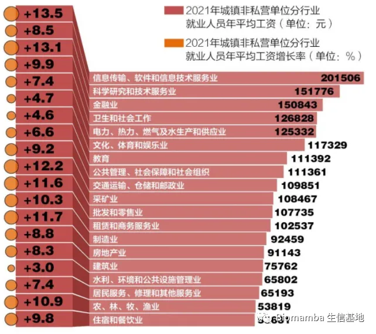
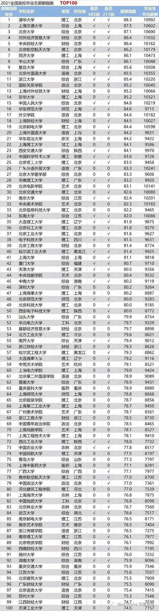

# 作为过来人，浅谈一下高考、考研、读博

> 原文：https://mp.weixin.qq.com/s?__biz=MzAwMzIzOTk5OQ==&mid=2247529258&idx=3&sn=3f40b5c987f55e99f1de0c18e41b00ec&chksm=9b3c0a7aac4b836c5283810794ed51d8797265027ddbd2e8bac4fa562f39b7f102771981ae05#rd
> 合集：漫谈胡侃

写在前面

今天考研日，浅聊一下。由于本人正在读博，标题中的三个阶段都经历过或正在经历，本意是**闲聊** ，也算是给将要经历的读者们做个**参考、**排雷**** 。本文写于2022年，时效性略有落后，不过逻辑上还是值得大家参考，若所述存在偏颇，大家也权当一乐。

高考****

人生中的分水岭，可能是一生中**相对** 最公平的一次竞争：相较于研究生(硕士/博士)的录取来说，我们抛开地域的教育资源分配不均衡这一因素(当然纳入这一因素来说还是存在不公)，高考**基本上** 可以说是绝对的公平了。那么高考之后面临的第一个问题就是选择学校与专业，在你**有选择余地** 时有以下几点需要考虑：**1、城市：**
这点不用多说，当然是大城市优先，本人当年有所偏科，高考完去北京混了个211的本科。虽说只是个211吧，由于所在地教育资源充沛，学校里的教师基本都毕业于清北、北医协和或者QS前一百的名校，或者干脆就是这类名校的教师在我校同时任教，也算是吃了波帝都的红利。此外大城市的就业机会更多、各类资源的分配也相对要公平一些。缺点自然是生活成本与压力会随之上升，并且需要做好长期背井离乡在外发展的准备。划重点：**B区的学校能不去就不去** 。**2、学校与专业：** 对于先选学校还是先选专业，向来众说纷纭，这里我的观点是专业优先。至于选什么专业呢，千万别听劝退党瞎BB，那些天天嚷着自己行业是天坑的，多半是**自己不够硬** ，大都是没有摸到行业的皮毛找找借口罢了。说实话我本科时低谷期很长，但我觉得是自己没有找到适合自己的事业，并不是所学专业的问题。所以大家择业时更应该先听取各个**行业精英** 所推荐的优势，再去听听劝退党的说辞(行业劣势)。至于具体应该选择哪个专业更好，可以参考该领域内人均为社会创造的价值[1]（平均薪水）：

很明显，目前各行业中仍然是**IT类** 的行业薪酬最高，这也与**生物信息学** 行业薪酬在生物口里薪资最高相对应，不要说什么怕跌，热门行业不去冲，难道去夕阳产业抄底嘛。至于**学校方面** 嘛，以下是去年的高校毕业生平均薪资Top100，其实可以看出，学校薪资的跨越度没有行业之间的大，换句话说，**差学校的热门专业可能要比好学校的冷门专业就业前景好** 。好了，公众号的用户高中生应该基本没有，关于本科先谈这么多。

考研

对于很多人来说，这是一次**改变命运** 的机会。说实话，本科生在这个年代过于的廉价，今年毕业的大学生大部分正好是千禧年生人，那年我国共诞下1765万个婴儿，而2022年的高校毕业生预计人数是1076万人，扣除其中大约100万个硕博毕业生，2022大约一千万的本科毕业生人数与2021年的出生人口相当[3]。换句话来说，世纪交替之时出生的人口中，超过一半的人有高等教育经历，这是**本科学历贬值** 的重要原因。所以考研带来的最直接收益是让自己的学历不那么廉价。虽然硕士的学历也在不断的变水，但是相对于我国整体人群来说，硕士学位(~0.7%)的拥有率仍然远低于学士学位(~4%)。谈到考研读研，在**有选择的情况下** ，你仍需要注意以下几点：

**1、专业：**

高考的志愿存在很多的不确定性，很多同学未必能选到自己心仪的专业，考研给了大家一次重新择业的机会。这一次，我**不推荐** 大家再依据行业薪酬来选择，到了研究生阶段，你今后可能会把你选择的专业转化为事业而奋斗终生，所以你是否能**乐在其中** 最重要，若是选择了不心水的专业，恐怕薪水再高也像是坐牢，至少读研的三年是如坐针毡。另外，硕士的专业与你实际研究领域的关联性不是绝对的，所以除了专业以外还要考虑所选导师的具体研究领域。

**2、学校与导师：**

无论是硕士还是博士，我个人觉得导师的选择要比学校重要的多，因为导师直接决定了你的学术生涯的过程与终点。关于导师，你有以下几点需要考虑：

**(1)毕业：**

读研，能毕业当然是重中之重，如果说导师的学生**总是延毕** ，尤其是硕士也要延毕，劝各位最好绕道，事出必有妖。

**(2)科研能力与经费：**

这俩指标也很好量化，科研能力可以拿导师近年来发文的**影响因子** 来衡量，经费直接用各类基金的资助额度来衡量，在报考之前仔细的检索一番是非常有必要地。注意，面上的**纵向基金** 要比从企业拿的**横向基金** 要有意义的多。排列组合这两点因素的话，无非这么几种导师：

**有科研能力有经费** ，这种多为国外引进的青年人才，既能为你提供科研实战的技术指导、又能给你提供配套经费支持，属于**上上签** 。

**有科研能力无经费** ，国内的年轻老师居多，可能刚晋升为导师，虽然各项基金还没落实，但刚从科研一线退下来的他们通常能够在技术上给予有力的支持，并且有晋升欲望，能够与学生共同进步，依旧值得推荐。

**无科研能力有经费** ，大多是声名在外的年长教授，可能不会对你的科研有实质性贡献，但是提供充足的科研经费，这也足够支持你完成学业。

**无科研能力无经费** ，编制下尸位素餐的产物，绕道吧。

**(3)教育背景：**

显然是有国外科研经历、国内名校教育经历的优先，那种本硕博、任教均在同一个学校完成的导师，建议绕道。

学校方面的话，还是那句话，B区的学校尽量别去。说实话，我当年顶着9:1的报录比从北京以前几名的位次考来南京这所211的行为属实大冤种。但据我观察，这样的高校里仍有不少尸位素餐的老师，就是因为很多导师只会对学生提要求却**不能给学生实际的指导** ，才给我们这类**科研公众号** 提供了生存空间，其实**我这个号的存在本身就是一件很悲哀的事** 。所以没上过啥好大学一直是我的遗憾，B区啥情况就更不用说了。另外，尽量别去调剂的、一轮复试都招不满的学校/专业，别老天天想着捡漏，哪有这么好的便宜等你捡，为啥这个坑有调剂心里没数麽，不要欺骗自己。我的用户里不乏刚步入科研生涯的(准)研一人群，同学们，**虽然考研已经很艰苦，但是上岸确实只是个起点、而非终点** ，不要在上岸时抱着侥幸从而耽误了自己三年甚至是一生。

读博

如果你正在经历或将要经历这个阶段，那么恭喜你，你将完成你求学生涯的最后一个阶段。但是行百里者半九十，读博的经历可能比你前面面对的所有境况都要艰难。但就如我给硕士推荐的一样，还是需要选择自己喜欢的事业，乐在其中很重要，还是拿我来说，虽然目前没有什么成就吧，但是做做生信分析、给大家做做科普确实让我觉得很有意义，所以对何时能毕业、毕业之后能拿到多少薪酬，我其实不太在意。这倒是个苦中作乐、自我鸡汤的好方式。

另外学校的选择这方面，拿我目前就读的学校举例，今年博士毕业发表论文的平均影响因子大概是6.7、中位数是4.9，排除共一等因素的加持，最终的平均值是也要小于6的，作为中东部地区的211来说，这个成绩并不理想。还有一个隐藏的点是，我的博士同学中仍有相当一部分两鬓斑白的中年人，挂着公司的高层职位来读博，却不常见到其在学校上课和做实验的身影，这个现象不是我能评价的。所以，还是那句话，**读博去B区就更不推荐** 了。

导师的选择可以参考硕士部分。

读博与硕士最大的不同是，硕士可能注重科研技能的学习与培训，而读博更需要科研思维的培养。不谈空泛的"创新思维"，博士最起码需要做到能够**独立思考** 并解决问题。就目前的情况来说，能润出去还是润出去看看，去见识一下**外面的科研环境** 还是相当有必要的。但是由于这两年的特殊原因，很多外部的申请不能成行，所以也造成了这两年国内高校申博普遍比较困难的情况，这两年没有申请上的同学也不要着急，可以再观望一番。

如果大家需要更深层次的讨论，也可以在后台中与我交流。

参考：

[1]:https://www.sohu.com/a/556044973_121132805

[2]:https://finance.sina.com.cn/china/gncj/2021-06-22/doc-ikqcfnca2443572.shtml

[3]:https://zhuanlan.zhihu.com/p/94118835

**如何联系我们**

 公众号后台消息回复不便，这里给大家留一下领取资料及免费服务器([足够支持你完成硕博生涯的生信环境](<http://mp.weixin.qq.com/s?__biz=MzAwMzIzOTk5OQ==&mid=2247507693&idx=1&sn=d9517a0803ad75cb7be430806834e7b8&chksm=9b3ca7bdac4b2eaba1ad01ed04ab1fbcbafcf4f6ddfe9e4f76ed9229707f545fe7d9c9ffd6ae&scene=21#wechat_redirect>))的**微信号** ，方便各位随时交流（别问在么，添加时直接说来意）。呼声很高的**交流群** 也建好了，欢迎大家入群讨论：

[永久免费的生信、科研交流群](<http://mp.weixin.qq.com/s?__biz=MzAwMzIzOTk5OQ==&mid=2247505868&idx=2&sn=20c81313eaef9a7031a84ef3a691d1b5&chksm=9b3cae9cac4b278a42c8de97e864c7664a37e9a4adb5973625fe3f8dd1093e55aeda88d443aa&scene=21#wechat_redirect>)

大家可以阅读完这几篇之后添加[给生信入门初学者的小贴士](<http://mp.weixin.qq.com/s?__biz=MzAwMzIzOTk5OQ==&mid=2247493329&idx=1&sn=597870b7f7ce10346da3561e7c281627&chksm=9b3c9f81ac4b169794088ce9abbcacb5f18e9fd174fc0d7e28da62d78facadf3100ef38aaf22&scene=21#wechat_redirect>)
[如何搜索公众号过往发布内容](<http://mp.weixin.qq.com/s?__biz=MzAwMzIzOTk5OQ==&mid=2247506266&idx=2&sn=22b1164bc9602c25620d058847785422&chksm=9b3ca00aac4b291c16d738271746ffb90149282a728f484e8a1952463c46a8e7dc4f883ab928&scene=21#wechat_redirect>)

**已有生信基地联系方式的同学****无需重复添加**

 您点的每个赞和在看，我都认真当成了喜欢
