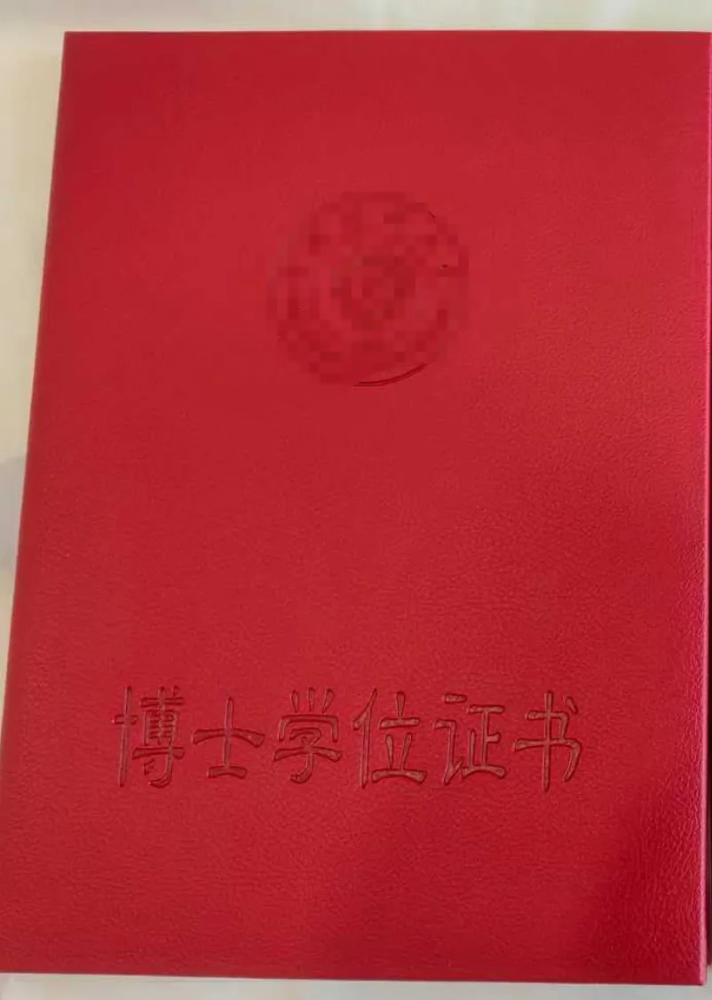
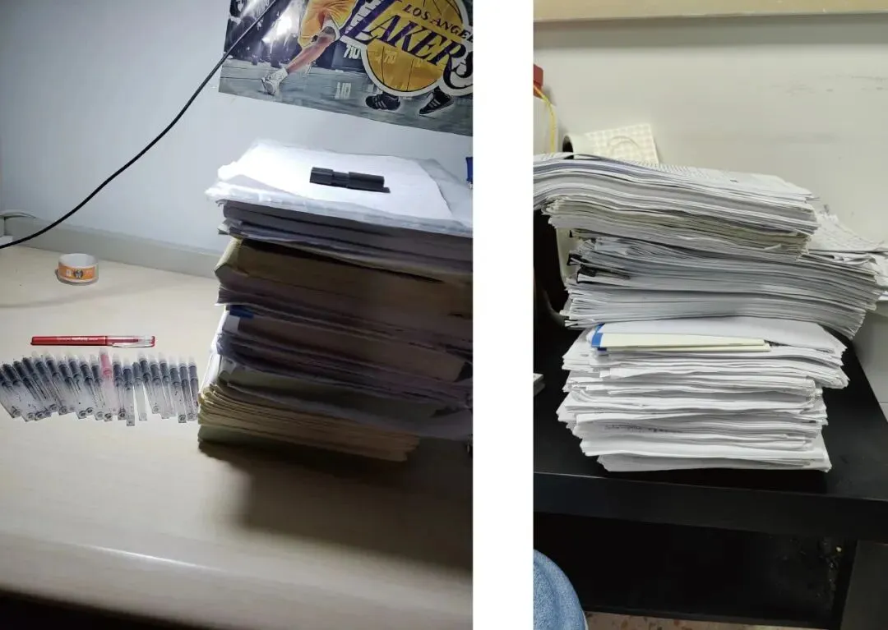
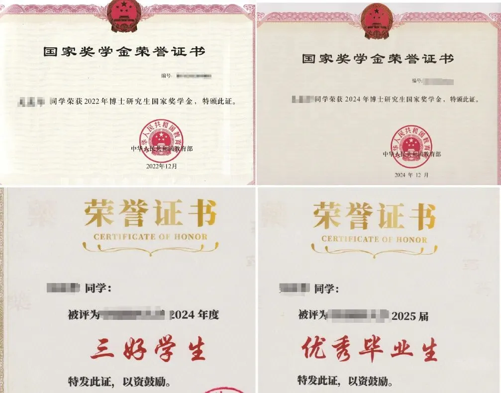
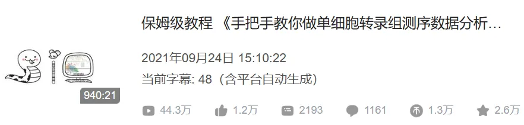

# 六年了，Biomamba终于毕业了

> 原文：https://mp.weixin.qq.com/s?__biz=MzAwMzIzOTk5OQ==&mid=2247529408&idx=1&sn=079464ea5c0cfc99526594a6c5531654&chksm=9b3c0a90ac4b8386e3e72b46b629d4f81dba8a1fd0653f06257685cde99d308efb9d66133586#rd
> 合集：漫谈胡侃

**一、学生时代完结**

边收拾东西边走马灯，和大家随便聊聊。双证到手，上岸！读博是副业，双证已到手，终于可以专心的给大家做教程了。下图中，左图为考研期间写过的资料和写干的笔芯(本以为是上岸，实则是下海)，右图为硕博期间读过的文献，当然，考虑到电子资料，只多不少。其实回过头来看看，硕博期间比较顺利。不过考研、读研、读博，就像在一间伸手不见五指的黑屋子里洗衣服，不到开灯，永远也不知道自己的衣服洗干净了没。焦虑了六年，一切都顺利的尘埃落定后，反而有些怅然若失。

**二、生信基地还得继续搞**

博士期间，虽然水平不高(请务必相信我)，但作为优秀毕业生也发了四篇一作SCI、拿了两次国奖、两次三好学生、两次优秀博士奖学金(运气太好了)。至少也认真、努力的做过一些科研，相信还是有资格、也有热情继续和大家一起讨论科研。
所以话说回来，毕业之后公众号还是得继续运营。遥想当年研一开展第一个单细胞课题，拿到数据被要求两周之内返回初稿，对于还是小白的我来说简直是天方夜谭。啃过其它老师的公众号、啃过官网，从编程到原理、从思路到套路，紧锣密鼓的张罗了两年多，才有了第一篇发表的单细胞文章。期间其实挺无助的，相信有很多和我一样的小伙伴，在无法得到专业生信指导的情况下，却要应对实验室的诸多数据处理需求。这似乎也是国内生信圈普遍的现象，做生信的课题很多，但专门做生信并且能够提供学习环境与配套资源支持的课题组很少。为了让更多的人少受点我受过的苦，Biomamba才下场制作单细胞教程，希望能够向大家伸出援手。看看现在的播放量和收到的[致谢](<https://mp.weixin.qq.com/mp/appmsgalbum?__biz=MzAwMzIzOTk5OQ==&action=getalbum&album_id=3425248581018714114#wechat_redirect>)，突然觉得自己原来边读博边深夜写脚本、做教案、录视频、搞剪辑也是非常值得：
好消息是，之后我也将不再孤军奋战，[生信基地建成](<https://mp.weixin.qq.com/s?__biz=MzAwMzIzOTk5OQ==&mid=2247526229&idx=1&sn=0718f1702150ba77a7f7e3beadd6e0ba&scene=21#wechat_redirect>)后我们[诚聘生信人才](<https://mp.weixin.qq.com/s?__biz=MzAwMzIzOTk5OQ==&mid=2247528660&idx=2&sn=6153f951a65d2dc82ca5bef005541504&scene=21#wechat_redirect>)，在小伙伴们的努力下，我们已经组织了几场生信教学，希望以后能够给大家提供系统化、规范化的生信教学。最近的一次在：[scRNA-seq数据分析小白全程班](<https://mp.weixin.qq.com/s?__biz=MzAwMzIzOTk5OQ==&mid=2247529379&idx=1&sn=10283cee636a7bc706f145edc791fe7c&scene=21#wechat_redirect>)

**三、人生是旷野**

其实最近有些"产后抑郁"，猛的从读博节奏中撤出来，对未来的生活有些无所适从。好不容易毕业免费了，现在最想做的是到处走走，算是替大家自由。既然步子也迈开了。如果大家恰好在硕博或生活中遇到了困难与挑战，需要心灵鸡汤；又或是有生信课题需要交流，亦或是课题组需要[单细胞讲座/教学](<https://mp.weixin.qq.com/s?__biz=MzAwMzIzOTk5OQ==&mid=2247529379&idx=1&sn=10283cee636a7bc706f145edc791fe7c&scene=21#wechat_redirect>)；又或是各位老师希望和我们联合完成一些课题或项目。那么我都可以在来到大家的城市时，与大家进行交流~大家可以通过邮件联系我：wchcpu2019@163.com，全球可飞，下周在日本。我们也欢迎大家随时[来生信基地兼职/工作/参观](<https://mp.weixin.qq.com/s?__biz=MzAwMzIzOTk5OQ==&mid=2247527394&idx=1&sn=e6d650be7044c5df6e10e2e4bf8589e5&scene=21#wechat_redirect>)。

**
**

**如何联系我们**

 留一个领取资料、[免费两周学习版](<https://mp.weixin.qq.com/s?__biz=MzAwMzIzOTk5OQ==&mid=2247527585&idx=1&sn=fa32112c11b215b33096cab43baf08ea&scene=21#wechat_redirect>)服务器的**微信号[Biomamba_zhushou]**，方便各位随时交流。同时我们也构建了[交流群矩阵](<https://mp.weixin.qq.com/s?__biz=MzAwMzIzOTk5OQ==&mid=2247528057&idx=1&sn=bb348c2a88c977c7cce67ee6731a3591&scene=21#wechat_redirect>)，欢迎大家入群讨论。
大家可以阅读完这几篇之后添加[给生信入门初学者的小贴士](<http://mp.weixin.qq.com/s?__biz=MzAwMzIzOTk5OQ==&mid=2247493329&idx=1&sn=597870b7f7ce10346da3561e7c281627&chksm=9b3c9f81ac4b169794088ce9abbcacb5f18e9fd174fc0d7e28da62d78facadf3100ef38aaf22&scene=21#wechat_redirect>)
[没有检索，就没有发言权](<https://mp.weixin.qq.com/s?__biz=MzAwMzIzOTk5OQ==&mid=2247529398&idx=2&sn=5a429852d61721916a405712677d5905&scene=21#wechat_redirect>)

**已有生信基地联系方式的同学****无需重复添加**

 您点的每个赞和在看，我都认真当成了喜欢
