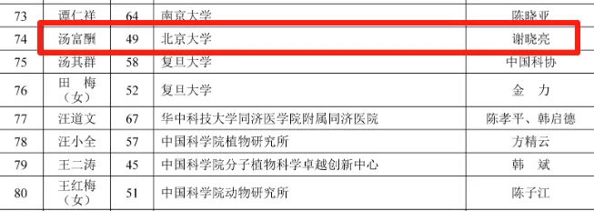
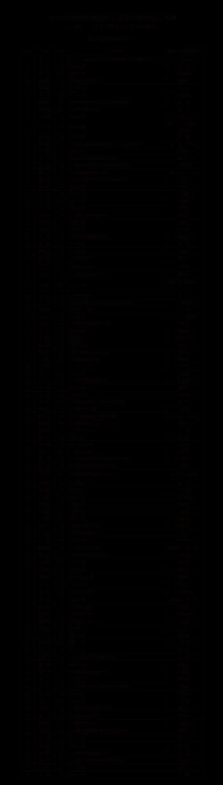
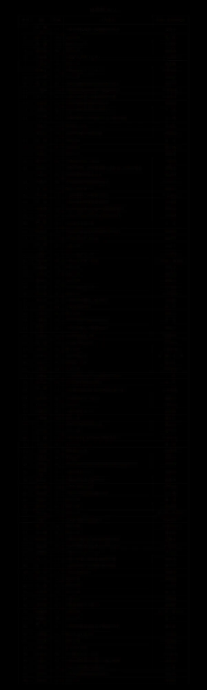
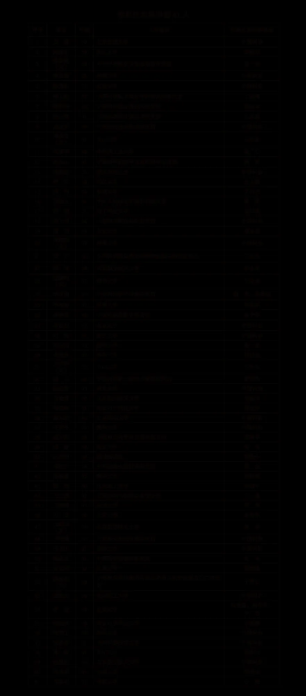

# 汤富酬老师入选2025年中国科学院院士增选有效候选人名单！

> 原文：https://mp.weixin.qq.com/s?__biz=MzAwMzIzOTk5OQ==&mid=2247530621&idx=1&sn=39f7a3c29f7831c2ad06108a3f175f22&chksm=9b3c012dac4b883b4c37741780c595962cfe9cff37e0d7ddc82ac0d24c334c3520b4e5f60188#rd
> 合集：漫谈胡侃

根据关于公布2025年中国科学院院士增选有效候选人名单的公告----中国科学院(https://www.cas.cn/tz/202508/t20250820_5080019.shtml)，单细胞的神——汤富酬老师已入围生命科学和医学学部提名，继["单细胞院士"](<https://mp.weixin.qq.com/s?__biz=MzAwMzIzOTk5OQ==&mid=2247505275&idx=1&sn=1ed0f9e1142bbdd8f554cedb6b1d515a&scene=21#wechat_redirect>)张泽民老师后，又一位入选的该领域老师。科学家才是真正值得追的星！上一次听汤老师报告还是：[汤神《Science》新作：scNanoATAC-seq2](<https://mp.weixin.qq.com/s?__biz=MzAwMzIzOTk5OQ==&mid=2247528284&idx=1&sn=462d26b37e7a64fef32590ee4c4bd481&scene=21#wechat_redirect>)完整提名如下，有没有你追的星呢？

**如何联系我们**

 留一个领取[资料](<https://mp.weixin.qq.com/s?__biz=MzAwMzIzOTk5OQ==&mid=2247530154&idx=2&sn=e5d0a63646094c3094b7b916350d22ad&scene=21#wechat_redirect>)、[开箱即用的单细胞分析镜像](<https://mp.weixin.qq.com/s?__biz=MzAwMzIzOTk5OQ==&mid=2247528410&idx=2&sn=0f2bac25479cf8d20dab5d82ae986f2e&scene=21#wechat_redirect>)的**微信号[Biomamba_zhushou]**，方便各位随时交流。同时我们也构建了[交流群矩阵](<https://mp.weixin.qq.com/s?__biz=MzAwMzIzOTk5OQ==&mid=2247528057&idx=1&sn=bb348c2a88c977c7cce67ee6731a3591&scene=21#wechat_redirect>)，欢迎大家入群讨论。
大家可以阅读完这几篇之后添加[给生信入门初学者的小贴士](<http://mp.weixin.qq.com/s?__biz=MzAwMzIzOTk5OQ==&mid=2247493329&idx=1&sn=597870b7f7ce10346da3561e7c281627&chksm=9b3c9f81ac4b169794088ce9abbcacb5f18e9fd174fc0d7e28da62d78facadf3100ef38aaf22&scene=21#wechat_redirect>)
[没有检索，就没有发言权](<https://mp.weixin.qq.com/s?__biz=MzAwMzIzOTk5OQ==&mid=2247529398&idx=2&sn=5a429852d61721916a405712677d5905&scene=21#wechat_redirect>)

**已有生信基地联系方式的同学****无需重复添加**

 您点的每个赞和在看，我都认真当成了喜欢
