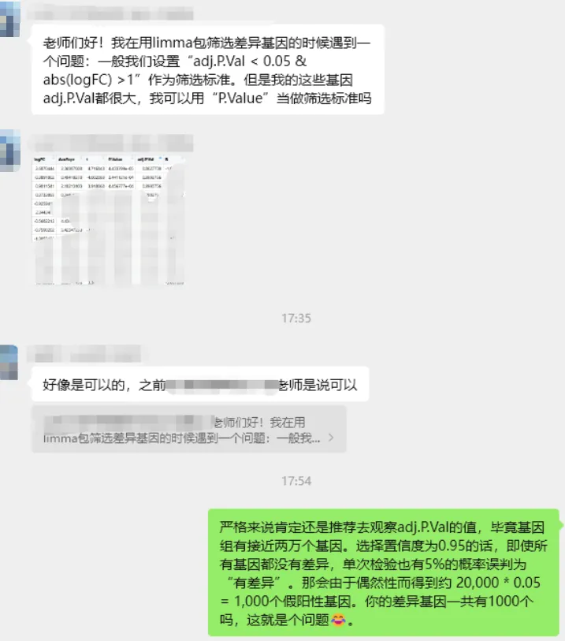
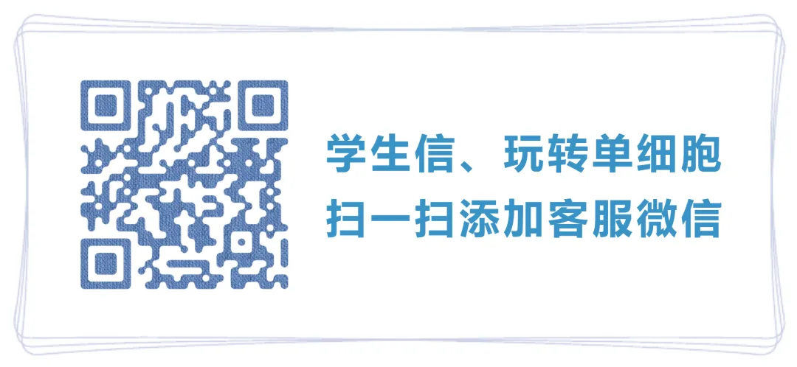

# 不要让你的实验影响结果？

> 原文：https://mp.weixin.qq.com/s?__biz=MzAwMzIzOTk5OQ==&mid=2247533677&idx=1&sn=e5599ee5194815e153bf9012a47e2e24&chksm=9b3c3d3dac4bb42b1d532bb8dceb5715dc1aefa74b86ec5212c0d08f5b2bd657e1bff5adbb41#rd
> 合集：漫谈胡侃

其实这类问题在我们的交流群里屡见不鲜，很多人的问题其实提问前就有了心仪答案，只是想得到别人的肯定，心安理得的说服自己而已。至于差异分析的显著性筛选问题，自然是尽量看adjustment P Value，并且越小越好；|logFC|自然是越大越好。基因组级别的数据做差异分析，近两万个观测值（基因）。选择置信度为0.95的话，即使所有基因都没有差异，单次检验也有5%的概率误判为“有差异”。那会由于偶然性而得到约20,000*0.05=1,000个假阳性基因（仅P Value来判断的话）。按照单细胞的稀疏程度，显然你的差异基因大概率都没有1000个。人们都会忽略事实选择于自己倾向于的结果，可能这就是经典的“不要让你的实验，影响结果”，只不过大家需要想清楚，你今天的选择相信，可能未来计划实验时，会成倍的为当下的选择买单。
还是那句话，你的很多疑问与困惑，大概率我们都给你踩过雷，你是选择相信，还是选择努力？[突然想起学单细胞走过的弯路](<https://mp.weixin.qq.com/s?__biz=MzAwMzIzOTk5OQ==&mid=2247533491&idx=1&sn=1dd2fe09639fcb52ac5be6d2af2b77b6&scene=21#wechat_redirect>)[这可能是全网最全的scRNA-seq分析教程！](<https://mp.weixin.qq.com/s?__biz=MzAwMzIzOTk5OQ==&mid=2247531388&idx=3&sn=dfaf8cac9db70bb408206fb3da27ffda&scene=21#wechat_redirect>)[82h视频教程《Python版scRNA-seq分析全流程》](<https://mp.weixin.qq.com/s?__biz=MzAwMzIzOTk5OQ==&mid=2247533067&idx=1&sn=7ef76058cbcf7bd45f58147766c75854&scene=21#wechat_redirect>)

**如何联系我们**

 留一个领取[资料](<https://mp.weixin.qq.com/s?__biz=MzAwMzIzOTk5OQ==&mid=2247532585&idx=1&sn=e265d2846ec66e5faaaf21403d274d2f&scene=21#wechat_redirect>)、[开箱即用的单细胞分析镜像](<https://mp.weixin.qq.com/s?__biz=MzAwMzIzOTk5OQ==&mid=2247528410&idx=2&sn=0f2bac25479cf8d20dab5d82ae986f2e&scene=21#wechat_redirect>)的**微信号[Biomamba_yunying]**，方便各位随时交流。同时我们也构建了[交流群矩阵](<https://mp.weixin.qq.com/s?__biz=MzAwMzIzOTk5OQ==&mid=2247528057&idx=1&sn=bb348c2a88c977c7cce67ee6731a3591&scene=21#wechat_redirect>)，欢迎大家入群讨论。
大家可以阅读完这几篇之后添加[给生信入门初学者的小贴士](<http://mp.weixin.qq.com/s?__biz=MzAwMzIzOTk5OQ==&mid=2247493329&idx=1&sn=597870b7f7ce10346da3561e7c281627&chksm=9b3c9f81ac4b169794088ce9abbcacb5f18e9fd174fc0d7e28da62d78facadf3100ef38aaf22&scene=21#wechat_redirect>)
[没有检索，就没有发言权](<https://mp.weixin.qq.com/s?__biz=MzAwMzIzOTk5OQ==&mid=2247529398&idx=2&sn=5a429852d61721916a405712677d5905&scene=21#wechat_redirect>)

**已有生信基地联系方式的同学****无需重复添加**

 您点的每个赞和在看，我都认真当成了喜欢
