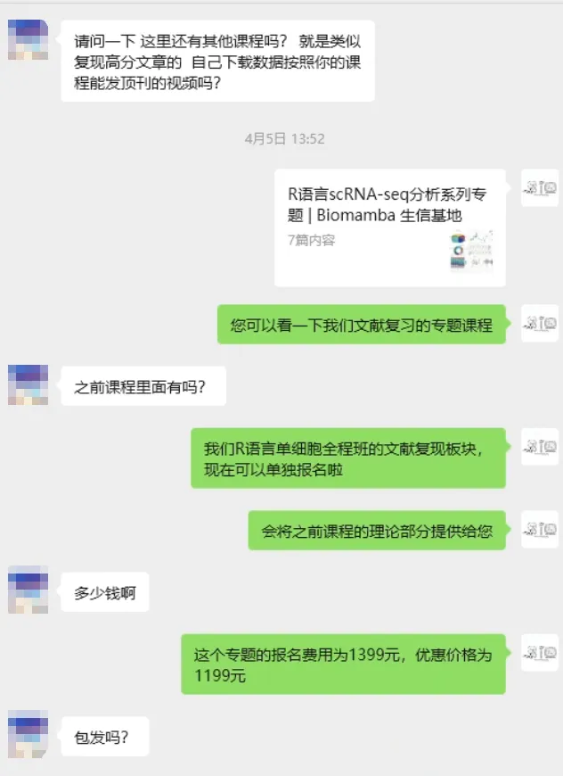
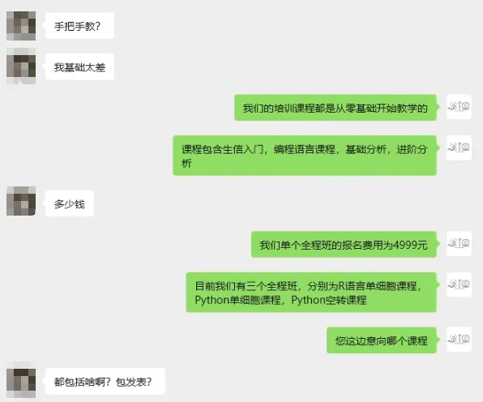
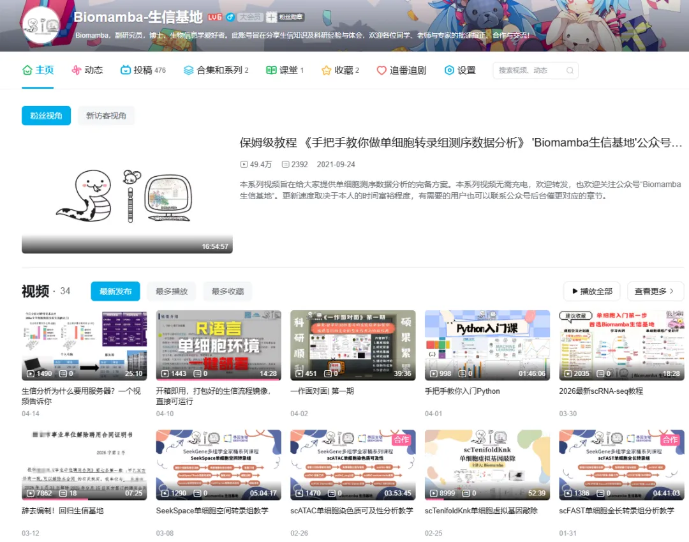
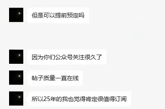
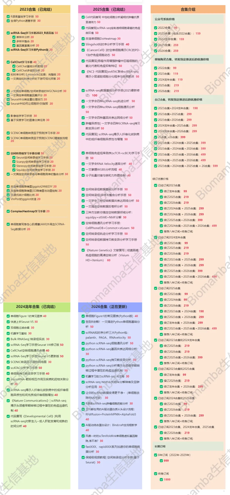

# 有些需求，只有骗子能满足

> 原文：https://mp.weixin.qq.com/s?__biz=MzAwMzIzOTk5OQ==&mid=2247537738&idx=1&sn=7257e7dcecbe677e12349ac2fea8bb26&chksm=9b3c2d1aac4ba40c033d2e80eca8d1259ef4f9d0fae3427d09e2f43706f60e46df9df1eb8419#rd
> 合集：漫谈胡侃

继上次[还有人买卖文章？](<https://mp.weixin.qq.com/s?__biz=MzAwMzIzOTk5OQ==&mid=2247526841&idx=1&sn=d0fae5c4b9dfa11a9efed89cbccdb30c&scene=21#wechat_redirect>)和[代发论文被骗7.5w？](<https://mp.weixin.qq.com/s?__biz=MzAwMzIzOTk5OQ==&mid=2247534422&idx=1&sn=95bffa8e043ff16ab645aaa112fc003e&scene=21#wechat_redirect>)之后，还有人粉丝问我们的课程包不包发文章。我只能说：有些需求，只有骗子才能满足。我们几千￥的课程，给大家提供两个月的生信教学，[送三个月256GB单细胞专属服务器](<https://mp.weixin.qq.com/s?__biz=MzAwMzIzOTk5OQ==&mid=2247535952&idx=2&sn=1e867b98de5717aace4024ced57d372a&scene=21#wechat_redirect>)，还要包你发文章，ber，这对吗。别报有侥幸心理，先不说价格高低，任何机构如果真有 “包发文章” 的正规渠道和通天能力，他们为什么不自己读研读博当硕导博导，反而要卖文章给你呢？“包发文章” 这种天上掉馅饼的承诺，只有骗子能给你拍胸脯保证；他们是在利用大家急着毕业、急着出成果的焦虑，把你往坑里带。所以在此也郑重提醒各位粉丝不要上当受骗，世界上哪有什么捷径，美好的愿望只有骗子能满足。真正的课程只能教你方法、教你流程、教你避坑。还是跟Biomamba一起学生信吧！咱有正经[博士学位](<https://mp.weixin.qq.com/s?__biz=MzAwMzIzOTk5OQ==&mid=2247529408&idx=1&sn=079464ea5c0cfc99526594a6c5531654&scene=21#wechat_redirect>)、副研究员聘文及论文发表经验：[为什么我们敢开放终身订阅](<https://mp.weixin.qq.com/s?__biz=MzAwMzIzOTk5OQ==&mid=2247535983&idx=1&sn=99378a252908b06f56432eb08741d278&scene=21#wechat_redirect>)，学技能永远比买文章收获大，而且更加踏实！最近我们也有粉丝庆典，可以关注下：[坏消息，五一结束了；好消息，生信基地破8万粉丝啦~来抽奖](<https://mp.weixin.qq.com/s?__biz=MzAwMzIzOTk5OQ==&mid=2247537713&idx=1&sn=dd3ef5f48e9e836835dc7369cac9769d&scene=21#wechat_redirect>)



Biomamba生信基地

Biomamba生信基地2020年创建，一直以来的初衷就是帮大家降低生信学习门槛——为大家整理系统且详实的干货内容，省去东搜西找的麻烦，最大程度帮大家节省宝贵的时间成本。我们用心打磨的每一份内容，都值得被更多人看见。现目前我们公众号大多数推文和视频是免费的，相信足够你完成很多常见生信流程的学习。我们的B站也有很多手把手的生信教学：

https://space.bilibili.com/484326544



平台当然也有付费板块，大家按需下单就好：[培训课程](<https://mp.weixin.qq.com/s?__biz=MzAwMzIzOTk5OQ==&mid=2247536399&idx=2&sn=6c73155a0393ed9c246fee69cb06341f&scene=21#wechat_redirect>)、[订阅资料](<https://mp.weixin.qq.com/s?__biz=MzAwMzIzOTk5OQ==&mid=2247535983&idx=1&sn=99378a252908b06f56432eb08741d278&scene=21#wechat_redirect>)。[培训课程](<https://mp.weixin.qq.com/s?__biz=MzAwMzIzOTk5OQ==&mid=2247536399&idx=2&sn=6c73155a0393ed9c246fee69cb06341f&scene=21#wechat_redirect>)实打实的定价，不搞虚的。除配套的学习手册、代码脚本、测试文件与专项练习题外，还提供三年内课程答疑、直播复听，永久回放；同时配备[开箱即用的分析环境](<https://mp.weixin.qq.com/s?__biz=MzAwMzIzOTk5OQ==&mid=2247536307&idx=1&sn=8d03259be06f54521aac5251dec988d5&scene=21#wechat_redirect>)，三个月SHPC共享特惠版[服务器](<https://mp.weixin.qq.com/s?__biz=MzAwMzIzOTk5OQ==&mid=2247535166&idx=2&sn=431238cb95bd4281424130333f6610c3&scene=21#wechat_redirect>)使用权限。我们甚至可以出了[先学习、后补票的支持政策](<https://mp.weixin.qq.com/s?__biz=MzAwMzIzOTk5OQ==&mid=2247537006&idx=1&sn=ce26abe79d33368befb40ae443c94692&scene=21#wechat_redirect>)，不设过高门槛，以学习效果为先，让每一位有需求、肯努力的伙伴都能无压力接触我们优质[生信课程](<https://mp.weixin.qq.com/s?__biz=MzAwMzIzOTk5OQ==&mid=2247536399&idx=2&sn=6c73155a0393ed9c246fee69cb06341f&scene=21#wechat_redirect>)。

[订阅资料](<https://mp.weixin.qq.com/s?__biz=MzAwMzIzOTk5OQ==&mid=2247535983&idx=1&sn=99378a252908b06f56432eb08741d278&scene=21#wechat_redirect>)同样干货满满，通过完成简单任务可免费领取。订阅教程一般都有配套视频和注释，教程也都是编译好的html文件方便大家学习(这意味着我的代码在我手里是可以保证顺利运行)，因此来我这学习的同学也别要求我提供答疑服务(一两百块块钱指望我一对一给你辅导出一篇SCI出来显然不现实)。当然我是给大家组建了免费交流群的，有空的时候我也会在群里答疑，欢迎大家一起讨论：[永久免费的千人生信、科研交流群](<https://mp.weixin.qq.com/s?__biz=MzAwMzIzOTk5OQ==&mid=2247536307&idx=2&sn=2d030173f51d24a4fee43bd0d83da03b&scene=21#wechat_redirect>)。大家确实有需要再订阅，非必要不订阅。

—Biomamba


培训课程


我们的培训课程主要有：[生信小白入门课](<https://mp.weixin.qq.com/s?__biz=MzAwMzIzOTk5OQ==&mid=2247526126&idx=1&sn=ab205f18c19b5b98b4b59b6c89b394ec&scene=21&token=1721358726&lang=zh_CN&poc_token=HKPDT2mjZ1EjCfBM7QtZoCWK39OO-kMAipOkd4-p#wechat_redirect>)、[R语言入门课](<https://mp.weixin.qq.com/s?__biz=MzAwMzIzOTk5OQ==&mid=2247528126&idx=2&sn=668c2709891956b567b316f9f2fb26ea&scene=21&click_id=2&token=1721358726&lang=zh_CN&poc_token=HNPGT2mjdx6snIb3sfaprsNlMqyNmwUUEDKM1wpf#wechat_redirect>)、[Python入门课](<https://mp.weixin.qq.com/s?__biz=MzAwMzIzOTk5OQ==&mid=2247537399&idx=1&sn=d14c7987d1384fe133094748844b8d59&scene=21#wechat_redirect>)、[R语言scRNA-seq基础课](<https://mp.weixin.qq.com/s?__biz=MzAwMzIzOTk5OQ==&mid=2247535877&idx=1&sn=e988a2172618fd6f609575294db9a44f&scene=21#wechat_redirect>)、[R语言scRNA-seq小白全程班](<https://mp.weixin.qq.com/s?__biz=MzAwMzIzOTk5OQ==&mid=2247535927&idx=2&sn=86947f0522de0d9785865bd24115b002&scene=21#wechat_redirect>)、[Python scRNA-seq全程班](<https://mp.weixin.qq.com/s?__biz=MzAwMzIzOTk5OQ==&mid=2247533067&idx=1&sn=7ef76058cbcf7bd45f58147766c75854&scene=21#wechat_redirect>)、[Python空间转录组全程班](<https://mp.weixin.qq.com/s?__biz=MzAwMzIzOTk5OQ==&mid=2247533721&idx=1&sn=9648ed4701224e5d2e4c704d7046d9de&scene=21#wechat_redirect>)。这些课程均有回放，可联系客服[Biomamba_zhushou]领取资料并进群，另外还有老师答疑解惑。

[](<https://mp.weixin.qq.com/s?__biz=MzAwMzIzOTk5OQ==&mid=2247536399&idx=2&sn=6c73155a0393ed9c246fee69cb06341f&scene=21#wechat_redirect>)

Biomamba 生信基地的培训课程

入门及编程语言

[生信小白入门课](<https://mp.weixin.qq.com/s?__biz=MzAwMzIzOTk5OQ==&mid=2247526459&idx=2&sn=13151661ad9d02bf4d8d20ab000b4df0&scene=21&token=2056463462&lang=zh_CN&poc_token=HEhmX2mjnVizkwrwJBJtfdhCDuMPdi3Fil96l-JU#wechat_redirect>)

[R语言入门课](<https://mp.weixin.qq.com/s?__biz=MzAwMzIzOTk5OQ==&mid=2247528126&idx=2&sn=668c2709891956b567b316f9f2fb26ea&scene=21&click_id=2&token=1721358726&lang=zh_CN&poc_token=HNPGT2mjdx6snIb3sfaprsNlMqyNmwUUEDKM1wpf#wechat_redirect>)

[Python入门课](<https://mp.weixin.qq.com/s?__biz=MzAwMzIzOTk5OQ==&mid=2247537399&idx=1&sn=d14c7987d1384fe133094748844b8d59&scene=21#wechat_redirect>)

[专题班](<https://mp.weixin.qq.com/mp/appmsgalbum?__biz=MzAwMzIzOTk5OQ==&action=getalbum&album_id=4421772406013378566#wechat_redirect>)

[短平快！R语言scRNA-seq数据基础分析专题](<https://mp.weixin.qq.com/s?__biz=MzAwMzIzOTk5OQ==&mid=2247535877&idx=1&sn=e988a2172618fd6f609575294db9a44f&scene=21#wechat_redirect>)

[R语言scRNA-seq进阶质控专题](<https://mp.weixin.qq.com/s?__biz=MzAwMzIzOTk5OQ==&mid=2247535877&idx=2&sn=0323d692cf61092ed994fb434e4cfb1d&scene=21#wechat_redirect>)

[R语言scRNA-seq轨迹分析专题](<https://mp.weixin.qq.com/s?__biz=MzAwMzIzOTk5OQ==&mid=2247535877&idx=3&sn=d24f80518eccef24183277eab1f62928&scene=21#wechat_redirect>)

[R语言scRNA-seq细胞通讯分析专题](<https://mp.weixin.qq.com/s?__biz=MzAwMzIzOTk5OQ==&mid=2247535877&idx=4&sn=847ec896b51c5c1571e31a54f198ebc2&scene=21#wechat_redirect>)

[R语言scRNA-seq基因共表达网络分析专题](<https://mp.weixin.qq.com/s?__biz=MzAwMzIzOTk5OQ==&mid=2247535877&idx=5&sn=23f42e58509a93e1f91c09cad53ccbdf&scene=21#wechat_redirect>)

[R语言scRNA-seq拷贝数变异分析专题](<https://mp.weixin.qq.com/s?__biz=MzAwMzIzOTk5OQ==&mid=2247535877&idx=6&sn=6b2682106ed9a84c5bf57dadec45a0d3&scene=21#wechat_redirect>)

[R语言scRNA-seq文献复现专题](<https://mp.weixin.qq.com/s?__biz=MzAwMzIzOTk5OQ==&mid=2247535877&idx=7&sn=b716aeb8e86eba4acd50b982beb0c963&scene=21#wechat_redirect>)

全程班

[R语言scRNA-seq小白全程班](<https://mp.weixin.qq.com/s?__biz=MzAwMzIzOTk5OQ==&mid=2247535927&idx=2&sn=86947f0522de0d9785865bd24115b002&scene=21#wechat_redirect>)

[Python scRNA-seq全程班](<https://mp.weixin.qq.com/s?__biz=MzAwMzIzOTk5OQ==&mid=2247533067&idx=1&sn=7ef76058cbcf7bd45f58147766c75854&scene=21#wechat_redirect>)

[Python空间转录组全程班](<https://mp.weixin.qq.com/s?__biz=MzAwMzIzOTk5OQ==&mid=2247533721&idx=1&sn=9648ed4701224e5d2e4c704d7046d9de&scene=21#wechat_redirect>)

三大全程班课程内容

[](<https://mp.weixin.qq.com/s?__biz=MzAwMzIzOTk5OQ==&mid=2247536399&idx=2&sn=6c73155a0393ed9c246fee69cb06341f&scene=21#wechat_redirect>)

我们后面将会举办更多的课程，大家可以持续关注我们~


订阅资料



经常有用户想要提前订阅资料，看来是真爱粉无疑了。既然氛围都到这了，我们就开放[终身订阅](<https://mp.weixin.qq.com/s?__biz=MzAwMzIzOTk5OQ==&mid=2247535983&idx=1&sn=99378a252908b06f56432eb08741d278&scene=21#wechat_redirect>)吧。终身订阅用户可以在获得我们未来每年更新合辑的所有资料，不要担心我们不更新，[生信基地](<https://mp.weixin.qq.com/s?__biz=MzAwMzIzOTk5OQ==&mid=2247526229&idx=1&sn=0718f1702150ba77a7f7e3beadd6e0ba&scene=21#wechat_redirect>)还有37年的产权，欢迎随时来看看(南京市江宁区，详询客服微信)。大家只要考虑自己会不会一直学习生信。

目前已有的五个合集总价为935￥（年均187￥，共54个万字以上教程，平均一篇才13￥），1999￥（按四十年算，年均50￥，预计单篇价格低于5￥）即可获得Biomamba生信基地合集终身订阅权限(暂定价格，随着资料增多、通货膨胀，随时涨价)，比小学生的教辅便宜多了。生信基地的任何业务均支持对公，希望加入终身订阅计划的小伙伴可以尽早联系客服微信[Biomamba_zhushou]。

**2026订阅合辑**

[ 2026订阅须知](<https://mp.weixin.qq.com/s?__biz=MzAwMzIzOTk5OQ==&mid=2247534690&idx=1&sn=4ff5291b649fb4fe4d703c48a04d37f2&scene=21#wechat_redirect>)

[单细胞Figure1的常见图表(Python版)](<https://mp.weixin.qq.com/s?__biz=MzAwMzIzOTk5OQ==&mid=2247534718&idx=1&sn=f1492239574ad489be9a1aa0c84af87a&scene=21#wechat_redirect>)

[告别R依赖！一文搞定Python单细胞基础分析](<https://mp.weixin.qq.com/s?__biz=MzAwMzIzOTk5OQ==&mid=2247534702&idx=1&sn=f1531163f8f620b59cf63dfaa1c03e67&scene=21#wechat_redirect>)

[风靡一时的scTenifoldKnk单细胞虚拟基因敲除,准不准?](<https://mp.weixin.qq.com/s?__biz=MzAwMzIzOTk5OQ==&mid=2247535112&idx=1&sn=95a6b88cd49fb2bbb7aa091a00e09e2c&scene=21#wechat_redirect>)

[scRNA拟时序分析三大Python包：palantir、PAGA、RNAvelocity](<https://mp.weixin.qq.com/s?__biz=MzAwMzIzOTk5OQ==&mid=2247535114&idx=1&sn=95b6364b67d7ae9f03ba8455863ddabe&payreadticket=HPRxP747AMBMeqhb_IlGTOIh7O-qGPPqwIhfSHKzxoHJeXTi0mOpPC_0fe2frIqitCWrSp8&scene=21#wechat_redirect>)

[正刊都在用的AI驱动蛋白质从头设计流程：RFdiffusion+ProteinMPNN+AlphaFold3](<https://mp.weixin.qq.com/s?__biz=MzAwMzIzOTk5OQ==&mid=2247535726&idx=1&sn=fa3a01ca6ec0f20d0e9b7ac960712ac3&scene=21#wechat_redirect>)

[CellphoneDB搞定细胞通讯分析](<https://mp.weixin.qq.com/s?__biz=MzAwMzIzOTk5OQ==&mid=2247536366&idx=1&sn=c3eb2d3abad1952b3b7fa88099c607b7&scene=21#wechat_redirect>)

[scRNA-seq肿瘤细胞药物敏感性预测分析](<https://mp.weixin.qq.com/s?__biz=MzAwMzIzOTk5OQ==&mid=2247536705&idx=1&sn=7fbfeba5dee45f6c3311bd31082a428c&scene=21#wechat_redirect>)

[fastXXX、rapidXXX系列加速你的单细胞数据分析](<https://mp.weixin.qq.com/s?__biz=MzAwMzIzOTk5OQ==&mid=2247536940&idx=1&sn=57eea9f64dfeff9231977ab5028c3dcd&scene=21#wechat_redirect>)

[转录因子、基因共表达网络分析手册：pySCENIC在脑、黑色素瘤中的应用](<https://mp.weixin.qq.com/s?__biz=MzAwMzIzOTk5OQ==&mid=2247537055&idx=1&sn=170371b86b42d47373bf7f0500031f19&scene=21#wechat_redirect>)

[让你的scRNA数据变得更干净~](<https://mp.weixin.qq.com/s?__biz=MzAwMzIzOTk5OQ==&mid=2247537531&idx=1&sn=e5f08c08b352287ddfda069a20019afb&scene=21#wechat_redirect>)

[保姆级视频教程| 空间转录组分析手册(基于Seurat)](<https://mp.weixin.qq.com/s?__biz=MzAwMzIzOTk5OQ==&mid=2247537631&idx=1&sn=b702b29384fd4f4878cc0b4d0fcf51e7&scene=21#wechat_redirect>)

持续更新中~

向下滑动查看更多

**2025订阅合辑**

[2025订阅须知](<https://mp.weixin.qq.com/s?__biz=MzAwMzIzOTk5OQ==&mid=2247526751&idx=1&sn=7ca3137d770f23f0c3d6195696618d81&scene=21&token=2143911808&lang=zh_CN&poc_token=HPJ5S2mj1patGAgGn2rvK_cl-hJW1vlWazK5cQHg#wechat_redirect>)

[《Cell》复现|中性粒细胞scRNA-seq图谱阐明抗肿瘤抗原呈递效力](<https://mp.weixin.qq.com/s?__biz=MzAwMzIzOTk5OQ==&mid=2247526776&idx=1&sn=99eb6a16c7bf345445b6ff4b61110138&payreadticket=HC__tGU8L5JA4wSD5JEaMhGrY7HFBRroyAtGo_3uXJgF2t-nj7ILdcOk3g21iGGHpvESIaY&scene=21#wechat_redirect>)

[代码复现|scRNA-seq绘制透明细胞肾癌的免疫微环境](<https://mp.weixin.qq.com/s?__biz=MzAwMzIzOTk5OQ==&mid=2247527498&idx=1&sn=c8282e9d4175bfb2e572278312073d81&chksm=9b3c151aac4b9c0c2ac7f0c184f5bba183b52a6c9b9f4e30d0494ef752df0cd216afe15dbf2f&scene=21&cur_album_id=3810782335739215872&search_click_id=#wechat_redirect>)

[改造单细胞DoHeatmap](<https://mp.weixin.qq.com/s?__biz=MzAwMzIzOTk5OQ==&mid=2247527762&idx=1&sn=ba7c8a4cb704e71fa86ebfe1f19bffea&chksm=9b3c1402ac4b9d142d99d739a6de3623182488fd6fa1b312e773b39a1a317642ddc4fa422997&token=2143911808&lang=zh_CN&scene=21#wechat_redirect>)

[Slingshot拟时序分析学习手册](<https://mp.weixin.qq.com/s?__biz=MzAwMzIzOTk5OQ==&mid=2247527850&idx=1&sn=f4e2ca5e2e5e71eeaf132375bb8270eb&chksm=9b3c14faac4b9dec4d9a4f90419c0aa9e8ef5630435f9d48ae8022cd91e7a0b46e4ba32f50bb&token=2143911808&lang=zh_CN&scene=21#wechat_redirect>)

[《Cancer Cell》|时空单细胞揭示CRC的PD-1治疗免疫细胞动态](<https://mp.weixin.qq.com/s?__biz=MzAwMzIzOTk5OQ==&mid=2247528056&idx=1&sn=73c0da3ff7ff50bafbb9315fd5b60f15&chksm=9b3c1728ac4b9e3ea3d3a35b9a60d5b21f74fe08671da8388c60ed43ba310617e6c48566b54a&token=2143911808&lang=zh_CN&scene=21#wechat_redirect>)

[scRNA-seq数据基础分析手册(2025最新修订)](<https://mp.weixin.qq.com/s?__biz=MzAwMzIzOTk5OQ==&mid=2247528199&idx=1&sn=ab75e7d7987ab233c675455188f10f33&chksm=9b3c1657ac4b9f41e312a5f508fa1fb2158dfdbaacfb2d67c3ffa3d134b0c6b5672c062499da&token=2143911808&lang=zh_CN&scene=21#wechat_redirect>)

[代码复现|吞噬作用增强肿瘤中巨噬细胞的氧化代谢和免疫抑制特征](<https://mp.weixin.qq.com/s?__biz=MzAwMzIzOTk5OQ==&mid=2247528289&idx=1&sn=b56f00f3d8a4b152e54f3acd40aef21d&chksm=9b3c1631ac4b9f27db6577962d2113ae2fa5c3960ac942bf6ee94f58073642eeb6a4d8369212&token=2143911808&lang=zh_CN&scene=21#wechat_redirect>)

[一文学会scRNA Velocity剪切速率分析](<https://mp.weixin.qq.com/s?__biz=MzAwMzIzOTk5OQ==&mid=2247528458&idx=1&sn=900357283922571c6294435be409a2f3&chksm=9b3c095aac4b804cecf155daa5a08391536d9f906ab6edb6c6650ec868ad1b14dc7be8bbde36&token=2143911808&lang=zh_CN&scene=21#wechat_redirect>)

[一文学会四种scRNA-seq轨迹分析](<https://mp.weixin.qq.com/s?__biz=MzAwMzIzOTk5OQ==&mid=2247528666&idx=1&sn=d29545d296bac3e41de322e43fde80dd&chksm=9b3c098aac4b809c28bb5c36a8a7f045e6e2339342640716763283b4b2e6c948f1d1869bd7df&token=2143911808&lang=zh_CN&scene=21#wechat_redirect>)

[一文学会四种scRNA-seq细胞通讯分析](<https://mp.weixin.qq.com/s?__biz=MzAwMzIzOTk5OQ==&mid=2247528770&idx=1&sn=6242bce437a9d60f81a8651ea9b57e0b&chksm=9b3c0812ac4b81040db203fef3e09e40e371f8095981f3cb55b8d9fce13fdba9c8bdc2dc8404&token=2143911808&lang=zh_CN&scene=21#wechat_redirect>)

[一文学会四种基因共表达网络分析](<https://mp.weixin.qq.com/s?__biz=MzAwMzIzOTk5OQ==&mid=2247529410&idx=1&sn=9bbaf955d93ddce60874e1cdc2f16115&chksm=9b3c0a92ac4b8384232b692057cba6acb7dba9c6af666e4ec7fc166e0ff960b18b857b8cfb98&token=2143911808&lang=zh_CN&scene=21#wechat_redirect>)

[肿瘤异质性分析必备| 一文学会四种scRNA-seq拷贝数变异分析](<https://mp.weixin.qq.com/s?__biz=MzAwMzIzOTk5OQ==&mid=2247529921&idx=1&sn=93f8ad6655ee6d2b036cd557a6a74be6&chksm=9b3c0c91ac4b85876ae4064fe28c95a0629550e29575faca5dcdd5b56aeddf8fae6584937572&token=2143911808&lang=zh_CN&scene=21#wechat_redirect>)

[分子批量对接与亲和力热图绘制](<https://mp.weixin.qq.com/s?__biz=MzAwMzIzOTk5OQ==&mid=2247530154&idx=1&sn=90de71a3b453e635920d309faedb36c7&chksm=9b3c0ffaac4b86ec8f1b8b46d0f76db869e6dfb4e8bb5c64a064a86f19c2dcf606d2e54e5edc&token=2143911808&lang=zh_CN&scene=21#wechat_redirect>)

[代码复现| scRNA-seq揭示人纤维化皮肤病中的成纤维细胞异质性与增殖](<https://mp.weixin.qq.com/s?__biz=MzAwMzIzOTk5OQ==&mid=2247530338&idx=1&sn=2d092e76080359f5a169ec14d54d1241&chksm=9b3c0e32ac4b872435a1f4af3c6903c777fdb07f43ad222ccbf08163ae259d56b9e499ee2fe6&token=2143911808&lang=zh_CN&scene=21#wechat_redirect>)

[单细胞免疫组库测序(scTCR+scBCR)学习手册](<https://mp.weixin.qq.com/s?__biz=MzAwMzIzOTk5OQ==&mid=2247530826&idx=1&sn=f95a284a432695c9b8f6878cd3691bfc&chksm=9b3c001aac4b890c144c8a3a37f9c6587f35341cf2090241400dad2e2ef0b08c7b8ccbd7fe2e&token=2143911808&lang=zh_CN&scene=21#wechat_redirect>)

[一文掌握WGBS分析流程](<https://mp.weixin.qq.com/s?__biz=MzAwMzIzOTk5OQ==&mid=2247531339&idx=1&sn=83d6e80e24494cc7080188d5c9e695e2&chksm=9b3c021bac4b8b0ddd6b02925ba1c43f965f8e83db7c599032040f27b068334b3601846837cd&token=2143911808&lang=zh_CN&scene=21#wechat_redirect>)

[《NC》代码复现|snATAC联合scRNA-seq揭示小鼠肾脏细胞分化程序与疾病靶点](<https://mp.weixin.qq.com/s?__biz=MzAwMzIzOTk5OQ==&mid=2247531908&idx=1&sn=2f094e390621a57853ba17f59f298ebe&chksm=9b3c04d4ac4b8dc26acab20d53b4c9f6cc50132d7ef4da167ff068a49f4801e7c42d96c6c986&token=2143911808&lang=zh_CN&scene=21#wechat_redirect>)

[空间转录组数据基础分析手册](<https://mp.weixin.qq.com/s?__biz=MzAwMzIzOTk5OQ==&mid=2247532178&idx=1&sn=2cc8f5453765bd68b8ddacf2c2e3d5e7&chksm=9b3c07c2ac4b8ed427f3bdd2c2f275e66110494056574cd7cc18d03a8ad9d9fe0e6eaf1706c5&token=2143911808&lang=zh_CN&scene=21#wechat_redirect>)

[空间转录组|多样本整合分析手册](<https://mp.weixin.qq.com/s?__biz=MzAwMzIzOTk5OQ==&mid=2247532349&idx=1&sn=59c0f14043906ff50c56dea3b16e9200&chksm=9b3c066dac4b8f7bb9f00c29c0085be4a049064eac8116ddcc7fab9e534b7aa031d90f8b6415&token=2143911808&lang=zh_CN&scene=21#wechat_redirect>)

[一文学会三种空转数据共表达网络分析](<https://mp.weixin.qq.com/s?__biz=MzAwMzIzOTk5OQ==&mid=2247532373&idx=1&sn=cd16d0151ef19c9a2dcfcba6ee09f431&chksm=9b3c0605ac4b8f13ede1e916f40e53c732614acb04c136f7c3f3e0b619dfbc10230c9ed58da0&token=2143911808&lang=zh_CN&scene=21#wechat_redirect>)

[一文搞定空转数据反卷积分析](<https://mp.weixin.qq.com/s?__biz=MzAwMzIzOTk5OQ==&mid=2247532458&idx=1&sn=f8ec547187374fe77c38fc1125709b3b&chksm=9b3c06faac4b8feca4a51657dc85b5cd8f176767eb01887702df0abe82e4d933fe0efb8a2cc9&token=2143911808&lang=zh_CN&scene=21#wechat_redirect>)

[三种方法教你搞定空转数据邻域分析：squidpy+stSME+NMF分解](<https://mp.weixin.qq.com/s?__biz=MzAwMzIzOTk5OQ==&mid=2247532641&idx=1&sn=c8422ab7c1cd70751fb3109a84cb64ea&chksm=9b3c3931ac4bb0275fe5fd89712535cce677a308ac5a2c4e85d6f2a8785a4c76359e6612553c&token=2143911808&lang=zh_CN&scene=21#wechat_redirect>)

[空转细胞通讯分析学习手册：CellPhoneDB+Commot+stLearn](<https://mp.weixin.qq.com/s?__biz=MzAwMzIzOTk5OQ==&mid=2247532763&idx=1&sn=f6e4df9242f1341d2dc7e6154c33aa46&chksm=9b3c398bac4bb09d978dddd3f44c04c855ec89f6cd949fccbe497c515a62440f58dca31b4885&token=2143911808&lang=zh_CN&scene=21#wechat_redirect>)

[空间转录组轨迹分析学习手册](<https://mp.weixin.qq.com/s?__biz=MzAwMzIzOTk5OQ==&mid=2247532806&idx=1&sn=7d7ecf4977cb2cc9ace0e4e31941a1ac&chksm=9b3c3856ac4bb140a5f0955158656f458951cfe9bdd0a68d8c8ff74bd1e3f7adcc4da76197f0&token=2143911808&lang=zh_CN&scene=21#wechat_redirect>)

[空间转录组数据拷贝数变异分析学习手册](<https://mp.weixin.qq.com/s?__biz=MzAwMzIzOTk5OQ==&mid=2247532924&idx=1&sn=46b87151e30163e393cf2c1751360bac&chksm=9b3c382cac4bb13ad9aecd8783f1c6b0c576b1a25d04c3d15fa95a7e4fd5fdd8090cba7ce027&token=2143911808&lang=zh_CN&scene=21#wechat_redirect>)

[《Nature Genetics》文献复写 | 结直肠癌免疫细胞的高清空转分析（Visium HD+Xenium）](<https://mp.weixin.qq.com/s?__biz=MzAwMzIzOTk5OQ==&mid=2247533068&idx=1&sn=52cbc8d161ec216b5d7a8238a49d47c6&chksm=9b3c3b5cac4bb24a1b5c8ee1304f896c2ccea583e81bda4f9fae26564bc7d77c09a58baef3de&token=2143911808&lang=zh_CN&scene=21#wechat_redirect>)

[2025订阅资料已完结，请留下你的评价！](<https://mp.weixin.qq.com/s?__biz=MzAwMzIzOTk5OQ==&mid=2247534421&idx=1&sn=2c80be7809a97981bab3f76fae55ac20&scene=21#wechat_redirect>)

向下滑动查看更多

**2024龙年订阅合辑**

[龙年订阅须知](<https://mp.weixin.qq.com/s?__biz=MzAwMzIzOTk5OQ==&mid=2247509093&idx=1&sn=d82ed3738bc25b922a4837016198951e&chksm=9b3cdd35ac4b5423f08cf6ab2f4afc5d815c2321991d880e8b7162e63fd1d7e4695cd7391022&token=2143911808&lang=zh_CN&scene=21#wechat_redirect>)

[单细胞Figure 1常见图表](<https://mp.weixin.qq.com/s?__biz=MzAwMzIzOTk5OQ==&mid=2247509260&idx=1&sn=9ff90a428c3f22d43a31ec864e2d8a94&chksm=9b3cdc5cac4b554a2f7cb2a6368f7df9a9a3f6e406eb070663f53d81841a76e188c0b50727de&token=2143911808&lang=zh_CN&scene=21#wechat_redirect>)

[快速上手Seurat V5](<https://mp.weixin.qq.com/s?__biz=MzAwMzIzOTk5OQ==&mid=2247509880&idx=1&sn=3b7cd169ccfe688d10cb1ca70dc91e91&chksm=9b3cde28ac4b573ec6d5f4bceafa4294c0e9a001b7d0c0b64f274a9978b1438eeccc747ca0c0&token=2143911808&lang=zh_CN&scene=21#wechat_redirect>)

[机器学习基础手册](<https://mp.weixin.qq.com/s?__biz=MzAwMzIzOTk5OQ==&mid=2247510121&idx=1&sn=87b53d350d9aedd5b3205d59e51356a0&chksm=9b3cd139ac4b582f23dd0ca65dcc66bed80b4240da76ee5abfbb61ec1bf62674ebfd2c50a45e&token=2143911808&lang=zh_CN&scene=21#wechat_redirect>)

[scRNA-Seq学习手册Seurat V4修订版](<https://mp.weixin.qq.com/s?__biz=MzAwMzIzOTk5OQ==&mid=2247510380&idx=1&sn=0eb2b0c519ef1dc25ee8821b736a0fde&chksm=9b3cd03cac4b592ad93149fb4847e6ba3dd03ab69e1ca594ddc64d323fb7496775789cae245d&token=2143911808&lang=zh_CN&scene=21#wechat_redirect>)

[Bulk RNASeq| 转录组实战](<https://mp.weixin.qq.com/s?__biz=MzAwMzIzOTk5OQ==&mid=2247510793&idx=1&sn=bfa69e8f261932d9bea74443fab732f0&chksm=9b3cd259ac4b5b4fd4b3bb80d0210a3396cda777b32ab49be1a45339453db314bb2a17fc438d&token=2143911808&lang=zh_CN&scene=21#wechat_redirect>)

[scRNA-Seq双细胞过滤手册](<https://mp.weixin.qq.com/s?__biz=MzAwMzIzOTk5OQ==&mid=2247511622&idx=1&sn=60b35668e569267bab14ec8fbba8bd74&chksm=9b3cd716ac4b5e00122eac47f55085198040a4a0e97c56895bbc39f3a9f1a1eb4eba27048a8f&token=2143911808&lang=zh_CN&scene=21#wechat_redirect>)

[CellChat空转细胞通讯合辑](<https://mp.weixin.qq.com/s?__biz=MzAwMzIzOTk5OQ==&mid=2247512011&idx=1&sn=fbd41832c5995d79fead016931d3bfbd&chksm=9b3cd69bac4b5f8d16e7d8b8eeb5490e4938daf68902b06a8d60e25f150ec4ec459796f3aaac&token=2143911808&lang=zh_CN&scene=21#wechat_redirect>)

[scRNA-Seq学习手册Seurat V5更新版](<https://mp.weixin.qq.com/s?__biz=MzAwMzIzOTk5OQ==&mid=2247519711&idx=1&sn=d25d4f5daf609bda8367f16db676ecf3&chksm=9b3cf48fac4b7d99e65eba6d4c66c63e40b1d187fa1d9e6449d6cd07d5dec5127cff54886f93&token=2143911808&lang=zh_CN&scene=21#wechat_redirect>)

[SCENIC转录因子调控网络图](<https://mp.weixin.qq.com/s?__biz=MzAwMzIzOTk5OQ==&mid=2247520750&idx=1&sn=496bead1531a7eddd5c286030d350745&chksm=9b3ce8beac4b61a8589a1f8a66bd0571e09c0646655b6d805348bf6f4a0c7b52851615c22868&token=2143911808&lang=zh_CN&scene=21#wechat_redirect>)

[scATAC分析学习手册](<https://mp.weixin.qq.com/s?__biz=MzAwMzIzOTk5OQ==&mid=2247521636&idx=1&sn=208907010f3f7412c1c91343d7dfb0d3&chksm=9b3cec34ac4b6522977cb002919634af5334eec170b32f4961826dafb42f44f611144b159b2b&token=2143911808&lang=zh_CN&scene=21#wechat_redirect>)

[单细胞拷贝数变异学习手册](<https://mp.weixin.qq.com/s?__biz=MzAwMzIzOTk5OQ==&mid=2247522733&idx=1&sn=4e3a0707fd8f83b5ad9377bc91ee8e53&chksm=9b3ce0fdac4b69ebf301818e3cccb668f443f66807d2a97edc463721d48392b52e10a262dfa7&token=2143911808&lang=zh_CN&scene=21#wechat_redirect>)

[microRNA-靶标相互作用及疾病和药物关联分析](<https://mp.weixin.qq.com/s?__biz=MzAwMzIzOTk5OQ==&mid=2247523676&idx=1&sn=6dad381e38df9ad63b90ed5935b73bf0&chksm=9b3ce40cac4b6d1af13dc1d8188d1134fae12213f536abcce8c683b6fa8e68b6a48c5b417215&token=2143911808&lang=zh_CN&scene=21#wechat_redirect>)

[《NC》代码复现| scRNA-seq揭示人纤维化皮肤病中的成纤维细胞异质性和间充质成纤维细胞增加](<https://mp.weixin.qq.com/s?__biz=MzAwMzIzOTk5OQ==&mid=2247525649&idx=1&sn=6145f50422ef8680be2a7ffd6c66f5f3&chksm=9b3c1c41ac4b955748b6735bb43b27fb222f3795c4ae49bb8a453f78765fc472ff43f9e7fc89&token=2143911808&lang=zh_CN&scene=21#wechat_redirect>)

[《Nature Communications》| scRNA-seq揭示头颈癌早期转移过程中潜在的免疫逃避机制](<https://mp.weixin.qq.com/s?__biz=MzAwMzIzOTk5OQ==&mid=2247526011&idx=1&sn=e601b8dedfad86ee6d9ce5b6d6ca8511&chksm=9b3c1f2bac4b963d523438200ea92f352bd84ab5fbb40a4b2220e7f1af77778f27aa1f728e47&scene=21&cur_album_id=3348420850777358342#wechat_redirect>)

[代码复写《Developmental Cell》|利用scRNA-seq对新生儿~成人肝脏发育和成熟的时间分析](<https://mp.weixin.qq.com/s?__biz=MzAwMzIzOTk5OQ==&mid=2247526426&idx=1&sn=7191649a25332d1b8bf2bd9c797d06a7&chksm=9b3c114aac4b985cd9d16e134892c140111b32493063036363b39119ef7aad205a3c12bba867&token=2143911808&lang=zh_CN&scene=21#wechat_redirect>)

[龙年订阅资料已完结~](<https://mp.weixin.qq.com/s?__biz=MzAwMzIzOTk5OQ==&mid=2247526649&idx=1&sn=9f822b11a117b2435982d8a22e9f4545&chksm=9b3c11a9ac4b98bf4467e02c806db8b4c8cd9c74897a1d47e1c96ddbe111e6ef487f17d5ce7e&token=2143911808&lang=zh_CN&scene=21#wechat_redirect>)

向下滑动查看更多

**2023订阅合辑**（含2022年）****

[2023年订阅须知](<https://mp.weixin.qq.com/s?__biz=MzAwMzIzOTk5OQ==&mid=2247497382&idx=1&sn=95586ea6dc381f8b8941cbd50f914c34&chksm=9b3c8ff6ac4b06e0a44df58181c3c85ea856fbc1b02e819640f7d9963fb598a4c4abb84f000f&token=2143911808&lang=zh_CN&scene=21#wechat_redirect>)

[2022资料合辑(重置链接)](<https://mp.weixin.qq.com/s?__biz=MzAwMzIzOTk5OQ==&mid=2247497402&idx=2&sn=4873b9088938bb39caab6f95ba4c085a&chksm=9b3c8feaac4b06fc88dc2bf696bb728c3d4bd3a4fb5c028ce4d3c9bbadd3aa6dc560510762b9&payreadticket=HNYpQvSInra-3ldTyzGJVm9iyIh-rqIogbBlJgMM3pZQ5wwMMc298D8UYY0f0jk0zv4wgcc&scene=21#wechat_redirect>)

[一文搞定拟时序分析的下游可视化探索](<https://mp.weixin.qq.com/s?__biz=MzAwMzIzOTk5OQ==&mid=2247497634&idx=1&sn=64872660e8ce80ff08c6c0745c2b241b&chksm=9b3c8ef2ac4b07e4a2ef03870c91fdc1c3ded245dcecd5a2049841cb7e9749bd1cd0852133f1&token=2143911808&lang=zh_CN&scene=21#wechat_redirect>)

[Seurat中如何让细胞听你指挥](<https://mp.weixin.qq.com/s?__biz=MzAwMzIzOTk5OQ==&mid=2247497669&idx=3&sn=ac3408c7dd28425426d954f81d283252&chksm=9b3c8e95ac4b0783c12182a960e8158c8a0992a20335f8c70f1dc63855c5984dd22e4dee706d&token=2143911808&lang=zh_CN&scene=21#wechat_redirect>)

[拟时序分析| 3.monocle2实操：完整版](<https://mp.weixin.qq.com/s?__biz=MzAwMzIzOTk5OQ==&mid=2247497730&idx=2&sn=930dc0e276219d70c937e943119388ff&chksm=9b3c8152ac4b08446d457cef3ede4a4a17c0ebacaec0c36efe7d7c8706fb4a3d62222d702ee5&token=2143911808&lang=zh_CN&scene=21#wechat_redirect>)

[一文搞定单细胞基因集评分](<https://mp.weixin.qq.com/s?__biz=MzAwMzIzOTk5OQ==&mid=2247497831&idx=2&sn=82fa51c76a381fba0b444e9b6b23eb5f&chksm=9b3c8137ac4b0821dfb62e9b365ea3c32abbbd80df42df63181c37ad9ed991c0183c2c7981d8&token=2143911808&lang=zh_CN&scene=21#wechat_redirect>)

[改造单细胞降维图| 2.ggplot2中的DIY](<https://mp.weixin.qq.com/s?__biz=MzAwMzIzOTk5OQ==&mid=2247497867&idx=1&sn=37a539bbd37dafb6cce5cd52dec84f52&chksm=9b3c81dbac4b08cd34b5edab4da14df5d0964a5c6fbe4dbab6f9879bbac9bc3f9e08abe8dd1c&token=2143911808&lang=zh_CN&scene=21#wechat_redirect>)

[改造单细胞降维图| 3.3D降维图与动图绘制](<https://mp.weixin.qq.com/s?__biz=MzAwMzIzOTk5OQ==&mid=2247498080&idx=2&sn=a9bcf65e3ae34ba201e8d49ee33c0728&chksm=9b3c8030ac4b0926c3f059a9a5d23f1bcdbcaf8e5a562eba2b7e3bec3396c44573269bd08e7b&token=2143911808&lang=zh_CN&scene=21#wechat_redirect>)

[一文搞定单细胞/空间转录组的WGCNA分析](<https://mp.weixin.qq.com/s?__biz=MzAwMzIzOTk5OQ==&mid=2247499737&idx=1&sn=b3f6174e1908494692d82ac154ce3218&chksm=9b3c8689ac4b0f9fbb0c8ba42172c702ca978683c4de28f9f56bd8e7764fe114ba9a1b9c7dac&token=2143911808&lang=zh_CN&scene=21#wechat_redirect>)

[生信Python速查手册](<https://mp.weixin.qq.com/s?__biz=MzAwMzIzOTk5OQ==&mid=2247499921&idx=1&sn=dcd6f95596e3de9bf378d850c217fe78&chksm=9b3cb9c1ac4b30d7bbd44057b181f87541f5904d24f903494ae557e768ae00c208c1b68b45c7&token=2143911808&lang=zh_CN&scene=21#wechat_redirect>)

[手把手教你做单细胞测序数据分析|3.单样本分析(2023年重置)](<https://mp.weixin.qq.com/s?__biz=MzAwMzIzOTk5OQ==&mid=2247500010&idx=2&sn=2f9fd1b0101d579bcd250fdc24e98bfc&chksm=9b3cb9baac4b30ac6f0ce28a6dd10470e73d1e1d6defece5636939a32a6db9b2cce0ff8688eb&token=2143911808&lang=zh_CN&scene=21#wechat_redirect>)

[手把手教你做单细胞测序数据分析|4.多样本整合(2023年重置)](<https://mp.weixin.qq.com/s?__biz=MzAwMzIzOTk5OQ==&mid=2247500117&idx=2&sn=cef0b0abec6d73a8c2615980ef68aec1&chksm=9b3cb805ac4b3113fdc820b9c9667f9554b2e39f90c45b5806021a415698b0a5141c521c64dc&token=2143911808&lang=zh_CN&scene=21#wechat_redirect>)

[手把手教你做单细胞测序数据分析|7基因集富集分析](<https://mp.weixin.qq.com/s?__biz=MzAwMzIzOTk5OQ==&mid=2247500357&idx=2&sn=40034079b771c478b482e849ed4b216c&chksm=9b3cbb15ac4b3203d517ff71073ab0520fe144bc108b7a26f6b17e88fb63a78c5777946618e3&token=2143911808&lang=zh_CN&scene=21#wechat_redirect>)

[SCENIC单细胞转录因子预测|2.学习手册](<https://mp.weixin.qq.com/s?__biz=MzAwMzIzOTk5OQ==&mid=2247500439&idx=1&sn=d6b4874a8352f5b7a4165629c03058ce&chksm=9b3cbbc7ac4b32d158fd3c5c2f155c54c892d40eaae3718409936fc319f69705da32badf79d6&token=2143911808&lang=zh_CN&scene=21#wechat_redirect>)

[scRNA-Seq学习手册2023_R语言版](<https://mp.weixin.qq.com/s?__biz=MzAwMzIzOTk5OQ==&mid=2247500516&idx=1&sn=3c0b9de505fcd232054e38b451fa1742&chksm=9b3cbbb4ac4b32a26b61f3a1f7941fff5852d3e6e744ec680aafd0b84ec976a33bf982fb5f79&token=2143911808&lang=zh_CN&scene=21#wechat_redirect>)

[单细胞复写|3.急性心肌梗塞(AMI)外周血scRNA-Seq分析实战(链接重置)](<https://mp.weixin.qq.com/s?__biz=MzAwMzIzOTk5OQ==&mid=2247501145&idx=2&sn=12c2e8d104ad343fc13acb8cda266e6c&chksm=9b3cbc09ac4b351f4ed708a0ed577a21f48ccb0d4173aed94a027b4170147ab85931ee51d1e5&token=2143911808&lang=zh_CN&scene=21#wechat_redirect>)

[SCENIC单细胞转录因子预测|4.精简版流程](<https://mp.weixin.qq.com/s?__biz=MzAwMzIzOTk5OQ==&mid=2247501260&idx=1&sn=f1e2a165599e753e2959aad7c8a298cb&chksm=9b3cbc9cac4b358a9499654a2f95fa9010309ee4f408ef8b1f31ceb1a0f263ce22e8b511c430&token=2143911808&lang=zh_CN&scene=21#wechat_redirect>)

[《细胞通讯》2.CellChat基础分析教程](<https://mp.weixin.qq.com/s?__biz=MzAwMzIzOTk5OQ==&mid=2247501296&idx=2&sn=fb3e252d95ee8b50cd446e71335b1aa0&chksm=9b3cbca0ac4b35b621b4f51d2c3a130f00461faeeff067396222c2fc2eeb53f3544664d7d9bc&token=2143911808&lang=zh_CN&scene=21#wechat_redirect>)

[《细胞通讯》2.2CellChat多组别分析](<https://mp.weixin.qq.com/s?__biz=MzAwMzIzOTk5OQ==&mid=2247501523&idx=2&sn=6fa803f256c2e0b945f93ae7d8245f50&chksm=9b3cbf83ac4b3695b587e9817840f419104c8680f5ef08ee39aa149b79852f48b179f68e3397&token=2143911808&lang=zh_CN&scene=21#wechat_redirect>)

[《拟时序分析》3.monocle2实操：完整版](<https://mp.weixin.qq.com/s?__biz=MzAwMzIzOTk5OQ==&mid=2247501684&idx=2&sn=45c8b083e1094718d7fc4b97e370b01d&chksm=9b3cbe24ac4b3732e6eb04084fe3af4419c817755e4eb9a11ba1fb9f68488d12fe7bc865ad0b&token=2143911808&lang=zh_CN&scene=21#wechat_redirect>)

[《细胞通讯》CellChat学习手册](<https://mp.weixin.qq.com/s?__biz=MzAwMzIzOTk5OQ==&mid=2247501735&idx=2&sn=35fc792961507f4ae1cbae3a2882fba6&chksm=9b3cbef7ac4b37e1417d4108c8bd378c68c3907431ddfc52ad37c916e85649bb450d761a8e19&token=2143911808&lang=zh_CN&scene=21#wechat_redirect>)

[ComplexHeatmap学习手册](<https://mp.weixin.qq.com/s?__biz=MzAwMzIzOTk5OQ==&mid=2247503470&idx=1&sn=81b5142c5c4f1af9ae87bdc480d5469b&chksm=9b3cb73eac4b3e285467305c2a8d08b07d8b56d85bce96bd978c422d1f22b2c0dad0ed1dc752&token=2143911808&lang=zh_CN&scene=21#wechat_redirect>)

[沉浸式统计细胞比例](<https://mp.weixin.qq.com/s?__biz=MzAwMzIzOTk5OQ==&mid=2247503971&idx=2&sn=7dafb1e743ebbb95e488d8d1b7024448&chksm=9b3ca933ac4b2025f922a325ec6893e93613f130ff1d4fd609e2d7274f7f1fdb5134092e28ad&token=2143911808&lang=zh_CN&scene=21#wechat_redirect>)

[VlnPlot的ggplot改造](<https://mp.weixin.qq.com/s?__biz=MzAwMzIzOTk5OQ==&mid=2247504843&idx=1&sn=b795a3e36ae092d8f87abb5a87187828&chksm=9b3caa9bac4b238dd33e905c33924b58aa4ff14e83abbf08046fba7fe765ecb0204163cb6acf&token=2143911808&lang=zh_CN&scene=21#wechat_redirect>)

[scRNA-Seq学习手册Python版](<https://mp.weixin.qq.com/s?__biz=MzAwMzIzOTk5OQ==&mid=2247504877&idx=2&sn=2b56a9cfa19fcc918ee6c2ed88fed017&chksm=9b3caabdac4b23ab6e28425a4a5eb4d40ee3612e51f84f5d1e53ac91bef93f717e9e754398e3&token=2143911808&lang=zh_CN&scene=21#wechat_redirect>)

[空间转录组学习手册合辑](<https://mp.weixin.qq.com/s?__biz=MzAwMzIzOTk5OQ==&mid=2247505088&idx=1&sn=9f60dca1b21f5ba8c32d09595a512134&chksm=9b3cad90ac4b2486820dd335d997d2a96b77beb6ad463b1df6a2f307e47ebe8d7de3304ebf7c&token=2143911808&lang=zh_CN&scene=21#wechat_redirect>)

[Seurat空间转录组学习手册](<https://mp.weixin.qq.com/s?__biz=MzAwMzIzOTk5OQ==&mid=2247505213&idx=2&sn=6b9aad43c273009c3d7f80c63bb9f619&chksm=9b3cac6dac4b257b8fca1980fd5437ce131dd26377eeef8614d09c11a7ee22ed771cbf323a60&token=2143911808&lang=zh_CN&scene=21#wechat_redirect>)

[Scanpy空间转录组学习手册](<https://mp.weixin.qq.com/s?__biz=MzAwMzIzOTk5OQ==&mid=2247505248&idx=2&sn=18995c7248ca6f13b61edfef24208ae1&chksm=9b3cac30ac4b2526050f91dd431bef96ab3dfbdc1a20b3dac32daa5138c11ceb8781b14a2bcd&token=2143911808&lang=zh_CN&scene=21#wechat_redirect>)

[Stereopy空间转录组学习手册](<https://mp.weixin.qq.com/s?__biz=MzAwMzIzOTk5OQ==&mid=2247505686&idx=2&sn=925ce770136ec3e964b954c639eed29e&chksm=9b3cae46ac4b2750f4c9f6d249d82257047334d7a7d5642288f5c2f909c51c934d692032eaa0&token=2143911808&lang=zh_CN&scene=21#wechat_redirect>)

[Squidpy空间转录组学习手册](<https://mp.weixin.qq.com/s?__biz=MzAwMzIzOTk5OQ==&mid=2247505844&idx=2&sn=5756c0702d080d6e602c504e7d461013&chksm=9b3caee4ac4b27f268c5f7cd39b6a1cbc138e465a6375c26c9a49b31697b63a4af2f702ec6b2&token=2143911808&lang=zh_CN&scene=21#wechat_redirect>)

[影像组学学习手册](<https://mp.weixin.qq.com/s?__biz=MzAwMzIzOTk5OQ==&mid=2247505914&idx=2&sn=c0065d26b1cb1763f03534d808bae713&chksm=9b3caeaaac4b27bca2fd20e9a19492b9d4d20e2adeb1c96f1648afcb29b7b20f9db87aedded1&token=2143911808&lang=zh_CN&scene=21#wechat_redirect>)

[R语言基础学习手册](<https://mp.weixin.qq.com/s?__biz=MzAwMzIzOTk5OQ==&mid=2247506720&idx=1&sn=fe897ba3c33a8e63bf6a4e35aeac1896&chksm=9b3ca270ac4b2b66812aa311757bd15f28172a86215537f21a6fe3c7e96215a536bdab025bb8&token=2143911808&lang=zh_CN&scene=21#wechat_redirect>)

[一文搞定空间转录组与单细胞测序的整合分析](<https://mp.weixin.qq.com/s?__biz=MzAwMzIzOTk5OQ==&mid=2247507210&idx=1&sn=f32037ffefd60b0d1bcca7bf9c3e0823&chksm=9b3ca45aac4b2d4cf0c68299db3a2891130d89d9e0fe2a9ecb34b394736550bcf7d7c51090cc&token=2143911808&lang=zh_CN&scene=21#wechat_redirect>)

[基于深度学习的图像分类任务](<https://mp.weixin.qq.com/s?__biz=MzAwMzIzOTk5OQ==&mid=2247507794&idx=1&sn=c70dd03a962adb3f3b92ffed47e978bb&chksm=9b3ca602ac4b2f1499838f7aa6f02de182921362dff124c98a65079ba900125f7695665ef5cc&token=2143911808&lang=zh_CN&scene=21#wechat_redirect>)

[2023订阅用户反馈调查](<https://mp.weixin.qq.com/s?__biz=MzAwMzIzOTk5OQ==&mid=2247507960&idx=1&sn=5a718d6aabf494a3387292fd5038e88f&chksm=9b3ca6a8ac4b2fbec471a40d42ddf882d752777be474313e625c7a3f7e001a360606de743b14&token=2143911808&lang=zh_CN&scene=21#wechat_redirect>)

[2023订阅资料已完结~](<https://mp.weixin.qq.com/s?__biz=MzAwMzIzOTk5OQ==&mid=2247508123&idx=1&sn=5211090a5013a94695d899d844cfe23e&chksm=9b3cd9cbac4b50dd65bbae0f76519bc670acb429b5ae3016d02e0474b19ed9bd2e1035a36b32&token=2143911808&lang=zh_CN&scene=21#wechat_redirect>)

向下滑动查看更多

终身订阅持续更新中~~~




**欢迎致谢**

如果以上内容对你有帮助，欢迎在文章的Acknowledgement中加上这一段，联系客服微信可以发放奖励：
```
Since Biomamba and his wechat public account team produce bioinformatics tutorials and share code with annotation, we thank Biomamba for their guidance in bioinformatics and data analysis for the current study.
```

**欢迎在发文/毕业时向我们分享你的喜悦~**

**已致谢文章**

[ 鼻咽癌的Bulk RNA-Seq与scRNA-Seq联合分析](<https://mp.weixin.qq.com/s?__biz=MzAwMzIzOTk5OQ==&mid=2247510548&idx=1&sn=58048c46e837b1d56dffa282272c6d96&chksm=9b3cd344ac4b5a52369e91b4e61fa0a2c951b82cc21165b99f42ba2c2191d4add803bd73c928&scene=21&cur_album_id=3425248581018714114#wechat_redirect>)

[13分+文章利用scRNA-Seq揭示地铁细颗粒物引起肺部炎症的分子机制](<https://mp.weixin.qq.com/s?__biz=MzAwMzIzOTk5OQ==&mid=2247511886&idx=1&sn=31c712d00377b0f0ed33703b5b4fbfd8&chksm=9b3cd61eac4b5f084fde14a2eb50356f2f40a66c608d38909f12a3d81f48cff029a09ce2ee8c&token=1453608870&lang=zh_CN&scene=21#wechat_redirect>)

[除了铁死亡，还有铜死亡？！](<https://mp.weixin.qq.com/s?__biz=MzAwMzIzOTk5OQ==&mid=2247518144&idx=1&sn=d036f1bb04b09eb73f53e2104d69404c&chksm=9b3cfe90ac4b77862f2f463b42132c7bfdb687a1b61d350dcf656117b1331271e179710fd4fa&scene=21&cur_album_id=3425248581018714114#wechat_redirect>)

[IF14.3| scRNA-seq+脂质组多组学分析揭示宫内生长受限导致肝损伤的性别差异](<https://mp.weixin.qq.com/s?__biz=MzAwMzIzOTk5OQ==&mid=2247520900&idx=1&sn=157134292ffc2e5df730c5ba8a357b61&chksm=9b3cebd4ac4b62c286543c30381e9b4fdb8b44b28d4fa902fb963bbd45b28e1d3f1bc98eb148&scene=21&cur_album_id=3425248581018714114#wechat_redirect>)[银屑病和脂肪肝病中共同病理和免疫特征](<https://mp.weixin.qq.com/s?__biz=MzAwMzIzOTk5OQ==&mid=2247521069&idx=1&sn=4ef441a885cb2525ee3b5c81001feddf&chksm=9b3cea7dac4b636be9f10ffdf75e13531fccae62129944b21a457db2e08c3f2db1e1b553ac34&scene=21&cur_album_id=3425248581018714114#wechat_redirect>) [《Advanced Science》新型Arf1抑制剂促进癌症干细胞衰老并增强抗肿瘤免疫](<http://mp.weixin.qq.com/s?__biz=MzAwMzIzOTk5OQ==&mid=2247522233&idx=1&sn=287a380de741ff55f0ce78dc9c727985&chksm=9b3ceee9ac4b67ffd925abafeba2cb215a5984e6dc85f0d8607340a07ec9208f1d19eae0e04b&scene=21#wechat_redirect>)

[scRNA-seq揭示脓毒症预后水平预测的关键靶点！](<http://mp.weixin.qq.com/s?__biz=MzAwMzIzOTk5OQ==&mid=2247522281&idx=1&sn=f95eb12fdc340b8da1123ec6253e6fac&chksm=9b3ceeb9ac4b67afa587e5fa3a2a8960e9bb28a1ad6dc48e49120a76154417a4c8be95af90b0&scene=21#wechat_redirect>)

[机器学习+生信多组学联合构建牙周炎"线粒体功能障碍与免疫微环境"关联网络](<https://mp.weixin.qq.com/s?__biz=MzAwMzIzOTk5OQ==&mid=2247527168&idx=1&sn=0791d2bf53a9a60015577f892b10d370&scene=21#wechat_redirect>)

[KIF18A在肝细胞癌转移中的双重角色](<https://mp.weixin.qq.com/s?__biz=MzAwMzIzOTk5OQ==&mid=2247528014&idx=1&sn=d285c9ebd415be328fc682d00e6182c0&scene=21#wechat_redirect>)

[bulk+scRNA-seq挖掘BCL2-MAPK14-TXN氧化应激诊断模型，鉴定脓毒症中氧化应激关键基因](<https://mp.weixin.qq.com/s?__biz=MzAwMzIzOTk5OQ==&mid=2247530000&idx=1&sn=e8ddca4e1b2e60839cdf2a7fe87b3dfe&chksm=9b3c0f40ac4b86562e0e307b9dbb8688159e72b3c19d9ceebf8a4bb2e21638896f005b497b11&scene=21&cur_album_id=3425248581018714114&search_click_id=#wechat_redirect>)

[致谢文章+1，中科院1区，scRNA-seq揭示麻黄-甘草配对治疗呼吸系统症状和多(I:C)诱发肺炎模型机制](<https://mp.weixin.qq.com/s?__biz=MzAwMzIzOTk5OQ==&mid=2247536407&idx=1&sn=4da88e13f112662a02fea89d1b7798e9&scene=21#wechat_redirect>)

[致谢文章又+1，生物信息学+机器学习鉴定驱动糖尿病肾病免疫激活和小管间隙损伤的PANoptosis枢纽基因](<https://mp.weixin.qq.com/s?__biz=MzAwMzIzOTk5OQ==&mid=2247537544&idx=1&sn=6e5bb738eb11af53173f9fef67b977df&scene=21#wechat_redirect>)

向下滑动查看更多

欢迎大家致谢~


**如何联系我们**

 留一个领取[资料](<https://mp.weixin.qq.com/s?__biz=MzAwMzIzOTk5OQ==&mid=2247535983&idx=1&sn=99378a252908b06f56432eb08741d278&scene=21#wechat_redirect>)、[开箱即用的单细胞分析镜像](<https://mp.weixin.qq.com/s?__biz=MzAwMzIzOTk5OQ==&mid=2247536307&idx=1&sn=8d03259be06f54521aac5251dec988d5&scene=21#wechat_redirect>)的**微信号[Biomamba_zhushou]**，方便各位随时交流。同时我们也构建了[交流群矩阵](<https://mp.weixin.qq.com/s?__biz=MzAwMzIzOTk5OQ==&mid=2247536307&idx=2&sn=2d030173f51d24a4fee43bd0d83da03b&scene=21#wechat_redirect>)，欢迎大家入群讨论。
大家可以阅读完这几篇之后添加[给生信入门初学者的小贴士](<http://mp.weixin.qq.com/s?__biz=MzAwMzIzOTk5OQ==&mid=2247493329&idx=1&sn=597870b7f7ce10346da3561e7c281627&chksm=9b3c9f81ac4b169794088ce9abbcacb5f18e9fd174fc0d7e28da62d78facadf3100ef38aaf22&scene=21#wechat_redirect>)[没有检索，就没有发言权](<https://mp.weixin.qq.com/s?__biz=MzAwMzIzOTk5OQ==&mid=2247529398&idx=2&sn=5a429852d61721916a405712677d5905&scene=21#wechat_redirect>)

**已有生信基地联系方式的同学****无需重复添加**


 您点的每个赞和在看，我都认真当成了喜欢
