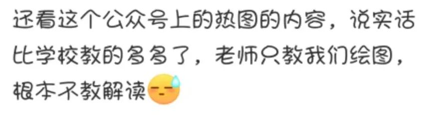
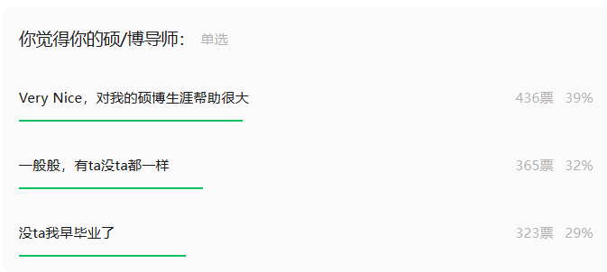
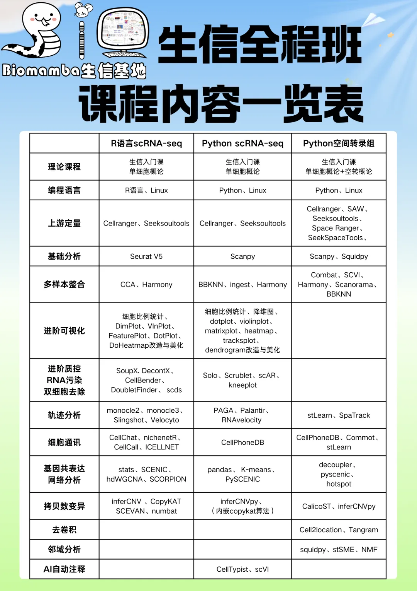
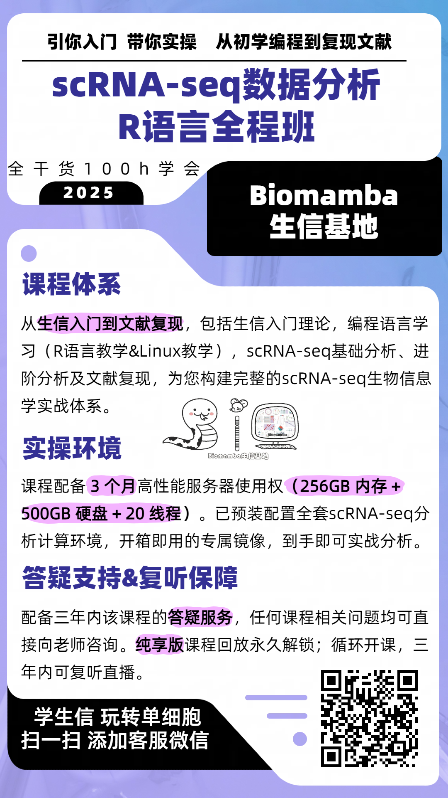
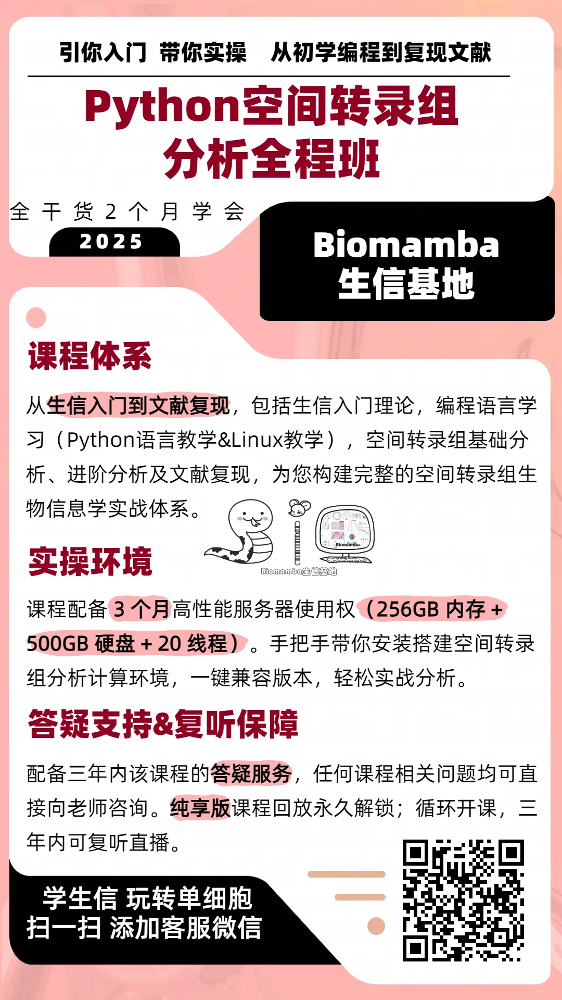
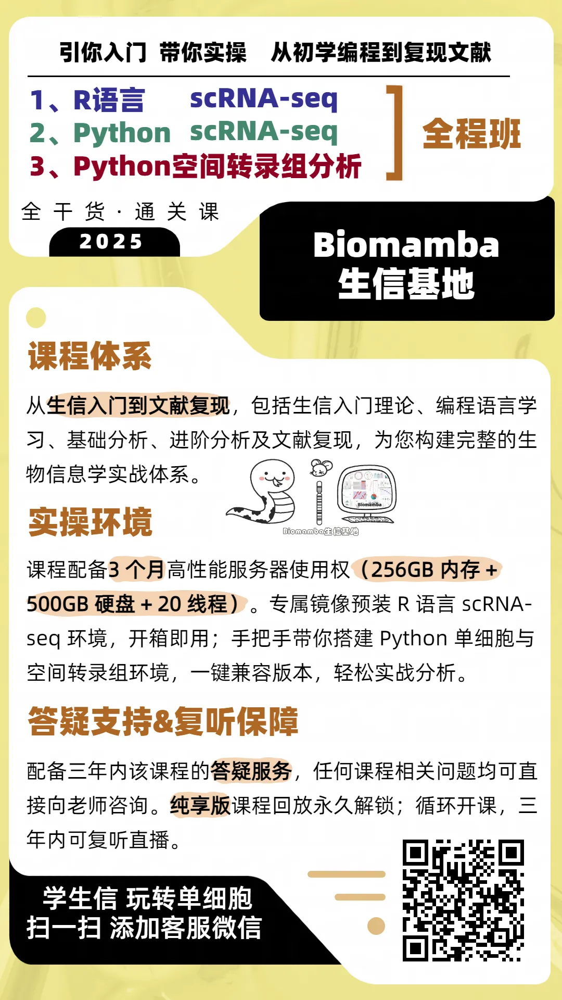

# 生信教育为何一直在野？

> 原文：https://mp.weixin.qq.com/s?__biz=MzAwMzIzOTk5OQ==&mid=2247538745&idx=1&sn=3384a8bfa8813e0e5374fb28d01c8c7b&chksm=9b3c2169ac4ba87f900a31301e1dcb5d5cb0ac907e91000009e8f3e542b422dda1a3bcc72537#rd
> 合集：漫谈胡侃

最近收到观众的评价，表示我们教的比学校教的内容多多了，学校老师只教绘图。仔细交谈了一下，这是位“生物信息学”专业的在读本科生，该院系很多专业课的老师甚至并非生信出身。其实我们也一直很疑惑，生信教育为何一直在野？对于这一现象，我们更觉得悲哀，Biomamba一直认为像本平台这类的自媒体或/民间学术组织并不应该存在。正是由于校园生信教育的缺失、校园生信人才培养与实际科研/社会需求之间严重脱节，才给了我们这类平台发展的机会。
当然，由于大家所处的环境不一样，对这件事的体感可能也不太相同，欢迎在评论区交流、杠一杠。之前我们也做过硕博关于导师满意图度的调研([《Nature》：什么能让博士生快乐——好导师](<https://mp.weixin.qq.com/s?__biz=MzAwMzIzOTk5OQ==&mid=2247532350&idx=1&sn=22e74cfeb6f02fab41292184f1a666c8&scene=21#wechat_redirect>))，好评率大概在39%(大家觉得比预想的高还是低了？)

关于生信教育，我们可以换一个问题：

**生信教学，我们一直在耕耘**

[ 搞生信教学](<https://mp.weixin.qq.com/s?__biz=MzAwMzIzOTk5OQ==&mid=2247531410&idx=1&sn=e0850491da199c8abaa538f2d64e0035&scene=21#wechat_redirect>)，我们是专业的，Biomamba生信基地全网分享的生信教程点击量近千万次。B站单细胞视频单个合辑播放量就直逼50w，每每看到有[粉丝致谢](<https://mp.weixin.qq.com/mp/appmsgalbum?__biz=MzAwMzIzOTk5OQ==&action=getalbum&album_id=3425248581018714114#wechat_redirect>)，还是满满的成就感。[生信基地](<https://mp.weixin.qq.com/s?__biz=MzAwMzIzOTk5OQ==&mid=2247526229&idx=1&sn=0718f1702150ba77a7f7e3beadd6e0ba&scene=21#wechat_redirect>)的要务就是为大家提供高质量生信教学，拒绝生信快餐，我们拥有多个学习周期两个月的全程课程，每个课程都创建并维护交流群，课后欢迎大家随时在群里针对课程内容提问！还配套[开箱即用的单细胞分析镜像](<https://mp.weixin.qq.com/s?__biz=MzAwMzIzOTk5OQ==&mid=2247528410&idx=2&sn=0f2bac25479cf8d20dab5d82ae986f2e&scene=21#wechat_redirect>)，想学不会都难！

感兴趣的同学欢迎联系客服微信[Biomamba_zhushou]参与学习

现有培训体系详细大家可参考(图片可跳转详细介绍)：

当然，三个班一起参加也会有优惠：

**如何联系我们**

 留一个领取[资料](<https://mp.weixin.qq.com/s?__biz=MzAwMzIzOTk5OQ==&mid=2247535983&idx=1&sn=99378a252908b06f56432eb08741d278&scene=21#wechat_redirect>)、[开箱即用的单细胞分析镜像](<https://mp.weixin.qq.com/s?__biz=MzAwMzIzOTk5OQ==&mid=2247536307&idx=1&sn=8d03259be06f54521aac5251dec988d5&scene=21#wechat_redirect>)的**微信号[Biomamba_zhushou]**，方便各位随时交流。同时我们也构建了[交流群矩阵](<https://mp.weixin.qq.com/s?__biz=MzAwMzIzOTk5OQ==&mid=2247536307&idx=2&sn=2d030173f51d24a4fee43bd0d83da03b&scene=21#wechat_redirect>)，欢迎大家入群讨论。
大家可以阅读完这几篇之后添加[给生信入门初学者的小贴士](<http://mp.weixin.qq.com/s?__biz=MzAwMzIzOTk5OQ==&mid=2247493329&idx=1&sn=597870b7f7ce10346da3561e7c281627&chksm=9b3c9f81ac4b169794088ce9abbcacb5f18e9fd174fc0d7e28da62d78facadf3100ef38aaf22&scene=21#wechat_redirect>)
[没有检索，就没有发言权](<https://mp.weixin.qq.com/s?__biz=MzAwMzIzOTk5OQ==&mid=2247529398&idx=2&sn=5a429852d61721916a405712677d5905&scene=21#wechat_redirect>)

**已有生信基地联系方式的同学****无需重复添加**

****

您点的每个赞和在看，我都认真当成了喜欢
