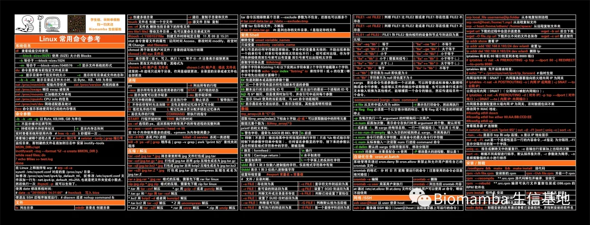
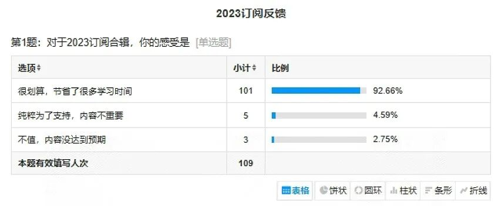
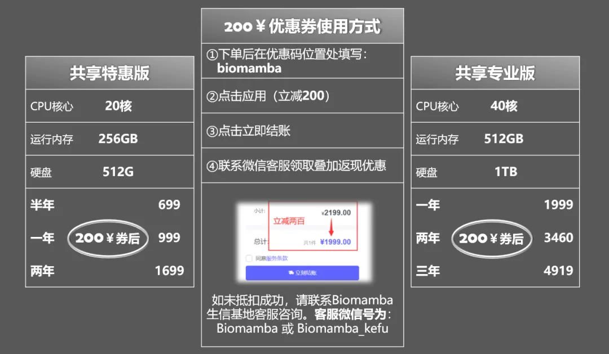
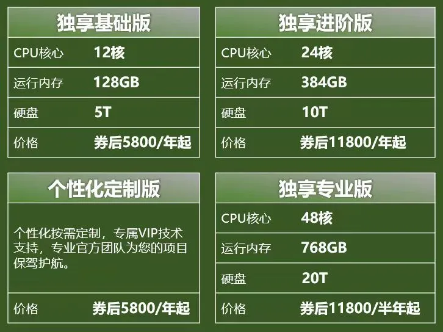

# 周边任选&全场九折啦~

> 原文：https://mp.weixin.qq.com/s?__biz=MzAwMzIzOTk5OQ==&mid=2247522606&idx=1&sn=e6d12a23b245a1813442cf15b5ef90fa&chksm=9b3ce07eac4b696808e82eae68522d1723f8078ff6dd9aef8fd87eda44a446d1fdb015b4271d#rd
> 合集：送周边

周边

Biomamba生信基地共有三种周边：金士顿64GB超大U盘、Biomamba同款胸包、Linux速查超大鼠标垫(80cmX30cm)。在此我们仍以抽奖的方式让大家在周边中任选其一。参与方式很简单，转发此条推送至朋友圈，30赞，截图发给**客服微信[****Biomamba_kefu****]，** 处领取抽奖小程序码**随机抽取十个名额** 。

赠品预览：Linux速查超大鼠标垫

Biomamba同款背包与词云展示：
**
**

金士顿64GB、3.0存储高速U盘：

**
****11月14号12:00前** 停止发放抽奖码并准时开奖：

资料九折

又是一年双十一，蹭波消费节的热度，公众号内的订阅资料(目前共36篇)来波折扣，联系文末微信可以以198￥***0.9** 获取全部资料(包括今年后面更新的内容，平均一篇万字的教程不到5￥)。当然，付费不是目的，以下资料都可以通过**转发领取**(更推荐这种方式)。

**2023合集：**[2022资料合辑(重置链接)](<http://mp.weixin.qq.com/s?__biz=MzAwMzIzOTk5OQ==&mid=2247497402&idx=2&sn=4873b9088938bb39caab6f95ba4c085a&chksm=9b3c8feaac4b06fc88dc2bf696bb728c3d4bd3a4fb5c028ce4d3c9bbadd3aa6dc560510762b9&scene=21#wechat_redirect>)
[scRNA-Seq学习手册2023_R语言版](<http://mp.weixin.qq.com/s?__biz=MzAwMzIzOTk5OQ==&mid=2247500516&idx=1&sn=3c0b9de505fcd232054e38b451fa1742&chksm=9b3cbbb4ac4b32a26b61f3a1f7941fff5852d3e6e744ec680aafd0b84ec976a33bf982fb5f79&scene=21#wechat_redirect>)[一文搞定拟时序分析的下游可视化探索](<http://mp.weixin.qq.com/s?__biz=MzAwMzIzOTk5OQ==&mid=2247497634&idx=1&sn=64872660e8ce80ff08c6c0745c2b241b&chksm=9b3c8ef2ac4b07e4a2ef03870c91fdc1c3ded245dcecd5a2049841cb7e9749bd1cd0852133f1&scene=21#wechat_redirect>)
[Seurat中如何让细胞听你指挥](<http://mp.weixin.qq.com/s?__biz=MzAwMzIzOTk5OQ==&mid=2247497669&idx=3&sn=ac3408c7dd28425426d954f81d283252&chksm=9b3c8e95ac4b0783c12182a960e8158c8a0992a20335f8c70f1dc63855c5984dd22e4dee706d&scene=21#wechat_redirect>)
[《拟时序分析》3.monocle2实操：完整版](<http://mp.weixin.qq.com/s?__biz=MzAwMzIzOTk5OQ==&mid=2247501684&idx=2&sn=45c8b083e1094718d7fc4b97e370b01d&chksm=9b3cbe24ac4b3732e6eb04084fe3af4419c817755e4eb9a11ba1fb9f68488d12fe7bc865ad0b&scene=21#wechat_redirect>)
[一文搞定单细胞基因集评分](<http://mp.weixin.qq.com/s?__biz=MzAwMzIzOTk5OQ==&mid=2247497831&idx=2&sn=82fa51c76a381fba0b444e9b6b23eb5f&chksm=9b3c8137ac4b0821dfb62e9b365ea3c32abbbd80df42df63181c37ad9ed991c0183c2c7981d8&scene=21#wechat_redirect>)
[改造单细胞降维图| 2.ggplot2中的DIY](<http://mp.weixin.qq.com/s?__biz=MzAwMzIzOTk5OQ==&mid=2247497867&idx=1&sn=37a539bbd37dafb6cce5cd52dec84f52&chksm=9b3c81dbac4b08cd34b5edab4da14df5d0964a5c6fbe4dbab6f9879bbac9bc3f9e08abe8dd1c&scene=21#wechat_redirect>)
[改造单细胞降维图| 3.3D降维图与动图绘制](<http://mp.weixin.qq.com/s?__biz=MzAwMzIzOTk5OQ==&mid=2247498080&idx=2&sn=a9bcf65e3ae34ba201e8d49ee33c0728&chksm=9b3c8030ac4b0926c3f059a9a5d23f1bcdbcaf8e5a562eba2b7e3bec3396c44573269bd08e7b&scene=21#wechat_redirect>)
[一文搞定单细胞/空间转录组的WGCNA分析](<http://mp.weixin.qq.com/s?__biz=MzAwMzIzOTk5OQ==&mid=2247499737&idx=1&sn=b3f6174e1908494692d82ac154ce3218&chksm=9b3c8689ac4b0f9fbb0c8ba42172c702ca978683c4de28f9f56bd8e7764fe114ba9a1b9c7dac&scene=21#wechat_redirect>)
[SCENIC单细胞转录因子预测|2.学习手册](<http://mp.weixin.qq.com/s?__biz=MzAwMzIzOTk5OQ==&mid=2247500439&idx=1&sn=d6b4874a8352f5b7a4165629c03058ce&chksm=9b3cbbc7ac4b32d158fd3c5c2f155c54c892d40eaae3718409936fc319f69705da32badf79d6&scene=21#wechat_redirect>)[生信Python速查手册](<http://mp.weixin.qq.com/s?__biz=MzAwMzIzOTk5OQ==&mid=2247499921&idx=1&sn=dcd6f95596e3de9bf378d850c217fe78&chksm=9b3cb9c1ac4b30d7bbd44057b181f87541f5904d24f903494ae557e768ae00c208c1b68b45c7&scene=21#wechat_redirect>)
[单细胞复写|3.急性心肌梗塞(AMI)外周血scRNA-Seq分析实战](<http://mp.weixin.qq.com/s?__biz=MzAwMzIzOTk5OQ==&mid=2247501145&idx=2&sn=12c2e8d104ad343fc13acb8cda266e6c&chksm=9b3cbc09ac4b351f4ed708a0ed577a21f48ccb0d4173aed94a027b4170147ab85931ee51d1e5&scene=21#wechat_redirect>)
[SCENIC单细胞转录因子预测|4.精简版流程](<http://mp.weixin.qq.com/s?__biz=MzAwMzIzOTk5OQ==&mid=2247501260&idx=1&sn=f1e2a165599e753e2959aad7c8a298cb&chksm=9b3cbc9cac4b358a9499654a2f95fa9010309ee4f408ef8b1f31ceb1a0f263ce22e8b511c430&scene=21#wechat_redirect>)
[《细胞通讯》2.CellChat基础分析教程](<http://mp.weixin.qq.com/s?__biz=MzAwMzIzOTk5OQ==&mid=2247501296&idx=2&sn=fb3e252d95ee8b50cd446e71335b1aa0&chksm=9b3cbca0ac4b35b621b4f51d2c3a130f00461faeeff067396222c2fc2eeb53f3544664d7d9bc&scene=21#wechat_redirect>)
[《细胞通讯》2.2CellChat多组别分析](<http://mp.weixin.qq.com/s?__biz=MzAwMzIzOTk5OQ==&mid=2247501523&idx=2&sn=6fa803f256c2e0b945f93ae7d8245f50&chksm=9b3cbf83ac4b3695b587e9817840f419104c8680f5ef08ee39aa149b79852f48b179f68e3397&scene=21#wechat_redirect>)
[《细胞通讯》CellChat学习手册](<http://mp.weixin.qq.com/s?__biz=MzAwMzIzOTk5OQ==&mid=2247501735&idx=2&sn=35fc792961507f4ae1cbae3a2882fba6&chksm=9b3cbef7ac4b37e1417d4108c8bd378c68c3907431ddfc52ad37c916e85649bb450d761a8e19&scene=21#wechat_redirect>)
[《拟时序分析》3.monocle2实操：完整版](<http://mp.weixin.qq.com/s?__biz=MzAwMzIzOTk5OQ==&mid=2247501684&idx=2&sn=45c8b083e1094718d7fc4b97e370b01d&chksm=9b3cbe24ac4b3732e6eb04084fe3af4419c817755e4eb9a11ba1fb9f68488d12fe7bc865ad0b&scene=21#wechat_redirect>)
[ComplexHeatmap学习手册](<http://mp.weixin.qq.com/s?__biz=MzAwMzIzOTk5OQ==&mid=2247503470&idx=1&sn=81b5142c5c4f1af9ae87bdc480d5469b&chksm=9b3cb73eac4b3e285467305c2a8d08b07d8b56d85bce96bd978c422d1f22b2c0dad0ed1dc752&scene=21#wechat_redirect>)[沉浸式统计细胞比例](<http://mp.weixin.qq.com/s?__biz=MzAwMzIzOTk5OQ==&mid=2247503971&idx=2&sn=7dafb1e743ebbb95e488d8d1b7024448&chksm=9b3ca933ac4b2025f922a325ec6893e93613f130ff1d4fd609e2d7274f7f1fdb5134092e28ad&scene=21#wechat_redirect>)[VlnPlot的ggplot改造](<http://mp.weixin.qq.com/s?__biz=MzAwMzIzOTk5OQ==&mid=2247504843&idx=1&sn=b795a3e36ae092d8f87abb5a87187828&chksm=9b3caa9bac4b238dd33e905c33924b58aa4ff14e83abbf08046fba7fe765ecb0204163cb6acf&scene=21#wechat_redirect>)
[scRNA-Seq学习手册Python版](<http://mp.weixin.qq.com/s?__biz=MzAwMzIzOTk5OQ==&mid=2247504877&idx=2&sn=2b56a9cfa19fcc918ee6c2ed88fed017&chksm=9b3caabdac4b23ab6e28425a4a5eb4d40ee3612e51f84f5d1e53ac91bef93f717e9e754398e3&scene=21#wechat_redirect>)
[空间转录组学习手册合辑](<http://mp.weixin.qq.com/s?__biz=MzAwMzIzOTk5OQ==&mid=2247505088&idx=1&sn=9f60dca1b21f5ba8c32d09595a512134&chksm=9b3cad90ac4b2486820dd335d997d2a96b77beb6ad463b1df6a2f307e47ebe8d7de3304ebf7c&scene=21#wechat_redirect>)
[Seurat空间转录组学习手册](<http://mp.weixin.qq.com/s?__biz=MzAwMzIzOTk5OQ==&mid=2247505213&idx=2&sn=6b9aad43c273009c3d7f80c63bb9f619&chksm=9b3cac6dac4b257b8fca1980fd5437ce131dd26377eeef8614d09c11a7ee22ed771cbf323a60&scene=21#wechat_redirect>)
[Scanpy空间转录组学习手册](<http://mp.weixin.qq.com/s?__biz=MzAwMzIzOTk5OQ==&mid=2247505248&idx=2&sn=18995c7248ca6f13b61edfef24208ae1&chksm=9b3cac30ac4b2526050f91dd431bef96ab3dfbdc1a20b3dac32daa5138c11ceb8781b14a2bcd&scene=21#wechat_redirect>)
[Stereopy空间转录组学习手册](<http://mp.weixin.qq.com/s?__biz=MzAwMzIzOTk5OQ==&mid=2247505686&idx=2&sn=925ce770136ec3e964b954c639eed29e&chksm=9b3cae46ac4b2750f4c9f6d249d82257047334d7a7d5642288f5c2f909c51c934d692032eaa0&scene=21#wechat_redirect>)[Squidpy空间转录组学习手册](<http://mp.weixin.qq.com/s?__biz=MzAwMzIzOTk5OQ==&mid=2247505844&idx=2&sn=5756c0702d080d6e602c504e7d461013&chksm=9b3caee4ac4b27f268c5f7cd39b6a1cbc138e465a6375c26c9a49b31697b63a4af2f702ec6b2&scene=21#wechat_redirect>)
[影像组学学习手册](<http://mp.weixin.qq.com/s?__biz=MzAwMzIzOTk5OQ==&mid=2247505914&idx=2&sn=c0065d26b1cb1763f03534d808bae713&chksm=9b3caeaaac4b27bca2fd20e9a19492b9d4d20e2adeb1c96f1648afcb29b7b20f9db87aedded1&scene=21#wechat_redirect>)
[R语言基础学习手册](<http://mp.weixin.qq.com/s?__biz=MzAwMzIzOTk5OQ==&mid=2247506720&idx=1&sn=fe897ba3c33a8e63bf6a4e35aeac1896&chksm=9b3ca270ac4b2b66812aa311757bd15f28172a86215537f21a6fe3c7e96215a536bdab025bb8&scene=21#wechat_redirect>)
[一文搞定空间转录组与单细胞测序的整合分析](<http://mp.weixin.qq.com/s?__biz=MzAwMzIzOTk5OQ==&mid=2247507210&idx=1&sn=f32037ffefd60b0d1bcca7bf9c3e0823&chksm=9b3ca45aac4b2d4cf0c68299db3a2891130d89d9e0fe2a9ecb34b394736550bcf7d7c51090cc&scene=21#wechat_redirect>)
[基于深度学习的图像分类任务](<http://mp.weixin.qq.com/s?__biz=MzAwMzIzOTk5OQ==&mid=2247507794&idx=1&sn=c70dd03a962adb3f3b92ffed47e978bb&chksm=9b3ca602ac4b2f1499838f7aa6f02de182921362dff124c98a65079ba900125f7695665ef5cc&scene=21#wechat_redirect>)

**龙年合集(持续更新中)：**[单细胞Figure 1常见图表](<http://mp.weixin.qq.com/s?__biz=MzAwMzIzOTk5OQ==&mid=2247509260&idx=1&sn=9ff90a428c3f22d43a31ec864e2d8a94&chksm=9b3cdc5cac4b554a2f7cb2a6368f7df9a9a3f6e406eb070663f53d81841a76e188c0b50727de&scene=21#wechat_redirect>)
[快速上手Seurat V5](<http://mp.weixin.qq.com/s?__biz=MzAwMzIzOTk5OQ==&mid=2247509880&idx=1&sn=3b7cd169ccfe688d10cb1ca70dc91e91&chksm=9b3cde28ac4b573ec6d5f4bceafa4294c0e9a001b7d0c0b64f274a9978b1438eeccc747ca0c0&scene=21#wechat_redirect>)
[机器学习基础手册](<http://mp.weixin.qq.com/s?__biz=MzAwMzIzOTk5OQ==&mid=2247510121&idx=1&sn=87b53d350d9aedd5b3205d59e51356a0&chksm=9b3cd139ac4b582f23dd0ca65dcc66bed80b4240da76ee5abfbb61ec1bf62674ebfd2c50a45e&scene=21#wechat_redirect>)
[scRNA-Seq学习手册Seurat V4修订版](<http://mp.weixin.qq.com/s?__biz=MzAwMzIzOTk5OQ==&mid=2247510380&idx=1&sn=0eb2b0c519ef1dc25ee8821b736a0fde&chksm=9b3cd03cac4b592ad93149fb4847e6ba3dd03ab69e1ca594ddc64d323fb7496775789cae245d&scene=21#wechat_redirect>)
[Bulk RNASeq| 转录组实战](<http://mp.weixin.qq.com/s?__biz=MzAwMzIzOTk5OQ==&mid=2247510793&idx=1&sn=bfa69e8f261932d9bea74443fab732f0&chksm=9b3cd259ac4b5b4fd4b3bb80d0210a3396cda777b32ab49be1a45339453db314bb2a17fc438d&scene=21#wechat_redirect>)[scRNA-Seq双细胞过滤手册](<http://mp.weixin.qq.com/s?__biz=MzAwMzIzOTk5OQ==&mid=2247511622&idx=1&sn=60b35668e569267bab14ec8fbba8bd74&chksm=9b3cd716ac4b5e00122eac47f55085198040a4a0e97c56895bbc39f3a9f1a1eb4eba27048a8f&scene=21#wechat_redirect>)[CellChat空转细胞通讯合辑](<http://mp.weixin.qq.com/s?__biz=MzAwMzIzOTk5OQ==&mid=2247512011&idx=1&sn=fbd41832c5995d79fead016931d3bfbd&chksm=9b3cd69bac4b5f8d16e7d8b8eeb5490e4938daf68902b06a8d60e25f150ec4ec459796f3aaac&scene=21#wechat_redirect>)
[scRNA-Seq学习手册Seurat V5更新版](<http://mp.weixin.qq.com/s?__biz=MzAwMzIzOTk5OQ==&mid=2247519711&idx=1&sn=d25d4f5daf609bda8367f16db676ecf3&chksm=9b3cf48fac4b7d99e65eba6d4c66c63e40b1d187fa1d9e6449d6cd07d5dec5127cff54886f93&scene=21#wechat_redirect>)[SCENIC转录因子调控网络图](<http://mp.weixin.qq.com/s?__biz=MzAwMzIzOTk5OQ==&mid=2247520750&idx=1&sn=496bead1531a7eddd5c286030d350745&chksm=9b3ce8beac4b61a8589a1f8a66bd0571e09c0646655b6d805348bf6f4a0c7b52851615c22868&scene=21#wechat_redirect>)[scATAC分析学习手册](<http://mp.weixin.qq.com/s?__biz=MzAwMzIzOTk5OQ==&mid=2247521636&idx=1&sn=208907010f3f7412c1c91343d7dfb0d3&chksm=9b3cec34ac4b6522977cb002919634af5334eec170b32f4961826dafb42f44f611144b159b2b&scene=21#wechat_redirect>)

好评率超高~

服务器也九折~

生信分析难免要上服务器，我们也一直致力于给大家提供**高效** 、**经济** 的算力，以下产品——共享的、独享的服务器，按照下面的券后价打**九折** 哦！

了解详情可点击超链接：

[生信分析需要使用服务器的八个理由](<http://mp.weixin.qq.com/s?__biz=MzAwMzIzOTk5OQ==&mid=2247511347&idx=1&sn=1834210a5de23b4b89d95ac38e808408&chksm=9b3cd463ac4b5d75cbae50842bb3c62280f23d79822dc77e48c9e1d3ebdc07594b696feec71c&scene=21#wechat_redirect>)

[足够支持你完成硕博生涯的生信环境](<http://mp.weixin.qq.com/s?__biz=MzAwMzIzOTk5OQ==&mid=2247511780&idx=1&sn=3acc0874f7d2fa75f1abbe7a9a9b4069&chksm=9b3cd7b4ac4b5ea27d4d53964e4a4a9fa8c806a19103729dd4ff0fa72e621411f46a251d269f&scene=21#wechat_redirect>)

服务器产品与注册连接：

共享(经济实惠)：[有root权限的共享服务器,报我名字立减200￥](<http://mp.weixin.qq.com/s?__biz=MzAwMzIzOTk5OQ==&mid=2247503869&idx=1&sn=142f8c7ba8620815a8770773df077f12&chksm=9b3cb6adac4b3fbb1acdf7593df06af5ac77d1fe9c0144c999de7109bd063b76080a33c50e0d&scene=21#wechat_redirect>)独享(省电省心)：[生信分析不求人](<http://mp.weixin.qq.com/s?__biz=MzAwMzIzOTk5OQ==&mid=2247508226&idx=1&sn=69e0eea720ac6aecc0362bcb9ac339ba&chksm=9b3cd852ac4b51445651a091be0fb6f638bd8cf5eb399af1c54804631fe3047706cf1d4044de&scene=21#wechat_redirect>)

访问链接：https://biomamba.xiyoucloud.net/

更多内容可咨询客服微信[**Biomamba_kefu**]

**以上活动均在11月14号12:00截止**

**如何联系我们**

 公众号后台消息更新不及时，超过48h便不许回复读者消息，这里给大家留一下领取资料及免费服务器([生信分析为什么要使用服务器？](<http://mp.weixin.qq.com/s?__biz=MzAwMzIzOTk5OQ==&mid=2247504843&idx=2&sn=c2ba75edc0382855cfc914c3bb713e7e&chksm=9b3caa9bac4b238d0690d2aa5a236c18c8ad8f0d7a23421eb63b5236ff1201c9ec99e12efc8f&scene=21#wechat_redirect>))的**微信号** ，方便各位随时交流、提建议（科研任务繁重，回复不及时请见谅）。此外呼声一直很高的**交流群** 也建好了，欢迎大家入群讨论：

[永久免费的千人生信、科研交流群](<http://mp.weixin.qq.com/s?__biz=MzAwMzIzOTk5OQ==&mid=2247492981&idx=1&sn=aed903c4b853113d8c89e13848ea3365&chksm=9b3c9c25ac4b1533feb5f42f94ab4b6023a160313db4bc6a2f142e54d26627e3ea94b53e9031&scene=21#wechat_redirect>)

大家可以阅读完这几篇之后添加[给生信入门初学者的小贴士](<http://mp.weixin.qq.com/s?__biz=MzAwMzIzOTk5OQ==&mid=2247493329&idx=1&sn=597870b7f7ce10346da3561e7c281627&chksm=9b3c9f81ac4b169794088ce9abbcacb5f18e9fd174fc0d7e28da62d78facadf3100ef38aaf22&scene=21#wechat_redirect>)
[如何搜索公众号过往发布内容](<http://mp.weixin.qq.com/s?__biz=MzAwMzIzOTk5OQ==&mid=2247488966&idx=1&sn=9e9e7659b4cf00ac3173d21e88e1602b&chksm=9b3f6c96ac48e580efe53f966430f6598785e5c5c6bcc20f5eef019e723e49baaaea6d73fb7b&scene=21#wechat_redirect>)

您点的每个赞和在看，我都认真当成了喜欢
